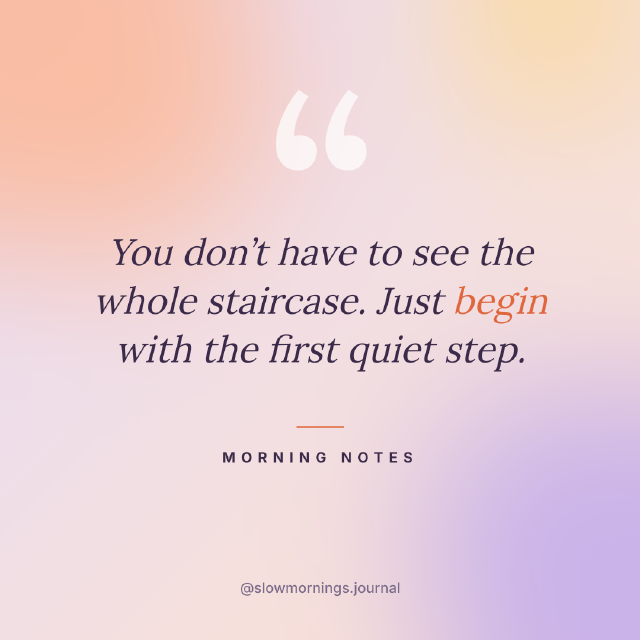

<!-- Generated by tools/gallery.mjs from showcase.yaml and build.json; do not edit. -->
# Instagram Quote Post

[Photo](../README.md) › [Social Media](../README.md#social-media) · `social` `instagram` `paragraph-text` `typography` `blur` `gradient`

A square quote card with soft blurred colour blobs, oversized quotation marks and a centred serif paragraph.



| | |
|---|---|
| Document | [instagram-quote-post.psd](instagram-quote-post.psd) (1.6 MB) |
| Contents | 1080 × 1080 px; 8 layers; 4 type layers; 1 shape layer; 1 fill layer; 1 mask |
| Features | `photo.type.text`, `photo.type.point-text`, `photo.filter.blur`, `photo.select.make`, `photo.layer.adjustment` |
| Built by | `kition-photo` @ `7abaa42e9a`: 19 commands in 672 ms |

## About

A 1080 × 1080 feed post. The backdrop is a gradient fill layer with colour blobs painted into
elliptical selections and softened with a large Gaussian Blur. The quote is paragraph text in a
text box, so it wraps and centres itself; the word "begin" is recoloured with a character range,
and the giant quotation mark is a faded Lora glyph behind it.

## Checks

- `inspect.layers`: `{"count":8}`
- `inspect.layers.3`: `{"name":"Quote","kind":"Type","text":{"font":"Lora","text":{"matches":"begin with the first"}}}`
- `inspect.layers.4`: `{"name":"Quote Mark","opacity":{"approx":0.7,"tol":0.01}}`
- `inspect.layers.5`: `{"name":"Blobs","kind":"Pixel","opacity":{"approx":0.75,"tol":0.01}}`
- `inspect.layers.6`: `{"name":"Wash","kind":"Fill"}`
- diagnostics: none (the kit's check finds nothing wrong)
- the saved document opens again; the thumbnail matches `thumb.png` within the `render` tolerance

## Steps

<details><summary>19 commands (from <a href="showcase.yaml">showcase.yaml</a>)</summary>

```yaml
- command: layer.newFillLayer.gradient
  params:
    from: "#fde2cf"
    to: "#e7dcf7"
    angle: 135
    style: linear
  as: wash
- command: layer.setProps
  params:
    layer: $wash.layer
    name: Wash
- command: layer.new.layer
  params:
    name: Blobs
  as: blobs
- command: select.rect
  params:
    x: -160
    y: -120
    width: 620
    height: 560
    ellipse: true
- command: edit.fill
  params:
    contents: color
    color: "#ffb38a"
- command: select.rect
  params:
    x: 700
    y: 640
    width: 560
    height: 560
    ellipse: true
- command: edit.fill
  params:
    contents: color
    color: "#b9a3f0"
- command: select.rect
  params:
    x: 760
    y: -80
    width: 320
    height: 300
    ellipse: true
- command: edit.fill
  params:
    contents: color
    color: "#ffd98a"
- command: select.deselect
- command: filter.blur.gaussianBlur
  params:
    radius: 120
- command: layer.setProps
  params:
    layer: $blobs.layer
    opacity: 0.75
- command: type.create
  params:
    x: 540
    y: 470
    text: “
    font: Lora
    weight: 700
    size: 420
    color: "#ffffff"
    align: center
    name: Quote Mark
  as: mark
- command: layer.setProps
  params:
    layer: $mark.layer
    opacity: 0.7
- command: type.create
  params:
    box:
      - 140
      - 400
      - 800
      - 380
    text: You don’t have to see the whole staircase. Just begin with the first quiet step.
    font: Lora
    italic: true
    size: 62
    leading: 82
    color: "#3b2a4a"
    align: center
    name: Quote
  as: quote
- command: type.setStyle
  params:
    layer: $quote.layer
    range:
      - 48
      - 53
    color: "#e0663c"
- command: shape.create
  params:
    kind: line
    from:
      - 500
      - 720
    to:
      - 580
      - 720
    weight: 3
    fill: "#e0663c"
    name: Divider
- command: type.create
  params:
    x: 540
    y: 780
    text: MORNING NOTES
    font: Inter
    weight: 700
    size: 24
    tracking: 400
    color: "#3b2a4a"
    align: center
    name: Series
- command: type.create
  params:
    x: 540
    y: 1000
    text: "@slowmornings.journal"
    font: Inter
    weight: 500
    size: 24
    color: "#7a6a8a"
    align: center
    name: Handle
```

</details>
