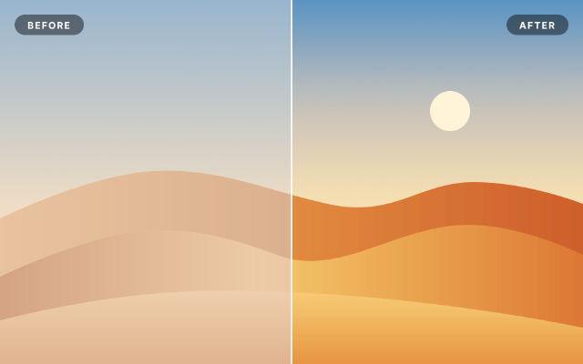

<!-- Generated by tools/gallery.mjs from showcase.yaml and build.json; do not edit. -->
# Levels & Curves Before / After

[Photo](../README.md) › [Adjustments & Color](../README.md#adjustments--color) · `adjustment-layers` `levels` `curves` `masks` `before-after`

A hazy desert scene corrected with Levels, Curves and Vibrance layers masked to the right half, for a split comparison.



| | |
|---|---|
| Document | [levels-curves-before-after.psd](levels-curves-before-after.psd) (3.3 MB) |
| Contents | 1600 × 1000 px; 15 layers; 2 type layers; 7 shape layers; 3 adjustment layers; 2 fill layers; 4 masks |
| Features | `photo.layer.adjustment`, `photo.layer.mask-basics`, `photo.select.make` |
| Built by | `kition-photo` @ `7abaa42e9a`: 23 commands in 156 ms |

## About

The left half is the flat original: dunes under a pale haze, with milky blacks and dull color.
The right half shows the fix as three adjustment layers made with a rectangular selection, so each
carries a layer mask over that half only: Levels sets the black and white points, Curves adds an
S-shaped contrast and a warmer red channel, and Vibrance brings the color back. A divider and two
labels finish the comparison.

## Checks

- `inspect.layers`: `{"count":15}`
- `inspect.layers.5`: `{"name":"Vibrance","kind":"Adjustment","adjustmentKind":"vibrance","hasMask":true}`
- `inspect.layers.6`: `{"name":"Contrast & Warmth","kind":"Adjustment","adjustmentKind":"curves","hasMask":true}`
- `inspect.layers.7`: `{"name":"Set Black & White Points","kind":"Adjustment","adjustmentKind":"levels","adjustmentParams":{"inBlack":92,"inWhite":246}}`
- `inspect.layers.8`: `{"name":"Haze","kind":"Fill","opacity":{"approx":0.42,"tol":0.01}}`
- `results.beforeSand.2`: `{"min":0.55}`
- `results.afterSand.2`: `{"max":0.42}`
- diagnostics: none (the kit's check finds nothing wrong)
- the saved document opens again; the thumbnail matches `thumb.png` within the `render` tolerance

## Steps

<details><summary>23 commands (from <a href="showcase.yaml">showcase.yaml</a>)</summary>

```yaml
- command: gradient.fill.create
  params:
    from:
      - 0
      - 0
    to:
      - 0
      - 560
    stops:
      - - 0
        - "#5d93c4"
      - - 1
        - "#f1d6b4"
  as: sky
- command: layer.renameLayer
  params:
    layer: $sky.layer
    name: Sky
- command: shape.create
  params:
    kind: ellipse
    rect:
      - 1180
      - 250
      - 110
      - 110
    fill: "#fff3d6"
    name: Sun
- command: shape.create
  params:
    kind: path
    name: Far Dune
    fill:
      gradient:
        stops:
          - - 0
            - "#e8ab72"
          - - 1
            - "#b8693a"
        angle: 0
    path:
      subpaths:
        - knots:
            - - 0
              - 600
            - anchor:
                - 420
                - 470
              in:
                - 240
                - 480
              out:
                - 600
                - 460
              smooth: true
            - anchor:
                - 900
                - 560
              in:
                - 720
                - 520
              out:
                - 1080
                - 600
              smooth: true
            - anchor:
                - 1300
                - 500
              in:
                - 1150
                - 500
              out:
                - 1450
                - 500
              smooth: true
            - - 1600
              - 560
            - - 1600
              - 1000
            - - 0
              - 1000
- command: shape.create
  params:
    kind: path
    name: Mid Dune
    fill:
      gradient:
        stops:
          - - 0
            - "#c47544"
          - - 0.45
            - "#f0b97f"
          - - 1
            - "#c97c47"
        angle: 0
    path:
      subpaths:
        - knots:
            - - 0
              - 760
            - anchor:
                - 300
                - 650
              in:
                - 140
                - 690
              out:
                - 460
                - 610
              smooth: true
            - anchor:
                - 760
                - 700
              in:
                - 600
                - 640
              out:
                - 920
                - 760
              smooth: true
            - anchor:
                - 1240
                - 620
              in:
                - 1060
                - 640
              out:
                - 1400
                - 600
              smooth: true
            - - 1600
              - 700
            - - 1600
              - 1000
            - - 0
              - 1000
- command: shape.create
  params:
    kind: path
    name: Near Dune
    fill:
      gradient:
        stops:
          - - 0
            - "#f3c08a"
          - - 1
            - "#d99158"
        angle: -90
    path:
      subpaths:
        - knots:
            - - 0
              - 880
            - anchor:
                - 520
                - 800
              in:
                - 260
                - 810
              out:
                - 780
                - 790
              smooth: true
            - anchor:
                - 1600
                - 900
              in:
                - 1200
                - 820
              out:
                - 1600
                - 900
            - - 1600
              - 1000
            - - 0
              - 1000
- command: layer.newFillLayer.solidColor
  params:
    color: "#e9e4dc"
  as: haze
- command: layer.setProps
  params:
    layer: $haze.layer
    name: Haze
    opacity: 0.42
- command: select.rect
  params:
    x: 800
    y: 0
    width: 800
    height: 1000
- command: layer.newAdjustmentLayer.levels
  params:
    inBlack: 92
    gamma: 0.95
    inWhite: 246
  as: levels
- command: layer.renameLayer
  params:
    layer: $levels.layer
    name: Set Black & White Points
- command: layer.newAdjustmentLayer.curves
  params:
    points:
      - - 0
        - 0
      - - 70
        - 52
      - - 180
        - 196
      - - 255
        - 255
    red:
      - - 0
        - 0
      - - 128
        - 140
      - - 255
        - 255
    blue:
      - - 0
        - 0
      - - 128
        - 120
      - - 255
        - 255
  as: curves
- command: layer.renameLayer
  params:
    layer: $curves.layer
    name: Contrast & Warmth
- command: layer.newAdjustmentLayer.vibrance
  params:
    vibrance: 30
    saturation: -5
  as: vibrance
- command: layer.renameLayer
  params:
    layer: $vibrance.layer
    name: Vibrance
- command: select.deselect
- command: shape.create
  params:
    kind: rect
    rect:
      - 798
      - 0
      - 4
      - 1000
    fill: "#ffffff"
    name: Divider
- command: shape.create
  params:
    kind: roundedRect
    rect:
      - 40
      - 40
      - 190
      - 56
    radii: 28
    fill:
      - 0
      - 0
      - 0
      - 0.45
    name: Before Pill
- command: type.create
  params:
    x: 135
    y: 79
    text: BEFORE
    font: Inter
    size: 26
    weight: 700
    tracking: 120
    color: "#ffffff"
    align: center
    name: Before Label
- command: shape.create
  params:
    kind: roundedRect
    rect:
      - 1390
      - 40
      - 170
      - 56
    radii: 28
    fill:
      - 0
      - 0
      - 0
      - 0.45
    name: After Pill
- command: type.create
  params:
    x: 1475
    y: 79
    text: AFTER
    font: Inter
    size: 26
    weight: 700
    tracking: 120
    color: "#ffffff"
    align: center
    name: After Label
- command: document.sampleColor
  params:
    x: 400
    y: 900
    size: 11
  as: beforeSand
- command: document.sampleColor
  params:
    x: 1200
    y: 900
    size: 11
  as: afterSand
```

</details>
