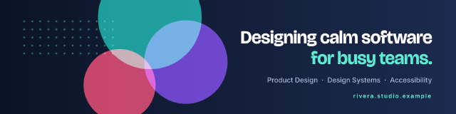

<!-- Generated by tools/gallery.mjs from showcase.yaml and build.json; do not edit. -->
# LinkedIn Profile Banner

[Photo](../README.md) › [Social Media](../README.md#social-media) · `social` `linkedin` `banner` `gradient` `shapes` `blend-modes` `type`

A 4:1 profile header for a product designer, with screen-blended circles, a dot grid and right-aligned headline type.



| | |
|---|---|
| Document | [linkedin-profile-banner.psd](linkedin-profile-banner.psd) (394 KB) |
| Contents | 1584 × 396 px; 16 layers; 4 type layers; 8 shape layers; 1 fill layer; 2 groups; 1 mask |
| Features | `photo.layer.adjustment`, `photo.path.shapes`, `photo.layer.basics`, `photo.layer.manage`, `photo.type.point-text` |
| Built by | `kition-photo` @ `7abaa42e9a`: 37 commands in 140 ms |

## About

A 1584 × 396 background image. The left third stays quiet because the profile photo covers it;
the copy is right-aligned type. Three translucent circles in Screen mode overlap into new colours,
and the dot grid is one row of combined dots, duplicated and moved down four times, in a group
at 35 % opacity.

## Checks

- `inspect.layers`: `{"count":8}`
- `inspect.layers.4`: `{"name":"Orbs","kind":"Group","children":{"count":3,"all":{"blend":"Screen","kind":"Shape"}}}`
- `inspect.layers.5`: `{"name":"Dot Grid","kind":"Group","opacity":{"approx":0.35,"tol":0.01},"children":{"count":5}}`
- `inspect.layers.3`: `{"name":"Headline Line 1","text":{"text":"Designing calm software","font":"Bricolage Grotesque"}}`
- `inspect.layers.4.children.2`: `{"name":"Teal Orb","shape":{"kind":"ellipse","fill":"#14b8a6"}}`
- `inspect.layers.5.children.0`: `{"name":"Dot Row 5","shape":{"fill":"#5eead4"}}`
- `inspect.layers.6`: `{"name":"Night Blue","kind":"Fill","fillContent":{"gradient":{"angle":0,"stops":[[0,"#0b1426"],[1,"#1b2a4e"]]}}}`
- diagnostics: none (the kit's check finds nothing wrong)
- the saved document opens again; the thumbnail matches `thumb.png` within the `render` tolerance

## Steps

<details><summary>37 commands (from <a href="showcase.yaml">showcase.yaml</a>)</summary>

```yaml
- command: layer.newFillLayer.gradient
  params:
    from: "#0b1426"
    to: "#1b2a4e"
    angle: 0
    style: linear
  as: bg
- command: layer.setProps
  params:
    layer: $bg.layer
    name: Night Blue
- command: layer.new.group
  params:
    name: Dot Grid
  as: dots
- command: shape.create
  params:
    kind: ellipse
    rect:
      - 80
      - 70
      - 7
      - 7
    fill: "#5eead4"
    name: Dot Row 1
  as: d1
- command: shape.create
  params:
    kind: ellipse
    rect:
      - 108
      - 70
      - 7
      - 7
    addTo: $d1.layer
- command: shape.create
  params:
    kind: ellipse
    rect:
      - 136
      - 70
      - 7
      - 7
    addTo: $d1.layer
- command: shape.create
  params:
    kind: ellipse
    rect:
      - 164
      - 70
      - 7
      - 7
    addTo: $d1.layer
- command: shape.create
  params:
    kind: ellipse
    rect:
      - 192
      - 70
      - 7
      - 7
    addTo: $d1.layer
- command: shape.create
  params:
    kind: ellipse
    rect:
      - 220
      - 70
      - 7
      - 7
    addTo: $d1.layer
- command: shape.create
  params:
    kind: ellipse
    rect:
      - 248
      - 70
      - 7
      - 7
    addTo: $d1.layer
- command: shape.create
  params:
    kind: ellipse
    rect:
      - 276
      - 70
      - 7
      - 7
    addTo: $d1.layer
- command: shape.create
  params:
    kind: ellipse
    rect:
      - 304
      - 70
      - 7
      - 7
    addTo: $d1.layer
- command: shape.create
  params:
    kind: ellipse
    rect:
      - 332
      - 70
      - 7
      - 7
    addTo: $d1.layer
- command: shape.create
  params:
    kind: ellipse
    rect:
      - 360
      - 70
      - 7
      - 7
    addTo: $d1.layer
- command: shape.create
  params:
    kind: ellipse
    rect:
      - 388
      - 70
      - 7
      - 7
    addTo: $d1.layer
- command: layer.duplicate
  params:
    layer: $d1.layer
    name: Dot Row 2
  as: d2
- command: layer.translate
  params:
    layer: $d2.layer
    dx: 0
    dy: 28
- command: layer.duplicate
  params:
    layer: $d2.layer
    name: Dot Row 3
  as: d3
- command: layer.translate
  params:
    layer: $d3.layer
    dx: 0
    dy: 28
- command: layer.duplicate
  params:
    layer: $d3.layer
    name: Dot Row 4
  as: d4
- command: layer.translate
  params:
    layer: $d4.layer
    dx: 0
    dy: 28
- command: layer.duplicate
  params:
    layer: $d4.layer
    name: Dot Row 5
  as: d5
- command: layer.translate
  params:
    layer: $d5.layer
    dx: 0
    dy: 28
- command: layer.setProps
  params:
    layer: $dots.layer
    opacity: 0.35
- command: layer.new.group
  params:
    name: Orbs
  as: orbs
- command: layer.moveTo
  params:
    layer: $orbs.layer
    target: $dots.layer
    position: above
- command: shape.create
  params:
    kind: ellipse
    rect:
      - 340
      - -120
      - 360
      - 360
    fill: "#14b8a6"
    name: Teal Orb
  as: o1
- command: shape.create
  params:
    kind: ellipse
    rect:
      - 500
      - 70
      - 290
      - 290
    fill: "#7c3aed"
    name: Violet Orb
  as: o2
- command: shape.create
  params:
    kind: ellipse
    rect:
      - 290
      - 170
      - 250
      - 250
    fill: "#f43f5e"
    name: Rose Orb
  as: o3
- command: layer.setProps
  params:
    layer: $o1.layer
    blend: Screen
    opacity: 0.8
- command: layer.setProps
  params:
    layer: $o2.layer
    blend: Screen
    opacity: 0.8
- command: layer.setProps
  params:
    layer: $o3.layer
    blend: Screen
    opacity: 0.8
- command: type.create
  params:
    x: 1500
    y: 150
    text: Designing calm software
    font: Bricolage Grotesque
    weight: 700
    size: 64
    tracking: -20
    color: "#ffffff"
    align: right
    name: Headline Line 1
  as: h1
- command: layer.moveTo
  params:
    layer: $h1.layer
    target: $orbs.layer
    position: above
- command: type.create
  params:
    x: 1500
    y: 222
    text: for busy teams.
    font: Bricolage Grotesque
    weight: 700
    size: 64
    tracking: -20
    color: "#5eead4"
    align: right
    name: Headline Line 2
- command: type.create
  params:
    x: 1500
    y: 286
    text: Product Design  ·  Design Systems  ·  Accessibility
    font: Inter
    weight: 500
    size: 24
    color: "#a5b4d4"
    align: right
    name: Focus Areas
- command: type.create
  params:
    x: 1500
    y: 340
    text: rivera.studio.example
    font: Inter
    weight: 600
    size: 20
    tracking: 150
    color: "#5eead4"
    align: right
    name: Website
```

</details>
