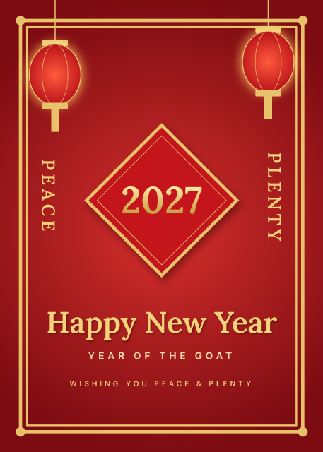

<!-- Generated by tools/gallery.mjs from showcase.yaml and build.json; do not edit. -->
# Lunar New Year Greeting Card

[Photo](../README.md) › [Print & Stationery](../README.md#print--stationery) · `print` `greeting-card` `vertical-type` `layer-styles` `shapes` `render-filters`

A red-and-gold Lunar New Year card with hanging lanterns, a diamond year panel, vertical couplet words and a gold double-rule frame.



| | |
|---|---|
| Document | [lunar-new-year-card.psd](lunar-new-year-card.psd) (1.7 MB) |
| Contents | 1000 × 1400 px; 26 layers; 6 type layers; 14 shape layers; 1 fill layer; 3 groups; 5 styled layers; 1 mask |
| Features | `photo.type.point-text`, `photo.type.features`, `photo.layer.styles`, `photo.path.shapes`, `photo.filter.stylize`, `photo.layer.manage` |
| Built by | `kition-photo` @ `e511ae24a4`: 29 commands in 94 ms |

## About

A greeting card for the Year of the Goat, set in Lora and Inter. The year sits in a
rotated-square panel with a gold Stroke and a Gradient Overlay on the numerals; the two couplet
words are vertical type layers with upright letters. The lanterns are groups of live shapes, and
the gold double-rule border comes from Render > Picture Frame on its own layer.

## Checks

- `inspect.layers`: `{"count":11}`
- `inspect.layers.0`: `{"name":"Wishes","kind":"Type","text":{"font":"Inter"}}`
- `inspect.layers.2`: `{"name":"Greeting","kind":"Type","text":{"text":"Happy New Year","font":"Lora"},"effects":{"items":{"any":{"key":"dropShadow"}}}}`
- `inspect.layers.3`: `{"name":"Couplet Right","kind":"Type","text":{"text":"PLENTY"}}`
- `inspect.layers.5`: `{"name":"Year Panel","kind":"Group","children":{"count":3,"any":{"name":"Year Numerals","text":{"text":"2027"},"effects":{"items":{"any":{"key":"gradientOverlay"}}}}}}`
- `inspect.layers.6`: `{"name":"Lantern Right","kind":"Group","children":{"count":6}}`
- `inspect.layers.7`: `{"name":"Lantern Left","kind":"Group","children":{"count":6,"any":{"name":"Body","shape":{"kind":"ellipse","fill":{"gradient":{"style":"radial"}},"stroke":{"fill":"#e8c26a"}}}}}`
- `inspect.layers.5.children.2`: `{"name":"Diamond","shape":{"fill":"#c4141c","stroke":{"fill":"#e8c26a","width":10,"align":"inside"}}}`
- `inspect.layers.8`: `{"name":"Border","kind":"Pixel"}`
- `inspect.layers.9`: `{"name":"Crimson","kind":"Fill","fillContent":{"gradient":{"style":"radial","stops":[[0,"#d8302c"],[1,"#7d0c12"]]}}}`
- `results.coupletInfo.orientation`: `"Vertical"`
- `results.coupletInfo.text`: `"PLENTY"`
- diagnostics: none (the kit's check finds nothing wrong)
- the saved document opens again; the thumbnail matches `thumb.png` within the `render` tolerance

## Steps

<details><summary>29 commands (from <a href="showcase.yaml">showcase.yaml</a>)</summary>

```yaml
- command: layer.newFillLayer.gradient
  params:
    from: "#d8302c"
    to: "#7d0c12"
    style: radial
    angle: 90
  as: bg
- command: layer.setProps
  params:
    layer: $bg.layer
    name: Crimson
- command: layer.new.layer
  params:
    name: Border
  as: border
- command: filter.render.pictureFrame
  params:
    frame: doubleLine
    vineColor: "#e8c26a"
    flowerColor: "#e8c26a"
    leafColor: "#e8c26a"
    margin: 3
    thickness: 30
- command: layer.new.group
  params:
    name: Lantern Left
  as: lanternL
- command: shape.create
  params:
    kind: line
    from:
      - 170
      - 0
    to:
      - 170
      - 130
    weight: 3
    fill: "#e8c26a"
    name: String
  as: l1
- command: shape.create
  params:
    kind: roundedRect
    rect:
      - 130
      - 122
      - 80
      - 20
    radii: 4
    fill: "#e8c26a"
    name: Cap
  as: l2
- command: shape.create
  params:
    kind: ellipse
    rect:
      - 90
      - 136
      - 160
      - 190
    fill:
      gradient:
        stops:
          - - 0
            - "#ff5a3c"
          - - 1
            - "#b8111a"
        style: radial
    stroke:
      width: 3
      color: "#e8c26a"
    name: Body
  as: l3
- command: shape.create
  params:
    kind: ellipse
    rect:
      - 130
      - 136
      - 80
      - 190
    fill: null
    stroke:
      width: 2
      color: "#e8c26a"
      opacity: 80
    name: Ribs
  as: l4
- command: shape.create
  params:
    kind: roundedRect
    rect:
      - 130
      - 318
      - 80
      - 20
    radii: 4
    fill: "#e8c26a"
    name: Base
  as: l5
- command: shape.create
  params:
    kind: rect
    rect:
      - 158
      - 338
      - 24
      - 70
    fill: "#e8c26a"
    name: Tassel
  as: l6
- command: layer.layerStyle.outerGlow
  params:
    layer: $l3.layer
    color: "#ffb347"
    opacity: 55
    size: 40
- command: layer.duplicate
  params:
    layer: $lanternL.layer
    name: Lantern Right
  as: lanternR
- command: layer.translate
  params:
    layer: $lanternR.layer
    dx: 660
    dy: -40
- command: layer.new.group
  params:
    name: Year Panel
  as: fu
- command: layer.moveTo
  params:
    layer: $fu.layer
    target: $lanternR.layer
    position: above
- command: shape.create
  params:
    kind: polygon
    rect:
      - 260
      - 380
      - 480
      - 480
    sides: 4
    fill: "#c4141c"
    stroke:
      width: 10
      color: "#e8c26a"
      align: inside
    name: Diamond
  as: diamond
- command: layer.layerStyle.dropShadow
  params:
    layer: $diamond.layer
    color: "#3d0006"
    opacity: 50
    distance: 14
    size: 30
    angle: 90
- command: shape.create
  params:
    kind: polygon
    rect:
      - 300
      - 420
      - 400
      - 400
    sides: 4
    fill: null
    stroke:
      width: 2
      color: "#e8c26a"
    name: Inner Diamond
  as: inner
- command: type.create
  params:
    x: 500
    y: 660
    text: "2027"
    font: Lora
    weight: 700
    size: 116
    color: "#f3d27a"
    align: center
    name: Year Numerals
  as: fuchar
- command: layer.layerStyle.gradientOverlay
  params:
    layer: $fuchar.layer
    from: "#c99a3e"
    to: "#ffe7a3"
    angle: 90
- command: type.create
  params:
    x: 150
    y: 492
    text: PEACE
    font: Lora
    weight: 600
    size: 56
    tracking: 200
    orientation: vertical
    color: "#f3d27a"
    name: Couplet Left
  as: coupletL
- command: layer.moveTo
  params:
    layer: $coupletL.layer
    target: $fu.layer
    position: above
- command: type.create
  params:
    x: 850
    y: 470
    text: PLENTY
    font: Lora
    weight: 600
    size: 56
    tracking: 200
    orientation: vertical
    color: "#f3d27a"
    name: Couplet Right
  as: coupletR
- command: type.create
  params:
    x: 500
    y: 1030
    text: Happy New Year
    font: Lora
    weight: 600
    size: 92
    color: "#f3d27a"
    align: center
    name: Greeting
  as: greeting
- command: layer.layerStyle.dropShadow
  params:
    layer: $greeting.layer
    color: "#3d0006"
    opacity: 45
    distance: 5
    size: 8
    angle: 90
- command: type.create
  params:
    x: 500
    y: 1112
    text: YEAR OF THE GOAT
    font: Inter
    weight: 600
    size: 30
    tracking: 350
    color: "#ffd9a8"
    align: center
    name: Year
- command: type.create
  params:
    x: 500
    y: 1196
    text: WISHING YOU PEACE & PLENTY
    font: Inter
    weight: 500
    size: 22
    tracking: 400
    color: "#f3d27a"
    align: center
    name: Wishes
- command: type.info
  params:
    layer: $coupletR.layer
  as: coupletInfo
```

</details>
