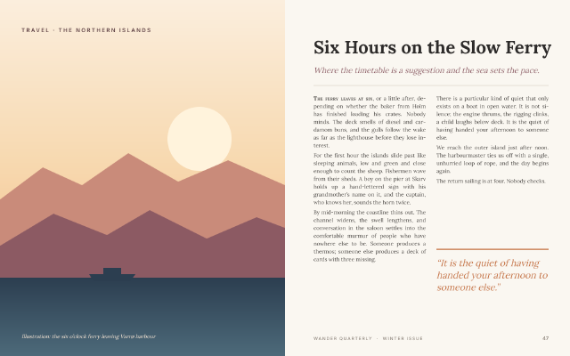

<!-- Generated by tools/gallery.mjs from showcase.yaml and build.json; do not edit. -->
# Magazine Feature Spread

[Photo](../README.md) › [Typography](../README.md#typography) · `type` `paragraph-text` `layout` `shapes`

A travel feature with an illustrated opener, a serif headline and two justified, hyphenated text columns.



| | |
|---|---|
| Document | [magazine-feature-spread.psd](magazine-feature-spread.psd) (990 KB) |
| Contents | 1600 × 1000 px; 19 layers; 9 type layers; 8 shape layers; 1 fill layer; 1 mask |
| Features | `photo.type.text`, `photo.type.styles`, `photo.path.shapes` |
| Built by | `kition-photo` @ `7abaa42e9a`: 20 commands in 287 ms |

## About

The body copy is two paragraph text layers in boxes, justified with hyphenation on, with a first
line indent and space between paragraphs. The opening words are set in small caps with a range
style on the same layer, and the pull quote and folio are separate type layers. The opener
illustration on the left page is made of gradient-filled shapes.

## Checks

- `inspect.layers`: `{"count":19,"any":{"name":"Headline","kind":"Type","text":{"text":"Six Hours on the Slow Ferry","font":"Lora"}}}`
- `inspect.layers.-2`: `{"kind":"Fill","fillContent":"#faf7f1"}`
- `results.col1Info.paragraphs.0.style`: `{"align":"JustifyLeft","hyphenate":true,"space_after_pt":6}`
- `results.col1Info.text`: `{"contains":"\nFor the first hour"}`
- `results.col1Info.lines`: `{"min":20}`
- `results.col1Info.lines.0`: `{"start":0,"end":46}`
- `results.col1Info.runs.0`: `{"start":0,"end":23,"style":{"caps":"SmallCaps","weight":700}}`
- `results.col1Info.runs.1.style`: `{"caps":"Normal"}`
- `results.col1Info.shape.Box`: `{"width":315,"height":640}`
- diagnostics: none (the kit's check finds nothing wrong)
- the saved document opens again; the thumbnail matches `thumb.png` within the `render` tolerance

## Steps

<details><summary>20 commands (from <a href="showcase.yaml">showcase.yaml</a>)</summary>

```yaml
- command: layer.newFillLayer.solidColor
  params:
    color: "#faf7f1"
  as: paper
- command: shape.create
  params:
    kind: rect
    rect:
      - 0
      - 0
      - 800
      - 1000
    fill:
      gradient:
        stops:
          - - 0
            - "#f3b27a"
          - - 0.55
            - "#f7d9b0"
          - - 1
            - "#fbeedd"
        angle: 90
    name: Sky
- command: shape.create
  params:
    kind: ellipse
    rect:
      - 470
      - 300
      - 180
      - 180
    fill: "#fff3dc"
    name: Sun
- command: shape.create
  params:
    kind: path
    name: Far Ridge
    fill: "#c98b7a"
    path:
      subpaths:
        - knots:
            - - 0
              - 560
            - - 120
              - 470
            - - 230
              - 520
            - - 360
              - 430
            - - 500
              - 510
            - - 640
              - 450
            - - 800
              - 520
            - - 800
              - 1000
            - - 0
              - 1000
- command: shape.create
  params:
    kind: path
    name: Near Ridge
    fill: "#8c5a63"
    path:
      subpaths:
        - knots:
            - - 0
              - 690
            - - 150
              - 600
            - - 300
              - 660
            - - 420
              - 590
            - - 580
              - 670
            - - 720
              - 610
            - - 800
              - 640
            - - 800
              - 1000
            - - 0
              - 1000
- command: shape.create
  params:
    kind: rect
    rect:
      - 0
      - 780
      - 800
      - 220
    fill:
      gradient:
        stops:
          - - 0
            - "#4d6a7a"
          - - 1
            - "#2c3e50"
        angle: 90
    name: Water
- command: shape.create
  params:
    kind: path
    name: Ferry
    fill: "#2c3e50"
    path:
      subpaths:
        - knots:
            - - 250
              - 770
            - - 380
              - 770
            - - 365
              - 790
            - - 262
              - 790
        - knots:
            - - 290
              - 770
            - - 290
              - 752
            - - 340
              - 752
            - - 340
              - 770
- command: type.create
  params:
    x: 60
    y: 90
    text: TRAVEL · THE NORTHERN ISLANDS
    font: Inter
    size: 15
    weight: 600
    tracking: 250
    color: "#5a3a3f"
    name: Section
- command: type.create
  params:
    x: 60
    y: 950
    text: "Illustration: the six o’clock ferry leaving Varrø harbour"
    font: Lora
    size: 15
    italic: true
    color: "#f3e6d6"
    name: Caption
- command: type.create
  params:
    x: 880
    y: 150
    text: Six Hours on the Slow Ferry
    font: Lora
    size: 50
    weight: 700
    color: "#2c2a29"
    name: Headline
- command: type.create
  params:
    x: 880
    y: 205
    text: Where the timetable is a suggestion and the sea sets the pace.
    font: Lora
    size: 22
    italic: true
    color: "#8c5a63"
    name: Standfirst
- command: shape.create
  params:
    kind: line
    from:
      - 880
      - 240
    to:
      - 1540
      - 240
    weight: 1
    fill: "#cbbfae"
    name: Rule
- command: type.create
  params:
    x: 880
    y: 270
    box:
      - 880
      - 270
      - 315
      - 640
    font: Lora
    size: 15
    leading: 22
    color: "#2f2b28"
    align: justify
    hyphenate: true
    spaceAfter: 6
    firstLineIndent: 0
    name: Column 1
    text: |-
      The ferry leaves at six, or a little after, depending on whether the baker from Holm has finished loading his crates. Nobody minds. The deck smells of diesel and cardamom buns, and the gulls follow the wake as far as the lighthouse before they lose interest.
      For the first hour the islands slide past like sleeping animals, low and green and close enough to count the sheep. Fishermen wave from their sheds. A boy on the pier at Skarv holds up a hand-lettered sign with his grandmother’s name on it, and the captain, who knows her, sounds the horn twice.
      By mid-morning the coastline thins out. The channel widens, the swell lengthens, and conversation in the saloon settles into the comfortable murmur of people who have nowhere else to be. Someone produces a thermos; someone else produces a deck of cards with three missing.
  as: col1
- command: type.setStyle
  params:
    layer: $col1.layer
    range:
      - 0
      - 23
    caps: small
    weight: 700
    tracking: 40
- command: type.create
  params:
    x: 1225
    y: 270
    box:
      - 1225
      - 270
      - 315
      - 400
    font: Lora
    size: 15
    leading: 22
    color: "#2f2b28"
    align: justify
    hyphenate: true
    spaceAfter: 6
    name: Column 2
    text: |-
      There is a particular kind of quiet that only exists on a boat in open water. It is not silence; the engine thrums, the rigging clinks, a child laughs below deck. It is the quiet of having handed your afternoon to someone else.
      We reach the outer island just after noon. The harbourmaster ties us off with a single, unhurried loop of rope, and the day begins again.
      The return sailing is at four. Nobody checks.
  as: col2
- command: shape.create
  params:
    kind: line
    from:
      - 1225
      - 700
    to:
      - 1540
      - 700
    weight: 3
    fill: "#c4703f"
    name: Quote Rule
- command: type.create
  params:
    x: 1225
    y: 728
    box:
      - 1225
      - 728
      - 315
      - 200
    text: “It is the quiet of having handed your afternoon to someone else.”
    font: Lora
    size: 26
    leading: 34
    italic: true
    color: "#c4703f"
    name: Pull Quote
- command: type.create
  params:
    x: 1540
    y: 955
    text: "47"
    font: Inter
    size: 14
    weight: 600
    color: "#8a8178"
    align: right
    name: Folio
- command: type.create
  params:
    x: 880
    y: 955
    text: WANDER QUARTERLY  ·  WINTER ISSUE
    font: Inter
    size: 12
    weight: 500
    tracking: 200
    color: "#8a8178"
    name: Running Foot
- command: type.info
  params:
    layer: $col1.layer
  as: col1Info
```

</details>
