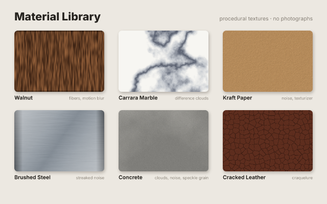

<!-- Generated by tools/gallery.mjs from showcase.yaml and build.json; do not edit. -->
# Material Texture Swatches

[Photo](../README.md) › [Filters & Textures](../README.md#filters--textures) · `filters` `textures` `render-filters` `clipping-mask` `reference`

Six procedural materials (walnut, marble, kraft paper, brushed steel, concrete, cracked leather), each built from render, noise and gallery filters.



| | |
|---|---|
| Document | [material-texture-swatches.psd](material-texture-swatches.psd) (6.5 MB) |
| Contents | 1600 × 1000 px; 28 layers; 14 type layers; 6 shape layers; 1 fill layer; 6 styled layers |
| Features | `photo.filter.noise-sharpen`, `photo.filter.gallery`, `photo.filter.blur`, `photo.layer.mask-basics` |
| Built by | `kition-photo` @ `7abaa42e9a`: 78 commands in 1377 ms |

## About

A material board for a 3D or interior mood deck, made without a single photograph. Each swatch is
a rounded shape with a texture layer clipped into it, and each texture is a short filter recipe
run inside a selection: Fibers and Motion Blur for walnut; Clouds, two passes of Difference Clouds,
Invert, Levels, Invert again and a gradient map for marble; noise and the Texturizer's sandstone for
kraft paper; streaked noise and a Soft Light sheen for brushed steel; clouds and speckle grain
for concrete; and Craquelure for leather. The recipe is printed under each swatch.

## Checks

- `inspect.layers`: `{"count":28}`
- `inspect.layers.2`: `{"name":"Cracked Leather","kind":"Pixel","clipped":true}`
- `inspect.layers.10`: `{"name":"Steel Sheen","kind":"Fill","clipped":true,"blend":"Soft Light"}`
- `inspect.layers.19`: `{"name":"Carrara Marble","kind":"Pixel","clipped":true}`
- `inspect.layers.20`: `{"name":"Carrara Marble Swatch","kind":"Shape","clipped":false,"effects":{"items":{"any":{"kind":"Drop Shadow"}}}}`
- `inspect.layers.23`: `{"name":"Walnut","kind":"Pixel","clipped":true}`
- `results.walnutTone.0`: `{"min":0.25,"max":0.6}`
- `results.walnutTone.2`: `{"max":0.25}`
- `results.leatherTone.0`: `{"min":0.2,"max":0.55}`
- `results.leatherTone.2`: `{"max":0.2}`
- diagnostics: none (the kit's check finds nothing wrong)
- the saved document opens again; the thumbnail matches `thumb.png` within the `render` tolerance

## Steps

<details><summary>78 commands (from <a href="showcase.yaml">showcase.yaml</a>)</summary>

```yaml
- command: edit.fill
  params:
    contents: color
    color: "#ece8e1"
- command: type.create
  params:
    x: 70
    y: 100
    text: Material Library
    font: Inter
    size: 54
    weight: 800
    color: "#24211d"
    name: Title
- command: type.create
  params:
    x: 1530
    y: 100
    text: procedural textures · no photographs
    font: Inter
    size: 26
    color: "#7d766c"
    align: right
    name: Subtitle
- command: shape.create
  params:
    kind: roundedRect
    rect:
      - 70
      - 150
      - 440
      - 300
    radii: 16
    fill: "#000000"
    name: Walnut Swatch
  as: walnutS
- command: layer.layerStyle.dropShadow
  params:
    layer: $walnutS.layer
    color: "#3a3128"
    opacity: 30
    distance: 8
    size: 18
    angle: 90
- command: layer.new.layer
  params:
    name: Walnut
  as: walnut
- command: select.rect
  params:
    x: 70
    y: 150
    width: 440
    height: 300
- command: filter.render.fibers
  params:
    variance: 22
    strength: 7
    seed: 14
    foreground: "#3b2213"
    background: "#94603a"
- command: filter.blur.motionBlur
  params:
    angle: 90
    distance: 16
- command: select.deselect
- command: layer.createClippingMask
  params:
    layer: $walnut.layer
- command: type.create
  params:
    x: 70
    y: 488
    text: Walnut
    font: Inter
    size: 26
    weight: 700
    color: "#24211d"
    name: Walnut Label
- command: type.create
  params:
    x: 510
    y: 488
    text: fibers, motion blur
    font: Inter
    size: 20
    color: "#8a8378"
    align: right
    name: Walnut Recipe
- command: shape.create
  params:
    kind: roundedRect
    rect:
      - 580
      - 150
      - 440
      - 300
    radii: 16
    fill: "#000000"
    name: Carrara Marble Swatch
  as: marbleS
- command: layer.layerStyle.dropShadow
  params:
    layer: $marbleS.layer
    color: "#3a3128"
    opacity: 30
    distance: 8
    size: 18
    angle: 90
- command: layer.new.layer
  params:
    name: Carrara Marble
  as: marble
- command: select.rect
  params:
    x: 580
    y: 150
    width: 440
    height: 300
- command: tools.setColors
  params:
    foreground: "#000000"
    background: "#ffffff"
- command: filter.render.clouds
  params:
    seed: 101
- command: filter.render.differenceClouds
  params:
    seed: 102
- command: filter.render.differenceClouds
  params:
    seed: 105
- command: image.adjustments.invert
- command: image.adjustments.levels
  params:
    inBlack: 200
    inWhite: 255
    gamma: 0.8
- command: image.adjustments.invert
- command: image.adjustments.gradientMap
  params:
    stops:
      - - 0
        - "#596070"
      - - 0.55
        - "#c4c8ce"
      - - 1
        - "#f7f6f2"
- command: select.deselect
- command: layer.createClippingMask
  params:
    layer: $marble.layer
- command: type.create
  params:
    x: 580
    y: 488
    text: Carrara Marble
    font: Inter
    size: 26
    weight: 700
    color: "#24211d"
    name: Carrara Marble Label
- command: type.create
  params:
    x: 1020
    y: 488
    text: difference clouds
    font: Inter
    size: 20
    color: "#8a8378"
    align: right
    name: Carrara Marble Recipe
- command: shape.create
  params:
    kind: roundedRect
    rect:
      - 1090
      - 150
      - 440
      - 300
    radii: 16
    fill: "#000000"
    name: Kraft Paper Swatch
  as: kraftS
- command: layer.layerStyle.dropShadow
  params:
    layer: $kraftS.layer
    color: "#3a3128"
    opacity: 30
    distance: 8
    size: 18
    angle: 90
- command: layer.new.layer
  params:
    name: Kraft Paper
  as: kraft
- command: select.rect
  params:
    x: 1090
    y: 150
    width: 440
    height: 300
- command: edit.fill
  params:
    contents: color
    color: "#b48a5a"
- command: filter.noise.addNoise
  params:
    amount: 10
    distribution: gaussian
    monochromatic: true
    seed: 21
- command: filter.gallery.texturizer
  params:
    texture: sandstone
    scaling: 80
    relief: 6
    light: topLeft
- command: select.deselect
- command: layer.createClippingMask
  params:
    layer: $kraft.layer
- command: type.create
  params:
    x: 1090
    y: 488
    text: Kraft Paper
    font: Inter
    size: 26
    weight: 700
    color: "#24211d"
    name: Kraft Paper Label
- command: type.create
  params:
    x: 1530
    y: 488
    text: noise, texturizer
    font: Inter
    size: 20
    color: "#8a8378"
    align: right
    name: Kraft Paper Recipe
- command: shape.create
  params:
    kind: roundedRect
    rect:
      - 70
      - 540
      - 440
      - 300
    radii: 16
    fill: "#000000"
    name: Brushed Steel Swatch
  as: steelS
- command: layer.layerStyle.dropShadow
  params:
    layer: $steelS.layer
    color: "#3a3128"
    opacity: 30
    distance: 8
    size: 18
    angle: 90
- command: layer.new.layer
  params:
    name: Brushed Steel
  as: steel
- command: select.rect
  params:
    x: 70
    y: 540
    width: 440
    height: 300
- command: edit.fill
  params:
    contents: color
    color: "#9ea4aa"
- command: filter.noise.addNoise
  params:
    amount: 35
    distribution: uniform
    monochromatic: true
    seed: 31
- command: filter.blur.motionBlur
  params:
    angle: 0
    distance: 80
- command: select.deselect
- command: layer.createClippingMask
  params:
    layer: $steel.layer
- command: gradient.fill.create
  params:
    from:
      - 70
      - 540
    to:
      - 510
      - 840
    stops:
      - - 0
        - "#ffffff"
      - - 0.5
        - "#3a3f45"
      - - 1
        - "#ffffff"
    mode: soft-light
    opacity: 80
  as: sheen
- command: layer.setProps
  params:
    layer: $sheen.layer
    name: Steel Sheen
    clipped: true
- command: type.create
  params:
    x: 70
    y: 878
    text: Brushed Steel
    font: Inter
    size: 26
    weight: 700
    color: "#24211d"
    name: Brushed Steel Label
- command: type.create
  params:
    x: 510
    y: 878
    text: streaked noise
    font: Inter
    size: 20
    color: "#8a8378"
    align: right
    name: Brushed Steel Recipe
- command: shape.create
  params:
    kind: roundedRect
    rect:
      - 580
      - 540
      - 440
      - 300
    radii: 16
    fill: "#000000"
    name: Concrete Swatch
  as: concreteS
- command: layer.layerStyle.dropShadow
  params:
    layer: $concreteS.layer
    color: "#3a3128"
    opacity: 30
    distance: 8
    size: 18
    angle: 90
- command: layer.new.layer
  params:
    name: Concrete
  as: concrete
- command: select.rect
  params:
    x: 580
    y: 540
    width: 440
    height: 300
- command: tools.setColors
  params:
    foreground: "#7f7e7a"
    background: "#b9b7b1"
- command: filter.render.clouds
  params:
    seed: 41
- command: filter.noise.addNoise
  params:
    amount: 8
    distribution: gaussian
    monochromatic: true
    seed: 42
- command: filter.gallery.grain
  params:
    intensity: 30
    contrast: 50
    grainType: speckle
- command: select.deselect
- command: layer.createClippingMask
  params:
    layer: $concrete.layer
- command: type.create
  params:
    x: 580
    y: 878
    text: Concrete
    font: Inter
    size: 26
    weight: 700
    color: "#24211d"
    name: Concrete Label
- command: type.create
  params:
    x: 1020
    y: 878
    text: clouds, noise, speckle grain
    font: Inter
    size: 20
    color: "#8a8378"
    align: right
    name: Concrete Recipe
- command: shape.create
  params:
    kind: roundedRect
    rect:
      - 1090
      - 540
      - 440
      - 300
    radii: 16
    fill: "#000000"
    name: Cracked Leather Swatch
  as: leatherS
- command: layer.layerStyle.dropShadow
  params:
    layer: $leatherS.layer
    color: "#3a3128"
    opacity: 30
    distance: 8
    size: 18
    angle: 90
- command: layer.new.layer
  params:
    name: Cracked Leather
  as: leather
- command: select.rect
  params:
    x: 1090
    y: 540
    width: 440
    height: 300
- command: edit.fill
  params:
    contents: color
    color: "#6e3523"
- command: filter.noise.addNoise
  params:
    amount: 6
    distribution: gaussian
    monochromatic: true
    seed: 51
- command: filter.gallery.craquelure
  params:
    crackSpacing: 18
    crackDepth: 5
    crackBrightness: 6
- command: select.deselect
- command: layer.createClippingMask
  params:
    layer: $leather.layer
- command: type.create
  params:
    x: 1090
    y: 878
    text: Cracked Leather
    font: Inter
    size: 26
    weight: 700
    color: "#24211d"
    name: Cracked Leather Label
- command: type.create
  params:
    x: 1530
    y: 878
    text: craquelure
    font: Inter
    size: 20
    color: "#8a8378"
    align: right
    name: Cracked Leather Recipe
- command: document.sampleColor
  params:
    x: 290
    y: 300
    size: 31
  as: walnutTone
- command: document.sampleColor
  params:
    x: 1310
    y: 690
    size: 31
  as: leatherTone
```

</details>
