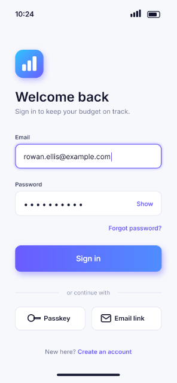

<!-- Generated by tools/gallery.mjs from showcase.yaml and build.json; do not edit. -->
# Mobile App Login Screen

[Photo](../README.md) › [UI & Web Design](../README.md#ui--web-design) · `ui` `mobile` `shapes` `layer-styles` `groups`

A sign-in screen for a fictional budgeting app at 375 × 812 pt (@2x), with fields, a gradient button and grouped sections.



| | |
|---|---|
| Document | [mobile-app-login-screen.psd](mobile-app-login-screen.psd) (668 KB) |
| Contents | 750 × 1624 px; 38 layers; 14 type layers; 16 shape layers; 1 fill layer; 6 groups; 3 styled layers; 1 mask |
| Features | `photo.path.shapes`, `photo.layer.styles`, `photo.layer.manage`, `photo.type.point-text` |
| Built by | `kition-photo` @ `7abaa42e9a`: 60 commands in 209 ms |

## About

A phone-sized mockup laid out on a 2× grid: status bar, app mark, heading, two input fields
(one focused, with an accent stroke and a soft glow), a gradient primary button with a coloured
shadow, alternative sign-in buttons and a footer link. Each part of the screen is its own named
layer group, the way a designer hands a screen to a developer: the status bar and the form are
grouped from selected layers, the other sections are made as groups and filled in place.

## Checks

- `inspect.width`: `750`
- `inspect.height`: `1624`
- `inspect.layers`: `{"count":8,"all":{"kind":{"oneOf":["Group","Fill","Pixel"]}}}`
- `inspect.layers.0`: `{"name":"Footer Area","kind":"Group","children":{"count":2}}`
- `inspect.layers.1`: `{"name":"Other Sign-In Options","kind":"Group","children":{"count":9}}`
- `inspect.layers.2`: `{"name":"Sign In","kind":"Group","children":{"count":2}}`
- `inspect.layers.4`: `{"name":"Header","kind":"Group","children":{"count":4}}`
- `inspect.layers.-3`: `{"name":"Status Bar","kind":"Group","children":{"count":4}}`
- `inspect.layers.-2`: `{"name":"Screen","kind":"Fill","fillContent":"#f7f8fc"}`
- `inspect.layers.3`: `{"name":"Form","kind":"Group","children":{"count":9,"any":{"name":"Email Field","kind":"Shape","shape":{"stroke":{"fill":"#6a5cff","align":"inside"}},"effects":{"items":{"any":{"key":"outerGlow"}}}}}}`
- `inspect.layers.2.children.1`: `{"name":"Sign In Button","shape":{"fill":{"gradient":{"stops":[[0,"#6a5cff"],[1,"#4f8dff"]]}}},"effects":{"items":{"any":{"key":"dropShadow"}}}}`
- diagnostics: none (the kit's check finds nothing wrong)
- the saved document opens again; the thumbnail matches `thumb.png` within the `render` tolerance

## Steps

<details><summary>60 commands (from <a href="showcase.yaml">showcase.yaml</a>)</summary>

```yaml
- command: layer.newFillLayer.solidColor
  params:
    color: "#f7f8fc"
  as: screen
- command: layer.setProps
  params:
    layer: $screen.layer
    name: Screen
- command: type.create
  params:
    x: 64
    y: 70
    text: 10:24
    font: Inter
    size: 30
    weight: 600
    color: "#11142d"
    name: Clock
  as: clock
- command: shape.create
  params:
    kind: roundedRect
    rect:
      - 626
      - 48
      - 52
      - 26
    radii: 7
    fill: null
    stroke:
      width: 3
      color: "#11142d"
    name: Battery
  as: battery
- command: shape.create
  params:
    kind: roundedRect
    rect:
      - 631
      - 53
      - 34
      - 16
    radii: 3
    fill: "#11142d"
    name: Battery Level
  as: level
- command: shape.create
  params:
    kind: roundedRect
    rect:
      - 566
      - 52
      - 8
      - 20
    radii: 2
    fill: "#11142d"
    name: Signal
  as: signal
- command: shape.create
  params:
    kind: roundedRect
    rect:
      - 554
      - 58
      - 8
      - 14
    radii: 2
    fill: "#11142d"
    addTo: $signal.layer
    op: combine
- command: shape.create
  params:
    kind: roundedRect
    rect:
      - 578
      - 46
      - 8
      - 26
    radii: 2
    fill: "#11142d"
    addTo: $signal.layer
    op: combine
- command: shape.create
  params:
    kind: roundedRect
    rect:
      - 590
      - 40
      - 8
      - 32
    radii: 2
    fill: "#11142d"
    addTo: $signal.layer
    op: combine
- command: layer.select
  params:
    layer: $clock.layer
- command: layer.select
  params:
    layer: $battery.layer
    mode: add
- command: layer.select
  params:
    layer: $level.layer
    mode: add
- command: layer.select
  params:
    layer: $signal.layer
    mode: add
- command: layer.groupLayers
  params:
    name: Status Bar
  as: statusBar
- command: layer.new.group
  params:
    name: Header
  as: header
- command: layer.moveTo
  params:
    layer: $header.layer
    target: $statusBar.layer
    position: above
- command: shape.create
  params:
    kind: roundedRect
    rect:
      - 64
      - 210
      - 120
      - 120
    radii: 34
    fill:
      gradient:
        stops:
          - - 0
            - "#6a5cff"
          - - 1
            - "#2ec5ff"
        angle: 135
    name: App Mark
  as: mark
- command: layer.layerStyle.dropShadow
  params:
    layer: $mark.layer
    color: "#5b4dff"
    opacity: 35
    distance: 12
    size: 28
    angle: 90
- command: shape.create
  params:
    kind: roundedRect
    rect:
      - 94
      - 272
      - 16
      - 28
    radii: 5
    fill: "#ffffff"
    name: Mark Glyph
  as: glyph
- command: shape.create
  params:
    kind: roundedRect
    rect:
      - 116
      - 256
      - 16
      - 44
    radii: 5
    fill: "#ffffff"
    addTo: $glyph.layer
    op: combine
- command: shape.create
  params:
    kind: roundedRect
    rect:
      - 138
      - 238
      - 16
      - 62
    radii: 5
    fill: "#ffffff"
    addTo: $glyph.layer
    op: combine
- command: type.create
  params:
    x: 64
    y: 430
    text: Welcome back
    font: Inter
    size: 56
    weight: 600
    color: "#11142d"
    name: Heading
  as: heading
- command: type.create
  params:
    x: 64
    y: 482
    text: Sign in to keep your budget on track.
    font: Inter
    size: 28
    color: "#6b7090"
    name: Subheading
  as: sub
- command: type.create
  params:
    x: 64
    y: 590
    text: Email
    font: Inter
    size: 24
    weight: 600
    color: "#3a3f5c"
    name: Email Label
  as: emailLabel
- command: layer.moveTo
  params:
    layer: $emailLabel.layer
    target: $header.layer
    position: above
- command: shape.create
  params:
    kind: roundedRect
    rect:
      - 64
      - 610
      - 622
      - 104
    radii: 22
    fill: "#ffffff"
    stroke:
      width: 3
      color: "#6a5cff"
      align: inside
    name: Email Field
  as: emailField
- command: layer.layerStyle.outerGlow
  params:
    layer: $emailField.layer
    color: "#6a5cff"
    opacity: 30
    size: 14
    blend: normal
- command: type.create
  params:
    x: 100
    y: 674
    text: rowan.ellis@example.com
    font: Inter
    size: 30
    color: "#11142d"
    name: Email Value
  as: emailValue
- command: shape.create
  params:
    kind: rect
    rect:
      - 472
      - 646
      - 3
      - 38
    fill: "#6a5cff"
    name: Caret
  as: caret
- command: type.create
  params:
    x: 64
    y: 790
    text: Password
    font: Inter
    size: 24
    weight: 600
    color: "#3a3f5c"
    name: Password Label
  as: pwLabel
- command: shape.create
  params:
    kind: roundedRect
    rect:
      - 64
      - 810
      - 622
      - 104
    radii: 22
    fill: "#ffffff"
    stroke:
      width: 2
      color: "#dfe2ef"
      align: inside
    name: Password Field
  as: pwField
- command: type.create
  params:
    x: 100
    y: 878
    text: ••••••••••
    font: Inter
    size: 34
    tracking: 200
    color: "#11142d"
    name: Password Dots
  as: dots
- command: type.create
  params:
    x: 650
    y: 873
    text: Show
    font: Inter
    size: 26
    weight: 600
    color: "#6a5cff"
    align: right
    name: Show Toggle
  as: show
- command: type.create
  params:
    x: 686
    y: 976
    text: Forgot password?
    font: Inter
    size: 26
    weight: 600
    color: "#6a5cff"
    align: right
    name: Forgot Link
  as: forgot
- command: layer.select
  params:
    layer: $emailLabel.layer
- command: layer.select
  params:
    layer: $forgot.layer
    mode: range
- command: layer.groupLayers
  params:
    name: Form
  as: form
- command: layer.new.group
  params:
    name: Sign In
  as: signIn
- command: layer.moveTo
  params:
    layer: $signIn.layer
    target: $form.layer
    position: above
- command: shape.create
  params:
    kind: roundedRect
    rect:
      - 64
      - 1040
      - 622
      - 112
    radii: 24
    fill:
      gradient:
        stops:
          - - 0
            - "#6a5cff"
          - - 1
            - "#4f8dff"
        angle: 0
    name: Sign In Button
  as: button
- command: layer.layerStyle.dropShadow
  params:
    layer: $button.layer
    color: "#5b4dff"
    opacity: 40
    distance: 14
    size: 30
    angle: 90
- command: type.create
  params:
    x: 375
    y: 1107
    text: Sign in
    font: Inter
    size: 32
    weight: 600
    color: "#ffffff"
    align: center
    name: Button Label
- command: layer.new.group
  params:
    name: Other Sign-In Options
  as: options
- command: layer.moveTo
  params:
    layer: $options.layer
    target: $signIn.layer
    position: above
- command: shape.create
  params:
    kind: line
    from:
      - 64
      - 1240
    to:
      - 250
      - 1240
    weight: 2
    fill: "#dfe2ef"
    name: Divider Left
- command: shape.create
  params:
    kind: line
    from:
      - 500
      - 1240
    to:
      - 686
      - 1240
    weight: 2
    fill: "#dfe2ef"
    name: Divider Right
- command: type.create
  params:
    x: 375
    y: 1249
    text: or continue with
    font: Inter
    size: 24
    color: "#8a8fab"
    align: center
    name: Divider Text
- command: shape.create
  params:
    kind: roundedRect
    rect:
      - 64
      - 1300
      - 298
      - 100
    radii: 22
    fill: "#ffffff"
    stroke:
      width: 2
      color: "#dfe2ef"
      align: inside
    name: Passkey Button
- command: shape.create
  params:
    kind: roundedRect
    rect:
      - 388
      - 1300
      - 298
      - 100
    radii: 22
    fill: "#ffffff"
    stroke:
      width: 2
      color: "#dfe2ef"
      align: inside
    name: Magic Link Button
- command: shape.create
  params:
    kind: ellipse
    rect:
      - 118
      - 1334
      - 28
      - 28
    fill: null
    stroke:
      width: 4
      color: "#11142d"
    name: Key Icon
  as: key
- command: shape.create
  params:
    kind: rect
    rect:
      - 144
      - 1346
      - 26
      - 5
    fill: "#11142d"
    addTo: $key.layer
    op: combine
- command: type.create
  params:
    x: 186
    y: 1359
    text: Passkey
    font: Inter
    size: 28
    weight: 600
    color: "#11142d"
    name: Passkey Label
- command: shape.create
  params:
    kind: roundedRect
    rect:
      - 430
      - 1334
      - 40
      - 30
    radii: 5
    fill: null
    stroke:
      width: 4
      color: "#11142d"
    name: Mail Icon
  as: mail
- command: shape.create
  params:
    kind: path
    addTo: $mail.layer
    op: combine
    path:
      subpaths:
        - closed: false
          knots:
            - - 434
              - 1340
            - - 450
              - 1352
            - - 466
              - 1340
- command: type.create
  params:
    x: 486
    y: 1359
    text: Email link
    font: Inter
    size: 28
    weight: 600
    color: "#11142d"
    name: Magic Link Label
- command: layer.new.group
  params:
    name: Footer Area
  as: footerArea
- command: layer.moveTo
  params:
    layer: $footerArea.layer
    target: $options.layer
    position: above
- command: type.create
  params:
    x: 375
    y: 1500
    text: New here? Create an account
    font: Inter
    size: 26
    color: "#6b7090"
    align: center
    name: Footer
  as: footer
- command: type.setStyle
  params:
    layer: $footer.layer
    range:
      - 10
      - 27
    weight: 600
    color: "#6a5cff"
- command: shape.create
  params:
    kind: roundedRect
    rect:
      - 241
      - 1584
      - 268
      - 10
    radii: 5
    fill: "#11142d"
    name: Home Indicator
```

</details>
