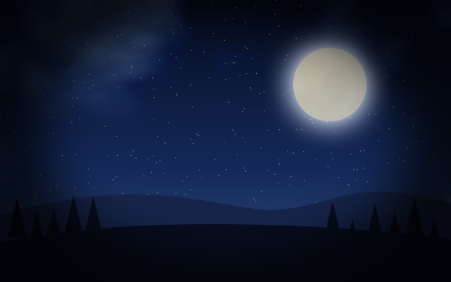

<!-- Generated by tools/gallery.mjs from showcase.yaml and build.json; do not edit. -->
# Moonlit Night Vignette

[Photo](../README.md) › [Masks & Compositing](../README.md#masks--compositing) · `masks` `render-filters` `blend-modes` `clipping-mask` `landscape`

A full moon over a pine ridge, with rendered stars and clouds, framed by a vignette layer whose mask is a feathered ellipse.



| | |
|---|---|
| Document | [moonlit-night-vignette.psd](moonlit-night-vignette.psd) (7.7 MB) |
| Contents | 1600 × 1000 px; 10 layers; 4 shape layers; 2 fill layers; 1 styled layer; 2 masks |
| Features | `photo.layer.mask-basics`, `photo.layer.masks`, `photo.select.make`, `photo.layer.style-basics` |
| Built by | `kition-photo` @ `7abaa42e9a`: 47 commands in 2985 ms |

## About

Everything is generated: stars are thresholded noise grown by Maximum and screened over a night
gradient; the drifting clouds are rendered Clouds in Screen mode, masked to the upper sky; the
moon is an ellipse with an outer glow and a crater texture clipped to it in Multiply. The finish is
a black fill layer whose mask comes from an inverted, heavily feathered elliptical selection, so
the corners fall into darkness while the center stays untouched.

## Checks

- `inspect.layers`: `{"count":10}`
- `inspect.layers.0`: `{"name":"Vignette","kind":"Fill","hasMask":true,"opacity":{"approx":0.75,"tol":0.01}}`
- `inspect.layers.4`: `{"name":"Craters","blend":"Multiply","clipped":true}`
- `inspect.layers.5`: `{"name":"Moon","kind":"Shape","effects":{"items":{"any":{"kind":"Outer Glow"}}}}`
- `inspect.layers.6`: `{"name":"Clouds","blend":"Screen","hasMask":true}`
- `inspect.layers.7`: `{"name":"Stars","blend":"Screen"}`
- `results.corner.2`: `{"max":0.06}`
- `results.center.2`: `{"min":0.25}`
- diagnostics: none (the kit's check finds nothing wrong)
- the saved document opens again; the thumbnail matches `thumb.png` within the `render` tolerance

## Steps

<details><summary>47 commands (from <a href="showcase.yaml">showcase.yaml</a>)</summary>

```yaml
- command: gradient.fill.create
  params:
    from:
      - 0
      - 0
    to:
      - 0
      - 1000
    stops:
      - - 0
        - "#050b1e"
      - - 0.6
        - "#14295a"
      - - 1
        - "#2f4b7c"
  as: sky
- command: layer.renameLayer
  params:
    layer: $sky.layer
    name: Night Sky
- command: layer.new.layer
  params:
    name: Stars
  as: stars
- command: edit.fill
  params:
    contents: color
    color: "#000000"
- command: filter.noise.addNoise
  params:
    amount: 115
    distribution: gaussian
    monochromatic: true
    seed: 17
- command: image.adjustments.threshold
  params:
    level: 254
- command: filter.other.maximum
  params:
    radius: 1
    preserve: roundness
- command: filter.blur.gaussianBlur
  params:
    radius: 0.8
- command: layer.setProps
  params:
    layer: $stars.layer
    blend: Screen
    opacity: 0.85
- command: layer.new.layer
  params:
    name: Clouds
  as: clouds
- command: tools.setColors
  params:
    foreground: "#000000"
    background: "#9fb3d9"
- command: filter.render.clouds
  params:
    seed: 44
- command: image.adjustments.levels
  params:
    inBlack: 70
    inWhite: 235
- command: filter.blur.motionBlur
  params:
    angle: 0
    distance: 60
- command: layer.setProps
  params:
    layer: $clouds.layer
    blend: Screen
    opacity: 0.55
- command: select.rect
  params:
    x: 0
    y: 380
    width: 1600
    height: 620
    feather: 80
- command: layer.layerMask.hideSelection
  params:
    layer: $clouds.layer
- command: shape.create
  params:
    kind: ellipse
    rect:
      - 1040
      - 170
      - 260
      - 260
    fill:
      gradient:
        stops:
          - - 0
            - "#fffdf2"
          - - 1
            - "#e9e2c8"
        angle: 135
    name: Moon
  as: moon
- command: layer.layerStyle.outerGlow
  params:
    layer: $moon.layer
    color: "#dfe8ff"
    opacity: 70
    size: 120
    spread: 2
- command: layer.new.layer
  params:
    name: Craters
  as: craters
- command: tools.setColors
  params:
    foreground: "#8c8676"
    background: "#ffffff"
- command: select.rect
  params:
    x: 1030
    y: 160
    width: 280
    height: 280
- command: filter.render.clouds
  params:
    seed: 3
- command: filter.render.differenceClouds
  params:
    seed: 8
- command: image.adjustments.levels
  params:
    inBlack: 0
    inWhite: 255
    outBlack: 60
- command: select.deselect
- command: layer.setProps
  params:
    layer: $craters.layer
    blend: Multiply
    opacity: 0.35
    clipped: true
- command: shape.create
  params:
    kind: path
    name: Far Ridge
    fill: "#16244a"
    path:
      subpaths:
        - knots:
            - - 0
              - 760
            - anchor:
                - 400
                - 690
              in:
                - 200
                - 700
              out:
                - 600
                - 680
              smooth: true
            - anchor:
                - 900
                - 740
              in:
                - 760
                - 720
              out:
                - 1060
                - 760
              smooth: true
            - anchor:
                - 1300
                - 680
              in:
                - 1180
                - 690
              out:
                - 1450
                - 670
              smooth: true
            - - 1600
              - 720
            - - 1600
              - 1000
            - - 0
              - 1000
- command: shape.create
  params:
    kind: path
    name: Near Ridge
    fill: "#070d1f"
    path:
      subpaths:
        - knots:
            - - 0
              - 860
            - anchor:
                - 500
                - 800
              in:
                - 260
                - 810
              out:
                - 740
                - 790
              smooth: true
            - anchor:
                - 1600
                - 850
              in:
                - 1200
                - 790
              out:
                - 1600
                - 850
            - - 1600
              - 1000
            - - 0
              - 1000
- command: shape.create
  params:
    kind: polygon
    sides: 3
    rect:
      - 21
      - 701
      - 79
      - 189
    fill: "#070d1f"
    name: Pines
  as: pines
- command: shape.create
  params:
    kind: polygon
    sides: 3
    rect:
      - 101
      - 748
      - 59
      - 142
    fill: "#070d1f"
    addTo: $pines.layer
    op: combine
- command: shape.create
  params:
    kind: polygon
    sides: 3
    rect:
      - 158
      - 735
      - 65
      - 155
    fill: "#070d1f"
    addTo: $pines.layer
    op: combine
- command: shape.create
  params:
    kind: polygon
    sides: 3
    rect:
      - 219
      - 692
      - 83
      - 198
    fill: "#070d1f"
    addTo: $pines.layer
    op: combine
- command: shape.create
  params:
    kind: polygon
    sides: 3
    rect:
      - 290
      - 697
      - 81
      - 193
    fill: "#070d1f"
    addTo: $pines.layer
    op: combine
- command: shape.create
  params:
    kind: polygon
    sides: 3
    rect:
      - 1143
      - 713
      - 74
      - 177
    fill: "#070d1f"
    addTo: $pines.layer
    op: combine
- command: shape.create
  params:
    kind: polygon
    sides: 3
    rect:
      - 1227
      - 777
      - 47
      - 113
    fill: "#070d1f"
    addTo: $pines.layer
    op: combine
- command: shape.create
  params:
    kind: polygon
    sides: 3
    rect:
      - 1295
      - 721
      - 70
      - 169
    fill: "#070d1f"
    addTo: $pines.layer
    op: combine
- command: shape.create
  params:
    kind: polygon
    sides: 3
    rect:
      - 1371
      - 749
      - 59
      - 141
    fill: "#070d1f"
    addTo: $pines.layer
    op: combine
- command: shape.create
  params:
    kind: polygon
    sides: 3
    rect:
      - 1430
      - 697
      - 81
      - 193
    fill: "#070d1f"
    addTo: $pines.layer
    op: combine
- command: shape.create
  params:
    kind: polygon
    sides: 3
    rect:
      - 1516
      - 774
      - 48
      - 116
    fill: "#070d1f"
    addTo: $pines.layer
    op: combine
- command: select.rect
  params:
    x: 160
    y: 60
    width: 1280
    height: 880
    ellipse: true
    feather: 160
- command: select.inverse
- command: layer.newFillLayer.solidColor
  params:
    color: "#000000"
  as: vignette
- command: select.deselect
- command: layer.setProps
  params:
    layer: $vignette.layer
    name: Vignette
    opacity: 0.75
- command: document.sampleColor
  params:
    x: 1580
    y: 980
    size: 11
    sampleLayer: all
  as: corner
- command: document.sampleColor
  params:
    x: 760
    y: 560
    size: 11
    sampleLayer: all
  as: center
```

</details>
