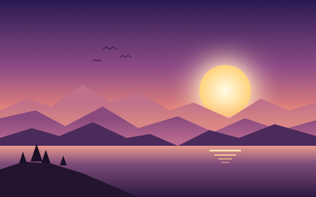

<!-- Generated by tools/gallery.mjs from showcase.yaml and build.json; do not edit. -->
# Mountain Sunset Illustration

[Photo](../README.md) › [Shapes & Illustration](../README.md#shapes--illustration) · `shapes` `gradient` `illustration` `landscape` `layer-styles`

A flat-style landscape of layered ridges, a glowing sun, drifting mist and a still lake, all live shapes.



| | |
|---|---|
| Document | [mountain-sunset-illustration.psd](mountain-sunset-illustration.psd) (4.2 MB) |
| Contents | 1600 × 1000 px; 16 layers; 12 shape layers; 3 fill layers; 1 styled layer |
| Features | `photo.path.shapes`, `photo.paint.gradients`, `photo.layer.style-basics` |
| Built by | `kition-photo` @ `7abaa42e9a`: 22 commands in 228 ms |

## About

A desktop wallpaper drawn entirely with vector shapes. The sky is a gradient fill layer, the sun is
an ellipse with a radial gradient and an outer glow, and each ridge is a path shape a shade darker
than the one behind it, which gives the depth. Mist bands are gradient fill layers fading to
transparent, and the lake mirrors the sky with a reflected sun stripe.

## Checks

- `inspect.layers`: `{"count":16,"any":{"name":"Sun","kind":"Shape","effects":{"items":{"any":{"kind":"Outer Glow"}}}}}`
- `inspect.layers.0`: `{"name":"Birds","kind":"Shape"}`
- `inspect.layers.-2`: `{"name":"Sky","kind":"Fill"}`
- diagnostics: none (the kit's check finds nothing wrong)
- the saved document opens again; the thumbnail matches `thumb.png` within the `render` tolerance

## Steps

<details><summary>22 commands (from <a href="showcase.yaml">showcase.yaml</a>)</summary>

```yaml
- command: gradient.fill.create
  params:
    from:
      - 0
      - 0
    to:
      - 0
      - 760
    stops:
      - - 0
        - "#2a1a52"
      - - 0.45
        - "#8e4b86"
      - - 0.78
        - "#f08a7a"
      - - 1
        - "#ffc58a"
  as: sky
- command: layer.renameLayer
  params:
    layer: $sky.layer
    name: Sky
- command: shape.create
  params:
    kind: ellipse
    rect:
      - 1010
      - 330
      - 260
      - 260
    fill:
      gradient:
        stops:
          - - 0
            - "#fffbe6"
          - - 1
            - "#ffd27a"
        style: radial
    name: Sun
  as: sun
- command: layer.layerStyle.outerGlow
  params:
    layer: $sun.layer
    color: "#ffcf7d"
    opacity: 85
    size: 180
    spread: 4
- command: shape.create
  params:
    kind: path
    name: Far Ridge
    fill: "#c0708a"
    path:
      subpaths:
        - knots:
            - - 0
              - 560
            - - 140
              - 500
            - - 260
              - 540
            - - 420
              - 430
            - - 560
              - 520
            - - 700
              - 470
            - - 860
              - 560
            - - 980
              - 520
            - - 1160
              - 600
            - - 1320
              - 500
            - - 1460
              - 560
            - - 1600
              - 520
            - - 1600
              - 1000
            - - 0
              - 1000
- command: gradient.fill.create
  params:
    from:
      - 0
      - 520
    to:
      - 0
      - 680
    stops:
      - - 0
        - "#f7a07a"
      - - 1
        - "#f7a07a"
    transparency:
      - - 0
        - 0
      - - 1
        - 70
  as: mist1
- command: layer.renameLayer
  params:
    layer: $mist1.layer
    name: Mist High
- command: shape.create
  params:
    kind: path
    name: Mid Ridge
    fill: "#8a4a7e"
    path:
      subpaths:
        - knots:
            - - 0
              - 600
            - - 180
              - 560
            - - 330
              - 640
            - - 520
              - 540
            - - 700
              - 650
            - - 900
              - 590
            - - 1080
              - 670
            - - 1240
              - 600
            - - 1420
              - 660
            - - 1600
              - 610
            - - 1600
              - 1000
            - - 0
              - 1000
- command: gradient.fill.create
  params:
    from:
      - 0
      - 600
    to:
      - 0
      - 720
    stops:
      - - 0
        - "#d9809a"
      - - 1
        - "#d9809a"
    transparency:
      - - 0
        - 0
      - - 1
        - 60
  as: mist2
- command: layer.renameLayer
  params:
    layer: $mist2.layer
    name: Mist Low
- command: shape.create
  params:
    kind: path
    name: Near Ridge
    fill: "#4b2a5c"
    path:
      subpaths:
        - knots:
            - - 0
              - 700
            - - 160
              - 650
            - - 300
              - 690
            - - 470
              - 620
            - - 640
              - 700
            - - 760
              - 680
            - - 900
              - 740
            - - 0
              - 740
        - knots:
            - - 900
              - 740
            - - 1060
              - 660
            - - 1210
              - 700
            - - 1390
              - 630
            - - 1600
              - 690
            - - 1600
              - 740
- command: shape.create
  params:
    kind: rect
    rect:
      - 0
      - 740
      - 1600
      - 260
    fill:
      gradient:
        stops:
          - - 0
            - "#e89a8c"
          - - 0.35
            - "#7e4b7a"
          - - 1
            - "#2c1a40"
        angle: -90
    name: Lake
- command: shape.create
  params:
    kind: roundedRect
    rect:
      - 1060
      - 760
      - 160
      - 8
    radii: 4
    fill: "#ffe7b0"
    name: Reflection 1
- command: shape.create
  params:
    kind: roundedRect
    rect:
      - 1085
      - 784
      - 110
      - 6
    radii: 3
    fill: "#ffd99a"
    name: Reflection 2
- command: shape.create
  params:
    kind: roundedRect
    rect:
      - 1105
      - 804
      - 70
      - 5
    radii: 2.5
    fill: "#f6c48c"
    name: Reflection 3
- command: shape.create
  params:
    kind: roundedRect
    rect:
      - 1120
      - 822
      - 40
      - 4
    radii: 2
    fill: "#e9b08a"
    name: Reflection 4
- command: shape.create
  params:
    kind: path
    name: Foreground Hill
    fill: "#24142f"
    path:
      subpaths:
        - knots:
            - - 0
              - 860
            - - 120
              - 820
            - - 260
              - 830
            - - 420
              - 880
            - - 560
              - 940
            - - 700
              - 1000
            - - 0
              - 1000
- command: shape.create
  params:
    kind: polygon
    sides: 3
    rect:
      - 150
      - 730
      - 70
      - 120
    fill: "#1c1026"
    name: Pines
  as: pine
- command: shape.create
  params:
    kind: polygon
    sides: 3
    rect:
      - 205
      - 760
      - 54
      - 92
    fill: "#1c1026"
    addTo: $pine.layer
    op: combine
- command: shape.create
  params:
    kind: polygon
    sides: 3
    rect:
      - 92
      - 770
      - 48
      - 82
    fill: "#1c1026"
    addTo: $pine.layer
    op: combine
- command: shape.create
  params:
    kind: polygon
    sides: 3
    rect:
      - 300
      - 790
      - 40
      - 66
    fill: "#1c1026"
    addTo: $pine.layer
    op: combine
- command: shape.create
  params:
    kind: path
    name: Birds
    fill: null
    stroke:
      width: 4
      color: "#3a1f4c"
      cap: round
      join: round
    path:
      subpaths:
        - closed: false
          knots:
            - - 520
              - 250
            - - 540
              - 238
            - - 556
              - 250
            - - 572
              - 238
            - - 592
              - 250
        - closed: false
          knots:
            - - 610
              - 290
            - - 624
              - 281
            - - 636
              - 290
            - - 648
              - 281
            - - 662
              - 290
        - closed: false
          knots:
            - - 470
              - 310
            - - 481
              - 303
            - - 490
              - 310
            - - 499
              - 303
            - - 510
              - 310
```

</details>
