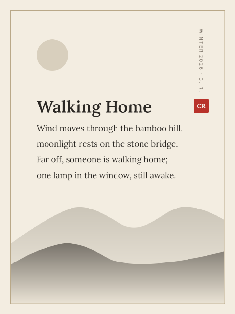

<!-- Generated by tools/gallery.mjs from showcase.yaml and build.json; do not edit. -->
# Night Walk Poem Card

[Photo](../README.md) › [Typography](../README.md#typography) · `type` `vertical-text` `shapes`

A short poem set in Lora on a paragraph text box, with an ink-wash hill, a pale moon and a red seal.



| | |
|---|---|
| Document | [night-walk-poem-card.psd](night-walk-poem-card.psd) (590 KB) |
| Contents | 900 × 1200 px; 11 layers; 4 type layers; 5 shape layers; 1 fill layer; 1 mask |
| Features | `photo.type.features`, `photo.type.text`, `photo.path.shapes` |
| Built by | `kition-photo` @ `e511ae24a4`: 12 commands in 72 ms |

## About

The poem is one paragraph text layer: the lines wrap inside a fixed box with generous leading,
set in Lora. The signature runs down the right margin as vertical point text, the seal below it
is a red rounded square with the poet's initials, and the hills are soft gradient shapes.

## Checks

- `inspect.layers`: `{"count":11,"any":{"name":"Title","kind":"Type","text":{"text":"Walking Home","font":"Lora"}}}`
- `inspect.layers.0`: `{"name":"Seal Text","kind":"Type"}`
- `results.signatureInfo.orientation`: `"Vertical"`
- `results.poemInfo.orientation`: `"Horizontal"`
- `results.poemInfo.text`: `{"contains":"one lamp in the window, still awake."}`
- `results.poemInfo.shape.Box`: `{"width":620,"height":300}`
- diagnostics: none (the kit's check finds nothing wrong)
- the saved document opens again; the thumbnail matches `thumb.png` within the `render` tolerance

## Steps

<details><summary>12 commands (from <a href="showcase.yaml">showcase.yaml</a>)</summary>

```yaml
- command: layer.newFillLayer.solidColor
  params:
    color: "#f3ede1"
  as: paper
- command: shape.create
  params:
    kind: rect
    rect:
      - 40
      - 40
      - 820
      - 1120
    fill: null
    stroke:
      width: 2
      color: "#b9a888"
    name: Frame
- command: shape.create
  params:
    kind: path
    name: Far Hill
    fill:
      gradient:
        stops:
          - - 0
            - "#c9c3b6"
          - - 1
            - "#f3ede1"
        angle: 270
    path:
      subpaths:
        - knots:
            - - 42
              - 930
            - anchor:
                - 260
                - 800
              in:
                - 160
                - 840
              out:
                - 330
                - 770
            - anchor:
                - 470
                - 860
              in:
                - 400
                - 820
              out:
                - 560
                - 900
            - anchor:
                - 700
                - 790
              in:
                - 620
                - 800
              out:
                - 770
                - 785
            - - 858
              - 840
            - - 858
              - 1158
            - - 42
              - 1158
- command: shape.create
  params:
    kind: path
    name: Near Hill
    fill:
      gradient:
        stops:
          - - 0
            - "#6f6a62"
          - - 1
            - "#e9e2d4"
        angle: 270
    path:
      subpaths:
        - knots:
            - - 42
              - 1010
            - anchor:
                - 200
                - 940
              in:
                - 120
                - 960
              out:
                - 280
                - 910
            - anchor:
                - 420
                - 990
              in:
                - 350
                - 950
              out:
                - 520
                - 1030
            - anchor:
                - 858
                - 960
              in:
                - 700
                - 1000
            - - 858
              - 1158
            - - 42
              - 1158
- command: shape.create
  params:
    kind: ellipse
    rect:
      - 140
      - 150
      - 120
      - 120
    fill: "#d8cfbd"
    name: Moon
- command: type.create
  params:
    x: 140
    y: 430
    text: Walking Home
    font: Lora
    weight: 600
    size: 64
    color: "#2a2723"
    name: Title
- command: type.create
  params:
    x: 140
    y: 476
    box:
      - 140
      - 476
      - 620
      - 300
    size: 32
    font: Lora
    leading: 60
    color: "#2a2723"
    name: Poem
    text: |-
      Wind moves through the bamboo hill,
      moonlight rests on the stone bridge.
      Far off, someone is walking home;
      one lamp in the window, still awake.
  as: poem
- command: type.create
  params:
    x: 770
    y: 110
    text: WINTER 2026 · C. R.
    font: Inter
    size: 18
    tracking: 200
    color: "#7a7166"
    orientation: vertical
    name: Signature
  as: signature
- command: shape.create
  params:
    kind: roundedRect
    rect:
      - 742
      - 376
      - 56
      - 56
    radii: 5
    fill: "#b8322a"
    name: Seal
  as: seal
- command: type.create
  params:
    x: 770
    y: 413
    text: CR
    font: Lora
    weight: 700
    size: 24
    color: "#f6e9e2"
    align: center
    name: Seal Text
- command: type.info
  params:
    layer: $poem.layer
  as: poemInfo
- command: type.info
  params:
    layer: $signature.layer
  as: signatureInfo
```

</details>
