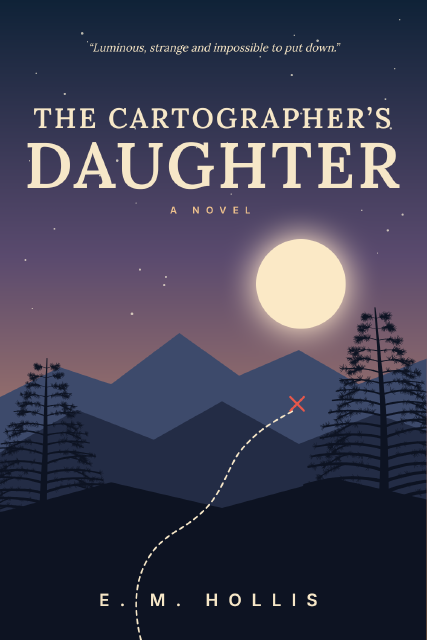

<!-- Generated by tools/gallery.mjs from showcase.yaml and build.json; do not edit. -->
# Novel Book Cover

[Photo](../README.md) › [Print & Stationery](../README.md#print--stationery) · `print` `book-cover` `gradient` `shapes` `render-filters` `layer-styles` `typography`

A literary novel cover with a dusk sky, a glowing moon, layered ridges, silhouetted pines and a dotted map route.



| | |
|---|---|
| Document | [novel-book-cover.psd](novel-book-cover.psd) (1.3 MB) |
| Contents | 1000 × 1500 px; 17 layers; 5 type layers; 7 shape layers; 1 fill layer; 2 groups; 2 styled layers; 1 mask |
| Features | `photo.layer.adjustment`, `photo.path.shapes`, `photo.filter.stylize`, `photo.layer.styles`, `photo.type.point-text`, `photo.layer.manage` |
| Built by | `kition-photo` @ `7abaa42e9a`: 59 commands in 1390 ms |

## About

A 6 × 9 inch front cover at 1000 × 1500. The dusk is a gradient fill layer; the stars are one
shape layer of combined dots, and the moon has an Outer Glow. Three ridge paths step from blue to
black, the pines come from Render > Tree and are turned into silhouettes with a Color Overlay,
and the cartographer's route is an open path with a dashed stroke ending in an X.

## Checks

- `inspect.layers`: `{"count":9}`
- `inspect.layers.0`: `{"name":"Cover Type","kind":"Group","children":{"count":5,"any":{"name":"Title Line 2","text":{"text":"DAUGHTER","font":"Lora"}}}}`
- `inspect.layers.2`: `{"name":"Route","kind":"Shape","shape":{"fill":null,"stroke":{"fill":"#f6e7c8","dashes":[2.5,2.5],"cap":"round"}}}`
- `inspect.layers.3`: `{"name":"Pines","kind":"Pixel","effects":{"items":{"any":{"key":"colorOverlay"}}}}`
- `inspect.layers.4`: `{"name":"Landscape","kind":"Group","children":{"count":3}}`
- `inspect.layers.5`: `{"name":"Moon","effects":{"items":{"any":{"key":"outerGlow"}}}}`
- `inspect.layers.6`: `{"name":"Stars","opacity":{"approx":0.7,"tol":0.01},"shape":{"fill":"#fff6dc"}}`
- `inspect.layers.7`: `{"name":"Dusk","kind":"Fill","fillContent":{"gradient":{"stops":{"count":3}}}}`
- `inspect.layers.7.fillContent.gradient.stops.1`: `[{"approx":0.6,"tol":0.001},"#5a4a6e"]`
- diagnostics: none (the kit's check finds nothing wrong)
- the saved document opens again; the thumbnail matches `thumb.png` within the `render` tolerance

## Steps

<details><summary>59 commands (from <a href="showcase.yaml">showcase.yaml</a>)</summary>

```yaml
- command: layer.newFillLayer.gradient
  params:
    from: "#f0a768"
    to: "#0f2237"
    angle: 90
    style: linear
  as: sky
- command: layer.setProps
  params:
    layer: $sky.layer
    name: Dusk
- command: gradient.fill.stop
  params:
    layer: $sky.layer
    action: add
    location: 0.6
    color: "#5a4a6e"
- command: shape.create
  params:
    kind: ellipse
    rect:
      - 67
      - 375
      - 3
      - 3
    fill: "#fff6dc"
    name: Stars
  as: stars
- command: shape.create
  params:
    kind: ellipse
    rect:
      - 382
      - 665
      - 5
      - 5
    addTo: $stars.layer
- command: shape.create
  params:
    kind: ellipse
    rect:
      - 540
      - 453
      - 3
      - 3
    addTo: $stars.layer
- command: shape.create
  params:
    kind: ellipse
    rect:
      - 713
      - 334
      - 3
      - 3
    addTo: $stars.layer
- command: shape.create
  params:
    kind: ellipse
    rect:
      - 883
      - 591
      - 3
      - 3
    addTo: $stars.layer
- command: shape.create
  params:
    kind: ellipse
    rect:
      - 741
      - 92
      - 6
      - 6
    addTo: $stars.layer
- command: shape.create
  params:
    kind: ellipse
    rect:
      - 608
      - 131
      - 3
      - 3
    addTo: $stars.layer
- command: shape.create
  params:
    kind: ellipse
    rect:
      - 935
      - 44
      - 3
      - 3
    addTo: $stars.layer
- command: shape.create
  params:
    kind: ellipse
    rect:
      - 923
      - 159
      - 3
      - 3
    addTo: $stars.layer
- command: shape.create
  params:
    kind: ellipse
    rect:
      - 306
      - 732
      - 6
      - 6
    addTo: $stars.layer
- command: shape.create
  params:
    kind: ellipse
    rect:
      - 846
      - 491
      - 3
      - 3
    addTo: $stars.layer
- command: shape.create
  params:
    kind: ellipse
    rect:
      - 906
      - 537
      - 5
      - 5
    addTo: $stars.layer
- command: shape.create
  params:
    kind: ellipse
    rect:
      - 315
      - 300
      - 3
      - 3
    addTo: $stars.layer
- command: shape.create
  params:
    kind: ellipse
    rect:
      - 901
      - 230
      - 4
      - 4
    addTo: $stars.layer
- command: shape.create
  params:
    kind: ellipse
    rect:
      - 317
      - 474
      - 3
      - 3
    addTo: $stars.layer
- command: shape.create
  params:
    kind: ellipse
    rect:
      - 325
      - 629
      - 5
      - 5
    addTo: $stars.layer
- command: shape.create
  params:
    kind: ellipse
    rect:
      - 681
      - 173
      - 5
      - 5
    addTo: $stars.layer
- command: shape.create
  params:
    kind: ellipse
    rect:
      - 688
      - 81
      - 3
      - 3
    addTo: $stars.layer
- command: shape.create
  params:
    kind: ellipse
    rect:
      - 913
      - 298
      - 5
      - 5
    addTo: $stars.layer
- command: shape.create
  params:
    kind: ellipse
    rect:
      - 57
      - 607
      - 4
      - 4
    addTo: $stars.layer
- command: shape.create
  params:
    kind: ellipse
    rect:
      - 386
      - 646
      - 5
      - 5
    addTo: $stars.layer
- command: shape.create
  params:
    kind: ellipse
    rect:
      - 83
      - 170
      - 3
      - 3
    addTo: $stars.layer
- command: shape.create
  params:
    kind: ellipse
    rect:
      - 149
      - 217
      - 5
      - 5
    addTo: $stars.layer
- command: shape.create
  params:
    kind: ellipse
    rect:
      - 357
      - 295
      - 6
      - 6
    addTo: $stars.layer
- command: shape.create
  params:
    kind: ellipse
    rect:
      - 271
      - 373
      - 6
      - 6
    addTo: $stars.layer
- command: shape.create
  params:
    kind: ellipse
    rect:
      - 74
      - 721
      - 3
      - 3
    addTo: $stars.layer
- command: shape.create
  params:
    kind: ellipse
    rect:
      - 232
      - 409
      - 4
      - 4
    addTo: $stars.layer
- command: shape.create
  params:
    kind: ellipse
    rect:
      - 885
      - 285
      - 6
      - 6
    addTo: $stars.layer
- command: shape.create
  params:
    kind: ellipse
    rect:
      - 125
      - 534
      - 4
      - 4
    addTo: $stars.layer
- command: shape.create
  params:
    kind: ellipse
    rect:
      - 203
      - 96
      - 3
      - 3
    addTo: $stars.layer
- command: shape.create
  params:
    kind: ellipse
    rect:
      - 703
      - 263
      - 5
      - 5
    addTo: $stars.layer
- command: shape.create
  params:
    kind: ellipse
    rect:
      - 189
      - 75
      - 6
      - 6
    addTo: $stars.layer
- command: shape.create
  params:
    kind: ellipse
    rect:
      - 531
      - 332
      - 3
      - 3
    addTo: $stars.layer
- command: shape.create
  params:
    kind: ellipse
    rect:
      - 721
      - 288
      - 4
      - 4
    addTo: $stars.layer
- command: shape.create
  params:
    kind: ellipse
    rect:
      - 459
      - 344
      - 3
      - 3
    addTo: $stars.layer
- command: shape.create
  params:
    kind: ellipse
    rect:
      - 941
      - 500
      - 5
      - 5
    addTo: $stars.layer
- command: layer.setProps
  params:
    layer: $stars.layer
    opacity: 0.7
- command: shape.create
  params:
    kind: ellipse
    rect:
      - 600
      - 560
      - 210
      - 210
    fill: "#fbe9c6"
    name: Moon
  as: moon
- command: layer.layerStyle.outerGlow
  params:
    layer: $moon.layer
    color: "#ffd9a0"
    opacity: 60
    size: 90
    spread: 2
- command: layer.new.group
  params:
    name: Landscape
  as: land
- command: shape.create
  params:
    kind: path
    path:
      subpaths:
        - knots:
            - - 0
              - 930
            - - 140
              - 860
            - - 260
              - 900
            - - 420
              - 780
            - - 560
              - 880
            - - 700
              - 820
            - - 840
              - 900
            - - 1000
              - 840
            - - 1000
              - 1500
            - - 0
              - 1500
    fill: "#3d4a6b"
    name: Far Ridge
  as: r1
- command: shape.create
  params:
    kind: path
    path:
      subpaths:
        - knots:
            - - 0
              - 1060
            - - 180
              - 960
            - - 360
              - 1030
            - - 520
              - 940
            - - 700
              - 1040
            - - 880
              - 970
            - - 1000
              - 1010
            - - 1000
              - 1500
            - - 0
              - 1500
    fill: "#232c45"
    name: Mid Ridge
  as: r2
- command: shape.create
  params:
    kind: path
    path:
      subpaths:
        - knots:
            - - 0
              - 1200
            - - 260
              - 1130
            - - 520
              - 1190
            - - 780
              - 1120
            - - 1000
              - 1170
            - - 1000
              - 1500
            - - 0
              - 1500
    fill: "#0d1322"
    name: Near Ridge
  as: r3
- command: layer.new.layer
  params:
    name: Pines
  as: pines
- command: layer.moveTo
  params:
    layer: $pines.layer
    target: $land.layer
    position: above
- command: filter.render.tree
  params:
    baseTreeType: 3
    x: 0.1
    y: 0.86
    size: 0.3
    seed: 2
- command: filter.render.tree
  params:
    baseTreeType: 3
    x: 0.9
    y: 0.84
    size: 0.36
    seed: 4
- command: layer.layerStyle.colorOverlay
  params:
    layer: $pines.layer
    color: "#0d1322"
- command: shape.create
  params:
    kind: path
    path:
      subpaths:
        - closed: false
          knots:
            - anchor:
                - 330
                - 1500
              in:
                - 330
                - 1500
              out:
                - 300
                - 1380
            - anchor:
                - 420
                - 1240
              in:
                - 330
                - 1290
              out:
                - 520
                - 1180
            - anchor:
                - 560
                - 1060
              in:
                - 520
                - 1120
              out:
                - 610
                - 1000
            - anchor:
                - 690
                - 960
              in:
                - 640
                - 990
              out:
                - 690
                - 960
    fill: null
    stroke:
      width: 4
      color: "#f6e7c8"
      dashes:
        - 2.5
        - 2.5
      cap: round
    name: Route
  as: route
- command: shape.create
  params:
    kind: path
    path:
      subpaths:
        - closed: false
          knots:
            - - 680
              - 930
            - - 712
              - 962
        - closed: false
          knots:
            - - 712
              - 930
            - - 680
              - 962
    fill: null
    stroke:
      width: 5
      color: "#e8574a"
      cap: round
    name: X Mark
  as: xmark
- command: layer.new.group
  params:
    name: Cover Type
  as: covertype
- command: type.create
  params:
    x: 500
    y: 120
    text: “Luminous, strange and impossible to put down.”
    font: Lora
    italic: true
    size: 26
    color: "#f6e7c8"
    align: center
    name: Blurb
  as: c1
- command: type.create
  params:
    x: 500
    y: 300
    text: THE CARTOGRAPHER’S
    font: Lora
    weight: 600
    size: 66
    tracking: 80
    color: "#f6e7c8"
    align: center
    name: Title Line 1
  as: c2
- command: type.create
  params:
    x: 500
    y: 440
    text: DAUGHTER
    font: Lora
    weight: 600
    size: 150
    tracking: 40
    color: "#f6e7c8"
    align: center
    name: Title Line 2
  as: c3
- command: type.create
  params:
    x: 500
    y: 500
    text: A NOVEL
    font: Inter
    weight: 600
    size: 22
    tracking: 700
    color: "#f0c38e"
    align: center
    name: Genre
  as: c4
- command: type.create
  params:
    x: 500
    y: 1420
    text: E. M. HOLLIS
    font: Inter
    weight: 600
    size: 40
    tracking: 600
    color: "#f6e7c8"
    align: center
    name: Author
  as: c5
```

</details>
