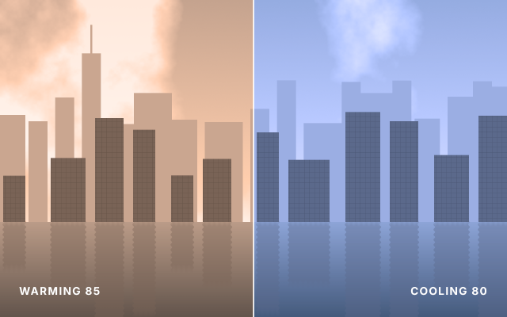

<!-- Generated by tools/gallery.mjs from showcase.yaml and build.json; do not edit. -->
# Warm vs Cool Photo Filter

[Photo](../README.md) › [Adjustments & Color](../README.md#adjustments--color) · `adjustment-layers` `photo-filter` `masks` `before-after` `cityscape`

One riverside skyline shown twice, through a warming 85 filter on the left and a cooling 80 filter on the right.



| | |
|---|---|
| Document | [photo-filter-warm-cool.psd](photo-filter-warm-cool.psd) (6.4 MB) |
| Contents | 1600 × 1000 px; 13 layers; 2 type layers; 4 shape layers; 2 adjustment layers; 2 fill layers; 3 masks |
| Features | `photo.layer.adjustment`, `photo.layer.mask-basics`, `photo.select.make` |
| Built by | `kition-photo` @ `7abaa42e9a`: 60 commands in 1861 ms |

## About

A neutral midday skyline (rendered clouds, one combined shape for the buildings with a clipped
window pattern, and a blurred, flipped reflection in the river) sits under two Photo Filter
adjustment layers. Each was made with half the canvas selected, so its layer mask limits it to
that half: Warming (85) at 70 % density gives the left a golden-hour cast, Cooling (80) at 60 %
gives the right a crisp blue morning. Both keep luminosity, so only the color temperature changes.

## Checks

- `inspect.layers`: `{"count":13}`
- `inspect.layers.3`: `{"name":"Cooling 80","kind":"Adjustment","adjustmentKind":"photoFilter","hasMask":true,"adjustmentParams":{"color":"#006dff","density":60}}`
- `inspect.layers.4`: `{"name":"Warming 85","kind":"Adjustment","adjustmentKind":"photoFilter","hasMask":true,"adjustmentParams":{"color":"#ec8a00","density":70}}`
- `inspect.layers.5`: `{"name":"Reflection","kind":"Pixel","opacity":{"approx":0.4,"tol":0.01}}`
- `inspect.layers.7`: `{"name":"Windows","kind":"Fill","clipped":true,"blend":"Multiply"}`
- `results.warmSky.2`: `{"max":0.9}`
- `results.coolSky.0`: `{"max":0.85}`
- `results.coolSky.2`: `{"min":0.95}`
- diagnostics: none (the kit's check finds nothing wrong)
- the saved document opens again; the thumbnail matches `thumb.png` within the `render` tolerance

## Steps

<details><summary>60 commands (from <a href="showcase.yaml">showcase.yaml</a>)</summary>

```yaml
- command: gradient.fill.create
  params:
    from:
      - 0
      - 0
    to:
      - 0
      - 700
    stops:
      - - 0
        - "#a3adb3"
      - - 1
        - "#e6e4de"
  as: sky
- command: layer.renameLayer
  params:
    layer: $sky.layer
    name: Sky
- command: layer.new.layer
  params:
    name: Clouds
  as: clouds
- command: tools.setColors
  params:
    foreground: "#000000"
    background: "#ffffff"
- command: filter.render.clouds
  params:
    seed: 31
- command: image.adjustments.levels
  params:
    inBlack: 130
    inWhite: 245
- command: layer.setProps
  params:
    layer: $clouds.layer
    blend: Screen
    opacity: 0.8
- command: shape.create
  params:
    kind: rect
    rect:
      - -20
      - 362
      - 100
      - 338
    fill: "#a9b0b4"
    name: Back Skyline
  as: back
- command: shape.create
  params:
    kind: rect
    rect:
      - 90
      - 382
      - 60
      - 318
    fill: "#a9b0b4"
    addTo: $back.layer
    op: combine
- command: shape.create
  params:
    kind: rect
    rect:
      - 174
      - 307
      - 60
      - 393
    fill: "#a9b0b4"
    addTo: $back.layer
    op: combine
- command: shape.create
  params:
    kind: rect
    rect:
      - 258
      - 168
      - 60
      - 532
    fill: "#a9b0b4"
    addTo: $back.layer
    op: combine
- command: shape.create
  params:
    kind: rect
    rect:
      - 342
      - 391
      - 80
      - 309
    fill: "#a9b0b4"
    addTo: $back.layer
    op: combine
- command: shape.create
  params:
    kind: rect
    rect:
      - 422
      - 293
      - 120
      - 407
    fill: "#a9b0b4"
    addTo: $back.layer
    op: combine
- command: shape.create
  params:
    kind: rect
    rect:
      - 542
      - 377
      - 80
      - 323
    fill: "#a9b0b4"
    addTo: $back.layer
    op: combine
- command: shape.create
  params:
    kind: rect
    rect:
      - 646
      - 385
      - 120
      - 315
    fill: "#a9b0b4"
    addTo: $back.layer
    op: combine
- command: shape.create
  params:
    kind: rect
    rect:
      - 790
      - 343
      - 60
      - 357
    fill: "#a9b0b4"
    addTo: $back.layer
    op: combine
- command: shape.create
  params:
    kind: rect
    rect:
      - 874
      - 253
      - 60
      - 447
    fill: "#a9b0b4"
    addTo: $back.layer
    op: combine
- command: shape.create
  params:
    kind: rect
    rect:
      - 958
      - 388
      - 120
      - 312
    fill: "#a9b0b4"
    addTo: $back.layer
    op: combine
- command: shape.create
  params:
    kind: rect
    rect:
      - 1078
      - 258
      - 60
      - 442
    fill: "#a9b0b4"
    addTo: $back.layer
    op: combine
- command: shape.create
  params:
    kind: rect
    rect:
      - 1138
      - 293
      - 100
      - 407
    fill: "#a9b0b4"
    addTo: $back.layer
    op: combine
- command: shape.create
  params:
    kind: rect
    rect:
      - 1238
      - 254
      - 60
      - 446
    fill: "#a9b0b4"
    addTo: $back.layer
    op: combine
- command: shape.create
  params:
    kind: rect
    rect:
      - 1308
      - 374
      - 80
      - 326
    fill: "#a9b0b4"
    addTo: $back.layer
    op: combine
- command: shape.create
  params:
    kind: rect
    rect:
      - 1412
      - 305
      - 80
      - 395
    fill: "#a9b0b4"
    addTo: $back.layer
    op: combine
- command: shape.create
  params:
    kind: rect
    rect:
      - 1492
      - 256
      - 60
      - 444
    fill: "#a9b0b4"
    addTo: $back.layer
    op: combine
- command: shape.create
  params:
    kind: rect
    rect:
      - 1552
      - 273
      - 80
      - 427
    fill: "#a9b0b4"
    addTo: $back.layer
    op: combine
- command: shape.create
  params:
    kind: rect
    rect:
      - 285
      - 78
      - 6
      - 90
    fill: "#a9b0b4"
    addTo: $back.layer
    op: combine
- command: shape.create
  params:
    kind: rect
    rect:
      - 10
      - 554
      - 70
      - 146
    fill: "#646a6e"
    name: Skyline
  as: city
- command: shape.create
  params:
    kind: rect
    rect:
      - 160
      - 498
      - 110
      - 202
    fill: "#646a6e"
    addTo: $city.layer
    op: combine
- command: shape.create
  params:
    kind: rect
    rect:
      - 300
      - 372
      - 90
      - 328
    fill: "#646a6e"
    addTo: $city.layer
    op: combine
- command: shape.create
  params:
    kind: rect
    rect:
      - 420
      - 409
      - 70
      - 291
    fill: "#646a6e"
    addTo: $city.layer
    op: combine
- command: shape.create
  params:
    kind: rect
    rect:
      - 540
      - 553
      - 70
      - 147
    fill: "#646a6e"
    addTo: $city.layer
    op: combine
- command: shape.create
  params:
    kind: rect
    rect:
      - 640
      - 501
      - 90
      - 199
    fill: "#646a6e"
    addTo: $city.layer
    op: combine
- command: shape.create
  params:
    kind: rect
    rect:
      - 810
      - 417
      - 70
      - 283
    fill: "#646a6e"
    addTo: $city.layer
    op: combine
- command: shape.create
  params:
    kind: rect
    rect:
      - 910
      - 504
      - 130
      - 196
    fill: "#646a6e"
    addTo: $city.layer
    op: combine
- command: shape.create
  params:
    kind: rect
    rect:
      - 1090
      - 353
      - 110
      - 347
    fill: "#646a6e"
    addTo: $city.layer
    op: combine
- command: shape.create
  params:
    kind: rect
    rect:
      - 1230
      - 382
      - 90
      - 318
    fill: "#646a6e"
    addTo: $city.layer
    op: combine
- command: shape.create
  params:
    kind: rect
    rect:
      - 1370
      - 489
      - 110
      - 211
    fill: "#646a6e"
    addTo: $city.layer
    op: combine
- command: shape.create
  params:
    kind: rect
    rect:
      - 1510
      - 365
      - 90
      - 335
    fill: "#646a6e"
    addTo: $city.layer
    op: combine
- command: pattern.presets.apply
  params:
    pattern: Grid
    scale: 100
  as: windows
- command: layer.setProps
  params:
    layer: $windows.layer
    name: Windows
    blend: Multiply
    opacity: 0.35
    clipped: true
- command: shape.create
  params:
    kind: rect
    rect:
      - 0
      - 700
      - 1600
      - 300
    fill:
      gradient:
        stops:
          - - 0
            - "#9aa5ab"
          - - 1
            - "#4d5a62"
        angle: -90
    name: River
  as: river
- command: layer.duplicate
  params:
    layer: $city.layer
    name: Reflection
  as: refl
- command: shape.rasterize
  params:
    layer: $refl.layer
- command: edit.transform
  params:
    layer: $refl.layer
    matrix:
      - 1
      - 0
      - 0
      - -1
      - 0
      - 1400
- command: layer.moveTo
  params:
    layer: $refl.layer
    target: $river.layer
    position: above
- command: layer.setProps
  params:
    layer: $refl.layer
    opacity: 0.4
- command: filter.blur.motionBlur
  params:
    angle: 90
    distance: 24
- command: filter.distort.ripple
  params:
    amount: 120
    size: medium
- command: select.rect
  params:
    x: 0
    y: 0
    width: 800
    height: 1000
- command: layer.newAdjustmentLayer.photoFilter
  params:
    filter: warming85
    density: 70
    preserveLuminosity: true
  as: warm
- command: layer.renameLayer
  params:
    layer: $warm.layer
    name: Warming 85
- command: select.rect
  params:
    x: 800
    y: 0
    width: 800
    height: 1000
- command: layer.newAdjustmentLayer.photoFilter
  params:
    filter: cooling80
    density: 60
    preserveLuminosity: true
  as: cool
- command: layer.renameLayer
  params:
    layer: $cool.layer
    name: Cooling 80
- command: select.deselect
- command: shape.create
  params:
    kind: rect
    rect:
      - 798
      - 0
      - 4
      - 1000
    fill: "#ffffff"
    name: Divider
- command: type.create
  params:
    x: 60
    y: 930
    text: WARMING 85
    font: Inter
    size: 34
    weight: 700
    tracking: 100
    color: "#ffffff"
    name: Warm Label
- command: type.create
  params:
    x: 1540
    y: 930
    text: COOLING 80
    font: Inter
    size: 34
    weight: 700
    tracking: 100
    color: "#ffffff"
    align: right
    name: Cool Label
- command: document.sampleColor
  params:
    x: 400
    y: 120
    size: 11
  as: warmSky
- command: document.sampleColor
  params:
    x: 1200
    y: 120
    size: 11
  as: coolSky
```

</details>
