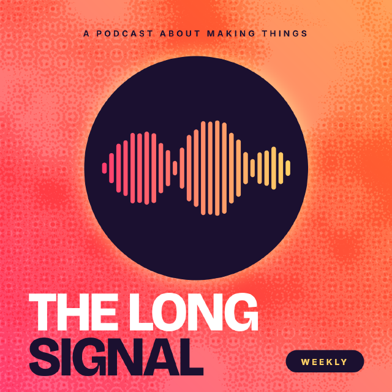

<!-- Generated by tools/gallery.mjs from showcase.yaml and build.json; do not edit. -->
# Podcast Cover Art

[Photo](../README.md) › [Social Media](../README.md#social-media) · `social` `podcast` `cover-art` `gradient` `shapes` `halftone` `layer-styles`

Square podcast artwork with a halftone-textured gradient, a dark disc, a gradient waveform and a stacked bold title.



| | |
|---|---|
| Document | [podcast-cover-art.psd](podcast-cover-art.psd) (4.6 MB) |
| Contents | 1400 × 1400 px; 10 layers; 4 type layers; 3 shape layers; 1 fill layer; 2 styled layers; 1 mask |
| Features | `photo.layer.adjustment`, `photo.path.shapes`, `photo.layer.styles`, `photo.filter.stylize`, `photo.type.point-text` |
| Built by | `kition-photo` @ `7abaa42e9a`: 43 commands in 2232 ms |

## About

Cover art at 1400 × 1400, the smallest size podcast directories accept. A Color Halftone of
rendered clouds, set to Soft Light, gives the gradient fill a printed texture. The waveform is
27 rounded rectangles combined into one shape layer with a Gradient Overlay, sitting on a dark
disc with an Outer Glow; the title words stack in Bricolage Grotesque.

## Checks

- `inspect.layers`: `{"count":10}`
- `inspect.layers.5`: `{"name":"Waveform","kind":"Shape","effects":{"items":{"any":{"key":"gradientOverlay"}}}}`
- `inspect.layers.6`: `{"name":"Disc","effects":{"items":{"any":{"key":"outerGlow"}}}}`
- `inspect.layers.7`: `{"name":"Halftone","kind":"Pixel","blend":"Soft Light","opacity":{"approx":0.45,"tol":0.01}}`
- `inspect.layers.4`: `{"name":"Kicker","kind":"Type"}`
- `results.wavelast.path.subpaths`: `{"count":27}`
- diagnostics: none (the kit's check finds nothing wrong)
- the saved document opens again; the thumbnail matches `thumb.png` within the `render` tolerance

## Steps

<details><summary>43 commands (from <a href="showcase.yaml">showcase.yaml</a>)</summary>

```yaml
- command: layer.newFillLayer.gradient
  params:
    from: "#ff3d6e"
    to: "#ff8a3d"
    angle: 45
    style: linear
  as: bg
- command: layer.setProps
  params:
    layer: $bg.layer
    name: Gradient
- command: tools.setColors
  params:
    foreground: "#000000"
    background: "#ffffff"
- command: layer.new.layer
  params:
    name: Halftone
  as: halftone
- command: filter.render.clouds
  params:
    seed: 21
- command: filter.pixelate.colorHalftone
  params:
    maxRadius: 14
- command: image.adjustments.desaturate
- command: layer.setProps
  params:
    layer: $halftone.layer
    blend: Soft Light
    opacity: 0.45
- command: shape.create
  params:
    kind: ellipse
    rect:
      - 300
      - 200
      - 800
      - 800
    fill: "#1b1030"
    name: Disc
  as: disc
- command: layer.layerStyle.outerGlow
  params:
    layer: $disc.layer
    color: "#ffb347"
    opacity: 45
    size: 80
    spread: 0
- command: shape.create
  params:
    kind: roundedRect
    rect:
      - 364.4
      - 580
      - 16
      - 40
    radii: 8
    fill: "#ffd166"
    name: Waveform
  as: wave
- command: shape.create
  params:
    kind: roundedRect
    rect:
      - 389.6
      - 546
      - 16
      - 108
    radii: 8
    addTo: $wave.layer
- command: shape.create
  params:
    kind: roundedRect
    rect:
      - 414.8
      - 513
      - 16
      - 174
    radii: 8
    addTo: $wave.layer
- command: shape.create
  params:
    kind: roundedRect
    rect:
      - 440
      - 500.5
      - 16
      - 199
    radii: 8
    addTo: $wave.layer
- command: shape.create
  params:
    kind: roundedRect
    rect:
      - 465.2
      - 474
      - 16
      - 252
    radii: 8
    addTo: $wave.layer
- command: shape.create
  params:
    kind: roundedRect
    rect:
      - 490.4
      - 475.5
      - 16
      - 249
    radii: 8
    addTo: $wave.layer
- command: shape.create
  params:
    kind: roundedRect
    rect:
      - 515.6
      - 469.5
      - 16
      - 261
    radii: 8
    addTo: $wave.layer
- command: shape.create
  params:
    kind: roundedRect
    rect:
      - 540.8
      - 475
      - 16
      - 250
    radii: 8
    addTo: $wave.layer
- command: shape.create
  params:
    kind: roundedRect
    rect:
      - 566
      - 510
      - 16
      - 180
    radii: 8
    addTo: $wave.layer
- command: shape.create
  params:
    kind: roundedRect
    rect:
      - 591.2
      - 535.5
      - 16
      - 129
    radii: 8
    addTo: $wave.layer
- command: shape.create
  params:
    kind: roundedRect
    rect:
      - 616.4
      - 574.5
      - 16
      - 51
    radii: 8
    addTo: $wave.layer
- command: shape.create
  params:
    kind: roundedRect
    rect:
      - 641.6
      - 527
      - 16
      - 146
    radii: 8
    addTo: $wave.layer
- command: shape.create
  params:
    kind: roundedRect
    rect:
      - 666.8
      - 481.5
      - 16
      - 237
    radii: 8
    addTo: $wave.layer
- command: shape.create
  params:
    kind: roundedRect
    rect:
      - 692
      - 461.5
      - 16
      - 277
    radii: 8
    addTo: $wave.layer
- command: shape.create
  params:
    kind: roundedRect
    rect:
      - 717.2
      - 432.5
      - 16
      - 335
    radii: 8
    addTo: $wave.layer
- command: shape.create
  params:
    kind: roundedRect
    rect:
      - 742.4
      - 434
      - 16
      - 332
    radii: 8
    addTo: $wave.layer
- command: shape.create
  params:
    kind: roundedRect
    rect:
      - 767.6
      - 429.5
      - 16
      - 341
    radii: 8
    addTo: $wave.layer
- command: shape.create
  params:
    kind: roundedRect
    rect:
      - 792.8
      - 437
      - 16
      - 326
    radii: 8
    addTo: $wave.layer
- command: shape.create
  params:
    kind: roundedRect
    rect:
      - 818
      - 473.5
      - 16
      - 253
    radii: 8
    addTo: $wave.layer
- command: shape.create
  params:
    kind: roundedRect
    rect:
      - 843.2
      - 497.5
      - 16
      - 205
    radii: 8
    addTo: $wave.layer
- command: shape.create
  params:
    kind: roundedRect
    rect:
      - 868.4
      - 542.5
      - 16
      - 115
    radii: 8
    addTo: $wave.layer
- command: shape.create
  params:
    kind: roundedRect
    rect:
      - 893.6
      - 567.5
      - 16
      - 65
    radii: 8
    addTo: $wave.layer
- command: shape.create
  params:
    kind: roundedRect
    rect:
      - 918.8
      - 543.5
      - 16
      - 113
    radii: 8
    addTo: $wave.layer
- command: shape.create
  params:
    kind: roundedRect
    rect:
      - 944
      - 537
      - 16
      - 126
    radii: 8
    addTo: $wave.layer
- command: shape.create
  params:
    kind: roundedRect
    rect:
      - 969.2
      - 523.5
      - 16
      - 153
    radii: 8
    addTo: $wave.layer
- command: shape.create
  params:
    kind: roundedRect
    rect:
      - 994.4
      - 543
      - 16
      - 114
    radii: 8
    addTo: $wave.layer
- command: shape.create
  params:
    kind: roundedRect
    rect:
      - 1019.6
      - 572.5
      - 16
      - 55
    radii: 8
    addTo: $wave.layer
  as: wavelast
- command: layer.layerStyle.gradientOverlay
  params:
    layer: $wave.layer
    from: "#ff3d6e"
    to: "#ffd166"
    angle: 0
- command: type.create
  params:
    x: 700
    y: 130
    text: A PODCAST ABOUT MAKING THINGS
    font: Inter
    weight: 700
    size: 30
    tracking: 300
    color: "#1b1030"
    align: center
    name: Kicker
- command: type.create
  params:
    x: 100
    y: 1180
    text: THE LONG
    font: Bricolage Grotesque
    weight: 800
    size: 200
    tracking: -30
    color: "#ffffff"
    name: Title Line 1
  as: t1
- command: type.create
  params:
    x: 100
    y: 1340
    text: SIGNAL
    font: Bricolage Grotesque
    weight: 800
    size: 200
    tracking: -30
    color: "#1b1030"
    name: Title Line 2
  as: t2
- command: shape.create
  params:
    kind: roundedRect
    rect:
      - 1020
      - 1250
      - 280
      - 80
    radii: 40
    fill: "#1b1030"
    name: Episode Pill
- command: type.create
  params:
    x: 1160
    y: 1303
    text: WEEKLY
    font: Inter
    weight: 800
    size: 30
    tracking: 250
    color: "#ffd166"
    align: center
    name: Episode Label
```

</details>
