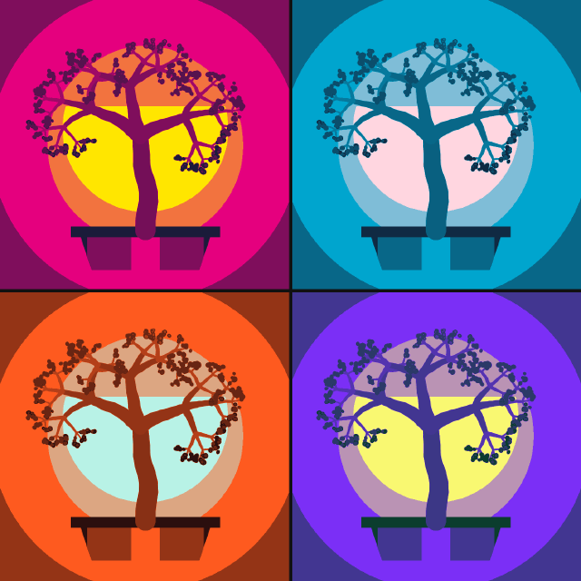

<!-- Generated by tools/gallery.mjs from showcase.yaml and build.json; do not edit. -->
# Pop Art Posterize Quad

[Photo](../README.md) › [Adjustments & Color](../README.md#adjustments--color) · `adjustment-layers` `posterize` `gradient-map` `smart-objects` `masks`

A bonsai study repeated four times as smart objects, posterized and recolored per panel with masked Gradient Map layers.



| | |
|---|---|
| Document | [pop-art-posterize-quad.psd](pop-art-posterize-quad.psd) (5.0 MB) |
| Contents | 1400 × 1400 px; 11 layers; 1 shape layer; 5 adjustment layers; 4 smart objects; 5 masks |
| Features | `photo.layer.adjustment`, `photo.layer.smart-objects`, `photo.layer.mask-basics` |
| Built by | `kition-photo` @ `7abaa42e9a`: 36 commands in 803 ms |

## About

The motif is painted once in the top-left panel: a radial glow, a striped sun, a rendered bonsai
and its pot. Converted to a smart object, it is duplicated and moved into the other three panels. One Posterize layer flattens the tones into bands,
and four Gradient Map layers, each masked to its panel by a selection, give each copy its own
three-ink palette, screen-print style.

## Checks

- `inspect.layers`: `{"count":11,"all":{"kind":{"oneOf":["Shape","Adjustment","Smart Object","Pixel"]}}}`
- `inspect.layers.1`: `{"name":"Violet & Lemon","kind":"Adjustment","adjustmentKind":"gradientMap","hasMask":true}`
- `inspect.layers.4`: `{"name":"Magenta & Yellow","kind":"Adjustment","adjustmentKind":"gradientMap","adjustmentParams":{"stops":[[0,"#1b1b3a"],[0.5,"#e6007e"],[1,"#ffe600"]]}}`
- `inspect.layers.5`: `{"name":"Posterize","kind":"Adjustment","adjustmentKind":"posterize","adjustmentParams":{"levels":5}}`
- `inspect.layers.6`: `{"name":"Motif TR","kind":"Smart Object","bounds":[700,0,700,700]}`
- `inspect.layers.9`: `{"name":"Motif TL","kind":"Smart Object","bounds":[0,0,700,700]}`
- `results.sunTL.0`: `{"approx":1,"tol":0.01}`
- `results.sunTL.1`: `{"approx":0.902,"tol":0.01}`
- `results.sunTL.2`: `{"max":0.01}`
- `results.sunTR.0`: `{"min":0.95}`
- `results.sunTR.2`: `{"min":0.8}`
- diagnostics: none (the kit's check finds nothing wrong)
- the saved document opens again; the thumbnail matches `thumb.png` within the `render` tolerance

## Steps

<details><summary>36 commands (from <a href="showcase.yaml">showcase.yaml</a>)</summary>

```yaml
- command: shape.create
  params:
    kind: rect
    rect:
      - 0
      - 0
      - 700
      - 700
    fill:
      gradient:
        stops:
          - - 0
            - "#f2f2f2"
          - - 1
            - "#3a3a3a"
        style: radial
        scale: 140
    name: Glow
- command: shape.create
  params:
    kind: ellipse
    rect:
      - 150
      - 110
      - 400
      - 400
    fill:
      gradient:
        stops:
          - - 0
            - "#ffffff"
          - - 1
            - "#b0b0b0"
        angle: 90
    name: Sun
- command: shape.create
  params:
    kind: path
    name: Pot
    fill:
      gradient:
        stops:
          - - 0
            - "#2a2a2a"
          - - 0.5
            - "#777777"
          - - 1
            - "#2a2a2a"
        angle: 0
    path:
      subpaths:
        - knots:
            - - 190
              - 560
            - - 510
              - 560
            - - 480
              - 650
            - - 220
              - 650
- command: shape.create
  params:
    kind: rect
    rect:
      - 170
      - 545
      - 360
      - 26
    fill: "#1e1e1e"
    name: Pot Rim
- command: layer.new.layer
  params:
    name: Bonsai
  as: bonsai
- command: filter.render.tree
  params:
    baseTreeType: 20
    x: 0.25
    y: 0.395
    size: 0.36
    seed: 6
- command: select.allLayers
- command: layer.smartObjects.convertToSmartObject
  as: motif
- command: layer.renameLayer
  params:
    layer: $motif.layer
    name: Motif TL
- command: layer.duplicate
  params:
    layer: $motif.layer
    name: Motif TR
  as: tr
- command: edit.transform
  params:
    layer: $tr.layer
    matrix:
      - 1
      - 0
      - 0
      - 1
      - 700
      - 0
- command: layer.duplicate
  params:
    layer: $motif.layer
    name: Motif BL
  as: bl
- command: edit.transform
  params:
    layer: $bl.layer
    matrix:
      - 1
      - 0
      - 0
      - 1
      - 0
      - 700
- command: layer.duplicate
  params:
    layer: $motif.layer
    name: Motif BR
  as: br
- command: edit.transform
  params:
    layer: $br.layer
    matrix:
      - 1
      - 0
      - 0
      - 1
      - 700
      - 700
- command: layer.selectTop
- command: layer.newAdjustmentLayer.posterize
  params:
    levels: 5
  as: poster
- command: layer.renameLayer
  params:
    layer: $poster.layer
    name: Posterize
- command: select.rect
  params:
    x: 0
    y: 0
    width: 700
    height: 700
- command: layer.newAdjustmentLayer.gradientMap
  params:
    stops:
      - - 0
        - "#1b1b3a"
      - - 0.5
        - "#e6007e"
      - - 1
        - "#ffe600"
  as: mapTL
- command: layer.renameLayer
  params:
    layer: $mapTL.layer
    name: Magenta & Yellow
- command: select.rect
  params:
    x: 700
    y: 0
    width: 700
    height: 700
- command: layer.newAdjustmentLayer.gradientMap
  params:
    stops:
      - - 0
        - "#102a43"
      - - 0.5
        - "#00a5cf"
      - - 1
        - "#ffd6e0"
  as: mapTR
- command: layer.renameLayer
  params:
    layer: $mapTR.layer
    name: Cyan & Blush
- command: select.rect
  params:
    x: 0
    y: 700
    width: 700
    height: 700
- command: layer.newAdjustmentLayer.gradientMap
  params:
    stops:
      - - 0
        - "#2b0f0e"
      - - 0.5
        - "#ff5a1f"
      - - 1
        - "#b8f2e6"
  as: mapBL
- command: layer.renameLayer
  params:
    layer: $mapBL.layer
    name: Orange & Mint
- command: select.rect
  params:
    x: 700
    y: 700
    width: 700
    height: 700
- command: layer.newAdjustmentLayer.gradientMap
  params:
    stops:
      - - 0
        - "#0b3d2e"
      - - 0.5
        - "#7b2ff7"
      - - 1
        - "#f9f871"
  as: mapBR
- command: layer.renameLayer
  params:
    layer: $mapBR.layer
    name: Violet & Lemon
- command: select.deselect
- command: shape.create
  params:
    kind: rect
    rect:
      - 696
      - 0
      - 8
      - 1400
    fill: "#111111"
    name: Gutter V
  as: gutter
- command: shape.create
  params:
    kind: rect
    rect:
      - 0
      - 696
      - 1400
      - 8
    fill: "#111111"
    addTo: $gutter.layer
    op: combine
- command: layer.renameLayer
  params:
    layer: $gutter.layer
    name: Gutters
- command: document.sampleColor
  params:
    x: 240
    y: 450
    size: 5
  as: sunTL
- command: document.sampleColor
  params:
    x: 940
    y: 450
    size: 5
  as: sunTR
```

</details>
