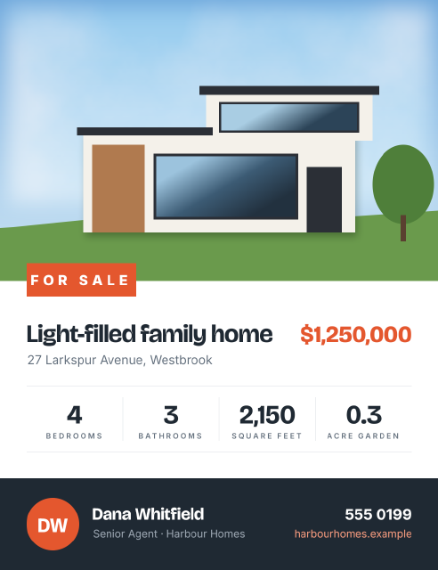

<!-- Generated by tools/gallery.mjs from showcase.yaml and build.json; do not edit. -->
# Real Estate Flyer

[Photo](../README.md) › [Posters & Marketing](../README.md#posters--marketing) · `flyer` `print` `shapes` `render-filters` `gradient` `type` `groups`

A for-sale property flyer with an illustrated modern house hero, a price, a four-figure spec row and an agent contact bar.



| | |
|---|---|
| Document | [real-estate-flyer.psd](real-estate-flyer.psd) (1.8 MB) |
| Contents | 1000 × 1300 px; 38 layers; 17 type layers; 16 shape layers; 3 groups; 1 styled layer |
| Features | `photo.path.shapes`, `photo.filter.stylize`, `photo.select.make`, `photo.layer.manage`, `photo.type.point-text`, `photo.layer.style-basics` |
| Built by | `kition-photo` @ `7abaa42e9a`: 49 commands in 772 ms |

## About

A letter-size flyer at 1000 × 1300. With no photographs, the hero is drawn: a gradient sky rect,
clouds rendered inside a rectangular selection, and a flat-roofed house of live shapes with
gradient-filled glazing, all in a `Hero` group. Below it the listing details use a clear type
hierarchy, the spec row is divided by thin rules, and the agent bar is its own group.

## Checks

- `inspect.layers`: `{"count":9}`
- `inspect.layers.0`: `{"name":"Agent Bar","kind":"Group","children":{"count":7}}`
- `inspect.layers.1`: `{"name":"Specs","kind":"Group","children":{"count":9}}`
- `inspect.layers.1.children.-1`: `{"name":"Spec Rules","shape":{"fill":"#d9dee4"}}`
- `inspect.layers.2`: `{"name":"Price","kind":"Type","text":{"text":"$1,250,000"}}`
- `inspect.layers.-2`: `{"name":"Hero","kind":"Group","children":{"count":13,"any":{"name":"Clouds","kind":"Pixel","blend":"Screen"}}}`
- `inspect.layers.-2.children`: `{"any":{"name":"Living Glazing","shape":{"fill":{"gradient":{"stops":{"count":3}}},"stroke":{"fill":"#2b2f36","align":"inside"}}}}`
- `inspect.layers.-3`: `{"name":"Sale Tag","kind":"Shape","shape":{"fill":"#e4572e"}}`
- diagnostics: none (the kit's check finds nothing wrong)
- the saved document opens again; the thumbnail matches `thumb.png` within the `render` tolerance

## Steps

<details><summary>49 commands (from <a href="showcase.yaml">showcase.yaml</a>)</summary>

```yaml
- command: layer.new.group
  params:
    name: Hero
  as: hero
- command: shape.create
  params:
    kind: rect
    rect:
      - 0
      - 0
      - 1000
      - 640
    fill:
      gradient:
        stops:
          - - 0
            - "#cfe6f5"
          - - 1
            - "#6fa8dc"
        angle: 90
    name: Sky
  as: h1
- command: layer.new.layer
  params:
    name: Clouds
  as: h2
- command: tools.setColors
  params:
    foreground: "#6fa8dc"
    background: "#ffffff"
- command: select.rect
  params:
    x: 0
    y: 0
    width: 1000
    height: 480
    feather: 60
- command: filter.render.clouds
  params:
    seed: 14
- command: select.deselect
- command: layer.setProps
  params:
    layer: $h2.layer
    blend: Screen
    opacity: 0.6
- command: shape.create
  params:
    kind: path
    path:
      subpaths:
        - knots:
            - - 0
              - 520
            - - 300
              - 490
            - - 700
              - 500
            - - 1000
              - 480
            - - 1000
              - 640
            - - 0
              - 640
    fill: "#6a9a4c"
    name: Lawn
  as: h3
- command: shape.create
  params:
    kind: rect
    rect:
      - 190
      - 300
      - 620
      - 230
    fill: "#f4f1ea"
    name: House Body
  as: h4
- command: layer.layerStyle.dropShadow
  params:
    layer: $h4.layer
    color: "#2c3e2a"
    opacity: 35
    distance: 10
    size: 20
    angle: 90
- command: shape.create
  params:
    kind: rect
    rect:
      - 470
      - 210
      - 380
      - 110
    fill: "#f4f1ea"
    name: Upper Floor
  as: h5
- command: shape.create
  params:
    kind: rect
    rect:
      - 455
      - 196
      - 410
      - 20
    fill: "#2b2f36"
    name: Upper Roof
  as: h6
- command: shape.create
  params:
    kind: rect
    rect:
      - 175
      - 290
      - 310
      - 18
    fill: "#2b2f36"
    name: Lower Roof
  as: h7
- command: shape.create
  params:
    kind: rect
    rect:
      - 210
      - 330
      - 120
      - 200
    fill: "#b07a4f"
    name: Cladding
  as: h8
- command: shape.create
  params:
    kind: rect
    rect:
      - 350
      - 350
      - 330
      - 150
    fill:
      gradient:
        stops:
          - - 0
            - "#9cc3dd"
          - - 0.5
            - "#3c5b74"
          - - 1
            - "#22313f"
        angle: -60
    stroke:
      width: 6
      color: "#2b2f36"
      align: inside
    name: Living Glazing
  as: h9
- command: shape.create
  params:
    kind: rect
    rect:
      - 500
      - 232
      - 320
      - 70
    fill:
      gradient:
        stops:
          - - 0
            - "#a9cde3"
          - - 1
            - "#2c4458"
        angle: -60
    stroke:
      width: 5
      color: "#2b2f36"
      align: inside
    name: Upper Glazing
  as: h10
- command: shape.create
  params:
    kind: rect
    rect:
      - 700
      - 380
      - 80
      - 150
    fill: "#2b2f36"
    name: Door
  as: h11
- command: shape.create
  params:
    kind: ellipse
    rect:
      - 850
      - 330
      - 140
      - 180
    fill: "#4f7f3a"
    name: Shrub
  as: h12
- command: shape.create
  params:
    kind: rect
    rect:
      - 914
      - 490
      - 12
      - 60
    fill: "#5a4030"
    name: Shrub Trunk
  as: h13
- command: shape.create
  params:
    kind: rect
    rect:
      - 60
      - 600
      - 250
      - 76
    fill: "#e4572e"
    name: Sale Tag
  as: tag
- command: layer.moveTo
  params:
    layer: $tag.layer
    target: $hero.layer
    position: above
- command: type.create
  params:
    x: 185
    y: 650
    text: FOR SALE
    font: Inter
    weight: 800
    size: 32
    tracking: 300
    color: "#ffffff"
    align: center
    name: Sale Label
- command: type.create
  params:
    x: 60
    y: 780
    text: Light-filled family home
    font: Bricolage Grotesque
    weight: 700
    size: 58
    tracking: -20
    color: "#1f2933"
    name: Headline
- command: type.create
  params:
    x: 62
    y: 830
    text: 27 Larkspur Avenue, Westbrook
    font: Inter
    size: 28
    color: "#616e7c"
    name: Address
- command: type.create
  params:
    x: 940
    y: 780
    text: $$1,250,000
    font: Bricolage Grotesque
    weight: 800
    size: 54
    color: "#e4572e"
    align: right
    name: Price
- command: layer.new.group
  params:
    name: Specs
  as: specs
- command: shape.create
  params:
    kind: line
    from:
      - 60
      - 880
    to:
      - 940
      - 880
    weight: 1
    fill: "#d9dee4"
    name: Spec Rules
  as: sp0
- command: shape.create
  params:
    kind: line
    from:
      - 60
      - 1030
    to:
      - 940
      - 1030
    weight: 1
    addTo: $sp0.layer
- command: shape.create
  params:
    kind: line
    from:
      - 280
      - 905
    to:
      - 280
      - 1005
    weight: 1
    addTo: $sp0.layer
- command: shape.create
  params:
    kind: line
    from:
      - 500
      - 905
    to:
      - 500
      - 1005
    weight: 1
    addTo: $sp0.layer
- command: shape.create
  params:
    kind: line
    from:
      - 720
      - 905
    to:
      - 720
      - 1005
    weight: 1
    addTo: $sp0.layer
- command: type.create
  params:
    x: 170
    y: 965
    text: "4"
    font: Bricolage Grotesque
    weight: 700
    size: 60
    color: "#1f2933"
    align: center
    name: Beds
  as: sp1
- command: type.create
  params:
    x: 170
    y: 1000
    text: BEDROOMS
    font: Inter
    weight: 600
    size: 17
    tracking: 250
    color: "#616e7c"
    align: center
    name: Beds Label
  as: sp2
- command: type.create
  params:
    x: 390
    y: 965
    text: "3"
    font: Bricolage Grotesque
    weight: 700
    size: 60
    color: "#1f2933"
    align: center
    name: Baths
  as: sp3
- command: type.create
  params:
    x: 390
    y: 1000
    text: BATHROOMS
    font: Inter
    weight: 600
    size: 17
    tracking: 250
    color: "#616e7c"
    align: center
    name: Baths Label
  as: sp4
- command: type.create
  params:
    x: 610
    y: 965
    text: 2,150
    font: Bricolage Grotesque
    weight: 700
    size: 60
    color: "#1f2933"
    align: center
    name: Area
  as: sp5
- command: type.create
  params:
    x: 610
    y: 1000
    text: SQUARE FEET
    font: Inter
    weight: 600
    size: 17
    tracking: 250
    color: "#616e7c"
    align: center
    name: Area Label
  as: sp6
- command: type.create
  params:
    x: 830
    y: 965
    text: "0.3"
    font: Bricolage Grotesque
    weight: 700
    size: 60
    color: "#1f2933"
    align: center
    name: Lot
  as: sp7
- command: type.create
  params:
    x: 830
    y: 1000
    text: ACRE GARDEN
    font: Inter
    weight: 600
    size: 17
    tracking: 250
    color: "#616e7c"
    align: center
    name: Lot Label
  as: sp8
- command: layer.new.group
  params:
    name: Agent Bar
  as: agent
- command: layer.moveTo
  params:
    layer: $agent.layer
    target: $specs.layer
    position: above
- command: shape.create
  params:
    kind: rect
    rect:
      - 0
      - 1090
      - 1000
      - 210
    fill: "#1f2933"
    name: Bar
  as: a1
- command: shape.create
  params:
    kind: ellipse
    rect:
      - 60
      - 1135
      - 120
      - 120
    fill: "#e4572e"
    name: Avatar
  as: a2
- command: type.create
  params:
    x: 120
    y: 1213
    text: DW
    font: Bricolage Grotesque
    weight: 700
    size: 46
    color: "#ffffff"
    align: center
    name: Initials
  as: a3
- command: type.create
  params:
    x: 210
    y: 1185
    text: Dana Whitfield
    font: Bricolage Grotesque
    weight: 700
    size: 40
    color: "#ffffff"
    name: Agent Name
  as: a4
- command: type.create
  params:
    x: 212
    y: 1225
    text: Senior Agent · Harbour Homes
    font: Inter
    size: 24
    color: "#9aa5b1"
    name: Agent Role
  as: a5
- command: type.create
  params:
    x: 940
    y: 1185
    text: 555 0199
    font: Inter
    weight: 700
    size: 34
    color: "#ffffff"
    align: right
    name: Phone
  as: a6
- command: type.create
  params:
    x: 940
    y: 1225
    text: harbourhomes.example
    font: Inter
    size: 24
    color: "#f39b7f"
    align: right
    name: Website
  as: a7
```

</details>
