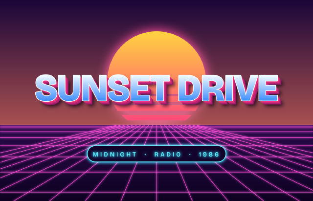

<!-- Generated by tools/gallery.mjs from showcase.yaml and build.json; do not edit. -->
# Retro 80s Extruded Title

[Photo](../README.md) › [Layer Styles](../README.md#layer-styles) · `layer-styles` `drop-shadow` `type` `retro`

A synthwave title card whose 3D extrusion is five stacked Drop Shadows on one live text layer.



| | |
|---|---|
| Document | [retro-80s-extruded-title.psd](retro-80s-extruded-title.psd) (1.3 MB) |
| Contents | 1400 × 900 px; 8 layers; 2 type layers; 4 shape layers; 1 fill layer; 5 styled layers; 1 mask |
| Features | `photo.layer.styles`, `photo.type.point-text`, `photo.path.shapes` |
| Built by | `kition-photo` @ `7abaa42e9a`: 22 commands in 196 ms |

## About

The chunky extrusion under the headline is not a copy of the text: it is five Drop Shadow
effects on the same type layer, each one step further along 135°, with no blur, plus a Stroke
and a Gradient Overlay for the chrome face. The sliced sun is an ellipse with rectangles
subtracted from it, and the floor is a single stroked shape of grid lines with an outer glow.

## Checks

- `inspect.layers`: `{"count":8}`
- `inspect.layers.2`: `{"name":"Headline","kind":"Type","text":{"text":"SUNSET DRIVE"},"effects":{"items":{"count":7}}}`
- `inspect.layers.2.effects.items`: `{"any":{"key":"gradientOverlay"},"none":{"key":"bevelEmboss"}}`
- `inspect.layers.1`: `{"name":"Tagline Pill","kind":"Shape"}`
- `inspect.layers.-3`: `{"name":"Sun","kind":"Shape"}`
- diagnostics: none (the kit's check finds nothing wrong)
- the saved document opens again; the thumbnail matches `thumb.png` within the `render` tolerance

## Steps

<details><summary>22 commands (from <a href="showcase.yaml">showcase.yaml</a>)</summary>

```yaml
- command: layer.newFillLayer.gradient
  params:
    from: "#ff7e5f"
    to: "#1a0638"
    angle: 90
  as: sky
- command: shape.create
  params:
    kind: ellipse
    rect:
      - 480
      - 140
      - 440
      - 440
    fill:
      gradient:
        stops:
          - - 0
            - "#ff3d81"
          - - 1
            - "#ffd23f"
        angle: 90
    name: Sun
  as: sun
- command: shape.create
  params:
    kind: rect
    rect:
      - 470
      - 420
      - 460
      - 10
    addTo: $sun.layer
    op: subtract
- command: shape.create
  params:
    kind: rect
    rect:
      - 470
      - 456
      - 460
      - 14
    addTo: $sun.layer
    op: subtract
- command: shape.create
  params:
    kind: rect
    rect:
      - 470
      - 496
      - 460
      - 18
    addTo: $sun.layer
    op: subtract
- command: shape.create
  params:
    kind: rect
    rect:
      - 470
      - 538
      - 460
      - 22
    addTo: $sun.layer
    op: subtract
- command: layer.layerStyle.outerGlow
  params:
    layer: $sun.layer
    color: "#ff3d81"
    opacity: 60
    size: 60
- command: shape.create
  params:
    kind: rect
    rect:
      - 0
      - 560
      - 1400
      - 340
    fill:
      gradient:
        stops:
          - - 0
            - "#0d0221"
          - - 1
            - "#2a0a4a"
        angle: 90
    name: Floor
- command: shape.create
  params:
    kind: path
    fill: null
    stroke:
      width: 2
      color: "#ff4fd8"
    name: Grid
    path:
      subpaths:
        - closed: false
          knots:
            - - 520
              - 560
            - - -900
              - 900
        - closed: false
          knots:
            - - 538
              - 560
            - - -740
              - 900
        - closed: false
          knots:
            - - 556
              - 560
            - - -580
              - 900
        - closed: false
          knots:
            - - 574
              - 560
            - - -420
              - 900
        - closed: false
          knots:
            - - 592
              - 560
            - - -260
              - 900
        - closed: false
          knots:
            - - 610
              - 560
            - - -100
              - 900
        - closed: false
          knots:
            - - 628
              - 560
            - - 60
              - 900
        - closed: false
          knots:
            - - 646
              - 560
            - - 220
              - 900
        - closed: false
          knots:
            - - 664
              - 560
            - - 380
              - 900
        - closed: false
          knots:
            - - 682
              - 560
            - - 540
              - 900
        - closed: false
          knots:
            - - 700
              - 560
            - - 700
              - 900
        - closed: false
          knots:
            - - 718
              - 560
            - - 860
              - 900
        - closed: false
          knots:
            - - 736
              - 560
            - - 1020
              - 900
        - closed: false
          knots:
            - - 754
              - 560
            - - 1180
              - 900
        - closed: false
          knots:
            - - 772
              - 560
            - - 1340
              - 900
        - closed: false
          knots:
            - - 790
              - 560
            - - 1500
              - 900
        - closed: false
          knots:
            - - 808
              - 560
            - - 1660
              - 900
        - closed: false
          knots:
            - - 826
              - 560
            - - 1820
              - 900
        - closed: false
          knots:
            - - 844
              - 560
            - - 1980
              - 900
        - closed: false
          knots:
            - - 862
              - 560
            - - 2140
              - 900
        - closed: false
          knots:
            - - 880
              - 560
            - - 2300
              - 900
        - closed: false
          knots:
            - - 0
              - 564
            - - 1400
              - 564
        - closed: false
          knots:
            - - 0
              - 572
            - - 1400
              - 572
        - closed: false
          knots:
            - - 0
              - 590
            - - 1400
              - 590
        - closed: false
          knots:
            - - 0
              - 616
            - - 1400
              - 616
        - closed: false
          knots:
            - - 0
              - 652
            - - 1400
              - 652
        - closed: false
          knots:
            - - 0
              - 702
            - - 1400
              - 702
        - closed: false
          knots:
            - - 0
              - 770
            - - 1400
              - 770
        - closed: false
          knots:
            - - 0
              - 860
            - - 1400
              - 860
  as: grid
- command: layer.layerStyle.outerGlow
  params:
    layer: $grid.layer
    color: "#ff4fd8"
    opacity: 70
    size: 10
- command: type.create
  params:
    x: 700
    y: 450
    text: SUNSET DRIVE
    font: Bricolage Grotesque
    size: 170
    variations:
      wght: 800
      wdth: 100
      opsz: 96
    color: "#ffffff"
    align: center
    name: Headline
  as: title
- command: layer.layerStyle.gradientOverlay
  params:
    layer: $title.layer
    from: "#3b8bff"
    to: "#f4fbff"
    angle: 90
    style: linear
- command: layer.layerStyle.stroke
  params:
    layer: $title.layer
    size: 3
    position: outside
    color: "#ffffff"
- command: layer.layerStyle.dropShadow
  params:
    layer: $title.layer
    color: "#ff3d81"
    opacity: 100
    blend: normal
    distance: 6
    size: 0
    angle: 135
    useGlobalLight: false
- command: layer.layerStyle.dropShadow
  params:
    layer: $title.layer
    color: "#e0307a"
    opacity: 100
    blend: normal
    distance: 12
    size: 0
    angle: 135
    useGlobalLight: false
    add: true
- command: layer.layerStyle.dropShadow
  params:
    layer: $title.layer
    color: "#bf2573"
    opacity: 100
    blend: normal
    distance: 18
    size: 0
    angle: 135
    useGlobalLight: false
    add: true
- command: layer.layerStyle.dropShadow
  params:
    layer: $title.layer
    color: "#9c1a6b"
    opacity: 100
    blend: normal
    distance: 24
    size: 0
    angle: 135
    useGlobalLight: false
    add: true
- command: layer.layerStyle.dropShadow
  params:
    layer: $title.layer
    color: "#2a0a4a"
    opacity: 80
    blend: multiply
    distance: 36
    size: 20
    angle: 135
    useGlobalLight: false
    add: true
- command: shape.create
  params:
    kind: roundedRect
    rect:
      - 390
      - 652
      - 620
      - 72
    radii: 36
    fill: "#12032b"
    stroke:
      width: 3
      color: "#5ef2ff"
    name: Tagline Pill
  as: pill
- command: layer.layerStyle.outerGlow
  params:
    layer: $pill.layer
    color: "#25d9ff"
    opacity: 75
    size: 18
- command: type.create
  params:
    x: 700
    y: 700
    text: MIDNIGHT  ·  RADIO  ·  1986
    font: Bricolage Grotesque
    size: 28
    variations:
      wght: 600
      wdth: 100
      opsz: 30
    tracking: 300
    color: "#5ef2ff"
    align: center
    name: Tagline
  as: tagline
- command: layer.layerStyle.outerGlow
  params:
    layer: $tagline.layer
    color: "#25d9ff"
    opacity: 80
    size: 16
```

</details>
