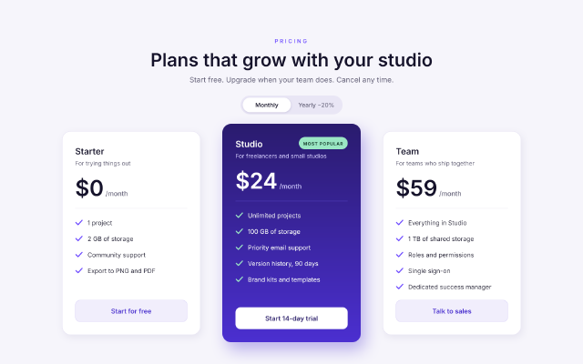

<!-- Generated by tools/gallery.mjs from showcase.yaml and build.json; do not edit. -->
# SaaS Pricing Table

[Photo](../README.md) › [UI & Web Design](../README.md#ui--web-design) · `ui` `web` `shapes` `layer-styles` `type`

A three-tier pricing section for a web page, with a highlighted middle plan, a billing toggle and checkmark feature lists.



| | |
|---|---|
| Document | [saas-pricing-table.psd](saas-pricing-table.psd) (1.1 MB) |
| Contents | 1600 × 1000 px; 49 layers; 32 type layers; 15 shape layers; 1 fill layer; 4 styled layers; 1 mask |
| Features | `photo.path.shapes`, `photo.layer.style-basics`, `photo.type.styles`, `photo.type.point-text` |
| Built by | `kition-photo` @ `7abaa42e9a`: 56 commands in 327 ms |

## About

A landing-page pricing block for a fictional design tool. The featured plan is taller, filled
with a gradient and lifted by a coloured Drop Shadow; the others are white cards with a hairline
stroke. Each price is one text layer whose "/month" is restyled smaller and lighter with a range
style, and each card's checkmarks are a single stroked path.

## Checks

- `inspect.layers`: `{"any":{"name":"Studio Card","kind":"Shape","effects":{"items":{"any":{"key":"dropShadow"}}}}}`
- `inspect.layers`: `{"any":{"name":"Popular Label","kind":"Type","text":{"text":"MOST POPULAR"}}}`
- `results.studioPrice.text`: `"$24 /month"`
- `results.studioPrice.runs.0.style.size_pt`: `60`
- `results.studioPrice.runs.1`: `{"start":3,"end":10,"style":{"size_pt":18,"weight":500}}`
- diagnostics: none (the kit's check finds nothing wrong)
- the saved document opens again; the thumbnail matches `thumb.png` within the `render` tolerance

## Steps

<details><summary>56 commands (from <a href="showcase.yaml">showcase.yaml</a>)</summary>

```yaml
- command: layer.newFillLayer.solidColor
  params:
    color: "#f6f5fb"
  as: page
- command: type.create
  params:
    x: 800
    y: 118
    text: PRICING
    font: Inter
    size: 15
    weight: 600
    tracking: 300
    color: "#6d4aff"
    align: center
    name: Eyebrow
- command: type.create
  params:
    x: 800
    y: 182
    text: Plans that grow with your studio
    font: Inter
    size: 50
    weight: 600
    color: "#15122b"
    align: center
    name: Heading
- command: type.create
  params:
    x: 800
    y: 226
    text: Start free. Upgrade when your team does. Cancel any time.
    font: Inter
    size: 20
    color: "#5d5a73"
    align: center
    name: Subheading
- command: shape.create
  params:
    kind: roundedRect
    rect:
      - 660
      - 262
      - 280
      - 52
    radii: 26
    fill: "#e9e6f5"
    name: Billing Toggle
- command: shape.create
  params:
    kind: roundedRect
    rect:
      - 666
      - 268
      - 132
      - 40
    radii: 20
    fill: "#ffffff"
    name: Toggle Thumb
  as: thumb
- command: layer.layerStyle.dropShadow
  params:
    layer: $thumb.layer
    color: "#2b1d6b"
    opacity: 15
    distance: 2
    size: 6
    angle: 90
- command: type.create
  params:
    x: 732
    y: 294
    text: Monthly
    font: Inter
    size: 16
    weight: 600
    color: "#15122b"
    align: center
    name: Toggle Monthly
- command: type.create
  params:
    x: 868
    y: 294
    text: Yearly −20%
    font: Inter
    size: 16
    weight: 500
    color: "#5d5a73"
    align: center
    name: Toggle Yearly
- command: shape.create
  params:
    kind: roundedRect
    rect:
      - 170
      - 360
      - 380
      - 560
    radii: 24
    fill: "#ffffff"
    stroke:
      width: 1
      color: "#e4e0f2"
      align: inside
    name: Starter Card
  as: card0
- command: layer.layerStyle.dropShadow
  params:
    layer: $card0.layer
    color: "#2b1d6b"
    opacity: 8
    distance: 8
    size: 24
    angle: 90
- command: type.create
  params:
    x: 206
    y: 424
    text: Starter
    font: Inter
    size: 24
    weight: 600
    color: "#15122b"
    name: Starter Name
- command: type.create
  params:
    x: 206
    y: 454
    text: For trying things out
    font: Inter
    size: 16
    color: "#5d5a73"
    name: Starter Blurb
- command: type.create
  params:
    x: 206
    y: 538
    text: $$0 /month
    font: Inter
    size: 60
    weight: 600
    color: "#15122b"
    name: Starter Price
  as: price0
- command: type.setStyle
  params:
    layer: $price0.layer
    range:
      - 2
      - 9
    size: 18
    weight: 500
    color: "#5d5a73"
- command: shape.create
  params:
    kind: line
    from:
      - 206
      - 572
    to:
      - 514
      - 572
    weight: 1
    fill: "#ece9f5"
    name: Starter Rule
- command: type.create
  params:
    x: 240
    y: 618
    text: 1 project
    font: Inter
    size: 17
    color: "#15122b"
    name: Starter Feature 1
- command: type.create
  params:
    x: 240
    y: 662
    text: 2 GB of storage
    font: Inter
    size: 17
    color: "#15122b"
    name: Starter Feature 2
- command: type.create
  params:
    x: 240
    y: 706
    text: Community support
    font: Inter
    size: 17
    color: "#15122b"
    name: Starter Feature 3
- command: type.create
  params:
    x: 240
    y: 750
    text: Export to PNG and PDF
    font: Inter
    size: 17
    color: "#15122b"
    name: Starter Feature 4
- command: shape.create
  params:
    kind: path
    fill: null
    stroke:
      width: 3
      color: "#6d4aff"
      cap: round
      join: round
    name: Starter Checks
    path:
      subpaths:
        - closed: false
          knots:
            - - 208
              - 611
            - - 214
              - 617
            - - 225
              - 605
        - closed: false
          knots:
            - - 208
              - 655
            - - 214
              - 661
            - - 225
              - 649
        - closed: false
          knots:
            - - 208
              - 699
            - - 214
              - 705
            - - 225
              - 693
        - closed: false
          knots:
            - - 208
              - 743
            - - 214
              - 749
            - - 225
              - 737
- command: shape.create
  params:
    kind: roundedRect
    rect:
      - 206
      - 824
      - 308
      - 60
    radii: 14
    fill: "#f1eefc"
    stroke:
      width: 1
      color: "#d9d2f7"
      align: inside
    name: Starter Button
- command: type.create
  params:
    x: 360
    y: 861
    text: Start for free
    font: Inter
    size: 18
    weight: 600
    color: "#4b2fd0"
    align: center
    name: Starter Button Label
- command: shape.create
  params:
    kind: roundedRect
    rect:
      - 610
      - 340
      - 380
      - 600
    radii: 24
    fill:
      gradient:
        stops:
          - - 0
            - "#2a1b6e"
          - - 1
            - "#4b2fd0"
        angle: 270
    name: Studio Card
  as: card1
- command: layer.layerStyle.dropShadow
  params:
    layer: $card1.layer
    color: "#4b2fd0"
    opacity: 35
    distance: 24
    size: 50
    angle: 90
- command: type.create
  params:
    x: 646
    y: 404
    text: Studio
    font: Inter
    size: 24
    weight: 600
    color: "#ffffff"
    name: Studio Name
- command: shape.create
  params:
    kind: roundedRect
    rect:
      - 820
      - 376
      - 134
      - 34
    radii: 17
    fill: "#9be7c4"
    name: Popular Badge
- command: type.create
  params:
    x: 887
    y: 399
    text: MOST POPULAR
    font: Inter
    size: 12
    weight: 700
    tracking: 100
    color: "#123d2b"
    align: center
    name: Popular Label
- command: type.create
  params:
    x: 646
    y: 434
    text: For freelancers and small studios
    font: Inter
    size: 16
    color: "#cfc6ff"
    name: Studio Blurb
- command: type.create
  params:
    x: 646
    y: 518
    text: $$24 /month
    font: Inter
    size: 60
    weight: 600
    color: "#ffffff"
    name: Studio Price
  as: price1
- command: type.setStyle
  params:
    layer: $price1.layer
    range:
      - 3
      - 10
    size: 18
    weight: 500
    color: "#cfc6ff"
- command: shape.create
  params:
    kind: line
    from:
      - 646
      - 552
    to:
      - 954
      - 552
    weight: 1
    fill: "#5a45c9"
    name: Studio Rule
- command: type.create
  params:
    x: 680
    y: 598
    text: Unlimited projects
    font: Inter
    size: 17
    color: "#ffffff"
    name: Studio Feature 1
- command: type.create
  params:
    x: 680
    y: 642
    text: 100 GB of storage
    font: Inter
    size: 17
    color: "#ffffff"
    name: Studio Feature 2
- command: type.create
  params:
    x: 680
    y: 686
    text: Priority email support
    font: Inter
    size: 17
    color: "#ffffff"
    name: Studio Feature 3
- command: type.create
  params:
    x: 680
    y: 730
    text: Version history, 90 days
    font: Inter
    size: 17
    color: "#ffffff"
    name: Studio Feature 4
- command: type.create
  params:
    x: 680
    y: 774
    text: Brand kits and templates
    font: Inter
    size: 17
    color: "#ffffff"
    name: Studio Feature 5
- command: shape.create
  params:
    kind: path
    fill: null
    stroke:
      width: 3
      color: "#9be7c4"
      cap: round
      join: round
    name: Studio Checks
    path:
      subpaths:
        - closed: false
          knots:
            - - 648
              - 591
            - - 654
              - 597
            - - 665
              - 585
        - closed: false
          knots:
            - - 648
              - 635
            - - 654
              - 641
            - - 665
              - 629
        - closed: false
          knots:
            - - 648
              - 679
            - - 654
              - 685
            - - 665
              - 673
        - closed: false
          knots:
            - - 648
              - 723
            - - 654
              - 729
            - - 665
              - 717
        - closed: false
          knots:
            - - 648
              - 767
            - - 654
              - 773
            - - 665
              - 761
- command: shape.create
  params:
    kind: roundedRect
    rect:
      - 646
      - 844
      - 308
      - 60
    radii: 14
    fill: "#ffffff"
    name: Studio Button
- command: type.create
  params:
    x: 800
    y: 881
    text: Start 14-day trial
    font: Inter
    size: 18
    weight: 600
    color: "#2a1b6e"
    align: center
    name: Studio Button Label
- command: shape.create
  params:
    kind: roundedRect
    rect:
      - 1050
      - 360
      - 380
      - 560
    radii: 24
    fill: "#ffffff"
    stroke:
      width: 1
      color: "#e4e0f2"
      align: inside
    name: Team Card
  as: card2
- command: layer.layerStyle.dropShadow
  params:
    layer: $card2.layer
    color: "#2b1d6b"
    opacity: 8
    distance: 8
    size: 24
    angle: 90
- command: type.create
  params:
    x: 1086
    y: 424
    text: Team
    font: Inter
    size: 24
    weight: 600
    color: "#15122b"
    name: Team Name
- command: type.create
  params:
    x: 1086
    y: 454
    text: For teams who ship together
    font: Inter
    size: 16
    color: "#5d5a73"
    name: Team Blurb
- command: type.create
  params:
    x: 1086
    y: 538
    text: $$59 /month
    font: Inter
    size: 60
    weight: 600
    color: "#15122b"
    name: Team Price
  as: price2
- command: type.setStyle
  params:
    layer: $price2.layer
    range:
      - 3
      - 10
    size: 18
    weight: 500
    color: "#5d5a73"
- command: shape.create
  params:
    kind: line
    from:
      - 1086
      - 572
    to:
      - 1394
      - 572
    weight: 1
    fill: "#ece9f5"
    name: Team Rule
- command: type.create
  params:
    x: 1120
    y: 618
    text: Everything in Studio
    font: Inter
    size: 17
    color: "#15122b"
    name: Team Feature 1
- command: type.create
  params:
    x: 1120
    y: 662
    text: 1 TB of shared storage
    font: Inter
    size: 17
    color: "#15122b"
    name: Team Feature 2
- command: type.create
  params:
    x: 1120
    y: 706
    text: Roles and permissions
    font: Inter
    size: 17
    color: "#15122b"
    name: Team Feature 3
- command: type.create
  params:
    x: 1120
    y: 750
    text: Single sign-on
    font: Inter
    size: 17
    color: "#15122b"
    name: Team Feature 4
- command: type.create
  params:
    x: 1120
    y: 794
    text: Dedicated success manager
    font: Inter
    size: 17
    color: "#15122b"
    name: Team Feature 5
- command: shape.create
  params:
    kind: path
    fill: null
    stroke:
      width: 3
      color: "#6d4aff"
      cap: round
      join: round
    name: Team Checks
    path:
      subpaths:
        - closed: false
          knots:
            - - 1088
              - 611
            - - 1094
              - 617
            - - 1105
              - 605
        - closed: false
          knots:
            - - 1088
              - 655
            - - 1094
              - 661
            - - 1105
              - 649
        - closed: false
          knots:
            - - 1088
              - 699
            - - 1094
              - 705
            - - 1105
              - 693
        - closed: false
          knots:
            - - 1088
              - 743
            - - 1094
              - 749
            - - 1105
              - 737
        - closed: false
          knots:
            - - 1088
              - 787
            - - 1094
              - 793
            - - 1105
              - 781
- command: shape.create
  params:
    kind: roundedRect
    rect:
      - 1086
      - 824
      - 308
      - 60
    radii: 14
    fill: "#f1eefc"
    stroke:
      width: 1
      color: "#d9d2f7"
      align: inside
    name: Team Button
- command: type.create
  params:
    x: 1240
    y: 861
    text: Talk to sales
    font: Inter
    size: 18
    weight: 600
    color: "#4b2fd0"
    align: center
    name: Team Button Label
- command: type.info
  params:
    layer: $price1.layer
  as: studioPrice
```

</details>
