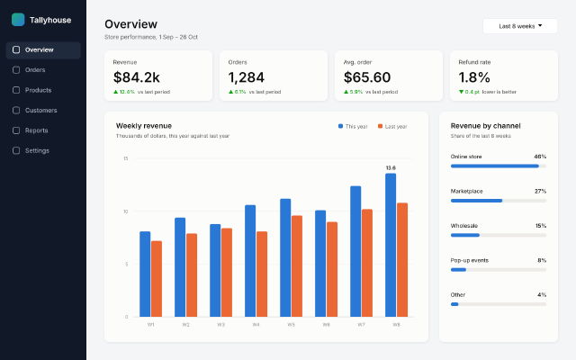

<!-- Generated by tools/gallery.mjs from showcase.yaml and build.json; do not edit. -->
# Sales Analytics Dashboard

[Photo](../README.md) › [UI & Web Design](../README.md#ui--web-design) · `ui` `dashboard` `chart` `shapes` `layer-styles`

A store analytics dashboard with KPI tiles, a grouped weekly revenue chart and channel share bars, all live shapes and type.



| | |
|---|---|
| Document | [sales-analytics-dashboard.psd](sales-analytics-dashboard.psd) (1.2 MB) |
| Contents | 1600 × 1000 px; 78 layers; 51 type layers; 25 shape layers; 1 fill layer; 6 styled layers; 1 mask |
| Features | `photo.path.shapes`, `photo.type.point-text`, `photo.type.styles`, `photo.layer.style-basics` |
| Built by | `kition-photo` @ `7abaa42e9a`: 112 commands in 744 ms |

## About

A desktop dashboard mockup for a fictional shop. Each bar series is one shape layer: the first
bar is a rounded rectangle and the other seven are added to it as sub-paths, so recolouring a
series is one change. Gridlines are a single stroked path, the KPI deltas colour only their
arrow and number with a range style, and the cards share a faint Drop Shadow.

## Checks

- `inspect.layers`: `{"any":{"name":"Bars This Year","kind":"Shape"}}`
- `inspect.layers.0`: `{"name":"Channel Bars","kind":"Shape"}`
- `results.thisYear.path.subpaths`: `{"count":8}`
- `results.thisYear.fill`: `"#2a78d6"`
- `results.lastYear.path.subpaths`: `{"count":8}`
- `results.lastYear.fill`: `"#eb6834"`
- `results.channels.path.subpaths`: `{"count":5}`
- diagnostics: none (the kit's check finds nothing wrong)
- the saved document opens again; the thumbnail matches `thumb.png` within the `render` tolerance

## Steps

<details><summary>112 commands (from <a href="showcase.yaml">showcase.yaml</a>)</summary>

```yaml
- command: layer.newFillLayer.solidColor
  params:
    color: "#f4f5f7"
  as: page
- command: shape.create
  params:
    kind: rect
    rect:
      - 0
      - 0
      - 240
      - 1000
    fill: "#111827"
    name: Sidebar
- command: shape.create
  params:
    kind: roundedRect
    rect:
      - 32
      - 36
      - 36
      - 36
    radii: 10
    fill:
      gradient:
        stops:
          - - 0
            - "#2a78d6"
          - - 1
            - "#1baf7a"
        angle: 135
    name: Logo Mark
- command: type.create
  params:
    x: 82
    y: 63
    text: Tallyhouse
    font: Inter
    size: 22
    weight: 600
    color: "#ffffff"
    name: Logo Word
- command: shape.create
  params:
    kind: roundedRect
    rect:
      - 16
      - 116
      - 208
      - 48
    radii: 10
    fill: "#1f2a3d"
    name: Nav Active
- command: shape.create
  params:
    kind: roundedRect
    rect:
      - 36
      - 129
      - 18
      - 18
    radii: 5
    fill: null
    stroke:
      width: 2
      color: "#ffffff"
    name: Nav Icon Overview
- command: type.create
  params:
    x: 70
    y: 144
    text: Overview
    font: Inter
    size: 17
    weight: 600
    color: "#ffffff"
    name: Nav Overview
- command: shape.create
  params:
    kind: roundedRect
    rect:
      - 36
      - 185
      - 18
      - 18
    radii: 5
    fill: null
    stroke:
      width: 2
      color: "#7c8597"
    name: Nav Icon Orders
- command: type.create
  params:
    x: 70
    y: 200
    text: Orders
    font: Inter
    size: 17
    weight: 500
    color: "#9aa3b5"
    name: Nav Orders
- command: shape.create
  params:
    kind: roundedRect
    rect:
      - 36
      - 241
      - 18
      - 18
    radii: 5
    fill: null
    stroke:
      width: 2
      color: "#7c8597"
    name: Nav Icon Products
- command: type.create
  params:
    x: 70
    y: 256
    text: Products
    font: Inter
    size: 17
    weight: 500
    color: "#9aa3b5"
    name: Nav Products
- command: shape.create
  params:
    kind: roundedRect
    rect:
      - 36
      - 297
      - 18
      - 18
    radii: 5
    fill: null
    stroke:
      width: 2
      color: "#7c8597"
    name: Nav Icon Customers
- command: type.create
  params:
    x: 70
    y: 312
    text: Customers
    font: Inter
    size: 17
    weight: 500
    color: "#9aa3b5"
    name: Nav Customers
- command: shape.create
  params:
    kind: roundedRect
    rect:
      - 36
      - 353
      - 18
      - 18
    radii: 5
    fill: null
    stroke:
      width: 2
      color: "#7c8597"
    name: Nav Icon Reports
- command: type.create
  params:
    x: 70
    y: 368
    text: Reports
    font: Inter
    size: 17
    weight: 500
    color: "#9aa3b5"
    name: Nav Reports
- command: shape.create
  params:
    kind: roundedRect
    rect:
      - 36
      - 409
      - 18
      - 18
    radii: 5
    fill: null
    stroke:
      width: 2
      color: "#7c8597"
    name: Nav Icon Settings
- command: type.create
  params:
    x: 70
    y: 424
    text: Settings
    font: Inter
    size: 17
    weight: 500
    color: "#9aa3b5"
    name: Nav Settings
- command: type.create
  params:
    x: 290
    y: 78
    text: Overview
    font: Inter
    size: 32
    weight: 600
    color: "#0b0b0b"
    name: Page Title
- command: type.create
  params:
    x: 290
    y: 108
    text: Store performance, 1 Sep – 26 Oct
    font: Inter
    size: 16
    color: "#52514e"
    name: Page Subtitle
- command: shape.create
  params:
    kind: roundedRect
    rect:
      - 1340
      - 50
      - 210
      - 44
    radii: 10
    fill: "#ffffff"
    stroke:
      width: 1
      color: "#dcdfe5"
      align: inside
    name: Range Picker
- command: type.create
  params:
    x: 1436
    y: 78
    text: Last 8 weeks
    font: Inter
    size: 16
    weight: 500
    color: "#0b0b0b"
    align: center
    name: Range Label
- command: shape.create
  params:
    kind: path
    path:
      subpaths:
        - knots:
            - - 1494
              - 67
            - - 1506
              - 67
            - - 1500
              - 74
    fill: "#0b0b0b"
    name: Range Chevron
- command: shape.create
  params:
    kind: roundedRect
    rect:
      - 290
      - 140
      - 300
      - 140
    radii: 14
    fill: "#fcfcfb"
    name: KPI Revenue
  as: kpi0
- command: layer.layerStyle.dropShadow
  params:
    layer: $kpi0.layer
    color: "#1d2433"
    opacity: 8
    distance: 2
    size: 8
    angle: 90
- command: type.create
  params:
    x: 314
    y: 178
    text: Revenue
    font: Inter
    size: 16
    weight: 500
    color: "#52514e"
    name: KPI Revenue Label
- command: type.create
  params:
    x: 314
    y: 228
    text: $$84.2k
    font: Inter
    size: 38
    weight: 600
    color: "#0b0b0b"
    name: KPI Revenue Value
- command: type.create
  params:
    x: 314
    y: 260
    text: ▲ 12.4%  vs last period
    font: Inter
    size: 14
    weight: 500
    color: "#52514e"
    name: KPI Revenue Delta
  as: kd0
- command: type.setStyle
  params:
    layer: $kd0.layer
    range:
      - 0
      - 7
    color: "#0ca30c"
    weight: 600
- command: shape.create
  params:
    kind: roundedRect
    rect:
      - 610
      - 140
      - 300
      - 140
    radii: 14
    fill: "#fcfcfb"
    name: KPI Orders
  as: kpi1
- command: layer.layerStyle.dropShadow
  params:
    layer: $kpi1.layer
    color: "#1d2433"
    opacity: 8
    distance: 2
    size: 8
    angle: 90
- command: type.create
  params:
    x: 634
    y: 178
    text: Orders
    font: Inter
    size: 16
    weight: 500
    color: "#52514e"
    name: KPI Orders Label
- command: type.create
  params:
    x: 634
    y: 228
    text: 1,284
    font: Inter
    size: 38
    weight: 600
    color: "#0b0b0b"
    name: KPI Orders Value
- command: type.create
  params:
    x: 634
    y: 260
    text: ▲ 6.1%  vs last period
    font: Inter
    size: 14
    weight: 500
    color: "#52514e"
    name: KPI Orders Delta
  as: kd1
- command: type.setStyle
  params:
    layer: $kd1.layer
    range:
      - 0
      - 6
    color: "#0ca30c"
    weight: 600
- command: shape.create
  params:
    kind: roundedRect
    rect:
      - 930
      - 140
      - 300
      - 140
    radii: 14
    fill: "#fcfcfb"
    name: KPI Avg. order
  as: kpi2
- command: layer.layerStyle.dropShadow
  params:
    layer: $kpi2.layer
    color: "#1d2433"
    opacity: 8
    distance: 2
    size: 8
    angle: 90
- command: type.create
  params:
    x: 954
    y: 178
    text: Avg. order
    font: Inter
    size: 16
    weight: 500
    color: "#52514e"
    name: KPI Avg. order Label
- command: type.create
  params:
    x: 954
    y: 228
    text: $$65.60
    font: Inter
    size: 38
    weight: 600
    color: "#0b0b0b"
    name: KPI Avg. order Value
- command: type.create
  params:
    x: 954
    y: 260
    text: ▲ 5.9%  vs last period
    font: Inter
    size: 14
    weight: 500
    color: "#52514e"
    name: KPI Avg. order Delta
  as: kd2
- command: type.setStyle
  params:
    layer: $kd2.layer
    range:
      - 0
      - 6
    color: "#0ca30c"
    weight: 600
- command: shape.create
  params:
    kind: roundedRect
    rect:
      - 1250
      - 140
      - 300
      - 140
    radii: 14
    fill: "#fcfcfb"
    name: KPI Refund rate
  as: kpi3
- command: layer.layerStyle.dropShadow
  params:
    layer: $kpi3.layer
    color: "#1d2433"
    opacity: 8
    distance: 2
    size: 8
    angle: 90
- command: type.create
  params:
    x: 1274
    y: 178
    text: Refund rate
    font: Inter
    size: 16
    weight: 500
    color: "#52514e"
    name: KPI Refund rate Label
- command: type.create
  params:
    x: 1274
    y: 228
    text: 1.8%
    font: Inter
    size: 38
    weight: 600
    color: "#0b0b0b"
    name: KPI Refund rate Value
- command: type.create
  params:
    x: 1274
    y: 260
    text: ▼ 0.4 pt  lower is better
    font: Inter
    size: 14
    weight: 500
    color: "#52514e"
    name: KPI Refund rate Delta
  as: kd3
- command: type.setStyle
  params:
    layer: $kd3.layer
    range:
      - 0
      - 8
    color: "#0ca30c"
    weight: 600
- command: shape.create
  params:
    kind: roundedRect
    rect:
      - 290
      - 310
      - 900
      - 640
    radii: 14
    fill: "#fcfcfb"
    name: Revenue Card
  as: chartCard
- command: layer.layerStyle.dropShadow
  params:
    layer: $chartCard.layer
    color: "#1d2433"
    opacity: 8
    distance: 2
    size: 8
    angle: 90
- command: type.create
  params:
    x: 322
    y: 356
    text: Weekly revenue
    font: Inter
    size: 20
    weight: 600
    color: "#0b0b0b"
    name: Chart Title
- command: type.create
  params:
    x: 322
    y: 382
    text: Thousands of dollars, this year against last year
    font: Inter
    size: 14
    color: "#52514e"
    name: Chart Subtitle
- command: shape.create
  params:
    kind: roundedRect
    rect:
      - 940
      - 344
      - 12
      - 12
    radii: 3
    fill: "#2a78d6"
    name: Legend Swatch This Year
- command: type.create
  params:
    x: 960
    y: 356
    text: This year
    font: Inter
    size: 14
    color: "#52514e"
    name: Legend This Year
- command: shape.create
  params:
    kind: roundedRect
    rect:
      - 1050
      - 344
      - 12
      - 12
    radii: 3
    fill: "#eb6834"
    name: Legend Swatch Last Year
- command: type.create
  params:
    x: 1070
    y: 356
    text: Last year
    font: Inter
    size: 14
    color: "#52514e"
    name: Legend Last Year
- command: type.create
  params:
    x: 356
    y: 885
    text: "0"
    font: Inter
    size: 13
    color: "#898781"
    align: right
    name: Y Tick 0
- command: type.create
  params:
    x: 356
    y: 738.333
    text: "5"
    font: Inter
    size: 13
    color: "#898781"
    align: right
    name: Y Tick 5
- command: type.create
  params:
    x: 356
    y: 591.667
    text: "10"
    font: Inter
    size: 13
    color: "#898781"
    align: right
    name: Y Tick 10
- command: type.create
  params:
    x: 356
    y: 445
    text: "15"
    font: Inter
    size: 13
    color: "#898781"
    align: right
    name: Y Tick 15
- command: shape.create
  params:
    kind: path
    fill: null
    stroke:
      width: 1
      color: "#ecebe8"
    name: Gridlines
    path:
      subpaths:
        - closed: false
          knots:
            - - 370
              - 733.333
            - - 1150
              - 733.333
        - closed: false
          knots:
            - - 370
              - 586.667
            - - 1150
              - 586.667
        - closed: false
          knots:
            - - 370
              - 440
            - - 1150
              - 440
- command: shape.create
  params:
    kind: line
    from:
      - 370
      - 880
    to:
      - 1150
      - 880
    weight: 1
    fill: "#c9c8c3"
    name: Baseline
- command: type.create
  params:
    x: 418.75
    y: 906
    text: W1
    font: Inter
    size: 13
    color: "#898781"
    align: center
    name: X Tick W1
- command: type.create
  params:
    x: 516.25
    y: 906
    text: W2
    font: Inter
    size: 13
    color: "#898781"
    align: center
    name: X Tick W2
- command: type.create
  params:
    x: 613.75
    y: 906
    text: W3
    font: Inter
    size: 13
    color: "#898781"
    align: center
    name: X Tick W3
- command: type.create
  params:
    x: 711.25
    y: 906
    text: W4
    font: Inter
    size: 13
    color: "#898781"
    align: center
    name: X Tick W4
- command: type.create
  params:
    x: 808.75
    y: 906
    text: W5
    font: Inter
    size: 13
    color: "#898781"
    align: center
    name: X Tick W5
- command: type.create
  params:
    x: 906.25
    y: 906
    text: W6
    font: Inter
    size: 13
    color: "#898781"
    align: center
    name: X Tick W6
- command: type.create
  params:
    x: 1003.75
    y: 906
    text: W7
    font: Inter
    size: 13
    color: "#898781"
    align: center
    name: X Tick W7
- command: type.create
  params:
    x: 1101.25
    y: 906
    text: W8
    font: Inter
    size: 13
    color: "#898781"
    align: center
    name: X Tick W8
- command: shape.create
  params:
    kind: roundedRect
    rect:
      - 419.75
      - 668.8
      - 30
      - 211.2
    radii:
      - 4
      - 4
      - 0
      - 0
    fill: "#eb6834"
    name: Bars Last Year
  as: BarsLastYear
- command: shape.create
  params:
    kind: roundedRect
    rect:
      - 517.25
      - 648.267
      - 30
      - 231.733
    radii:
      - 4
      - 4
      - 0
      - 0
    addTo: $BarsLastYear.layer
    op: combine
- command: shape.create
  params:
    kind: roundedRect
    rect:
      - 614.75
      - 633.6
      - 30
      - 246.4
    radii:
      - 4
      - 4
      - 0
      - 0
    addTo: $BarsLastYear.layer
    op: combine
- command: shape.create
  params:
    kind: roundedRect
    rect:
      - 712.25
      - 642.4
      - 30
      - 237.6
    radii:
      - 4
      - 4
      - 0
      - 0
    addTo: $BarsLastYear.layer
    op: combine
- command: shape.create
  params:
    kind: roundedRect
    rect:
      - 809.75
      - 598.4
      - 30
      - 281.6
    radii:
      - 4
      - 4
      - 0
      - 0
    addTo: $BarsLastYear.layer
    op: combine
- command: shape.create
  params:
    kind: roundedRect
    rect:
      - 907.25
      - 616
      - 30
      - 264
    radii:
      - 4
      - 4
      - 0
      - 0
    addTo: $BarsLastYear.layer
    op: combine
- command: shape.create
  params:
    kind: roundedRect
    rect:
      - 1004.75
      - 580.8
      - 30
      - 299.2
    radii:
      - 4
      - 4
      - 0
      - 0
    addTo: $BarsLastYear.layer
    op: combine
- command: shape.create
  params:
    kind: roundedRect
    rect:
      - 1102.25
      - 563.2
      - 30
      - 316.8
    radii:
      - 4
      - 4
      - 0
      - 0
    addTo: $BarsLastYear.layer
    op: combine
- command: shape.create
  params:
    kind: roundedRect
    rect:
      - 387.75
      - 642.4
      - 30
      - 237.6
    radii:
      - 4
      - 4
      - 0
      - 0
    fill: "#2a78d6"
    name: Bars This Year
  as: BarsThisYear
- command: shape.create
  params:
    kind: roundedRect
    rect:
      - 485.25
      - 604.267
      - 30
      - 275.733
    radii:
      - 4
      - 4
      - 0
      - 0
    addTo: $BarsThisYear.layer
    op: combine
- command: shape.create
  params:
    kind: roundedRect
    rect:
      - 582.75
      - 621.867
      - 30
      - 258.133
    radii:
      - 4
      - 4
      - 0
      - 0
    addTo: $BarsThisYear.layer
    op: combine
- command: shape.create
  params:
    kind: roundedRect
    rect:
      - 680.25
      - 569.067
      - 30
      - 310.933
    radii:
      - 4
      - 4
      - 0
      - 0
    addTo: $BarsThisYear.layer
    op: combine
- command: shape.create
  params:
    kind: roundedRect
    rect:
      - 777.75
      - 551.467
      - 30
      - 328.533
    radii:
      - 4
      - 4
      - 0
      - 0
    addTo: $BarsThisYear.layer
    op: combine
- command: shape.create
  params:
    kind: roundedRect
    rect:
      - 875.25
      - 583.733
      - 30
      - 296.267
    radii:
      - 4
      - 4
      - 0
      - 0
    addTo: $BarsThisYear.layer
    op: combine
- command: shape.create
  params:
    kind: roundedRect
    rect:
      - 972.75
      - 516.267
      - 30
      - 363.733
    radii:
      - 4
      - 4
      - 0
      - 0
    addTo: $BarsThisYear.layer
    op: combine
- command: shape.create
  params:
    kind: roundedRect
    rect:
      - 1070.25
      - 481.067
      - 30
      - 398.933
    radii:
      - 4
      - 4
      - 0
      - 0
    addTo: $BarsThisYear.layer
    op: combine
- command: type.create
  params:
    x: 1085.25
    y: 471.067
    text: "13.6"
    font: Inter
    size: 14
    weight: 600
    color: "#0b0b0b"
    align: center
    name: Peak Label
- command: shape.create
  params:
    kind: roundedRect
    rect:
      - 1220
      - 310
      - 330
      - 640
    radii: 14
    fill: "#fcfcfb"
    name: Channels Card
  as: chCard
- command: layer.layerStyle.dropShadow
  params:
    layer: $chCard.layer
    color: "#1d2433"
    opacity: 8
    distance: 2
    size: 8
    angle: 90
- command: type.create
  params:
    x: 1252
    y: 356
    text: Revenue by channel
    font: Inter
    size: 20
    weight: 600
    color: "#0b0b0b"
    name: Channels Title
- command: type.create
  params:
    x: 1252
    y: 382
    text: Share of the last 8 weeks
    font: Inter
    size: 14
    color: "#52514e"
    name: Channels Subtitle
- command: type.create
  params:
    x: 1252
    y: 440
    text: Online store
    font: Inter
    size: 15
    weight: 500
    color: "#0b0b0b"
    name: Channel Online store
- command: type.create
  params:
    x: 1518
    y: 440
    text: 46%
    font: Inter
    size: 15
    weight: 600
    color: "#0b0b0b"
    align: right
    name: Channel Online store Value
- command: type.create
  params:
    x: 1252
    y: 536
    text: Marketplace
    font: Inter
    size: 15
    weight: 500
    color: "#0b0b0b"
    name: Channel Marketplace
- command: type.create
  params:
    x: 1518
    y: 536
    text: 27%
    font: Inter
    size: 15
    weight: 600
    color: "#0b0b0b"
    align: right
    name: Channel Marketplace Value
- command: type.create
  params:
    x: 1252
    y: 632
    text: Wholesale
    font: Inter
    size: 15
    weight: 500
    color: "#0b0b0b"
    name: Channel Wholesale
- command: type.create
  params:
    x: 1518
    y: 632
    text: 15%
    font: Inter
    size: 15
    weight: 600
    color: "#0b0b0b"
    align: right
    name: Channel Wholesale Value
- command: type.create
  params:
    x: 1252
    y: 728
    text: Pop-up events
    font: Inter
    size: 15
    weight: 500
    color: "#0b0b0b"
    name: Channel Pop-up events
- command: type.create
  params:
    x: 1518
    y: 728
    text: 8%
    font: Inter
    size: 15
    weight: 600
    color: "#0b0b0b"
    align: right
    name: Channel Pop-up events Value
- command: type.create
  params:
    x: 1252
    y: 824
    text: Other
    font: Inter
    size: 15
    weight: 500
    color: "#0b0b0b"
    name: Channel Other
- command: type.create
  params:
    x: 1518
    y: 824
    text: 4%
    font: Inter
    size: 15
    weight: 600
    color: "#0b0b0b"
    align: right
    name: Channel Other Value
- command: shape.create
  params:
    kind: roundedRect
    rect:
      - 1252
      - 456
      - 266
      - 10
    radii: 5
    fill: "#ecebe8"
    name: Channel Tracks
  as: tracks
- command: shape.create
  params:
    kind: roundedRect
    rect:
      - 1252
      - 552
      - 266
      - 10
    radii: 5
    addTo: $tracks.layer
    op: combine
- command: shape.create
  params:
    kind: roundedRect
    rect:
      - 1252
      - 648
      - 266
      - 10
    radii: 5
    addTo: $tracks.layer
    op: combine
- command: shape.create
  params:
    kind: roundedRect
    rect:
      - 1252
      - 744
      - 266
      - 10
    radii: 5
    addTo: $tracks.layer
    op: combine
- command: shape.create
  params:
    kind: roundedRect
    rect:
      - 1252
      - 840
      - 266
      - 10
    radii: 5
    addTo: $tracks.layer
    op: combine
- command: shape.create
  params:
    kind: roundedRect
    rect:
      - 1252
      - 456
      - 244.7
      - 10
    radii: 5
    fill: "#2a78d6"
    name: Channel Bars
  as: chbars
- command: shape.create
  params:
    kind: roundedRect
    rect:
      - 1252
      - 552
      - 143.6
      - 10
    radii: 5
    addTo: $chbars.layer
    op: combine
- command: shape.create
  params:
    kind: roundedRect
    rect:
      - 1252
      - 648
      - 79.8
      - 10
    radii: 5
    addTo: $chbars.layer
    op: combine
- command: shape.create
  params:
    kind: roundedRect
    rect:
      - 1252
      - 744
      - 42.6
      - 10
    radii: 5
    addTo: $chbars.layer
    op: combine
- command: shape.create
  params:
    kind: roundedRect
    rect:
      - 1252
      - 840
      - 21.3
      - 10
    radii: 5
    addTo: $chbars.layer
    op: combine
- command: shape.info
  params:
    layer: $BarsThisYear.layer
  as: thisYear
- command: shape.info
  params:
    layer: $BarsLastYear.layer
  as: lastYear
- command: shape.info
  params:
    layer: $chbars.layer
  as: channels
```

</details>
