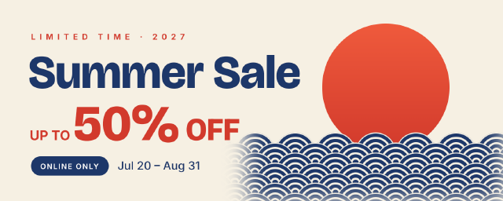

<!-- Generated by tools/gallery.mjs from showcase.yaml and build.json; do not edit. -->
# Summer Sale Wave Banner

[Photo](../README.md) › [Posters & Marketing](../README.md#posters--marketing) · `banner` `web` `shapes` `pattern` `masks` `type`

A wide e-commerce banner with a red rising sun over a pattern of overlapping waves and a mixed-font discount headline.



| | |
|---|---|
| Document | [summer-sale-wave-banner.psd](summer-sale-wave-banner.psd) (1.4 MB) |
| Contents | 1500 × 600 px; 17 layers; 5 type layers; 9 shape layers; 1 fill layer; 1 group; 2 masks |
| Features | `photo.path.shapes`, `photo.type.point-text`, `photo.type.styles`, `photo.layer.mask-basics`, `photo.layer.manage`, `photo.select.make` |
| Built by | `kition-photo` @ `e511ae24a4`: 64 commands in 898 ms |

## About

A 1500 × 600 store banner. The wave pattern is one row of concentric circles in a single shape
layer, duplicated and nudged six times so each lower row overlaps the one above; the `Waves` group
fades in on the left through a feathered layer mask. The discount line is one type layer with two
fonts: "Up to" in Inter and the figure in Bricolage Grotesque.

## Checks

- `inspect.layers`: `{"count":10}`
- `inspect.layers.3`: `{"name":"Discount","kind":"Type","text":{"text":"UP TO 50% OFF"}}`
- `inspect.layers.4`: `{"name":"Headline","text":{"text":"Summer Sale","font":"Bricolage Grotesque"}}`
- `inspect.layers.6`: `{"name":"Waves","kind":"Group","hasMask":true,"children":{"count":7,"all":{"kind":"Shape"}}}`
- `inspect.layers.6.children.0`: `{"name":"Wave Row 7","shape":{"fill":"#1d3769","stroke":{"fill":"#f4efe3","align":"inside"}}}`
- `inspect.layers.6.children.-1`: `{"name":"Wave Row 1"}`
- `inspect.layers.7`: `{"name":"Rising Sun","kind":"Shape","shape":{"kind":"ellipse","fill":{"gradient":{"stops":[[0,"#ef5a3c"],[1,"#d23a2c"]]}}}}`
- `inspect.layers.8`: `{"name":"Washi","kind":"Fill","fillContent":"#f6f0e3"}`
- diagnostics: none (the kit's check finds nothing wrong)
- the saved document opens again; the thumbnail matches `thumb.png` within the `render` tolerance

## Steps

<details><summary>64 commands (from <a href="showcase.yaml">showcase.yaml</a>)</summary>

```yaml
- command: layer.newFillLayer.solidColor
  params:
    color: "#f6f0e3"
  as: paper
- command: layer.setProps
  params:
    layer: $paper.layer
    name: Washi
- command: shape.create
  params:
    kind: ellipse
    rect:
      - 960
      - 70
      - 380
      - 380
    fill:
      gradient:
        stops:
          - - 0
            - "#ef5a3c"
          - - 1
            - "#d23a2c"
        angle: -90
    name: Rising Sun
  as: sun
- command: layer.new.group
  params:
    name: Waves
  as: waves
- command: shape.create
  params:
    kind: ellipse
    rect:
      - 580
      - 395
      - 120
      - 120
    fill: "#1d3769"
    stroke:
      width: 3
      color: "#f4efe3"
      align: inside
    name: Wave Row 1
  as: row1
- command: shape.create
  params:
    kind: ellipse
    rect:
      - 596
      - 411
      - 88
      - 88
    addTo: $row1.layer
- command: shape.create
  params:
    kind: ellipse
    rect:
      - 612
      - 427
      - 56
      - 56
    addTo: $row1.layer
- command: shape.create
  params:
    kind: ellipse
    rect:
      - 628
      - 443
      - 24
      - 24
    addTo: $row1.layer
- command: shape.create
  params:
    kind: ellipse
    rect:
      - 700
      - 395
      - 120
      - 120
    addTo: $row1.layer
- command: shape.create
  params:
    kind: ellipse
    rect:
      - 716
      - 411
      - 88
      - 88
    addTo: $row1.layer
- command: shape.create
  params:
    kind: ellipse
    rect:
      - 732
      - 427
      - 56
      - 56
    addTo: $row1.layer
- command: shape.create
  params:
    kind: ellipse
    rect:
      - 748
      - 443
      - 24
      - 24
    addTo: $row1.layer
- command: shape.create
  params:
    kind: ellipse
    rect:
      - 820
      - 395
      - 120
      - 120
    addTo: $row1.layer
- command: shape.create
  params:
    kind: ellipse
    rect:
      - 836
      - 411
      - 88
      - 88
    addTo: $row1.layer
- command: shape.create
  params:
    kind: ellipse
    rect:
      - 852
      - 427
      - 56
      - 56
    addTo: $row1.layer
- command: shape.create
  params:
    kind: ellipse
    rect:
      - 868
      - 443
      - 24
      - 24
    addTo: $row1.layer
- command: shape.create
  params:
    kind: ellipse
    rect:
      - 940
      - 395
      - 120
      - 120
    addTo: $row1.layer
- command: shape.create
  params:
    kind: ellipse
    rect:
      - 956
      - 411
      - 88
      - 88
    addTo: $row1.layer
- command: shape.create
  params:
    kind: ellipse
    rect:
      - 972
      - 427
      - 56
      - 56
    addTo: $row1.layer
- command: shape.create
  params:
    kind: ellipse
    rect:
      - 988
      - 443
      - 24
      - 24
    addTo: $row1.layer
- command: shape.create
  params:
    kind: ellipse
    rect:
      - 1060
      - 395
      - 120
      - 120
    addTo: $row1.layer
- command: shape.create
  params:
    kind: ellipse
    rect:
      - 1076
      - 411
      - 88
      - 88
    addTo: $row1.layer
- command: shape.create
  params:
    kind: ellipse
    rect:
      - 1092
      - 427
      - 56
      - 56
    addTo: $row1.layer
- command: shape.create
  params:
    kind: ellipse
    rect:
      - 1108
      - 443
      - 24
      - 24
    addTo: $row1.layer
- command: shape.create
  params:
    kind: ellipse
    rect:
      - 1180
      - 395
      - 120
      - 120
    addTo: $row1.layer
- command: shape.create
  params:
    kind: ellipse
    rect:
      - 1196
      - 411
      - 88
      - 88
    addTo: $row1.layer
- command: shape.create
  params:
    kind: ellipse
    rect:
      - 1212
      - 427
      - 56
      - 56
    addTo: $row1.layer
- command: shape.create
  params:
    kind: ellipse
    rect:
      - 1228
      - 443
      - 24
      - 24
    addTo: $row1.layer
- command: shape.create
  params:
    kind: ellipse
    rect:
      - 1300
      - 395
      - 120
      - 120
    addTo: $row1.layer
- command: shape.create
  params:
    kind: ellipse
    rect:
      - 1316
      - 411
      - 88
      - 88
    addTo: $row1.layer
- command: shape.create
  params:
    kind: ellipse
    rect:
      - 1332
      - 427
      - 56
      - 56
    addTo: $row1.layer
- command: shape.create
  params:
    kind: ellipse
    rect:
      - 1348
      - 443
      - 24
      - 24
    addTo: $row1.layer
- command: shape.create
  params:
    kind: ellipse
    rect:
      - 1420
      - 395
      - 120
      - 120
    addTo: $row1.layer
- command: shape.create
  params:
    kind: ellipse
    rect:
      - 1436
      - 411
      - 88
      - 88
    addTo: $row1.layer
- command: shape.create
  params:
    kind: ellipse
    rect:
      - 1452
      - 427
      - 56
      - 56
    addTo: $row1.layer
- command: shape.create
  params:
    kind: ellipse
    rect:
      - 1468
      - 443
      - 24
      - 24
    addTo: $row1.layer
- command: shape.create
  params:
    kind: ellipse
    rect:
      - 1540
      - 395
      - 120
      - 120
    addTo: $row1.layer
- command: shape.create
  params:
    kind: ellipse
    rect:
      - 1556
      - 411
      - 88
      - 88
    addTo: $row1.layer
- command: shape.create
  params:
    kind: ellipse
    rect:
      - 1572
      - 427
      - 56
      - 56
    addTo: $row1.layer
- command: shape.create
  params:
    kind: ellipse
    rect:
      - 1588
      - 443
      - 24
      - 24
    addTo: $row1.layer
- command: layer.duplicate
  params:
    layer: $row1.layer
    name: Wave Row 2
  as: row2
- command: layer.translate
  params:
    layer: $row2.layer
    dx: -60
    dy: 30
- command: layer.duplicate
  params:
    layer: $row2.layer
    name: Wave Row 3
  as: row3
- command: layer.translate
  params:
    layer: $row3.layer
    dx: 60
    dy: 30
- command: layer.duplicate
  params:
    layer: $row3.layer
    name: Wave Row 4
  as: row4
- command: layer.translate
  params:
    layer: $row4.layer
    dx: -60
    dy: 30
- command: layer.duplicate
  params:
    layer: $row4.layer
    name: Wave Row 5
  as: row5
- command: layer.translate
  params:
    layer: $row5.layer
    dx: 60
    dy: 30
- command: layer.duplicate
  params:
    layer: $row5.layer
    name: Wave Row 6
  as: row6
- command: layer.translate
  params:
    layer: $row6.layer
    dx: -60
    dy: 30
- command: layer.duplicate
  params:
    layer: $row6.layer
    name: Wave Row 7
  as: row7
- command: layer.translate
  params:
    layer: $row7.layer
    dx: 60
    dy: 30
- command: select.rect
  params:
    x: 740
    y: 0
    width: 900
    height: 600
    feather: 60
- command: layer.layerMask.revealSelection
  params:
    layer: $waves.layer
- command: select.deselect
- command: type.create
  params:
    x: 92
    y: 118
    text: LIMITED TIME · 2027
    font: Inter
    weight: 700
    size: 24
    tracking: 500
    color: "#d23a2c"
    name: Kicker
  as: kicker
- command: layer.moveTo
  params:
    layer: $kicker.layer
    target: $waves.layer
    position: above
- command: type.create
  params:
    x: 84
    y: 262
    text: Summer Sale
    font: Bricolage Grotesque
    weight: 800
    size: 140
    tracking: -10
    color: "#1d3769"
    name: Headline
- command: type.create
  params:
    x: 88
    y: 418
    text: UP TO 50% OFF
    font: Inter
    weight: 700
    size: 40
    color: "#d23a2c"
    name: Discount
  as: discount
- command: type.setStyle
  params:
    layer: $discount.layer
    range:
      - 6
      - 9
    font: Bricolage Grotesque
    weight: 800
    size: 150
- command: type.setStyle
  params:
    layer: $discount.layer
    range:
      - 9
      - 13
    font: Bricolage Grotesque
    weight: 800
    size: 96
- command: shape.create
  params:
    kind: roundedRect
    rect:
      - 92
      - 466
      - 232
      - 58
    radii: 29
    fill: "#1d3769"
    name: Online Pill
- command: type.create
  params:
    x: 208
    y: 504
    text: ONLINE ONLY
    font: Inter
    weight: 600
    size: 22
    tracking: 120
    color: "#ffffff"
    align: center
    name: Online Label
- command: type.create
  params:
    x: 350
    y: 506
    text: Jul 20 – Aug 31
    font: Inter
    weight: 500
    size: 34
    color: "#1d3769"
    name: Dates
```

</details>
