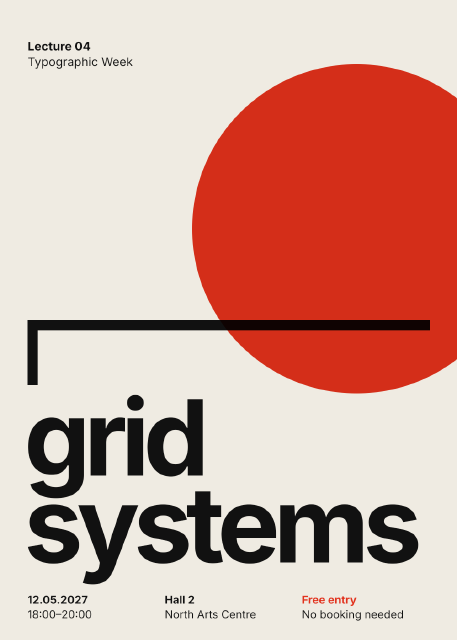

<!-- Generated by tools/gallery.mjs from showcase.yaml and build.json; do not edit. -->
# Swiss Style Lecture Poster

[Photo](../README.md) › [Posters & Marketing](../README.md#posters--marketing) · `poster` `minimal` `shapes` `type` `groups` `blend-modes`

A minimalist International Typographic Style poster with a red circle, a strict grid and tight sans-serif type.



| | |
|---|---|
| Document | [swiss-lecture-poster.psd](swiss-lecture-poster.psd) (544 KB) |
| Contents | 1000 × 1400 px; 16 layers; 10 type layers; 3 shape layers; 1 fill layer; 1 group; 1 mask |
| Features | `photo.layer.solid-fill`, `photo.path.shapes`, `photo.type.point-text`, `photo.layer.basics`, `photo.layer.manage` |
| Built by | `kition-photo` @ `7abaa42e9a`: 17 commands in 87 ms |

## About

A grid poster built from very few parts: a solid fill layer for the paper, a red circle that runs
off the edge and multiplies over a black rule, and lower-case Inter Bold (from the Inter variable
font) set big with negative tracking. The small information blocks hang from a three-column grid and are kept in a group.

## Checks

- `inspect.layers`: `{"count":8}`
- `inspect.layers.0`: `{"name":"Information","kind":"Group","children":{"count":8,"all":{"kind":"Type"}}}`
- `inspect.layers.1`: `{"name":"Headline 2","kind":"Type","text":{"text":"systems","sizePt":230}}`
- `inspect.layers.1.bounds.2`: `{"min":850}`
- `inspect.layers.3`: `{"name":"Circle","kind":"Shape","blend":"Multiply","shape":{"kind":"ellipse","fill":"#e2321c"}}`
- `inspect.layers.-2`: `{"name":"Paper","kind":"Fill","fillContent":"#efebe2"}`
- diagnostics: none (the kit's check finds nothing wrong)
- the saved document opens again; the thumbnail matches `thumb.png` within the `render` tolerance

## Steps

<details><summary>17 commands (from <a href="showcase.yaml">showcase.yaml</a>)</summary>

```yaml
- command: layer.newFillLayer.solidColor
  params:
    color: "#efebe2"
  as: paper
- command: layer.setProps
  params:
    layer: $paper.layer
    name: Paper
- command: shape.create
  params:
    kind: rect
    rect:
      - 60
      - 700
      - 880
      - 22
    fill: "#111111"
    name: Rule
  as: rule
- command: shape.create
  params:
    kind: rect
    rect:
      - 60
      - 722
      - 22
      - 120
    fill: "#111111"
    name: Stem
  as: stem
- command: shape.create
  params:
    kind: ellipse
    rect:
      - 420
      - 140
      - 720
      - 720
    fill: "#e2321c"
    name: Circle
  as: circle
- command: layer.setProps
  params:
    layer: $circle.layer
    blend: Multiply
- command: type.create
  params:
    x: 52
    y: 1040
    text: grid
    font: Inter
    weight: 700
    size: 230
    tracking: -60
    color: "#111111"
    name: Headline 1
  as: h1
- command: type.create
  params:
    x: 52
    y: 1230
    text: systems
    font: Inter
    weight: 700
    size: 230
    tracking: -60
    color: "#111111"
    name: Headline 2
  as: h2
- command: layer.new.group
  params:
    name: Information
  as: info
- command: type.create
  params:
    x: 60
    y: 110
    text: Lecture 04
    font: Inter
    weight: 700
    size: 26
    color: "#111111"
    name: Series
  as: t1
- command: type.create
  params:
    x: 60
    y: 144
    text: Typographic Week
    font: Inter
    size: 26
    color: "#111111"
    name: Event
  as: t2
- command: type.create
  params:
    x: 60
    y: 1320
    text: 12.05.2027
    font: Inter
    weight: 700
    size: 24
    color: "#111111"
    name: Date
  as: t3
- command: type.create
  params:
    x: 60
    y: 1352
    text: 18:00–20:00
    font: Inter
    size: 24
    color: "#111111"
    name: Time
  as: t4
- command: type.create
  params:
    x: 360
    y: 1320
    text: Hall 2
    font: Inter
    weight: 700
    size: 24
    color: "#111111"
    name: Venue
  as: t5
- command: type.create
  params:
    x: 360
    y: 1352
    text: North Arts Centre
    font: Inter
    size: 24
    color: "#111111"
    name: Address
  as: t6
- command: type.create
  params:
    x: 660
    y: 1320
    text: Free entry
    font: Inter
    weight: 700
    size: 24
    color: "#e2321c"
    name: Entry
  as: t7
- command: type.create
  params:
    x: 660
    y: 1352
    text: No booking needed
    font: Inter
    size: 24
    color: "#111111"
    name: Booking
  as: t8
```

</details>
