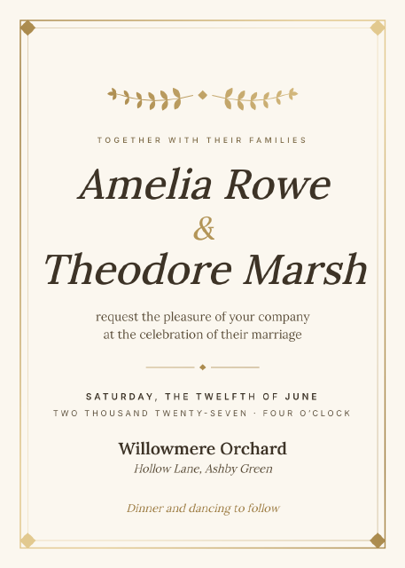

<!-- Generated by tools/gallery.mjs from showcase.yaml and build.json; do not edit. -->
# Wedding Invitation

[Photo](../README.md) › [Print & Stationery](../README.md#print--stationery) · `print` `wedding` `invitation` `typography` `shapes` `ornaments` `layer-styles`

A formal ivory invitation in Lora with a gold double frame, corner diamonds and a laurel sprig drawn from bezier paths.



| | |
|---|---|
| Document | [wedding-invitation.psd](wedding-invitation.psd) (1.0 MB) |
| Contents | 1000 × 1400 px; 22 layers; 11 type layers; 7 shape layers; 1 fill layer; 2 groups; 1 styled layer; 1 mask |
| Features | `photo.type.point-text`, `photo.path.shapes`, `photo.layer.styles`, `photo.layer.manage`, `photo.layer.solid-fill` |
| Built by | `kition-photo` @ `7abaa42e9a`: 29 commands in 325 ms |

## About

A 5 × 7 inch invitation at 200 ppi. The double frame and the corner ornaments are stroked
shapes in a group with a gold Gradient Overlay, so one style colours every rule. The laurel is
two shape layers, open stem paths and 26 bezier leaves, and the names are Lora italic with a
centred ampersand in gold.

## Checks

- `inspect.layers`: `{"count":4}`
- `inspect.layers.0`: `{"name":"Wording","kind":"Group","children":{"count":11,"all":{"kind":"Type"}}}`
- `inspect.layers.0.children`: `{"any":{"name":"Name One","text":{"text":"Amelia Rowe","font":"Lora"}}}`
- `inspect.layers.1`: `{"name":"Ornaments","kind":"Group","children":{"count":7,"all":{"kind":"Shape"}},"effects":{"items":{"any":{"key":"gradientOverlay"}}}}`
- `inspect.layers.1.children.-1`: `{"name":"Frame Outer","shape":{"kind":"rect","fill":null,"stroke":{"fill":"#b39557","width":3}}}`
- `inspect.layers.2`: `{"name":"Ivory Stock","kind":"Fill","fillContent":"#fbf7ef"}`
- `results.leaves.path.subpaths`: `{"count":26}`
- diagnostics: none (the kit's check finds nothing wrong)
- the saved document opens again; the thumbnail matches `thumb.png` within the `render` tolerance

## Steps

<details><summary>29 commands (from <a href="showcase.yaml">showcase.yaml</a>)</summary>

```yaml
- command: layer.newFillLayer.solidColor
  params:
    color: "#fbf7ef"
  as: paper
- command: layer.setProps
  params:
    layer: $paper.layer
    name: Ivory Stock
- command: layer.new.group
  params:
    name: Ornaments
  as: orn
- command: shape.create
  params:
    kind: rect
    rect:
      - 50
      - 50
      - 900
      - 1300
    fill: null
    stroke:
      width: 3
      color: "#b39557"
      align: center
    name: Frame Outer
  as: f1
- command: shape.create
  params:
    kind: rect
    rect:
      - 68
      - 68
      - 864
      - 1264
    fill: null
    stroke:
      width: 1
      color: "#b39557"
      align: center
    name: Frame Inner
  as: f2
- command: shape.create
  params:
    kind: polygon
    rect:
      - 48
      - 48
      - 40
      - 40
    sides: 4
    fill: "#b39557"
    name: Corner Diamonds
  as: corners
- command: shape.create
  params:
    kind: polygon
    rect:
      - 912
      - 48
      - 40
      - 40
    sides: 4
    addTo: $corners.layer
- command: shape.create
  params:
    kind: polygon
    rect:
      - 48
      - 1312
      - 40
      - 40
    sides: 4
    addTo: $corners.layer
- command: shape.create
  params:
    kind: polygon
    rect:
      - 912
      - 1312
      - 40
      - 40
    sides: 4
    addTo: $corners.layer
- command: shape.create
  params:
    kind: path
    path:
      subpaths:
        - closed: false
          knots:
            - - 476
              - 235
            - - 444.3
              - 241.5
            - - 412.7
              - 246.2
            - - 381
              - 247.8
            - - 349.3
              - 245.5
            - - 317.7
              - 239.4
            - - 286
              - 230.6
        - closed: false
          knots:
            - - 524
              - 235
            - - 555.7
              - 241.5
            - - 587.3
              - 246.2
            - - 619
              - 247.8
            - - 650.7
              - 245.5
            - - 682.3
              - 239.4
            - - 714
              - 230.6
    fill: null
    stroke:
      width: 2
      color: "#b39557"
      cap: round
      join: round
    name: Laurel Stems
  as: stems
- command: shape.create
  params:
    kind: path
    path:
      subpaths:
        - closed: true
          knots:
            - anchor:
                - 444.3
                - 241.5
              in:
                - 429.8
                - 238.3
              out:
                - 446.3
                - 226.8
            - anchor:
                - 426.4
                - 215.8
              in:
                - 439.1
                - 218.4
              out:
                - 424.4
                - 228.7
        - closed: true
          knots:
            - anchor:
                - 444.3
                - 241.5
              in:
                - 448.8
                - 255.7
              out:
                - 430.6
                - 247.2
            - anchor:
                - 431.1
                - 269.9
              in:
                - 426.9
                - 257.6
              out:
                - 443.2
                - 265.2
        - closed: true
          knots:
            - anchor:
                - 412.7
                - 246.2
              in:
                - 399.4
                - 243.3
              out:
                - 414.4
                - 232.7
            - anchor:
                - 396.2
                - 222.7
              in:
                - 407.9
                - 225.1
              out:
                - 394.4
                - 234.5
        - closed: true
          knots:
            - anchor:
                - 412.7
                - 246.2
              in:
                - 416.7
                - 259.2
              out:
                - 400.1
                - 251.4
            - anchor:
                - 400.6
                - 272.2
              in:
                - 396.7
                - 260.9
              out:
                - 411.7
                - 267.9
        - closed: true
          knots:
            - anchor:
                - 381
                - 247.8
              in:
                - 369
                - 245.1
              out:
                - 382.6
                - 235.6
            - anchor:
                - 366.1
                - 226.5
              in:
                - 376.7
                - 228.6
              out:
                - 364.4
                - 237.2
        - closed: true
          knots:
            - anchor:
                - 381
                - 247.8
              in:
                - 384.7
                - 259.5
              out:
                - 369.6
                - 252.5
            - anchor:
                - 370
                - 271.3
              in:
                - 366.5
                - 261.1
              out:
                - 380.1
                - 267.4
        - closed: true
          knots:
            - anchor:
                - 349.3
                - 245.5
              in:
                - 338.5
                - 243
              out:
                - 350.8
                - 234.5
            - anchor:
                - 335.9
                - 226.3
              in:
                - 345.5
                - 228.2
              out:
                - 334.5
                - 235.9
        - closed: true
          knots:
            - anchor:
                - 349.3
                - 245.5
              in:
                - 352.6
                - 256
              out:
                - 339.1
                - 249.7
            - anchor:
                - 339.5
                - 266.6
              in:
                - 336.3
                - 257.4
              out:
                - 348.5
                - 263.1
        - closed: true
          knots:
            - anchor:
                - 317.7
                - 239.4
              in:
                - 308.1
                - 237.3
              out:
                - 318.9
                - 229.7
            - anchor:
                - 305.8
                - 222.5
              in:
                - 314.2
                - 224.1
              out:
                - 304.5
                - 231
        - closed: true
          knots:
            - anchor:
                - 317.7
                - 239.4
              in:
                - 320.6
                - 248.7
              out:
                - 308.6
                - 243.2
            - anchor:
                - 308.9
                - 258.1
              in:
                - 306.2
                - 250
              out:
                - 316.9
                - 255
        - closed: true
          knots:
            - anchor:
                - 286
                - 230.6
              in:
                - 277.7
                - 228.7
              out:
                - 287.1
                - 222.1
            - anchor:
                - 275.7
                - 215.8
              in:
                - 283
                - 217.3
              out:
                - 274.5
                - 223.2
        - closed: true
          knots:
            - anchor:
                - 286
                - 230.6
              in:
                - 288.6
                - 238.7
              out:
                - 278.1
                - 233.8
            - anchor:
                - 278.4
                - 246.9
              in:
                - 276
                - 239.8
              out:
                - 285.4
                - 244.2
        - closed: true
          knots:
            - anchor:
                - 286
                - 230.6
              in:
                - 278.3
                - 237.6
              out:
                - 278.3
                - 223.6
            - anchor:
                - 264
                - 230.6
              in:
                - 270.6
                - 224.3
              out:
                - 270.6
                - 236.9
        - closed: true
          knots:
            - anchor:
                - 555.7
                - 241.5
              in:
                - 553.7
                - 226.8
              out:
                - 570.2
                - 238.3
            - anchor:
                - 573.6
                - 215.8
              in:
                - 575.6
                - 228.7
              out:
                - 560.9
                - 218.4
        - closed: true
          knots:
            - anchor:
                - 555.7
                - 241.5
              in:
                - 569.4
                - 247.2
              out:
                - 551.2
                - 255.7
            - anchor:
                - 568.9
                - 269.9
              in:
                - 556.8
                - 265.2
              out:
                - 573.1
                - 257.6
        - closed: true
          knots:
            - anchor:
                - 587.3
                - 246.2
              in:
                - 585.6
                - 232.7
              out:
                - 600.6
                - 243.3
            - anchor:
                - 603.8
                - 222.7
              in:
                - 605.6
                - 234.5
              out:
                - 592.1
                - 225.1
        - closed: true
          knots:
            - anchor:
                - 587.3
                - 246.2
              in:
                - 599.9
                - 251.4
              out:
                - 583.3
                - 259.2
            - anchor:
                - 599.4
                - 272.2
              in:
                - 588.3
                - 267.9
              out:
                - 603.3
                - 260.9
        - closed: true
          knots:
            - anchor:
                - 619
                - 247.8
              in:
                - 617.4
                - 235.6
              out:
                - 631
                - 245.1
            - anchor:
                - 633.9
                - 226.5
              in:
                - 635.6
                - 237.2
              out:
                - 623.3
                - 228.6
        - closed: true
          knots:
            - anchor:
                - 619
                - 247.8
              in:
                - 630.4
                - 252.5
              out:
                - 615.3
                - 259.5
            - anchor:
                - 630
                - 271.3
              in:
                - 619.9
                - 267.4
              out:
                - 633.5
                - 261.1
        - closed: true
          knots:
            - anchor:
                - 650.7
                - 245.5
              in:
                - 649.2
                - 234.5
              out:
                - 661.5
                - 243
            - anchor:
                - 664.1
                - 226.3
              in:
                - 665.5
                - 235.9
              out:
                - 654.5
                - 228.2
        - closed: true
          knots:
            - anchor:
                - 650.7
                - 245.5
              in:
                - 660.9
                - 249.7
              out:
                - 647.4
                - 256
            - anchor:
                - 660.5
                - 266.6
              in:
                - 651.5
                - 263.1
              out:
                - 663.7
                - 257.4
        - closed: true
          knots:
            - anchor:
                - 682.3
                - 239.4
              in:
                - 681.1
                - 229.7
              out:
                - 691.9
                - 237.3
            - anchor:
                - 694.2
                - 222.5
              in:
                - 695.5
                - 231
              out:
                - 685.8
                - 224.1
        - closed: true
          knots:
            - anchor:
                - 682.3
                - 239.4
              in:
                - 691.4
                - 243.2
              out:
                - 679.4
                - 248.7
            - anchor:
                - 691.1
                - 258.1
              in:
                - 683.1
                - 255
              out:
                - 693.8
                - 250
        - closed: true
          knots:
            - anchor:
                - 714
                - 230.6
              in:
                - 712.9
                - 222.1
              out:
                - 722.3
                - 228.7
            - anchor:
                - 724.3
                - 215.8
              in:
                - 725.5
                - 223.2
              out:
                - 717
                - 217.3
        - closed: true
          knots:
            - anchor:
                - 714
                - 230.6
              in:
                - 721.9
                - 233.8
              out:
                - 711.4
                - 238.7
            - anchor:
                - 721.6
                - 246.9
              in:
                - 714.6
                - 244.2
              out:
                - 724
                - 239.8
        - closed: true
          knots:
            - anchor:
                - 714
                - 230.6
              in:
                - 721.7
                - 223.6
              out:
                - 721.7
                - 237.6
            - anchor:
                - 736
                - 230.6
              in:
                - 729.4
                - 236.9
              out:
                - 729.4
                - 224.3
    fill: "#b39557"
    name: Laurel Leaves
  as: leaves
- command: shape.create
  params:
    kind: polygon
    rect:
      - 488
      - 222
      - 24
      - 24
    sides: 4
    fill: "#b39557"
    name: Laurel Diamond
  as: ldiamond
- command: shape.create
  params:
    kind: line
    from:
      - 360
      - 905
    to:
      - 480
      - 905
    weight: 1.5
    fill: "#b39557"
    name: Divider
  as: divider
- command: shape.create
  params:
    kind: line
    from:
      - 520
      - 905
    to:
      - 640
      - 905
    weight: 1.5
    addTo: $divider.layer
- command: shape.create
  params:
    kind: polygon
    rect:
      - 492
      - 897
      - 16
      - 16
    sides: 4
    addTo: $divider.layer
- command: layer.layerStyle.gradientOverlay
  params:
    layer: $orn.layer
    from: "#9c7a3c"
    to: "#e2c98f"
    angle: 45
    style: reflected
- command: layer.new.group
  params:
    name: Wording
  as: words
- command: layer.moveTo
  params:
    layer: $words.layer
    target: $orn.layer
    position: above
- command: type.create
  params:
    x: 500
    y: 352
    text: TOGETHER WITH THEIR FAMILIES
    font: Inter
    weight: 500
    size: 19
    tracking: 400
    color: "#7d6a45"
    align: center
    name: Opening
  as: w1
- command: type.create
  params:
    x: 500
    y: 490
    text: Amelia Rowe
    font: Lora
    italic: true
    weight: 500
    size: 104
    color: "#3d3326"
    align: center
    name: Name One
  as: w2
- command: type.create
  params:
    x: 500
    y: 590
    text: "&"
    font: Lora
    italic: true
    size: 80
    color: "#b39557"
    align: center
    name: Ampersand
  as: w3
- command: type.create
  params:
    x: 500
    y: 700
    text: Theodore Marsh
    font: Lora
    italic: true
    weight: 500
    size: 104
    color: "#3d3326"
    align: center
    name: Name Two
  as: w4
- command: type.create
  params:
    x: 500
    y: 790
    text: request the pleasure of your company
    font: Lora
    size: 30
    color: "#5a4c36"
    align: center
    name: Request 1
  as: w5
- command: type.create
  params:
    x: 500
    y: 834
    text: at the celebration of their marriage
    font: Lora
    size: 30
    color: "#5a4c36"
    align: center
    name: Request 2
  as: w6
- command: type.create
  params:
    x: 500
    y: 985
    text: SATURDAY, THE TWELFTH OF JUNE
    font: Inter
    weight: 600
    size: 22
    tracking: 300
    color: "#3d3326"
    align: center
    name: Date
  as: w7
- command: type.create
  params:
    x: 500
    y: 1025
    text: TWO THOUSAND TWENTY-SEVEN · FOUR O’CLOCK
    font: Inter
    size: 20
    tracking: 300
    color: "#5a4c36"
    align: center
    name: Year and Time
  as: w8
- command: type.create
  params:
    x: 500
    y: 1120
    text: Willowmere Orchard
    font: Lora
    weight: 600
    size: 42
    color: "#3d3326"
    align: center
    name: Venue
  as: w9
- command: type.create
  params:
    x: 500
    y: 1164
    text: Hollow Lane, Ashby Green
    font: Lora
    italic: true
    size: 28
    color: "#5a4c36"
    align: center
    name: Address
  as: w10
- command: type.create
  params:
    x: 500
    y: 1262
    text: Dinner and dancing to follow
    font: Lora
    italic: true
    size: 28
    color: "#9c7a3c"
    align: center
    name: Reception
  as: w11
```

</details>
