<!-- Generated by tools/gallery.mjs from showcase.yaml and build.json; do not edit. -->
# Scene showcase

3D scenes: primitives, modifiers, sculpting, curves, text, materials, lights and cameras. Saved as .kscene. Every sample is built from `showcase.yaml` by the kit's own commands and drawn by its own engine (`kition-scene`).

**12 samples** · 5 categories · 16 features of `kition-scene/features.yaml` · [all kits](../README.md)

[Abstract & Motion](#abstract--motion) (3) · [Architecture & Interiors](#architecture--interiors) (2) · [Materials & Lighting](#materials--lighting) (2) · [Product Renders](#product-renders) (4) · [Sculpting & Characters](#sculpting--characters) (1)

## Abstract & Motion

<table>
<tr>
<td width="33%" valign="top">
<a href="low-poly-island/">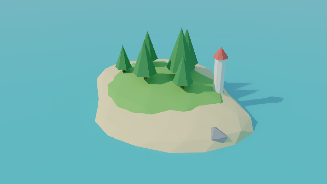</a> 
Scene 
<b><a href="low-poly-island/">Low-Poly Island</a></b> 
A faceted desert island with pine trees, rocks and a lighthouse sits in a turquoise sea under a warm afternoon sun. 
<i>20 meshes; 8 materials; 1 light</i> 
<code>low-poly</code> <code>displace</code> <code>flat-shading</code> <code>sun-light</code> <code>stylised</code>
</td>
<td width="33%" valign="top">
<a href="pastel-geometry-still-life/">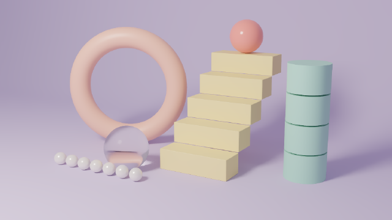</a> 
Scene 
<b><a href="pastel-geometry-still-life/">Pastel Geometry Still Life</a></b> 
An abstract arrangement of stairs, a standing ring, pillars and pearls in soft pastel colours on a seamless lilac set. 
<i>7 meshes; 7 materials; 1 light</i> 
<code>abstract</code> <code>array</code> <code>bevel</code> <code>pastel</code> <code>composition</code>
</td>
<td width="33%" valign="top">
<a href="toy-blocks-drop/">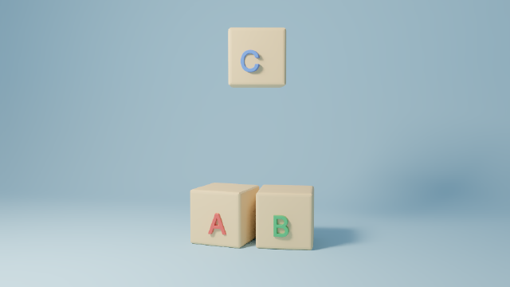</a> 
Scene 
<b><a href="toy-blocks-drop/">Toy Blocks Drop</a></b> 
Three wooden alphabet blocks fall into a stack one after another with squash and bounce, shown mid-fall at frame 30. 
<i>4 meshes; 5 materials; 1 light</i> 
<code>animation</code> <code>keyframes</code> <code>drop</code> <code>parenting</code> <code>text</code>
</td>
</tr>
</table>

## Architecture & Interiors

<table>
<tr>
<td width="33%" valign="top">
<a href="apartment-facade-arrays/">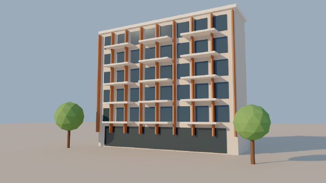</a> 
Scene 
<b><a href="apartment-facade-arrays/">Apartment Facade Arrays</a></b> 
A six-storey apartment block whose windows, balconies and fins are each one object repeated by Array modifiers, in low evening sun. 
<i>11 meshes; 8 materials; 1 light</i> 
<code>architecture</code> <code>array</code> <code>facade</code> <code>sun-light</code> <code>wide-angle</code>
</td>
<td width="33%" valign="top">
<a href="isometric-study-room/">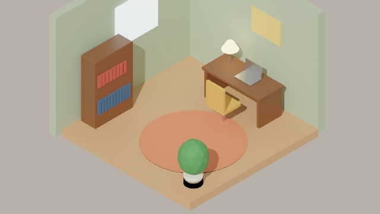</a> 
Scene 
<b><a href="isometric-study-room/">Isometric Study Room</a></b> 
A cosy isometric study with a desk, bookshelf, plant, rug and a glowing lamp, framed by an orthographic camera. 
<i>21 meshes; 13 materials; 1 light</i> 
<code>isometric</code> <code>interior</code> <code>orthographic</code> <code>array</code> <code>bevel</code> <code>emission</code>
</td>
<td width="33%"></td>
</tr>
</table>

## Materials & Lighting

<table>
<tr>
<td width="33%" valign="top">
<a href="espresso-cup-three-point/">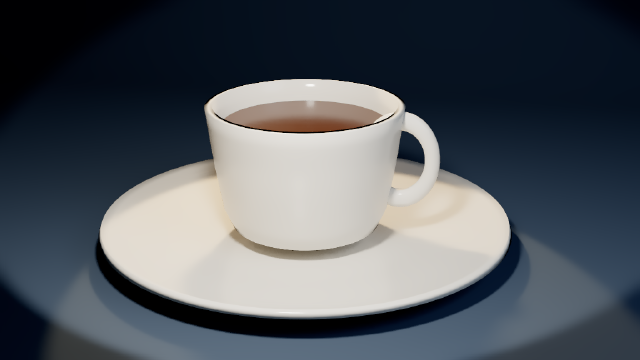</a> 
Scene 
<b><a href="espresso-cup-three-point/">Espresso Cup Three-Point Light</a></b> 
A glazed espresso cup and saucer on a seamless set, lit by a classic key, fill and rim rig built in one command. 
<i>5 meshes; 3 materials; 3 lights</i> 
<code>three-point-lighting</code> <code>lathe</code> <code>solidify</code> <code>ceramics</code> <code>studio-lighting</code>
</td>
<td width="33%" valign="top">
<a href="material-study-spheres/">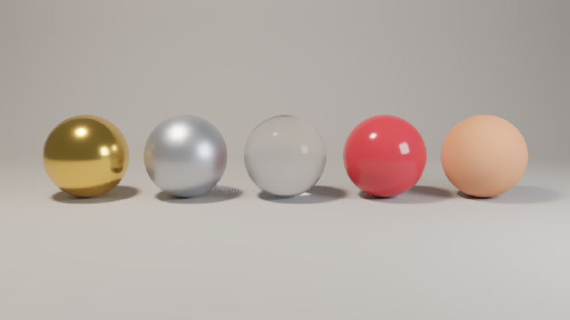</a> 
Scene 
<b><a href="material-study-spheres/">Material Study Spheres</a></b> 
Five spheres on a seamless backdrop compare gold, brushed steel, glass, glossy plastic and matte clay under a studio rig. 
<i>6 meshes; 6 materials; 2 lights</i> 
<code>materials</code> <code>glass</code> <code>metal</code> <code>studio-lighting</code> <code>path-tracing</code>
</td>
<td width="33%"></td>
</tr>
</table>

## Product Renders

<table>
<tr>
<td width="33%" valign="top">
<a href="amber-perfume-bottle/">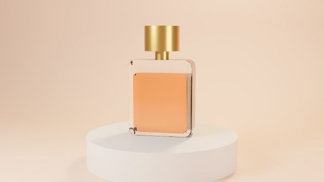</a> 
Scene 
<b><a href="amber-perfume-bottle/">Amber Perfume Bottle</a></b> 
A bevelled glass perfume bottle with amber liquid and a gold cap stands on a stone plinth against a peach cyclorama. 
<i>6 meshes; 5 materials; 3 lights</i> 
<code>product-shot</code> <code>glass</code> <code>bevel</code> <code>modifiers</code> <code>backdrop</code>
</td>
<td width="33%" valign="top">
<a href="chess-endgame-study/">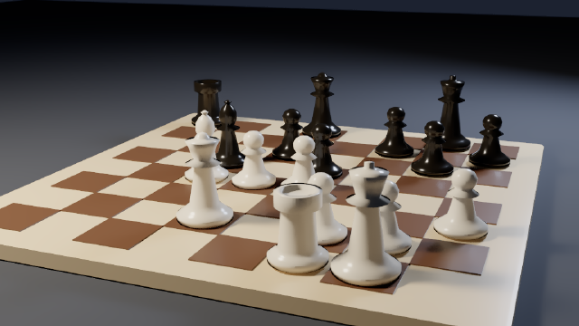</a> 
Scene 
<b><a href="chess-endgame-study/">Chess Endgame Study</a></b> 
Ivory and ebony chess pieces turned on a lathe stand mid-game on a walnut and maple board, shot low with shallow depth of field. 
<i>22 meshes; 5 materials; 2 lights</i> 
<code>lathe</code> <code>screw-modifier</code> <code>curves</code> <code>array</code> <code>depth-of-field</code>
</td>
<td width="33%" valign="top">
<a href="glazed-donut-sprinkles/">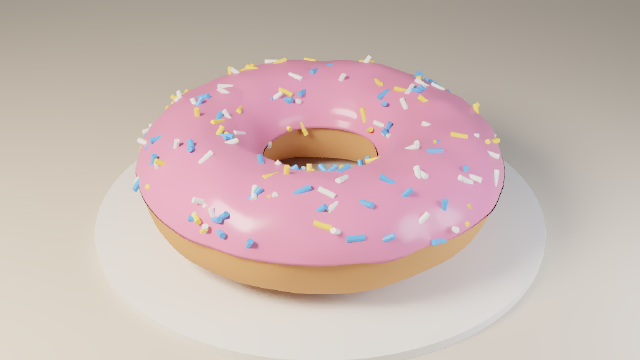</a> 
Scene 
<b><a href="glazed-donut-sprinkles/">Glazed Donut with Sprinkles</a></b> 
The classic first 3D project, a ring donut with pink icing and scattered sprinkles on a ceramic plate. 
<i>7 meshes; 7 materials; 2 lights</i> 
<code>modelling</code> <code>modifiers</code> <code>particles</code> <code>food</code> <code>bisect</code>
</td>
</tr>
<tr>
<td width="33%" valign="top">
<a href="gold-bevel-logo-text/">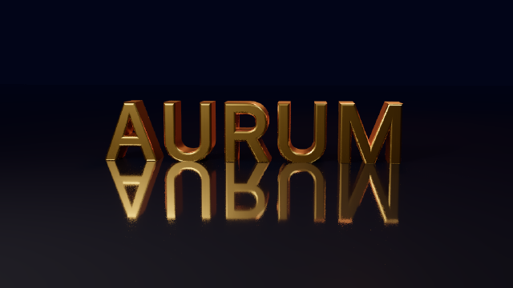</a> 
Scene 
<b><a href="gold-bevel-logo-text/">Gold Bevel Logo Text</a></b> 
An extruded, bevelled gold wordmark stands on a dark reflective floor, caught by a soft key and a warm rim light. 
<i>1 mesh; 2 materials; 3 lights</i> 
<code>text</code> <code>bevel</code> <code>metal</code> <code>reflections</code> <code>logo</code>
</td>
<td width="33%"></td>
<td width="33%"></td>
</tr>
</table>

## Sculpting & Characters

<table>
<tr>
<td width="33%" valign="top">
<a href="sculpted-desert-boulder/">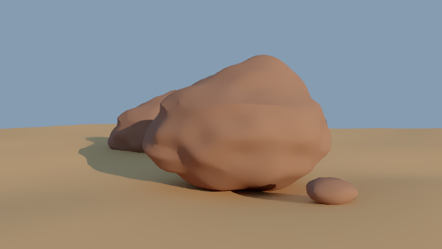</a> 
Scene 
<b><a href="sculpted-desert-boulder/">Sculpted Desert Boulder</a></b> 
A weathered sandstone boulder sculpted from an icosphere with flatten, crease and clay strokes, resting on rippled sand at golden hour. 
<i>4 meshes; 2 materials; 1 light</i> 
<code>sculpting</code> <code>displace</code> <code>rock</code> <code>sun-light</code> <code>environment</code>
</td>
<td width="33%"></td>
<td width="33%"></td>
</tr>
</table>

## Tags

`abstract` 1 · `animation` 1 · `architecture` 1 · `array` 4 · `backdrop` 1 · `bevel` 4 · `bisect` 1 · `ceramics` 1 · `composition` 1 · `curves` 1 · `depth-of-field` 1 · `displace` 2 · `drop` 1 · `emission` 1 · `environment` 1 · `facade` 1 · `flat-shading` 1 · `food` 1 · `glass` 2 · `interior` 1 · `isometric` 1 · `keyframes` 1 · `lathe` 2 · `logo` 1 · `low-poly` 1 · `materials` 1 · `metal` 2 · `modelling` 1 · `modifiers` 2 · `orthographic` 1 · `parenting` 1 · `particles` 1 · `pastel` 1 · `path-tracing` 1 · `product-shot` 1 · `reflections` 1 · `rock` 1 · `screw-modifier` 1 · `sculpting` 1 · `solidify` 1 · `studio-lighting` 2 · `stylised` 1 · `sun-light` 3 · `text` 2 · `three-point-lighting` 1 · `wide-angle` 1
