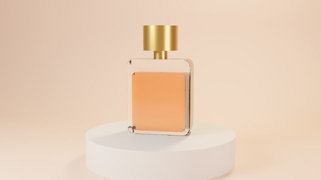

<!-- Generated by tools/gallery.mjs from showcase.yaml and build.json; do not edit. -->
# Amber Perfume Bottle

[Scene](../README.md) › [Product Renders](../README.md#product-renders) · `product-shot` `glass` `bevel` `modifiers` `backdrop`

A bevelled glass perfume bottle with amber liquid and a gold cap stands on a stone plinth against a peach cyclorama.



| | |
|---|---|
| Document | [amber-perfume-bottle.kscene](amber-perfume-bottle.kscene) (17 KB) |
| Contents | 6 meshes; 5 materials; 3 lights |
| Features | `scene.modifier.basics`, `scene.modifier.stack`, `scene.material.basics`, `scene.render.lights-world`, `scene.object.add`, `scene.viewport.rendered` |
| Built by | `kition-scene` @ `96f79582aa`: 38 commands in 13 ms |

## About

A cosmetics product shot from primitives. The bottle is a cube scaled flat and rounded with a
Bevel modifier (four segments), in clear glass (transmission 1); the perfume inside is a smaller
bevelled block of amber glass. The neck and the cap are cylinders, the cap in brushed gold. A
marble-grey plinth and a curved peach backdrop keep the frame clean, lit by a large soft key,
a warm rim behind the glass and a dim fill.

## Checks

- `inspect.objects`: `{"count":10,"any":{"name":"Bottle","modifiers":[{"type":"bevel","segments":5}]}}`
- `inspect.materials`: `{"count":5,"any":{"name":"Bottle Glass","transmission":1}}`
- diagnostics: none (the kit's check finds nothing wrong)
- the saved document opens again; the thumbnail matches `thumb.png` within the `render` tolerance

## Steps

<details><summary>38 commands (from <a href="showcase.yaml">showcase.yaml</a>)</summary>

```yaml
- command: edit.delete
  params:
    objects:
      - Cube
      - Light
- command: material.delete
  params:
    material: Material
- command: render.set
  params:
    width: 1920
    height: 1080
    view: agx
- command: add.backdrop
  params:
    name: Backdrop
    width: 16
    depth: 12
    height: 7
    radius: 2.5
    segments: 24
    location:
      - 0
      - -3
      - 0
- command: material.new
  params:
    name: Peach Paper
    baseColor: "#f1c7ae"
    roughness: 0.9
- command: add.cylinder
  params:
    name: Plinth
    radius: 1.3
    depth: 0.5
    vertices: 96
    location:
      - 0
      - 0
      - 0.25
- command: modifier.add
  params:
    object: Plinth
    type: bevel
    width: 0.02
    segments: 2
- command: material.new
  params:
    name: Stone
    baseColor: "#e8e2da"
    roughness: 0.55
- command: add.cube
  params:
    name: Bottle
    size: 1
    location:
      - 0
      - 0
      - 1.15
    scale:
      - 1.1
      - 0.5
      - 1.3
- command: modifier.add
  params:
    object: Bottle
    type: bevel
    width: 0.12
    segments: 5
- command: material.new
  params:
    name: Bottle Glass
    baseColor: "#ffffff"
    roughness: 0.02
- command: material.set
  params:
    material: Bottle Glass
    transmission: 1
    ior: 1.5
- command: add.cube
  params:
    name: Perfume
    size: 1
    location:
      - 0
      - 0
      - 1.07
    scale:
      - 0.92
      - 0.36
      - 1
- command: modifier.add
  params:
    object: Perfume
    type: bevel
    width: 0.08
    segments: 4
- command: material.new
  params:
    name: Amber Perfume
    baseColor: "#ffc04a"
    roughness: 0.05
- command: material.set
  params:
    material: Amber Perfume
    transmission: 1
    ior: 1.36
- command: add.cylinder
  params:
    name: Neck
    radius: 0.12
    depth: 0.16
    vertices: 48
    location:
      - 0
      - 0
      - 1.87
- command: add.cylinder
  params:
    name: Cap
    radius: 0.3
    depth: 0.42
    vertices: 64
    location:
      - 0
      - 0
      - 2.15
- command: modifier.add
  params:
    object: Cap
    type: bevel
    width: 0.03
    segments: 3
- command: material.new
  params:
    name: Brushed Gold
    baseColor: "#d9a648"
    metallic: 1
    roughness: 0.3
- command: material.assign
  params:
    material: Brushed Gold
    objects:
      - Neck
- command: object.shadeSmoothByAngle
  params:
    objects:
      - Bottle
      - Perfume
      - Cap
      - Neck
      - Plinth
    angle: 40
- command: add.light
  params:
    name: Key Softbox
    kind: area
    power: 1100
    color: "#fff6ec"
    location:
      - -4
      - -4.5
      - 4
- command: object.lookAt
  params:
    object: Key Softbox
    target:
      - 0
      - 0
      - 1.2
- command: light.set
  params:
    object: Key Softbox
    radius: 2
- command: add.light
  params:
    name: Rim
    kind: area
    power: 1300
    color: "#ffd2a0"
    location:
      - 1.5
      - 4
      - 6.5
- command: object.lookAt
  params:
    object: Rim
    target:
      - 0
      - 0
      - 1.2
- command: light.set
  params:
    object: Rim
    radius: 1.2
- command: add.light
  params:
    name: Fill
    kind: area
    power: 250
    color: "#ffe9e0"
    location:
      - 4.5
      - -3
      - 2
- command: object.lookAt
  params:
    object: Fill
    target:
      - 0
      - 0
      - 1.2
- command: light.set
  params:
    object: Fill
    radius: 2
- command: world.set
  params:
    color: "#f3d6c6"
    strength: 0.3
- command: object.transform
  params:
    objects:
      - Camera
    location:
      - 1.6
      - -7.5
      - 2.2
- command: object.lookAt
  params:
    object: Camera
    target:
      - 0
      - 0
      - 1.25
- command: camera.set
  params:
    object: Camera
    lens: 50
- command: select.none
- command: view.overlays
  params:
    on: false
- command: view.camera
```

</details>
