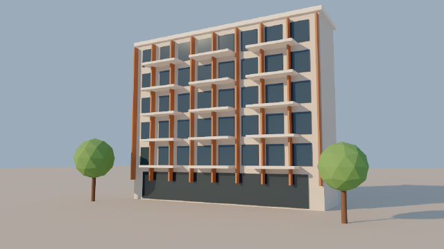

<!-- Generated by tools/gallery.mjs from showcase.yaml and build.json; do not edit. -->
# Apartment Facade Arrays

[Scene](../README.md) › [Architecture & Interiors](../README.md#architecture--interiors) · `architecture` `array` `facade` `sun-light` `wide-angle`

A six-storey apartment block whose windows, balconies and fins are each one object repeated by Array modifiers, in low evening sun.



| | |
|---|---|
| Document | [apartment-facade-arrays.kscene](apartment-facade-arrays.kscene) (13 KB) |
| Contents | 11 meshes; 8 materials; 1 light |
| Features | `scene.modifier.basics`, `scene.modifier.stack`, `scene.object.add`, `scene.material.basics`, `scene.render.lights-world`, `scene.viewport.rendered` |
| Built by | `kition-scene` @ `96f79582aa`: 39 commands in 5 ms |

## About

An architectural massing render where repetition does the work. One window (a glass pane in a
dark frame) becomes the whole grid with two Array modifiers, eight across and six up; the
balcony slabs and the vertical timber fins are single objects with their own arrays. The
concrete body, a glazed ground-floor lobby, a pavement and two round trees set the scale, and a
warm, low sun throws long shadows across the facade under a pale blue sky.

## Checks

- `inspect.objects`: `{"count":13,"any":{"name":"Window","modifiers":[{"type":"array","count":8},{"type":"array","count":5}]}}`
- `inspect.materials`: `{"count":8,"any":{"name":"Cedar"}}`
- diagnostics: none (the kit's check finds nothing wrong)
- the saved document opens again; the thumbnail matches `thumb.png` within the `render` tolerance

## Steps

<details><summary>39 commands (from <a href="showcase.yaml">showcase.yaml</a>)</summary>

```yaml
- command: edit.delete
  params:
    objects:
      - Cube
      - Light
- command: material.delete
  params:
    material: Material
- command: render.set
  params:
    width: 1920
    height: 1080
    view: agx
- command: add.plane
  params:
    name: Ground
    size: 300
    location:
      - 0
      - 0
      - 0
- command: material.new
  params:
    name: Pavement
    baseColor: "#b9b3aa"
    roughness: 0.9
- command: add.cube
  params:
    name: Building
    size: 1
    location:
      - 0
      - 2
      - 6.6
    scale:
      - 16
      - 4
      - 13.2
- command: material.new
  params:
    name: Board-marked Concrete
    baseColor: "#d8d2c8"
    roughness: 0.85
- command: add.cube
  params:
    name: Lobby Glass
    size: 1
    location:
      - 0
      - -0.02
      - 1.2
    scale:
      - 14
      - 0.1
      - 2.2
- command: material.new
  params:
    name: Lobby Glazing
    baseColor: "#2b3c48"
    roughness: 0.05
    metallic: 0.3
- command: add.cube
  params:
    name: Window
    size: 1
    location:
      - -6.65
      - -0.02
      - 3.6
    scale:
      - 1.3
      - 0.1
      - 1.5
- command: modifier.add
  params:
    object: Window
    type: array
    count: 8
    relativeOffset:
      - 1.46
      - 0
      - 0
- command: modifier.add
  params:
    object: Window
    type: array
    count: 5
    relativeOffset:
      - 0
      - 0
      - 1.4
- command: material.new
  params:
    name: Window Glass
    baseColor: "#33495a"
    roughness: 0.08
    metallic: 0.4
- command: add.cube
  params:
    name: Balconies
    size: 1
    location:
      - -4.75
      - -0.6
      - 2.75
    scale:
      - 3.4
      - 1.2
      - 0.18
- command: modifier.add
  params:
    object: Balconies
    type: array
    count: 3
    relativeOffset:
      - 1.4
      - 0
      - 0
- command: modifier.add
  params:
    object: Balconies
    type: array
    count: 5
    relativeOffset:
      - 0
      - 0
      - 11.67
- command: modifier.add
  params:
    object: Balconies
    type: bevel
    width: 0.02
    segments: 2
- command: material.new
  params:
    name: White Slab
    baseColor: "#f2efe9"
    roughness: 0.7
- command: add.cube
  params:
    name: Fins
    size: 1
    location:
      - -7.9
      - -0.25
      - 7.3
    scale:
      - 0.12
      - 0.5
      - 11.4
- command: modifier.add
  params:
    object: Fins
    type: array
    count: 9
    relativeOffset:
      - 16.43
      - 0
      - 0
- command: material.new
  params:
    name: Cedar
    baseColor: "#a8673a"
    roughness: 0.7
- command: add.cube
  params:
    name: Parapet
    size: 1
    location:
      - 0
      - 2
      - 13.35
    scale:
      - 16.4
      - 4.4
      - 0.3
- command: material.assign
  params:
    material: White Slab
    objects:
      - Parapet
- command: add.cylinder
  params:
    name: Tree Trunk L
    radius: 0.15
    depth: 2.4
    vertices: 12
    location:
      - -9.5
      - -3
      - 1.2
- command: add.icoSphere
  params:
    name: Tree Crown L
    radius: 1.6
    subdivisions: 2
    location:
      - -9.5
      - -3
      - 3.4
- command: add.cylinder
  params:
    name: Tree Trunk R
    radius: 0.15
    depth: 2
    vertices: 12
    location:
      - 10
      - -4
      - 1
- command: add.icoSphere
  params:
    name: Tree Crown R
    radius: 1.3
    subdivisions: 2
    location:
      - 10
      - -4
      - 2.9
- command: material.new
  params:
    name: Bark
    baseColor: "#5b4030"
    roughness: 0.9
- command: material.assign
  params:
    material: Bark
    objects:
      - Tree Trunk L
      - Tree Trunk R
- command: material.new
  params:
    name: Foliage
    baseColor: "#5e8f45"
    roughness: 0.85
- command: material.assign
  params:
    material: Foliage
    objects:
      - Tree Crown L
      - Tree Crown R
- command: add.light
  params:
    name: Evening Sun
    kind: sun
    power: 6
    color: "#ffd2a0"
    location:
      - 0
      - -20
      - 20
    rotation:
      - 68
      - 0
      - -35
- command: world.set
  params:
    color: "#a9c8e8"
    strength: 0.8
- command: object.transform
  params:
    objects:
      - Camera
    location:
      - 14
      - -24
      - 3.2
- command: object.lookAt
  params:
    object: Camera
    target:
      - 0
      - 1
      - 6
- command: camera.set
  params:
    object: Camera
    lens: 30
- command: select.none
- command: view.overlays
  params:
    on: false
- command: view.camera
```

</details>
