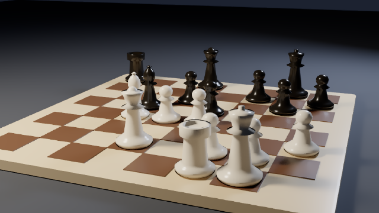

<!-- Generated by tools/gallery.mjs from showcase.yaml and build.json; do not edit. -->
# Chess Endgame Study

[Scene](../README.md) › [Product Renders](../README.md#product-renders) · `lathe` `screw-modifier` `curves` `array` `depth-of-field`

Ivory and ebony chess pieces turned on a lathe stand mid-game on a walnut and maple board, shot low with shallow depth of field.



| | |
|---|---|
| Document | [chess-endgame-study.kscene](chess-endgame-study.kscene) (13 KB) |
| Contents | 22 meshes; 5 materials; 2 lights |
| Features | `scene.curve.text-lattice`, `scene.modifier.basics`, `scene.modifier.stack`, `scene.material.basics`, `scene.render.lights-world`, `scene.viewport.rendered` |
| Built by | `kition-scene` @ `96f79582aa`: 124 commands in 12 ms |

## About

Every piece is turned like on a lathe: a poly curve traces half the profile in the XZ plane,
object.convertToMesh makes it an edge line, and a Screw modifier spins it 360° in 48 steps.
Five profiles (pawn, rook, bishop, queen, king) give eighteen pieces in polished ivory and ebony.
The dark squares are a single tile repeated by two Array modifiers (four by four, two tiles
apart) plus a second, offset copy; the light squares are the maple board beneath. A low camera
with depth of field focused on the white bishop finishes the still life.

## Checks

- `inspect.objects`: `{"count":25,"any":{"name":"Black Queen","material":{"exists":true},"modifiers":[{"type":"screw","angle":360,"steps":48}]}}`
- `inspect.materials`: `{"count":5,"any":{"name":"Ebony"}}`
- `inspect.objects.0`: `{"name":"Camera","camera":{"depthOfField":true,"lens":45}}`
- diagnostics: none (the kit's check finds nothing wrong)
- the saved document opens again; the thumbnail matches `thumb.png` within the `render` tolerance

## Steps

<details><summary>124 commands (from <a href="showcase.yaml">showcase.yaml</a>)</summary>

```yaml
- command: edit.delete
  params:
    objects:
      - Cube
      - Light
- command: material.delete
  params:
    material: Material
- command: render.set
  params:
    width: 1920
    height: 1080
    view: agx
- command: add.plane
  params:
    name: Table
    size: 40
    location:
      - 0
      - 0
      - -0.01
- command: material.new
  params:
    name: Dark Felt
    baseColor: "#2b2f36"
    roughness: 0.9
- command: add.cube
  params:
    name: Board
    size: 1
    location:
      - 0
      - 0
      - 0.065
    scale:
      - 4.5
      - 4.5
      - 0.13
- command: modifier.add
  params:
    object: Board
    type: bevel
    width: 0.02
    segments: 2
- command: material.new
  params:
    name: Maple
    baseColor: "#e3c99f"
    roughness: 0.35
- command: add.cube
  params:
    name: Dark Squares A
    size: 1
    location:
      - -1.75
      - -1.75
      - 0.135
    scale:
      - 0.5
      - 0.5
      - 0.01
- command: modifier.add
  params:
    object: Dark Squares A
    type: array
    count: 4
    relativeOffset:
      - 2
      - 0
      - 0
- command: modifier.add
  params:
    object: Dark Squares A
    type: array
    count: 4
    relativeOffset:
      - 0
      - 2
      - 0
- command: add.cube
  params:
    name: Dark Squares B
    size: 1
    location:
      - -1.25
      - -1.25
      - 0.135
    scale:
      - 0.5
      - 0.5
      - 0.01
- command: modifier.add
  params:
    object: Dark Squares B
    type: array
    count: 4
    relativeOffset:
      - 2
      - 0
      - 0
- command: modifier.add
  params:
    object: Dark Squares B
    type: array
    count: 4
    relativeOffset:
      - 0
      - 2
      - 0
- command: material.new
  params:
    name: Walnut Inlay
    baseColor: "#5a3a24"
    roughness: 0.35
- command: material.assign
  params:
    material: Walnut Inlay
    objects:
      - Dark Squares A
      - Dark Squares B
- command: add.curveBezier
  params:
    name: White King
    location:
      - 1.25
      - -1.75
      - 0.15
- command: curve.setSplines
  params:
    object: White King
    splines:
      - type: poly
        points:
          - co:
              - 0
              - 0
              - 0
          - co:
              - 0.44
              - 0
              - 0
          - co:
              - 0.44
              - 0
              - 0.09
          - co:
              - 0.34
              - 0
              - 0.15
          - co:
              - 0.23
              - 0
              - 0.26
          - co:
              - 0.14
              - 0
              - 0.88
          - co:
              - 0.27
              - 0
              - 0.94
          - co:
              - 0.15
              - 0
              - 1
          - co:
              - 0.21
              - 0
              - 1.2
          - co:
              - 0.24
              - 0
              - 1.3
          - co:
              - 0.1
              - 0
              - 1.33
          - co:
              - 0.06
              - 0
              - 1.36
          - co:
              - 0.06
              - 0
              - 1.42
          - co:
              - 0
              - 0
              - 1.43
- command: object.convertToMesh
  params:
    objects:
      - White King
- command: modifier.add
  params:
    object: White King
    type: screw
    angle: 360
    steps: 48
    axis: z
- command: object.transform
  params:
    objects:
      - White King
    scale:
      - 0.55
      - 0.55
      - 0.55
- command: add.curveBezier
  params:
    name: White Rook
    location:
      - 0.75
      - -1.75
      - 0.15
- command: curve.setSplines
  params:
    object: White Rook
    splines:
      - type: poly
        points:
          - co:
              - 0
              - 0
              - 0
          - co:
              - 0.4
              - 0
              - 0
          - co:
              - 0.4
              - 0
              - 0.09
          - co:
              - 0.32
              - 0
              - 0.14
          - co:
              - 0.26
              - 0
              - 0.2
          - co:
              - 0.22
              - 0
              - 0.7
          - co:
              - 0.31
              - 0
              - 0.75
          - co:
              - 0.31
              - 0
              - 0.95
          - co:
              - 0.22
              - 0
              - 0.95
          - co:
              - 0.22
              - 0
              - 0.88
          - co:
              - 0
              - 0
              - 0.88
- command: object.convertToMesh
  params:
    objects:
      - White Rook
- command: modifier.add
  params:
    object: White Rook
    type: screw
    angle: 360
    steps: 48
    axis: z
- command: object.transform
  params:
    objects:
      - White Rook
    scale:
      - 0.55
      - 0.55
      - 0.55
- command: add.curveBezier
  params:
    name: White Queen
    location:
      - -0.25
      - -1.25
      - 0.15
- command: curve.setSplines
  params:
    object: White Queen
    splines:
      - type: poly
        points:
          - co:
              - 0
              - 0
              - 0
          - co:
              - 0.42
              - 0
              - 0
          - co:
              - 0.42
              - 0
              - 0.09
          - co:
              - 0.33
              - 0
              - 0.15
          - co:
              - 0.22
              - 0
              - 0.25
          - co:
              - 0.13
              - 0
              - 0.8
          - co:
              - 0.26
              - 0
              - 0.86
          - co:
              - 0.14
              - 0
              - 0.92
          - co:
              - 0.2
              - 0
              - 1.1
          - co:
              - 0.25
              - 0
              - 1.2
          - co:
              - 0.12
              - 0
              - 1.22
          - co:
              - 0.1
              - 0
              - 1.26
          - co:
              - 0.07
              - 0
              - 1.3
          - co:
              - 0
              - 0
              - 1.33
- command: object.convertToMesh
  params:
    objects:
      - White Queen
- command: modifier.add
  params:
    object: White Queen
    type: screw
    angle: 360
    steps: 48
    axis: z
- command: object.transform
  params:
    objects:
      - White Queen
    scale:
      - 0.55
      - 0.55
      - 0.55
- command: add.curveBezier
  params:
    name: White Bishop
    location:
      - -0.75
      - -0.25
      - 0.15
- command: curve.setSplines
  params:
    object: White Bishop
    splines:
      - type: poly
        points:
          - co:
              - 0
              - 0
              - 0
          - co:
              - 0.38
              - 0
              - 0
          - co:
              - 0.38
              - 0
              - 0.08
          - co:
              - 0.29
              - 0
              - 0.13
          - co:
              - 0.2
              - 0
              - 0.22
          - co:
              - 0.12
              - 0
              - 0.62
          - co:
              - 0.22
              - 0
              - 0.67
          - co:
              - 0.11
              - 0
              - 0.72
          - co:
              - 0.17
              - 0
              - 0.84
          - co:
              - 0.16
              - 0
              - 0.97
          - co:
              - 0.1
              - 0
              - 1.07
          - co:
              - 0.04
              - 0
              - 1.12
          - co:
              - 0.07
              - 0
              - 1.16
          - co:
              - 0
              - 0
              - 1.2
- command: object.convertToMesh
  params:
    objects:
      - White Bishop
- command: modifier.add
  params:
    object: White Bishop
    type: screw
    angle: 360
    steps: 48
    axis: z
- command: object.transform
  params:
    objects:
      - White Bishop
    scale:
      - 0.55
      - 0.55
      - 0.55
- command: add.curveBezier
  params:
    name: White Pawn D4
    location:
      - -0.25
      - -0.25
      - 0.15
- command: curve.setSplines
  params:
    object: White Pawn D4
    splines:
      - type: poly
        points:
          - co:
              - 0
              - 0
              - 0
          - co:
              - 0.38
              - 0
              - 0
          - co:
              - 0.38
              - 0
              - 0.08
          - co:
              - 0.3
              - 0
              - 0.13
          - co:
              - 0.2
              - 0
              - 0.22
          - co:
              - 0.13
              - 0
              - 0.5
          - co:
              - 0.22
              - 0
              - 0.55
          - co:
              - 0.12
              - 0
              - 0.62
          - co:
              - 0.17
              - 0
              - 0.7
          - co:
              - 0.18
              - 0
              - 0.78
          - co:
              - 0.14
              - 0
              - 0.86
          - co:
              - 0.07
              - 0
              - 0.9
          - co:
              - 0
              - 0
              - 0.91
- command: object.convertToMesh
  params:
    objects:
      - White Pawn D4
- command: modifier.add
  params:
    object: White Pawn D4
    type: screw
    angle: 360
    steps: 48
    axis: z
- command: object.transform
  params:
    objects:
      - White Pawn D4
    scale:
      - 0.55
      - 0.55
      - 0.55
- command: add.curveBezier
  params:
    name: White Pawn E4
    location:
      - 0.25
      - -0.25
      - 0.15
- command: curve.setSplines
  params:
    object: White Pawn E4
    splines:
      - type: poly
        points:
          - co:
              - 0
              - 0
              - 0
          - co:
              - 0.38
              - 0
              - 0
          - co:
              - 0.38
              - 0
              - 0.08
          - co:
              - 0.3
              - 0
              - 0.13
          - co:
              - 0.2
              - 0
              - 0.22
          - co:
              - 0.13
              - 0
              - 0.5
          - co:
              - 0.22
              - 0
              - 0.55
          - co:
              - 0.12
              - 0
              - 0.62
          - co:
              - 0.17
              - 0
              - 0.7
          - co:
              - 0.18
              - 0
              - 0.78
          - co:
              - 0.14
              - 0
              - 0.86
          - co:
              - 0.07
              - 0
              - 0.9
          - co:
              - 0
              - 0
              - 0.91
- command: object.convertToMesh
  params:
    objects:
      - White Pawn E4
- command: modifier.add
  params:
    object: White Pawn E4
    type: screw
    angle: 360
    steps: 48
    axis: z
- command: object.transform
  params:
    objects:
      - White Pawn E4
    scale:
      - 0.55
      - 0.55
      - 0.55
- command: add.curveBezier
  params:
    name: White Pawn F2
    location:
      - 0.75
      - -1.25
      - 0.15
- command: curve.setSplines
  params:
    object: White Pawn F2
    splines:
      - type: poly
        points:
          - co:
              - 0
              - 0
              - 0
          - co:
              - 0.38
              - 0
              - 0
          - co:
              - 0.38
              - 0
              - 0.08
          - co:
              - 0.3
              - 0
              - 0.13
          - co:
              - 0.2
              - 0
              - 0.22
          - co:
              - 0.13
              - 0
              - 0.5
          - co:
              - 0.22
              - 0
              - 0.55
          - co:
              - 0.12
              - 0
              - 0.62
          - co:
              - 0.17
              - 0
              - 0.7
          - co:
              - 0.18
              - 0
              - 0.78
          - co:
              - 0.14
              - 0
              - 0.86
          - co:
              - 0.07
              - 0
              - 0.9
          - co:
              - 0
              - 0
              - 0.91
- command: object.convertToMesh
  params:
    objects:
      - White Pawn F2
- command: modifier.add
  params:
    object: White Pawn F2
    type: screw
    angle: 360
    steps: 48
    axis: z
- command: object.transform
  params:
    objects:
      - White Pawn F2
    scale:
      - 0.55
      - 0.55
      - 0.55
- command: add.curveBezier
  params:
    name: White Pawn G2
    location:
      - 1.25
      - -1.25
      - 0.15
- command: curve.setSplines
  params:
    object: White Pawn G2
    splines:
      - type: poly
        points:
          - co:
              - 0
              - 0
              - 0
          - co:
              - 0.38
              - 0
              - 0
          - co:
              - 0.38
              - 0
              - 0.08
          - co:
              - 0.3
              - 0
              - 0.13
          - co:
              - 0.2
              - 0
              - 0.22
          - co:
              - 0.13
              - 0
              - 0.5
          - co:
              - 0.22
              - 0
              - 0.55
          - co:
              - 0.12
              - 0
              - 0.62
          - co:
              - 0.17
              - 0
              - 0.7
          - co:
              - 0.18
              - 0
              - 0.78
          - co:
              - 0.14
              - 0
              - 0.86
          - co:
              - 0.07
              - 0
              - 0.9
          - co:
              - 0
              - 0
              - 0.91
- command: object.convertToMesh
  params:
    objects:
      - White Pawn G2
- command: modifier.add
  params:
    object: White Pawn G2
    type: screw
    angle: 360
    steps: 48
    axis: z
- command: object.transform
  params:
    objects:
      - White Pawn G2
    scale:
      - 0.55
      - 0.55
      - 0.55
- command: add.curveBezier
  params:
    name: White Pawn H3
    location:
      - 1.75
      - -0.75
      - 0.15
- command: curve.setSplines
  params:
    object: White Pawn H3
    splines:
      - type: poly
        points:
          - co:
              - 0
              - 0
              - 0
          - co:
              - 0.38
              - 0
              - 0
          - co:
              - 0.38
              - 0
              - 0.08
          - co:
              - 0.3
              - 0
              - 0.13
          - co:
              - 0.2
              - 0
              - 0.22
          - co:
              - 0.13
              - 0
              - 0.5
          - co:
              - 0.22
              - 0
              - 0.55
          - co:
              - 0.12
              - 0
              - 0.62
          - co:
              - 0.17
              - 0
              - 0.7
          - co:
              - 0.18
              - 0
              - 0.78
          - co:
              - 0.14
              - 0
              - 0.86
          - co:
              - 0.07
              - 0
              - 0.9
          - co:
              - 0
              - 0
              - 0.91
- command: object.convertToMesh
  params:
    objects:
      - White Pawn H3
- command: modifier.add
  params:
    object: White Pawn H3
    type: screw
    angle: 360
    steps: 48
    axis: z
- command: object.transform
  params:
    objects:
      - White Pawn H3
    scale:
      - 0.55
      - 0.55
      - 0.55
- command: add.curveBezier
  params:
    name: Black King
    location:
      - 1.25
      - 1.75
      - 0.15
- command: curve.setSplines
  params:
    object: Black King
    splines:
      - type: poly
        points:
          - co:
              - 0
              - 0
              - 0
          - co:
              - 0.44
              - 0
              - 0
          - co:
              - 0.44
              - 0
              - 0.09
          - co:
              - 0.34
              - 0
              - 0.15
          - co:
              - 0.23
              - 0
              - 0.26
          - co:
              - 0.14
              - 0
              - 0.88
          - co:
              - 0.27
              - 0
              - 0.94
          - co:
              - 0.15
              - 0
              - 1
          - co:
              - 0.21
              - 0
              - 1.2
          - co:
              - 0.24
              - 0
              - 1.3
          - co:
              - 0.1
              - 0
              - 1.33
          - co:
              - 0.06
              - 0
              - 1.36
          - co:
              - 0.06
              - 0
              - 1.42
          - co:
              - 0
              - 0
              - 1.43
- command: object.convertToMesh
  params:
    objects:
      - Black King
- command: modifier.add
  params:
    object: Black King
    type: screw
    angle: 360
    steps: 48
    axis: z
- command: object.transform
  params:
    objects:
      - Black King
    scale:
      - 0.55
      - 0.55
      - 0.55
- command: add.curveBezier
  params:
    name: Black Queen
    location:
      - -0.25
      - 1.75
      - 0.15
- command: curve.setSplines
  params:
    object: Black Queen
    splines:
      - type: poly
        points:
          - co:
              - 0
              - 0
              - 0
          - co:
              - 0.42
              - 0
              - 0
          - co:
              - 0.42
              - 0
              - 0.09
          - co:
              - 0.33
              - 0
              - 0.15
          - co:
              - 0.22
              - 0
              - 0.25
          - co:
              - 0.13
              - 0
              - 0.8
          - co:
              - 0.26
              - 0
              - 0.86
          - co:
              - 0.14
              - 0
              - 0.92
          - co:
              - 0.2
              - 0
              - 1.1
          - co:
              - 0.25
              - 0
              - 1.2
          - co:
              - 0.12
              - 0
              - 1.22
          - co:
              - 0.1
              - 0
              - 1.26
          - co:
              - 0.07
              - 0
              - 1.3
          - co:
              - 0
              - 0
              - 1.33
- command: object.convertToMesh
  params:
    objects:
      - Black Queen
- command: modifier.add
  params:
    object: Black Queen
    type: screw
    angle: 360
    steps: 48
    axis: z
- command: object.transform
  params:
    objects:
      - Black Queen
    scale:
      - 0.55
      - 0.55
      - 0.55
- command: add.curveBezier
  params:
    name: Black Rook
    location:
      - -1.75
      - 1.75
      - 0.15
- command: curve.setSplines
  params:
    object: Black Rook
    splines:
      - type: poly
        points:
          - co:
              - 0
              - 0
              - 0
          - co:
              - 0.4
              - 0
              - 0
          - co:
              - 0.4
              - 0
              - 0.09
          - co:
              - 0.32
              - 0
              - 0.14
          - co:
              - 0.26
              - 0
              - 0.2
          - co:
              - 0.22
              - 0
              - 0.7
          - co:
              - 0.31
              - 0
              - 0.75
          - co:
              - 0.31
              - 0
              - 0.95
          - co:
              - 0.22
              - 0
              - 0.95
          - co:
              - 0.22
              - 0
              - 0.88
          - co:
              - 0
              - 0
              - 0.88
- command: object.convertToMesh
  params:
    objects:
      - Black Rook
- command: modifier.add
  params:
    object: Black Rook
    type: screw
    angle: 360
    steps: 48
    axis: z
- command: object.transform
  params:
    objects:
      - Black Rook
    scale:
      - 0.55
      - 0.55
      - 0.55
- command: add.curveBezier
  params:
    name: Black Bishop
    location:
      - -0.75
      - 0.25
      - 0.15
- command: curve.setSplines
  params:
    object: Black Bishop
    splines:
      - type: poly
        points:
          - co:
              - 0
              - 0
              - 0
          - co:
              - 0.38
              - 0
              - 0
          - co:
              - 0.38
              - 0
              - 0.08
          - co:
              - 0.29
              - 0
              - 0.13
          - co:
              - 0.2
              - 0
              - 0.22
          - co:
              - 0.12
              - 0
              - 0.62
          - co:
              - 0.22
              - 0
              - 0.67
          - co:
              - 0.11
              - 0
              - 0.72
          - co:
              - 0.17
              - 0
              - 0.84
          - co:
              - 0.16
              - 0
              - 0.97
          - co:
              - 0.1
              - 0
              - 1.07
          - co:
              - 0.04
              - 0
              - 1.12
          - co:
              - 0.07
              - 0
              - 1.16
          - co:
              - 0
              - 0
              - 1.2
- command: object.convertToMesh
  params:
    objects:
      - Black Bishop
- command: modifier.add
  params:
    object: Black Bishop
    type: screw
    angle: 360
    steps: 48
    axis: z
- command: object.transform
  params:
    objects:
      - Black Bishop
    scale:
      - 0.55
      - 0.55
      - 0.55
- command: add.curveBezier
  params:
    name: Black Pawn D6
    location:
      - -0.25
      - 0.75
      - 0.15
- command: curve.setSplines
  params:
    object: Black Pawn D6
    splines:
      - type: poly
        points:
          - co:
              - 0
              - 0
              - 0
          - co:
              - 0.38
              - 0
              - 0
          - co:
              - 0.38
              - 0
              - 0.08
          - co:
              - 0.3
              - 0
              - 0.13
          - co:
              - 0.2
              - 0
              - 0.22
          - co:
              - 0.13
              - 0
              - 0.5
          - co:
              - 0.22
              - 0
              - 0.55
          - co:
              - 0.12
              - 0
              - 0.62
          - co:
              - 0.17
              - 0
              - 0.7
          - co:
              - 0.18
              - 0
              - 0.78
          - co:
              - 0.14
              - 0
              - 0.86
          - co:
              - 0.07
              - 0
              - 0.9
          - co:
              - 0
              - 0
              - 0.91
- command: object.convertToMesh
  params:
    objects:
      - Black Pawn D6
- command: modifier.add
  params:
    object: Black Pawn D6
    type: screw
    angle: 360
    steps: 48
    axis: z
- command: object.transform
  params:
    objects:
      - Black Pawn D6
    scale:
      - 0.55
      - 0.55
      - 0.55
- command: add.curveBezier
  params:
    name: Black Pawn E5
    location:
      - 0.25
      - 0.25
      - 0.15
- command: curve.setSplines
  params:
    object: Black Pawn E5
    splines:
      - type: poly
        points:
          - co:
              - 0
              - 0
              - 0
          - co:
              - 0.38
              - 0
              - 0
          - co:
              - 0.38
              - 0
              - 0.08
          - co:
              - 0.3
              - 0
              - 0.13
          - co:
              - 0.2
              - 0
              - 0.22
          - co:
              - 0.13
              - 0
              - 0.5
          - co:
              - 0.22
              - 0
              - 0.55
          - co:
              - 0.12
              - 0
              - 0.62
          - co:
              - 0.17
              - 0
              - 0.7
          - co:
              - 0.18
              - 0
              - 0.78
          - co:
              - 0.14
              - 0
              - 0.86
          - co:
              - 0.07
              - 0
              - 0.9
          - co:
              - 0
              - 0
              - 0.91
- command: object.convertToMesh
  params:
    objects:
      - Black Pawn E5
- command: modifier.add
  params:
    object: Black Pawn E5
    type: screw
    angle: 360
    steps: 48
    axis: z
- command: object.transform
  params:
    objects:
      - Black Pawn E5
    scale:
      - 0.55
      - 0.55
      - 0.55
- command: add.curveBezier
  params:
    name: Black Pawn F7
    location:
      - 0.75
      - 1.25
      - 0.15
- command: curve.setSplines
  params:
    object: Black Pawn F7
    splines:
      - type: poly
        points:
          - co:
              - 0
              - 0
              - 0
          - co:
              - 0.38
              - 0
              - 0
          - co:
              - 0.38
              - 0
              - 0.08
          - co:
              - 0.3
              - 0
              - 0.13
          - co:
              - 0.2
              - 0
              - 0.22
          - co:
              - 0.13
              - 0
              - 0.5
          - co:
              - 0.22
              - 0
              - 0.55
          - co:
              - 0.12
              - 0
              - 0.62
          - co:
              - 0.17
              - 0
              - 0.7
          - co:
              - 0.18
              - 0
              - 0.78
          - co:
              - 0.14
              - 0
              - 0.86
          - co:
              - 0.07
              - 0
              - 0.9
          - co:
              - 0
              - 0
              - 0.91
- command: object.convertToMesh
  params:
    objects:
      - Black Pawn F7
- command: modifier.add
  params:
    object: Black Pawn F7
    type: screw
    angle: 360
    steps: 48
    axis: z
- command: object.transform
  params:
    objects:
      - Black Pawn F7
    scale:
      - 0.55
      - 0.55
      - 0.55
- command: add.curveBezier
  params:
    name: Black Pawn G6
    location:
      - 1.25
      - 0.75
      - 0.15
- command: curve.setSplines
  params:
    object: Black Pawn G6
    splines:
      - type: poly
        points:
          - co:
              - 0
              - 0
              - 0
          - co:
              - 0.38
              - 0
              - 0
          - co:
              - 0.38
              - 0
              - 0.08
          - co:
              - 0.3
              - 0
              - 0.13
          - co:
              - 0.2
              - 0
              - 0.22
          - co:
              - 0.13
              - 0
              - 0.5
          - co:
              - 0.22
              - 0
              - 0.55
          - co:
              - 0.12
              - 0
              - 0.62
          - co:
              - 0.17
              - 0
              - 0.7
          - co:
              - 0.18
              - 0
              - 0.78
          - co:
              - 0.14
              - 0
              - 0.86
          - co:
              - 0.07
              - 0
              - 0.9
          - co:
              - 0
              - 0
              - 0.91
- command: object.convertToMesh
  params:
    objects:
      - Black Pawn G6
- command: modifier.add
  params:
    object: Black Pawn G6
    type: screw
    angle: 360
    steps: 48
    axis: z
- command: object.transform
  params:
    objects:
      - Black Pawn G6
    scale:
      - 0.55
      - 0.55
      - 0.55
- command: add.curveBezier
  params:
    name: Black Pawn H7
    location:
      - 1.75
      - 1.25
      - 0.15
- command: curve.setSplines
  params:
    object: Black Pawn H7
    splines:
      - type: poly
        points:
          - co:
              - 0
              - 0
              - 0
          - co:
              - 0.38
              - 0
              - 0
          - co:
              - 0.38
              - 0
              - 0.08
          - co:
              - 0.3
              - 0
              - 0.13
          - co:
              - 0.2
              - 0
              - 0.22
          - co:
              - 0.13
              - 0
              - 0.5
          - co:
              - 0.22
              - 0
              - 0.55
          - co:
              - 0.12
              - 0
              - 0.62
          - co:
              - 0.17
              - 0
              - 0.7
          - co:
              - 0.18
              - 0
              - 0.78
          - co:
              - 0.14
              - 0
              - 0.86
          - co:
              - 0.07
              - 0
              - 0.9
          - co:
              - 0
              - 0
              - 0.91
- command: object.convertToMesh
  params:
    objects:
      - Black Pawn H7
- command: modifier.add
  params:
    object: Black Pawn H7
    type: screw
    angle: 360
    steps: 48
    axis: z
- command: object.transform
  params:
    objects:
      - Black Pawn H7
    scale:
      - 0.55
      - 0.55
      - 0.55
- command: object.shadeSmooth
  params:
    objects:
      - White King
      - White Rook
      - White Queen
      - White Bishop
      - White Pawn D4
      - White Pawn E4
      - White Pawn F2
      - White Pawn G2
      - White Pawn H3
      - Black King
      - Black Queen
      - Black Rook
      - Black Bishop
      - Black Pawn D6
      - Black Pawn E5
      - Black Pawn F7
      - Black Pawn G6
      - Black Pawn H7
- command: material.new
  params:
    name: Ivory
    baseColor: "#f1e8d6"
    roughness: 0.22
- command: material.assign
  params:
    material: Ivory
    objects:
      - White King
      - White Rook
      - White Queen
      - White Bishop
      - White Pawn D4
      - White Pawn E4
      - White Pawn F2
      - White Pawn G2
      - White Pawn H3
- command: material.new
  params:
    name: Ebony
    baseColor: "#17140f"
    roughness: 0.18
- command: material.assign
  params:
    material: Ebony
    objects:
      - Black King
      - Black Queen
      - Black Rook
      - Black Bishop
      - Black Pawn D6
      - Black Pawn E5
      - Black Pawn F7
      - Black Pawn G6
      - Black Pawn H7
- command: add.light
  params:
    name: Key
    kind: area
    power: 900
    color: "#fff1de"
    location:
      - -4
      - -3
      - 5
- command: object.lookAt
  params:
    object: Key
    target:
      - 0
      - 0
      - 0.3
- command: light.set
  params:
    object: Key
    radius: 1.5
- command: add.light
  params:
    name: Rim
    kind: area
    power: 700
    color: "#cfe0ff"
    location:
      - 3
      - 5
      - 4
- command: object.lookAt
  params:
    object: Rim
    target:
      - 0
      - 0
      - 0.3
- command: light.set
  params:
    object: Rim
    radius: 1.5
- command: world.set
  params:
    color: "#3a4150"
    strength: 0.35
- command: object.transform
  params:
    objects:
      - Camera
    location:
      - 2.4
      - -6.2
      - 2.3
- command: object.lookAt
  params:
    object: Camera
    target:
      - -0.1
      - 0.3
      - 0.2
- command: camera.set
  params:
    object: Camera
    lens: 45
    depthOfField: true
    focusObject: White Bishop
    fStop: 2.8
- command: select.none
- command: view.overlays
  params:
    on: false
- command: view.camera
```

</details>
