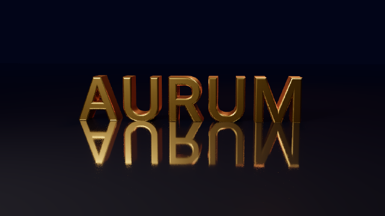

<!-- Generated by tools/gallery.mjs from showcase.yaml and build.json; do not edit. -->
# Gold Bevel Logo Text

[Scene](../README.md) › [Product Renders](../README.md#product-renders) · `text` `bevel` `metal` `reflections` `logo`

An extruded, bevelled gold wordmark stands on a dark reflective floor, caught by a soft key and a warm rim light.



| | |
|---|---|
| Document | [gold-bevel-logo-text.kscene](gold-bevel-logo-text.kscene) (5 KB) |
| Contents | 1 mesh; 2 materials; 3 lights |
| Features | `scene.curve.text-lattice`, `scene.material.basics`, `scene.render.lights-world`, `scene.object.add`, `scene.viewport.rendered` |
| Built by | `kition-scene` @ `96f79582aa`: 24 commands in 2 ms |

## About

A title-card logo built from a text object: text.set gives it depth (`extrude`) and a rounded
edge (`bevelDepth`), and a polished gold material (metallic 1, roughness 0.22) picks up the
lights. The floor is a large plane with a near-black glossy material, so the letters reflect in
it; a big area key, a warm rim behind and a dim blue world shape the metal.

## Checks

- `inspect.objects`: `{"count":6,"any":{"name":"Wordmark","type":"text"}}`
- `inspect.materials`: `{"count":2,"any":{"name":"Polished Gold","metallic":1}}`
- diagnostics: none (the kit's check finds nothing wrong)
- the saved document opens again; the thumbnail matches `thumb.png` within the `render` tolerance

## Steps

<details><summary>24 commands (from <a href="showcase.yaml">showcase.yaml</a>)</summary>

```yaml
- command: edit.delete
  params:
    objects:
      - Cube
      - Light
- command: material.delete
  params:
    material: Material
- command: render.set
  params:
    width: 1920
    height: 1080
    view: agx
- command: add.text
  params:
    name: Wordmark
    body: AURUM
    size: 1.1
    location:
      - 0
      - 0
      - 0
    rotation:
      - 90
      - 0
      - 0
  as: word
- command: text.set
  params:
    object: Wordmark
    align: center
    extrude: 0.14
    bevelDepth: 0.025
    bevelResolution: 4
    characterSpacing: 1.08
- command: material.new
  params:
    name: Polished Gold
    baseColor: "#e9b44c"
    metallic: 1
    roughness: 0.22
- command: add.plane
  params:
    name: Floor
    size: 40
    location:
      - 0
      - 0
      - -0.01
- command: material.new
  params:
    name: Black Lacquer
    baseColor: "#0d0e12"
    roughness: 0.06
- command: add.light
  params:
    name: Key
    kind: area
    power: 900
    color: "#fff2df"
    location:
      - -2.5
      - -5
      - 3.2
- command: object.lookAt
  params:
    object: Key
    target:
      - 0
      - 0
      - 0.4
- command: light.set
  params:
    object: Key
    radius: 1.5
- command: add.light
  params:
    name: Rim
    kind: area
    power: 1200
    color: "#ff9a4d"
    location:
      - 1.5
      - 5
      - 6
- command: object.lookAt
  params:
    object: Rim
    target:
      - 0
      - 0
      - 0.4
- command: light.set
  params:
    object: Rim
    radius: 1
- command: add.light
  params:
    name: Top Fill
    kind: area
    power: 250
    color: "#dfe8ff"
    location:
      - 3
      - -3
      - 5
- command: object.lookAt
  params:
    object: Top Fill
    target:
      - 0
      - 0
      - 0.4
- command: light.set
  params:
    object: Top Fill
    radius: 2.5
- command: world.set
  params:
    color: "#1b2440"
    strength: 0.25
- command: object.transform
  params:
    objects:
      - Camera
    location:
      - 0.5
      - -6.5
      - 1
- command: object.lookAt
  params:
    object: Camera
    target:
      - 0
      - 0
      - 0.15
- command: camera.set
  params:
    object: Camera
    lens: 45
- command: select.none
- command: view.overlays
  params:
    on: false
- command: view.camera
```

</details>
