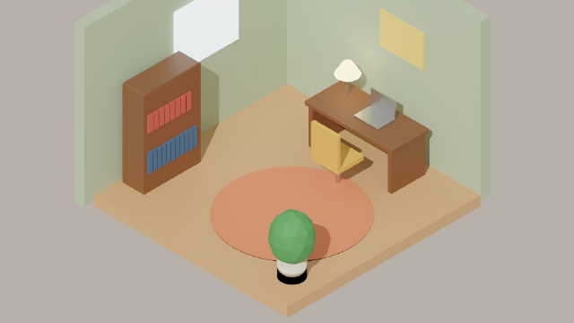

<!-- Generated by tools/gallery.mjs from showcase.yaml and build.json; do not edit. -->
# Isometric Study Room

[Scene](../README.md) › [Architecture & Interiors](../README.md#architecture--interiors) · `isometric` `interior` `orthographic` `array` `bevel` `emission`

A cosy isometric study with a desk, bookshelf, plant, rug and a glowing lamp, framed by an orthographic camera.



| | |
|---|---|
| Document | [isometric-study-room.kscene](isometric-study-room.kscene) (20 KB) |
| Contents | 21 meshes; 13 materials; 1 light |
| Features | `scene.object.add`, `scene.modifier.basics`, `scene.modifier.stack`, `scene.material.basics`, `scene.render.lights-world`, `scene.camera.sensor-fit`, `scene.viewport.rendered` |
| Built by | `kition-scene` @ `96f79582aa`: 62 commands in 13 ms |

## About

A room cut-away in the isometric style used for app illustrations. The camera is orthographic,
turned 45° and tilted to the classic isometric angle. Every piece of furniture is a scaled cube
with a small Bevel so edges catch the light; the books are one block repeated by an Array
modifier with a relative offset, and the shelves by another. The lamp's shade has an emissive
material that lights the desk, and the window is an emissive panel set into the wall.

## Checks

- `inspect.objects`: `{"count":23,"any":{"name":"Books Low","modifiers":[{"type":"array","count":11}]}}`
- `inspect.objects.0`: `{"name":"Camera","camera":{"orthographic":true,"orthoScale":8.4}}`
- `inspect.materials`: `{"count":13,"any":{"name":"Warm Glow","emissionStrength":6}}`
- diagnostics: none (the kit's check finds nothing wrong)
- the saved document opens again; the thumbnail matches `thumb.png` within the `render` tolerance

## Steps

<details><summary>62 commands (from <a href="showcase.yaml">showcase.yaml</a>)</summary>

```yaml
- command: edit.delete
  params:
    objects:
      - Cube
      - Light
- command: material.delete
  params:
    material: Material
- command: render.set
  params:
    width: 1920
    height: 1080
    view: agx
- command: add.cube
  params:
    name: Floor
    size: 1
    location:
      - 0
      - 0
      - -0.1
    scale:
      - 4
      - 4
      - 0.2
- command: material.new
  params:
    name: Oak Floor
    baseColor: "#c99a6b"
    roughness: 0.6
- command: add.cube
  params:
    name: Back Wall
    size: 1
    location:
      - 0
      - 2.1
      - 1.5
    scale:
      - 4
      - 0.2
      - 3.2
- command: add.cube
  params:
    name: Left Wall
    size: 1
    location:
      - -2.1
      - 0
      - 1.5
    scale:
      - 0.2
      - 4.4
      - 3.2
- command: material.new
  params:
    name: Sage Paint
    baseColor: "#a9c2a8"
    roughness: 0.9
- command: material.assign
  params:
    material: Sage Paint
    objects:
      - Back Wall
      - Left Wall
- command: add.cube
  params:
    name: Window
    size: 1
    location:
      - -1.98
      - 0.3
      - 1.9
    scale:
      - 0.05
      - 1.3
      - 1.1
- command: material.new
  params:
    name: Daylight Glass
    baseColor: "#dff1ff"
    roughness: 0.2
- command: material.set
  params:
    material: Daylight Glass
    emission: "#dff1ff"
    emissionStrength: 3
- command: add.cylinder
  params:
    name: Rug
    radius: 1.2
    depth: 0.02
    vertices: 64
    location:
      - 0.4
      - -0.3
      - 0.01
- command: material.new
  params:
    name: Terracotta Rug
    baseColor: "#d9774f"
    roughness: 0.95
- command: add.cube
  params:
    name: Desk Top
    size: 1
    location:
      - 0.2
      - 1.45
      - 0.78
    scale:
      - 1.8
      - 0.8
      - 0.06
- command: add.cube
  params:
    name: Desk Leg L
    size: 1
    location:
      - -0.62
      - 1.45
      - 0.38
    scale:
      - 0.08
      - 0.7
      - 0.76
- command: add.cube
  params:
    name: Desk Leg R
    size: 1
    location:
      - 1.02
      - 1.45
      - 0.38
    scale:
      - 0.08
      - 0.7
      - 0.76
- command: material.new
  params:
    name: Walnut
    baseColor: "#6b4429"
    roughness: 0.5
- command: material.assign
  params:
    material: Walnut
    objects:
      - Desk Top
      - Desk Leg L
      - Desk Leg R
- command: add.cube
  params:
    name: Laptop
    size: 1
    location:
      - 0.35
      - 1.45
      - 0.83
    scale:
      - 0.5
      - 0.35
      - 0.03
- command: add.cube
  params:
    name: Laptop Screen
    size: 1
    location:
      - 0.35
      - 1.64
      - 1
    scale:
      - 0.5
      - 0.03
      - 0.34
- command: material.new
  params:
    name: Aluminium
    baseColor: "#c4c7cc"
    metallic: 1
    roughness: 0.35
- command: material.assign
  params:
    material: Aluminium
    objects:
      - Laptop
      - Laptop Screen
- command: add.cylinder
  params:
    name: Lamp Stem
    radius: 0.025
    depth: 0.45
    vertices: 16
    location:
      - -0.35
      - 1.6
      - 1.03
- command: material.assign
  params:
    material: Aluminium
    objects:
      - Lamp Stem
- command: add.cone
  params:
    name: Lamp Shade
    radius1: 0.2
    radius2: 0.08
    depth: 0.2
    vertices: 32
    location:
      - -0.35
      - 1.6
      - 1.3
- command: material.new
  params:
    name: Warm Glow
    baseColor: "#ffd9a0"
    roughness: 0.5
- command: material.set
  params:
    material: Warm Glow
    emission: "#ffcf8a"
    emissionStrength: 6
- command: add.cube
  params:
    name: Chair Seat
    size: 1
    location:
      - 0.3
      - 0.75
      - 0.45
    scale:
      - 0.55
      - 0.55
      - 0.08
- command: add.cube
  params:
    name: Chair Back
    size: 1
    location:
      - 0.3
      - 0.5
      - 0.8
    scale:
      - 0.55
      - 0.06
      - 0.6
- command: add.cylinder
  params:
    name: Chair Post
    radius: 0.04
    depth: 0.42
    vertices: 12
    location:
      - 0.3
      - 0.75
      - 0.21
- command: material.new
  params:
    name: Mustard Fabric
    baseColor: "#e0a83a"
    roughness: 0.85
- command: material.assign
  params:
    material: Mustard Fabric
    objects:
      - Chair Seat
      - Chair Back
- command: material.assign
  params:
    material: Aluminium
    objects:
      - Chair Post
- command: add.cube
  params:
    name: Shelf Frame
    size: 1
    location:
      - -1.7
      - -0.9
      - 0.9
    scale:
      - 0.45
      - 1.2
      - 1.8
- command: material.assign
  params:
    material: Walnut
    objects:
      - Shelf Frame
- command: add.cube
  params:
    name: Books Low
    size: 1
    location:
      - -1.6
      - -1.38
      - 0.55
    scale:
      - 0.32
      - 0.08
      - 0.36
- command: modifier.add
  params:
    object: Books Low
    type: array
    count: 11
    relativeOffset:
      - 0
      - 1.15
      - 0
- command: add.cube
  params:
    name: Books High
    size: 1
    location:
      - -1.6
      - -1.38
      - 1.25
    scale:
      - 0.32
      - 0.09
      - 0.3
- command: modifier.add
  params:
    object: Books High
    type: array
    count: 8
    relativeOffset:
      - 0
      - 1.25
      - 0
- command: material.new
  params:
    name: Book Blue
    baseColor: "#2f5d8a"
    roughness: 0.7
- command: material.assign
  params:
    material: Book Blue
    objects:
      - Books Low
- command: material.new
  params:
    name: Book Red
    baseColor: "#b5473a"
    roughness: 0.7
- command: material.assign
  params:
    material: Book Red
    objects:
      - Books High
- command: add.cylinder
  params:
    name: Pot
    radius: 0.22
    depth: 0.4
    vertices: 32
    location:
      - 1.5
      - -1.4
      - 0.2
- command: material.new
  params:
    name: White Ceramic
    baseColor: "#f2efe8"
    roughness: 0.3
- command: add.icoSphere
  params:
    name: Foliage
    radius: 0.36
    subdivisions: 2
    location:
      - 1.5
      - -1.4
      - 0.7
    scale:
      - 1
      - 1
      - 1.25
- command: material.new
  params:
    name: Leaf Green
    baseColor: "#3f8f4a"
    roughness: 0.7
- command: add.cube
  params:
    name: Poster
    size: 1
    location:
      - 0.4
      - 1.98
      - 2
    scale:
      - 0.9
      - 0.04
      - 0.65
- command: material.new
  params:
    name: Poster Print
    baseColor: "#f3d36b"
    roughness: 0.6
- command: modifier.add
  params:
    object: Desk Top
    type: bevel
    width: 0.02
    segments: 2
- command: modifier.add
  params:
    object: Shelf Frame
    type: bevel
    width: 0.03
    segments: 2
- command: modifier.add
  params:
    object: Chair Seat
    type: bevel
    width: 0.04
    segments: 3
- command: modifier.add
  params:
    object: Chair Back
    type: bevel
    width: 0.025
    segments: 3
- command: object.shadeSmooth
  params:
    objects:
      - Pot
      - Lamp Shade
      - Rug
- command: add.light
  params:
    name: Sun
    kind: sun
    power: 4
    color: "#fff1dc"
    location:
      - 8
      - -2
      - 12
    rotation:
      - 48
      - 0
      - 30
- command: world.set
  params:
    color: "#efe2d2"
    strength: 0.7
- command: object.transform
  params:
    objects:
      - Camera
    location:
      - 12
      - -12
      - 12.6
    rotation:
      - 54.736
      - 0
      - 45
- command: camera.set
  params:
    object: Camera
    orthographic: true
    orthoScale: 8.4
- command: select.none
- command: view.overlays
  params:
    on: false
- command: view.camera
```

</details>
