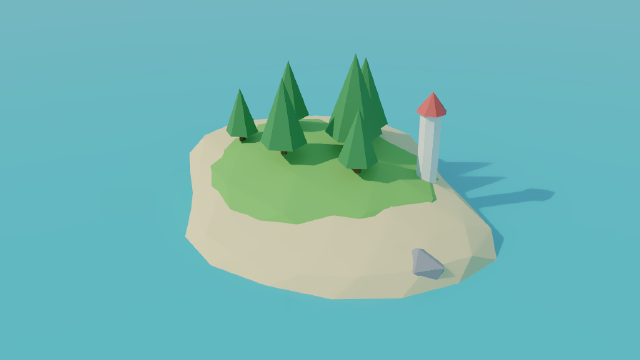

<!-- Generated by tools/gallery.mjs from showcase.yaml and build.json; do not edit. -->
# Low-Poly Island

[Scene](../README.md) › [Abstract & Motion](../README.md#abstract--motion) · `low-poly` `displace` `flat-shading` `sun-light` `stylised`

A faceted desert island with pine trees, rocks and a lighthouse sits in a turquoise sea under a warm afternoon sun.



| | |
|---|---|
| Document | [low-poly-island.kscene](low-poly-island.kscene) (22 KB) |
| Contents | 20 meshes; 8 materials; 1 light |
| Features | `scene.object.add`, `scene.modifier.basics`, `scene.material.basics`, `scene.render.lights-world`, `scene.viewport.rendered` |
| Built by | `kition-scene` @ `96f79582aa`: 44 commands in 14 ms |

## About

A stylised diorama in the low-poly style. The island is an icosphere squashed flat and broken
up by a Displace modifier with coarse noise, kept flat-shaded so every facet catches the sun;
a smaller, higher copy in grass green caps the sand. The pines are six-sided cones on stubby
trunks, the rocks are level-1 icospheres, and the sea is a large glossy plane. One warm sun and
a sky-blue world light the scene.

## Checks

- `inspect.objects`: `{"count":22,"any":{"name":"Sand","modifiers":[{"type":"displace"}]}}`
- `inspect.materials`: `{"count":8}`
- `inspect.world.strength`: `0.9`
- diagnostics: none (the kit's check finds nothing wrong)
- the saved document opens again; the thumbnail matches `thumb.png` within the `render` tolerance

## Steps

<details><summary>44 commands (from <a href="showcase.yaml">showcase.yaml</a>)</summary>

```yaml
- command: edit.delete
  params:
    objects:
      - Cube
      - Light
- command: material.delete
  params:
    material: Material
- command: render.set
  params:
    width: 1920
    height: 1080
    view: agx
- command: add.plane
  params:
    name: Sea
    size: 60
    location:
      - 0
      - 0
      - 0
- command: material.new
  params:
    name: Lagoon
    baseColor: "#1fb5c4"
    roughness: 0.12
- command: add.icoSphere
  params:
    name: Sand
    radius: 1
    subdivisions: 3
    location:
      - 0
      - 0
      - 0
    scale:
      - 2.6
      - 2.2
      - 0.75
- command: modifier.add
  params:
    object: Sand
    type: displace
    strength: 0.5
    noiseScale: 0.8
- command: material.new
  params:
    name: Sand
    baseColor: "#ecd29a"
    roughness: 0.9
- command: add.icoSphere
  params:
    name: Grass
    radius: 1
    subdivisions: 2
    location:
      - -0.1
      - 0.1
      - 0.25
    scale:
      - 2.2
      - 1.8
      - 0.62
- command: modifier.add
  params:
    object: Grass
    type: displace
    strength: 0.25
    noiseScale: 1
- command: material.new
  params:
    name: Grass
    baseColor: "#6fb04a"
    roughness: 0.85
- command: add.cone
  params:
    name: Pine 1
    radius1: 0.32
    radius2: 0
    depth: 0.9
    vertices: 6
    location:
      - -0.8
      - 0.4
      - 1.5
- command: add.cylinder
  params:
    name: Trunk 1
    radius: 0.05
    depth: 0.3
    vertices: 6
    location:
      - -0.8
      - 0.4
      - 1.02
- command: add.cone
  params:
    name: Pine 2
    radius1: 0.38
    radius2: 0
    depth: 1.08
    vertices: 6
    location:
      - 0.3
      - 0.9
      - 1.54
- command: add.cylinder
  params:
    name: Trunk 2
    radius: 0.05
    depth: 0.3
    vertices: 6
    location:
      - 0.3
      - 0.9
      - 0.97
- command: add.cone
  params:
    name: Pine 3
    radius1: 0.29
    radius2: 0
    depth: 0.81
    vertices: 6
    location:
      - 0.9
      - -0.2
      - 1.35
- command: add.cylinder
  params:
    name: Trunk 3
    radius: 0.05
    depth: 0.3
    vertices: 6
    location:
      - 0.9
      - -0.2
      - 0.92
- command: add.cone
  params:
    name: Pine 4
    radius1: 0.35
    radius2: 0
    depth: 0.99
    vertices: 6
    location:
      - -0.2
      - -0.5
      - 1.55
- command: add.cylinder
  params:
    name: Trunk 4
    radius: 0.05
    depth: 0.3
    vertices: 6
    location:
      - -0.2
      - -0.5
      - 1.02
- command: add.cone
  params:
    name: Pine 5
    radius1: 0.43
    radius2: 0
    depth: 1.22
    vertices: 6
    location:
      - 0.5
      - 0.3
      - 1.71
- command: add.cylinder
  params:
    name: Trunk 5
    radius: 0.05
    depth: 0.3
    vertices: 6
    location:
      - 0.5
      - 0.3
      - 1.07
- command: add.cone
  params:
    name: Pine 6
    radius1: 0.26
    radius2: 0
    depth: 0.72
    vertices: 6
    location:
      - -1.2
      - -0.3
      - 1.26
- command: add.cylinder
  params:
    name: Trunk 6
    radius: 0.05
    depth: 0.3
    vertices: 6
    location:
      - -1.2
      - -0.3
      - 0.87
- command: material.new
  params:
    name: Pine Needles
    baseColor: "#2f7d3a"
    roughness: 0.8
- command: material.assign
  params:
    material: Pine Needles
    objects:
      - Pine 1
      - Pine 2
      - Pine 3
      - Pine 4
      - Pine 5
      - Pine 6
- command: material.new
  params:
    name: Bark
    baseColor: "#7a4b2a"
    roughness: 0.9
- command: material.assign
  params:
    material: Bark
    objects:
      - Trunk 1
      - Trunk 2
      - Trunk 3
      - Trunk 4
      - Trunk 5
      - Trunk 6
- command: add.icoSphere
  params:
    name: Rock 1
    radius: 0.35
    subdivisions: 1
    location:
      - 2.3
      - -0.9
      - 0.1
    scale:
      - 1.2
      - 1
      - 0.8
- command: add.icoSphere
  params:
    name: Rock 2
    radius: 0.22
    subdivisions: 1
    location:
      - 2.6
      - -0.3
      - 0.05
- command: add.icoSphere
  params:
    name: Rock 3
    radius: 0.28
    subdivisions: 1
    location:
      - -2.5
      - 1.2
      - 0.05
    rotation:
      - 20
      - 10
      - 30
- command: material.new
  params:
    name: Granite
    baseColor: "#8d8f94"
    roughness: 0.8
- command: material.assign
  params:
    material: Granite
    objects:
      - Rock 1
      - Rock 2
      - Rock 3
- command: add.cylinder
  params:
    name: Lighthouse
    radius: 0.16
    depth: 1.1
    vertices: 8
    location:
      - 1.6
      - 0.6
      - 1.05
- command: material.new
  params:
    name: Whitewash
    baseColor: "#f4f1ea"
    roughness: 0.6
- command: add.cone
  params:
    name: Lamp Roof
    radius1: 0.22
    radius2: 0
    depth: 0.3
    vertices: 8
    location:
      - 1.6
      - 0.6
      - 1.75
- command: material.new
  params:
    name: Red Roof
    baseColor: "#d2453a"
    roughness: 0.6
- command: add.light
  params:
    name: Sun
    kind: sun
    power: 4
    color: "#fff0d6"
    rotation:
      - 50
      - 0
      - -40
- command: world.set
  params:
    color: "#8fd3f0"
    strength: 0.9
- command: object.transform
  params:
    objects:
      - Camera
    location:
      - 5.5
      - -7.5
      - 5.2
- command: object.lookAt
  params:
    object: Camera
    target:
      - 0.1
      - 0
      - 0.3
- command: camera.set
  params:
    object: Camera
    lens: 38
- command: select.none
- command: view.overlays
  params:
    on: false
- command: view.camera
```

</details>
