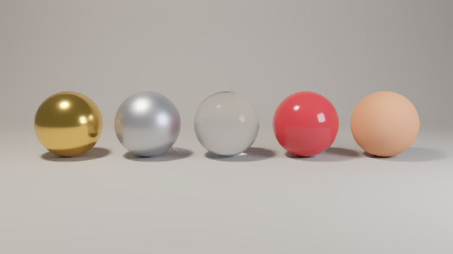

<!-- Generated by tools/gallery.mjs from showcase.yaml and build.json; do not edit. -->
# Material Study Spheres

[Scene](../README.md) › [Materials & Lighting](../README.md#materials--lighting) · `materials` `glass` `metal` `studio-lighting` `path-tracing`

Five spheres on a seamless backdrop compare gold, brushed steel, glass, glossy plastic and matte clay under a studio rig.



| | |
|---|---|
| Document | [material-study-spheres.kscene](material-study-spheres.kscene) (28 KB) |
| Contents | 6 meshes; 6 materials; 2 lights |
| Features | `scene.material.basics`, `scene.material.manage`, `scene.render.lights-world`, `scene.object.add`, `scene.viewport.rendered` |
| Built by | `kition-scene` @ `96f79582aa`: 30 commands in 30 ms |

## About

The classic look-development lineup. Each sphere has its own material made with material.new
and tuned with material.set: metallic 1 with low and medium roughness for gold and steel,
transmission 1 at IOR 1.5 for glass, a glossy red dielectric and a rough clay. A curved backdrop
hides the horizon and two area lights act as a softbox key and a cool fill panel; the thumbnail is the
path-traced viewport through the scene camera.

## Checks

- `inspect.objects`: `{"count":9,"any":{"name":"Softbox Key","type":"light"}}`
- `inspect.materials`: `{"count":6,"any":{"name":"Clear Glass","transmission":1,"ior":1.5}}`
- `inspect.world.strength`: `0.35`
- `inspect.render.view`: `"agx"`
- diagnostics: none (the kit's check finds nothing wrong)
- the saved document opens again; the thumbnail matches `thumb.png` within the `render` tolerance

## Steps

<details><summary>30 commands (from <a href="showcase.yaml">showcase.yaml</a>)</summary>

```yaml
- command: edit.delete
  params:
    objects:
      - Cube
      - Light
- command: render.set
  params:
    width: 1920
    height: 1080
    view: agx
- command: add.backdrop
  params:
    name: Backdrop
    width: 18
    depth: 15
    height: 7
    radius: 2.5
    segments: 24
    location:
      - 0
      - -4.5
      - 0
- command: material.new
  params:
    name: Studio Grey
    baseColor: "#b9b4ad"
    roughness: 0.8
- command: add.uvSphere
  params:
    name: Gold
    radius: 0.5
    segments: 48
    rings: 24
    location:
      - -2.4
      - 0
      - 0.5
- command: material.new
  params:
    name: Polished Gold
    baseColor: "#f2c15b"
    metallic: 1
    roughness: 0.18
- command: add.uvSphere
  params:
    name: Steel
    radius: 0.5
    segments: 48
    rings: 24
    location:
      - -1.2
      - 0
      - 0.5
- command: material.new
  params:
    name: Brushed Steel
    baseColor: "#c9ccd1"
    metallic: 1
    roughness: 0.42
- command: add.uvSphere
  params:
    name: Glass
    radius: 0.5
    segments: 48
    rings: 24
    location:
      - 0
      - 0
      - 0.5
- command: material.new
  params:
    name: Clear Glass
    baseColor: "#ffffff"
    roughness: 0
- command: material.set
  params:
    material: Clear Glass
    transmission: 1
    ior: 1.5
- command: add.uvSphere
  params:
    name: Plastic
    radius: 0.5
    segments: 48
    rings: 24
    location:
      - 1.2
      - 0
      - 0.5
- command: material.new
  params:
    name: Red Plastic
    baseColor: "#c8282e"
    roughness: 0.15
- command: add.uvSphere
  params:
    name: Clay
    radius: 0.5
    segments: 48
    rings: 24
    location:
      - 2.4
      - 0
      - 0.5
- command: material.new
  params:
    name: Matte Clay
    baseColor: "#d98e64"
    roughness: 0.95
- command: object.shadeSmooth
  params:
    objects:
      - Gold
      - Steel
      - Glass
      - Plastic
      - Clay
- command: object.transform
  params:
    objects:
      - Camera
    location:
      - 0
      - -7.2
      - 1.6
- command: object.lookAt
  params:
    object: Camera
    target:
      - 0
      - 0
      - 0.45
- command: camera.set
  params:
    object: Camera
    lens: 38
- command: add.light
  params:
    name: Softbox Key
    kind: area
    power: 900
    color: "#fff4e8"
    location:
      - -3
      - -2
      - 7.5
- command: object.lookAt
  params:
    object: Softbox Key
    target:
      - 0
      - 0
      - 0.5
- command: light.set
  params:
    object: Softbox Key
    radius: 1.5
- command: add.light
  params:
    name: Fill Panel
    kind: area
    power: 300
    color: "#e8f0ff"
    location:
      - 4.5
      - -3
      - 2.5
- command: object.lookAt
  params:
    object: Fill Panel
    target:
      - 0
      - 0
      - 0.5
- command: light.set
  params:
    object: Fill Panel
    radius: 2
- command: world.set
  params:
    color: "#9aa0a8"
    strength: 0.35
- command: material.delete
  params:
    material: Material
- command: select.none
- command: view.overlays
  params:
    on: false
- command: view.camera
```

</details>
