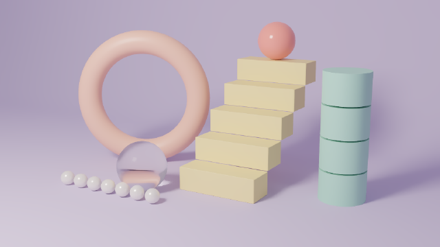

<!-- Generated by tools/gallery.mjs from showcase.yaml and build.json; do not edit. -->
# Pastel Geometry Still Life

[Scene](../README.md) › [Abstract & Motion](../README.md#abstract--motion) · `abstract` `array` `bevel` `pastel` `composition`

An abstract arrangement of stairs, a standing ring, pillars and pearls in soft pastel colours on a seamless lilac set.



| | |
|---|---|
| Document | [pastel-geometry-still-life.kscene](pastel-geometry-still-life.kscene) (115 KB) |
| Contents | 7 meshes; 7 materials; 1 light |
| Features | `scene.object.add`, `scene.modifier.basics`, `scene.modifier.stack`, `scene.material.basics`, `scene.render.lights-world`, `scene.viewport.rendered` |
| Built by | `kition-scene` @ `96f79582aa`: 35 commands in 79 ms |

## About

The kind of abstract still life used for brand backgrounds. The staircase is one bevelled block
with an Array modifier offset one block back and one up per copy; the pillar stacks three
discs with another Array; the row of pearls is a single sphere repeated seven times. A large
upright torus, a coral ball on the top step and a clear glass sphere in front complete the
composition, lit by one big soft key and a lilac world.

## Checks

- `inspect.objects`: `{"count":9,"any":{"name":"Stairs","modifiers":[{"type":"array","count":5},{"type":"bevel"}]}}`
- `inspect.materials`: `{"count":7}`
- diagnostics: none (the kit's check finds nothing wrong)
- the saved document opens again; the thumbnail matches `thumb.png` within the `render` tolerance

## Steps

<details><summary>35 commands (from <a href="showcase.yaml">showcase.yaml</a>)</summary>

```yaml
- command: edit.delete
  params:
    objects:
      - Cube
      - Light
- command: material.delete
  params:
    material: Material
- command: render.set
  params:
    width: 1920
    height: 1080
    view: agx
- command: add.backdrop
  params:
    name: Set
    width: 40
    depth: 14
    height: 8
    radius: 3
    segments: 24
    location:
      - 0
      - -4
      - 0
- command: material.new
  params:
    name: Lilac
    baseColor: "#cdbfe6"
    roughness: 0.9
- command: add.cube
  params:
    name: Stairs
    size: 1
    location:
      - 0.6
      - -0.4
      - 0.2
    scale:
      - 1.4
      - 0.5
      - 0.4
- command: modifier.add
  params:
    object: Stairs
    type: array
    count: 5
    relativeOffset:
      - 0
      - 1
      - 1
- command: modifier.add
  params:
    object: Stairs
    type: bevel
    width: 0.03
    segments: 3
- command: material.new
  params:
    name: Butter
    baseColor: "#f6dd8f"
    roughness: 0.6
- command: add.uvSphere
  params:
    name: Coral Ball
    radius: 0.35
    segments: 48
    rings: 24
    location:
      - 0.6
      - 1.6
      - 2.35
- command: material.new
  params:
    name: Coral Gloss
    baseColor: "#ff8a7a"
    roughness: 0.15
- command: add.torus
  params:
    name: Ring
    majorRadius: 1.05
    minorRadius: 0.22
    majorSegments: 96
    minorSegments: 32
    location:
      - -1.6
      - 0.4
      - 1.27
    rotation:
      - 90
      - 0
      - 25
- command: material.new
  params:
    name: Peach Satin
    baseColor: "#f7b49a"
    roughness: 0.35
- command: add.cylinder
  params:
    name: Pillar
    radius: 0.38
    depth: 0.5
    vertices: 64
    location:
      - 2.4
      - 0.3
      - 0.25
- command: modifier.add
  params:
    object: Pillar
    type: array
    count: 4
    relativeOffset:
      - 0
      - 0
      - 1.05
- command: modifier.add
  params:
    object: Pillar
    type: bevel
    width: 0.04
    segments: 3
- command: material.new
  params:
    name: Mint
    baseColor: "#9fdcc4"
    roughness: 0.5
- command: add.uvSphere
  params:
    name: Pearls
    radius: 0.12
    segments: 32
    rings: 16
    location:
      - -1.9
      - -1.4
      - 0.12
- command: modifier.add
  params:
    object: Pearls
    type: array
    count: 7
    relativeOffset:
      - 1.25
      - 0
      - 0
- command: material.new
  params:
    name: Pearl
    baseColor: "#fbf6ee"
    roughness: 0.2
    metallic: 0.3
- command: add.uvSphere
  params:
    name: Glass Ball
    radius: 0.42
    segments: 48
    rings: 24
    location:
      - -0.6
      - -1
      - 0.42
- command: material.new
  params:
    name: Clear Glass
    baseColor: "#ffffff"
    roughness: 0
- command: material.set
  params:
    material: Clear Glass
    transmission: 1
    ior: 1.45
- command: object.shadeSmooth
  params:
    objects:
      - Coral Ball
      - Ring
      - Pearls
      - Glass Ball
- command: object.shadeSmoothByAngle
  params:
    objects:
      - Pillar
      - Stairs
    angle: 40
- command: add.light
  params:
    name: Softbox
    kind: area
    power: 1600
    color: "#fff6ee"
    location:
      - -1.5
      - -8
      - 7
- command: object.lookAt
  params:
    object: Softbox
    target:
      - 0
      - 0
      - 0.8
- command: light.set
  params:
    object: Softbox
    radius: 3
- command: world.set
  params:
    color: "#d9cdef"
    strength: 0.5
- command: object.transform
  params:
    objects:
      - Camera
    location:
      - 5.2
      - -8.4
      - 3.3
- command: object.lookAt
  params:
    object: Camera
    target:
      - 0.2
      - 0.2
      - 1
- command: camera.set
  params:
    object: Camera
    lens: 48
- command: select.none
- command: view.overlays
  params:
    on: false
- command: view.camera
```

</details>
