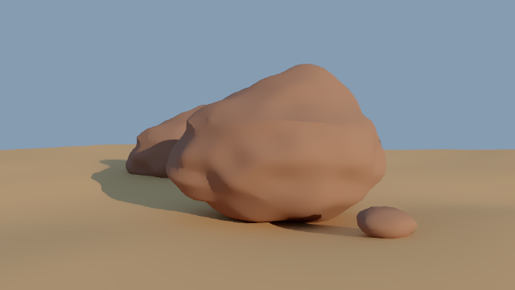

<!-- Generated by tools/gallery.mjs from showcase.yaml and build.json; do not edit. -->
# Sculpted Desert Boulder

[Scene](../README.md) › [Sculpting & Characters](../README.md#sculpting--characters) · `sculpting` `displace` `rock` `sun-light` `environment`

A weathered sandstone boulder sculpted from an icosphere with flatten, crease and clay strokes, resting on rippled sand at golden hour.



| | |
|---|---|
| Document | [sculpted-desert-boulder.kscene](sculpted-desert-boulder.kscene) (292 KB) |
| Contents | 4 meshes; 2 materials; 1 light |
| Features | `scene.sculpt.paint`, `scene.modifier.basics`, `scene.object.add`, `scene.material.basics`, `scene.render.lights-world`, `scene.viewport.rendered` |
| Built by | `kition-scene` @ `96f79582aa`: 36 commands in 3639 ms |

## About

An environment prop sculpted with world-space brush strokes. Starting from a level-5
icosphere, Flatten strokes cut the broad planes a split rock has, Crease strokes carve the
cracks, Clay Strips build up ledges and Grab pulls the silhouette out of round; a Displace
modifier then adds fine pitting. The sand is a subdivided grid with its own long, low Displace
for dunes, lit by a low orange sun and a blue sky.

## Checks

- `inspect.objects`: `{"count":6,"any":{"name":"Boulder","mesh":{"vertices":2562},"modifiers":[{"type":"displace"}]}}`
- `inspect.mode.mode`: `"object"`
- `inspect.materials`: `{"count":2}`
- diagnostics: none (the kit's check finds nothing wrong)
- the saved document opens again; the thumbnail matches `thumb.png` within the `render` tolerance

## Steps

<details><summary>36 commands (from <a href="showcase.yaml">showcase.yaml</a>)</summary>

```yaml
- command: edit.delete
  params:
    objects:
      - Cube
      - Light
- command: material.delete
  params:
    material: Material
- command: render.set
  params:
    width: 1920
    height: 1080
    view: agx
- command: add.grid
  params:
    name: Dunes
    size: 40
    xSubdivisions: 120
    ySubdivisions: 120
- command: modifier.add
  params:
    object: Dunes
    type: displace
    strength: 0.35
    noiseScale: 3.5
- command: object.shadeSmooth
  params:
    objects:
      - Dunes
- command: material.new
  params:
    name: Desert Sand
    baseColor: "#d9a86c"
    roughness: 0.95
- command: add.icoSphere
  params:
    name: Boulder
    radius: 1.2
    subdivisions: 5
    location:
      - 0
      - 0
      - 0.8
    scale:
      - 1.3
      - 1
      - 0.85
- command: object.shadeSmooth
  params:
    objects:
      - Boulder
- command: mode.sculpt
  params:
    object: Boulder
    on: true
- command: sculpt.stroke
  params:
    kind: flatten
    strength: 0.9
    worldRadius: 0.7
    points:
      - - -0.9
        - -0.6
        - 1.4
      - - 0
        - -0.8
        - 1.55
      - - 0.9
        - -0.6
        - 1.4
    symmetry:
      - false
      - false
      - false
- command: sculpt.stroke
  params:
    kind: flatten
    strength: 0.9
    worldRadius: 0.6
    points:
      - - 1.4
        - -0.3
        - 0.9
      - - 1.5
        - 0.3
        - 0.9
    symmetry:
      - false
      - false
      - false
- command: sculpt.stroke
  params:
    kind: crease
    strength: 0.8
    worldRadius: 0.12
    points:
      - - -0.5
        - -0.95
        - 1.3
      - - -0.2
        - -1
        - 0.9
      - - 0.1
        - -1
        - 0.6
      - - 0.3
        - -0.95
        - 0.3
    symmetry:
      - false
      - false
      - false
- command: sculpt.stroke
  params:
    kind: crease
    strength: 0.7
    worldRadius: 0.1
    points:
      - - 0.6
        - -0.85
        - 1.2
      - - 0.9
        - -0.8
        - 0.9
      - - 1.3
        - -0.6
        - 0.7
    symmetry:
      - false
      - false
      - false
- command: sculpt.stroke
  params:
    kind: clayStrips
    strength: 0.6
    worldRadius: 0.35
    points:
      - - -1.4
        - -0.4
        - 0.8
      - - -1.2
        - -0.7
        - 0.5
      - - -0.8
        - -0.95
        - 0.3
    symmetry:
      - false
      - false
      - false
- command: sculpt.stroke
  params:
    kind: grab
    worldRadius: 0.9
    points:
      - - 0.3
        - 0.2
        - 1.6
    drag:
      - 0.2
      - 0
      - 0.35
    symmetry:
      - false
      - false
      - false
- command: sculpt.stroke
  params:
    kind: flatten
    strength: 1
    worldRadius: 0.55
    points:
      - - -1.3
        - -0.6
        - 1
      - - -1
        - -0.9
        - 0.9
    symmetry:
      - false
      - false
      - false
- command: sculpt.stroke
  params:
    kind: flatten
    strength: 1
    worldRadius: 0.5
    points:
      - - 0.4
        - -1
        - 0.9
      - - 0.8
        - -0.9
        - 0.6
    symmetry:
      - false
      - false
      - false
- command: sculpt.stroke
  params:
    kind: crease
    strength: 1
    worldRadius: 0.14
    points:
      - - -1.1
        - -0.75
        - 1.35
      - - -0.6
        - -0.95
        - 1.1
      - - 0
        - -1.05
        - 1.15
      - - 0.6
        - -0.95
        - 1.25
      - - 1.1
        - -0.7
        - 1.2
    symmetry:
      - false
      - false
      - false
- command: sculpt.stroke
  params:
    kind: crease
    strength: 1
    worldRadius: 0.14
    points:
      - - -0.5
        - -0.95
        - 1.3
      - - -0.2
        - -1
        - 0.9
      - - 0.1
        - -1
        - 0.6
      - - 0.3
        - -0.95
        - 0.3
    symmetry:
      - false
      - false
      - false
- command: mode.sculpt
  params:
    object: Boulder
    on: false
- command: modifier.add
  params:
    object: Boulder
    type: displace
    strength: 0.16
    noiseScale: 0.35
- command: material.new
  params:
    name: Sandstone
    baseColor: "#8a6450"
    roughness: 0.95
- command: edit.duplicate
  params:
    objects:
      - Boulder
    offset:
      - -4.2
      - 3.2
      - -0.35
  as: twin
- command: add.icoSphere
  params:
    name: Pebble
    radius: 0.25
    subdivisions: 3
    location:
      - 1.9
      - -1
      - 0.15
    scale:
      - 1.3
      - 1
      - 0.7
- command: modifier.add
  params:
    object: Pebble
    type: displace
    strength: 0.04
    noiseScale: 0.12
- command: material.assign
  params:
    material: Sandstone
    objects:
      - Pebble
- command: object.shadeSmooth
  params:
    objects:
      - Pebble
- command: add.light
  params:
    name: Low Sun
    kind: sun
    power: 5
    color: "#ffdcb0"
    location:
      - -10
      - -6
      - 8
    rotation:
      - 76
      - 0
      - 65
- command: world.set
  params:
    color: "#8fb6e0"
    strength: 0.7
- command: object.transform
  params:
    objects:
      - Camera
    location:
      - 3.2
      - -6
      - 1.2
- command: object.lookAt
  params:
    object: Camera
    target:
      - -0.6
      - 0.5
      - 0.9
- command: camera.set
  params:
    object: Camera
    lens: 32
- command: select.none
- command: view.overlays
  params:
    on: false
- command: view.camera
```

</details>
