<!-- Generated by tools/gallery.mjs from showcase.yaml and build.json; do not edit. -->
# Sheet showcase

Spreadsheets: formulas, number formats, styles, merged cells, tables, charts and several sheets. Saved as .xlsx. Every sample is built from `showcase.yaml` by the kit's own commands and drawn by its own engine (`kition-sheet`).

**41 samples** · 7 categories · 18 features of `kition-sheet/features.yaml` · [all kits](../README.md)

[Business Templates](#business-templates) (5) · [Charts](#charts) (5) · [Finance & Budgets](#finance--budgets) (9) · [Formatting & Styles](#formatting--styles) (4) · [Formulas & Functions](#formulas--functions) (7) · [Planners & Trackers](#planners--trackers) (5) · [Tables & Data](#tables--data) (6)

## Business Templates

<table>
<tr>
<td width="33%" valign="top">
<a href="payroll-register/">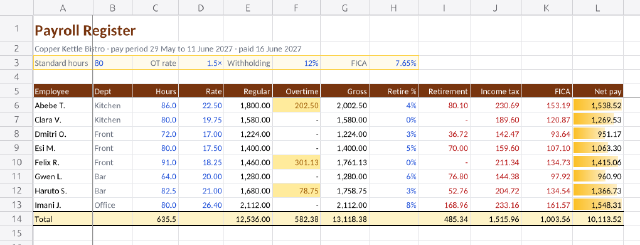</a> 
Sheet 
<b><a href="payroll-register/">Payroll Register</a></b> 
A fortnight's payroll for a small bistro, from hours and rates through overtime, pre-tax retirement, withholding and FICA to net pay. 
<i>1 sheet; used range A1:L14</i> 
<code>payroll</code> <code>template</code> <code>formulas</code> <code>number-formats</code> <code>conditional-formatting</code>
</td>
<td width="33%" valign="top">
<a href="print-shop-invoice/">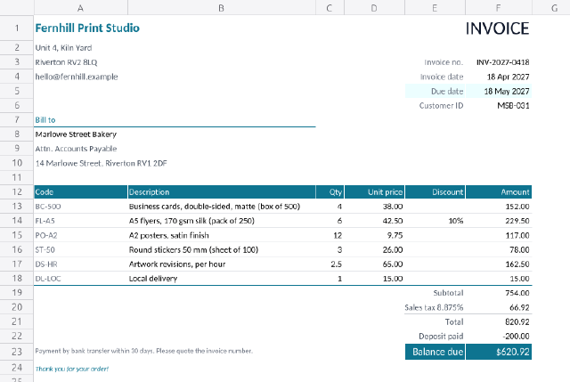</a> 
Sheet 
<b><a href="print-shop-invoice/">Print Shop Invoice</a></b> 
A ready-to-send invoice with line discounts, rounded sales tax, a deposit and the balance due, laid out without gridlines. 
<i>1 sheet; used range A1:F24</i> 
<code>invoice</code> <code>template</code> <code>formulas</code> <code>number-formats</code> <code>page-setup</code>
</td>
<td width="33%" valign="top">
<a href="renovation-estimate/">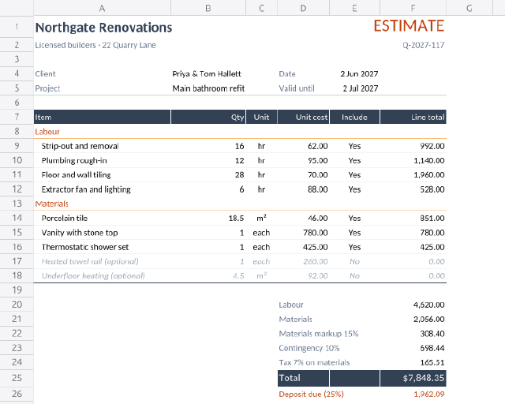</a> 
Sheet 
<b><a href="renovation-estimate/">Renovation Estimate</a></b> 
A contractor's bathroom quote with labour and materials, optional extras switched by a Yes/No list, markup, contingency, tax and deposit. 
<i>1 sheet; used range A1:F26</i> 
<code>quote</code> <code>template</code> <code>formulas</code> <code>data-validation</code> <code>conditional-formatting</code>
</td>
</tr>
<tr>
<td width="33%" valign="top">
<a href="travel-expense-report/">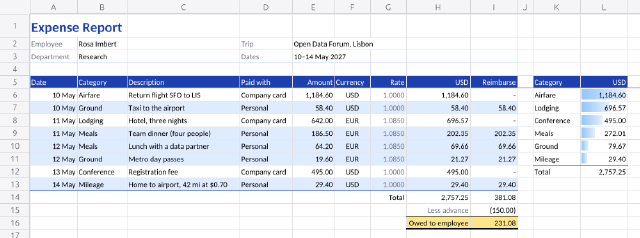</a> 
Sheet 
<b><a href="travel-expense-report/">Travel Expense Report</a></b> 
A conference trip's receipts in two currencies, converted, split into company-paid and reimbursable, and summed by category. 
<i>1 sheet; used range A1:L16</i> 
<code>expenses</code> <code>template</code> <code>formulas</code> <code>data-validation</code> <code>conditional-formatting</code>
</td>
<td width="33%" valign="top">
<a href="weekly-timesheet/">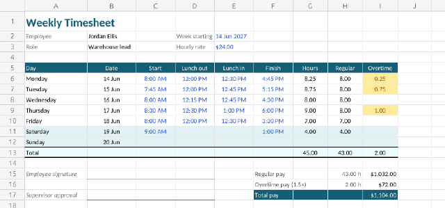</a> 
Sheet 
<b><a href="weekly-timesheet/">Weekly Timesheet</a></b> 
Clock-in and clock-out times turned into daily hours, daily overtime past eight hours and the week's pay, with time arithmetic. 
<i>1 sheet; used range A1:I17</i> 
<code>timesheet</code> <code>template</code> <code>date-functions</code> <code>formulas</code> <code>conditional-formatting</code>
</td>
<td width="33%"></td>
</tr>
</table>

## Charts

<table>
<tr>
<td width="33%" valign="top">
<a href="market-share-doughnut/">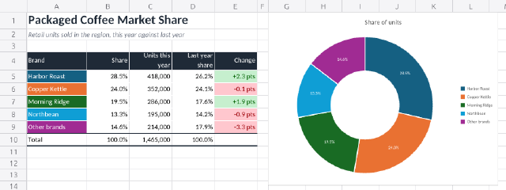</a> 
Sheet 
<b><a href="market-share-doughnut/">Market Share Doughnut</a></b> 
Unit sales of five coffee brands turned into shares, a change-in-points column and a labelled doughnut chart. 
<i>1 sheet; used range A1:E10</i> 
<code>chart</code> <code>doughnut-chart</code> <code>percentages</code> <code>market-share</code>
</td>
<td width="33%" valign="top">
<a href="profit-bridge-waterfall/">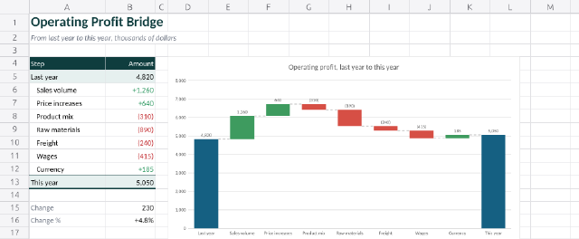</a> 
Sheet 
<b><a href="profit-bridge-waterfall/">Profit Bridge Waterfall</a></b> 
A waterfall chart that walks operating profit from last year to this year through its drivers. 
<i>1 sheet; used range A1:B16</i> 
<code>chart</code> <code>waterfall-chart</code> <code>finance</code> <code>variance</code>
</td>
<td width="33%" valign="top">
<a href="revenue-margin-combo/">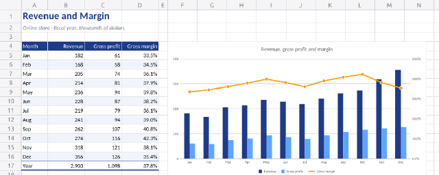</a> 
Sheet 
<b><a href="revenue-margin-combo/">Revenue and Margin Combo</a></b> 
Monthly revenue and gross profit as columns with gross margin as a line on a secondary axis. 
<i>1 sheet; used range A1:D17</i> 
<code>chart</code> <code>combo-chart</code> <code>secondary-axis</code> <code>sales</code>
</td>
</tr>
<tr>
<td width="33%" valign="top">
<a href="signup-trend-forecast/">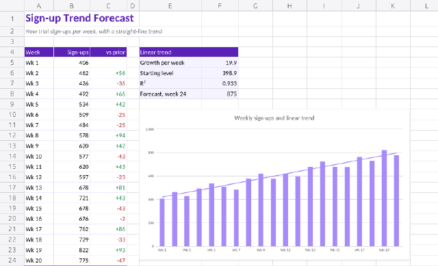</a> 
Sheet 
<b><a href="signup-trend-forecast/">Sign-up Trend Forecast</a></b> 
Twenty weeks of trial sign-ups as columns with a linear trendline, the fit worked out in cells and a week-24 forecast. 
<i>1 sheet; used range A1:F24</i> 
<code>chart</code> <code>column-chart</code> <code>trendline</code> <code>forecast</code> <code>marketing</code>
</td>
<td width="33%" valign="top">
<a href="survey-likert-stacked-bar/">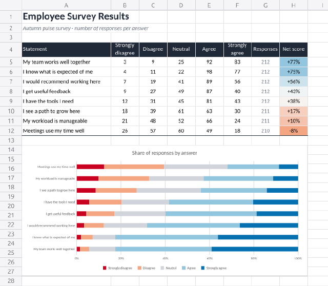</a> 
Sheet 
<b><a href="survey-likert-stacked-bar/">Employee Survey Results</a></b> 
Five-point agreement answers for eight survey statements, shown as a 100% stacked bar chart with a net-agreement score. 
<i>1 sheet; used range A1:H12</i> 
<code>chart</code> <code>bar-chart</code> <code>stacked-chart</code> <code>survey</code> <code>percentages</code>
</td>
<td width="33%"></td>
</tr>
</table>

## Finance & Budgets

<table>
<tr>
<td width="33%" valign="top">
<a href="break-even-analysis/">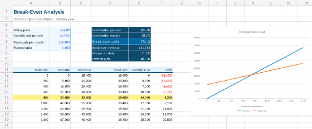</a> 
Sheet 
<b><a href="break-even-analysis/">Break-Even Analysis</a></b> 
How many coffee drippers a small pottery has to sell each month to cover its costs, with the revenue and cost lines crossing on a chart. 
<i>1 sheet; used range A1:F20</i> 
<code>break-even</code> <code>formulas</code> <code>chart</code> <code>conditional-formatting</code> <code>number-formats</code>
</td>
<td width="33%" valign="top">
<a href="cash-flow-forecast/">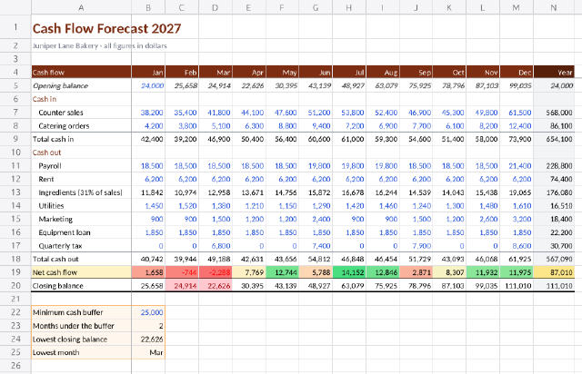</a> 
Sheet 
<b><a href="cash-flow-forecast/">12-Month Cash Flow Forecast</a></b> 
A bakery's year of cash in and cash out, month by month, with running balances, a colour scale and a warning when cash dips under the buffer. 
<i>1 sheet; used range A1:N25</i> 
<code>cash-flow</code> <code>forecast</code> <code>formulas</code> <code>conditional-formatting</code> <code>number-formats</code>
</td>
<td width="33%" valign="top">
<a href="depreciation-schedule/">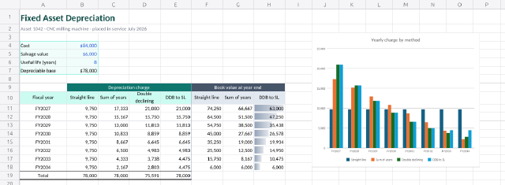</a> 
Sheet 
<b><a href="depreciation-schedule/">Depreciation Schedule</a></b> 
One machine depreciated four ways, with SLN, SYD, DDB and VDB side by side and the book value each leaves behind. 
<i>1 sheet; used range A1:H19</i> 
<code>depreciation</code> <code>financial-functions</code> <code>formulas</code> <code>chart</code> <code>number-formats</code>
</td>
</tr>
<tr>
<td width="33%" valign="top">
<a href="household-budget/">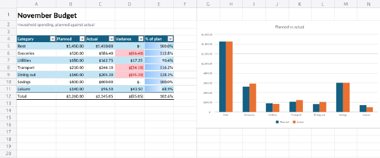</a> 
Sheet 
<b><a href="household-budget/">Household Budget</a></b> 
A monthly budget with planned and actual spending, variance formulas, a total row and a column chart. 
<i>1 sheet; used range A1:E12</i> 
<code>budget</code> <code>formulas</code> <code>number-formats</code> <code>chart</code> <code>conditional-formatting</code>
</td>
<td width="33%" valign="top">
<a href="investment-growth/">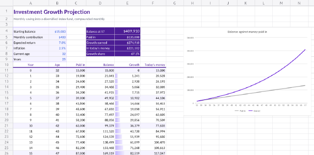</a> 
Sheet 
<b><a href="investment-growth/">Investment Growth Projection</a></b> 
Twenty-five years of monthly saving projected with FV, split into money paid in and growth earned, with a line chart of the gap opening up. 
<i>1 sheet; used range A1:F36</i> 
<code>investing</code> <code>financial-functions</code> <code>formulas</code> <code>chart</code> <code>number-formats</code>
</td>
<td width="33%" valign="top">
<a href="loan-amortization/">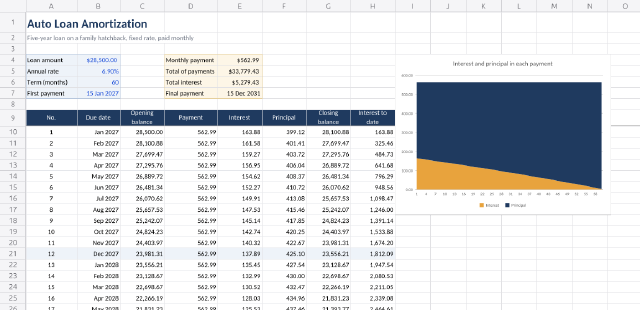</a> 
Sheet 
<b><a href="loan-amortization/">Loan Amortization Schedule</a></b> 
A five-year car loan paid off month by month, with PMT, IPMT and PPMT splitting every payment into interest and principal. 
<i>1 sheet; used range A1:H69</i> 
<code>loan</code> <code>financial-functions</code> <code>formulas</code> <code>number-formats</code> <code>chart</code>
</td>
</tr>
<tr>
<td width="33%" valign="top">
<a href="mortgage-comparison/">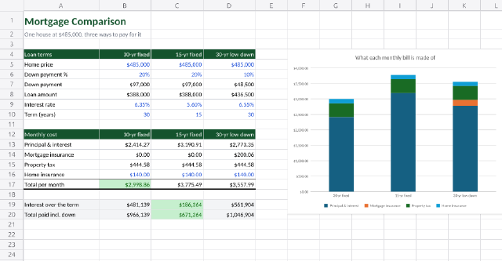</a> 
Sheet 
<b><a href="mortgage-comparison/">Mortgage Comparison</a></b> 
Three ways to finance the same house side by side, from the monthly bill to the interest paid over the life of the loan. 
<i>1 sheet; used range A1:D20</i> 
<code>loan</code> <code>financial-functions</code> <code>formulas</code> <code>chart</code> <code>conditional-formatting</code>
</td>
<td width="33%" valign="top">
<a href="mortgage-rate-sensitivity/">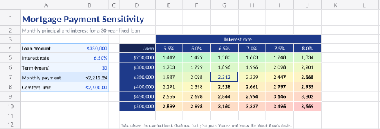</a> 
Sheet 
<b><a href="mortgage-rate-sensitivity/">Mortgage Rate Sensitivity</a></b> 
A two-variable data table of monthly payments for every loan size and interest rate, shaded from affordable to stretched. 
<i>1 sheet; used range A1:J12</i> 
<code>loan</code> <code>what-if</code> <code>financial-functions</code> <code>conditional-formatting</code> <code>number-formats</code>
</td>
<td width="33%" valign="top">
<a href="project-appraisal-npv-irr/">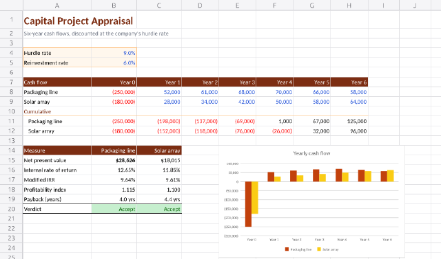</a> 
Sheet 
<b><a href="project-appraisal-npv-irr/">Project Appraisal (NPV &amp; IRR)</a></b> 
Two capital projects compared on NPV, IRR, MIRR, profitability index and payback, with a verdict for each. 
<i>1 sheet; used range A1:H20</i> 
<code>investing</code> <code>financial-functions</code> <code>formulas</code> <code>chart</code> <code>conditional-formatting</code>
</td>
</tr>
</table>

## Formatting & Styles

<table>
<tr>
<td width="33%" valign="top">
<a href="number-format-gallery/">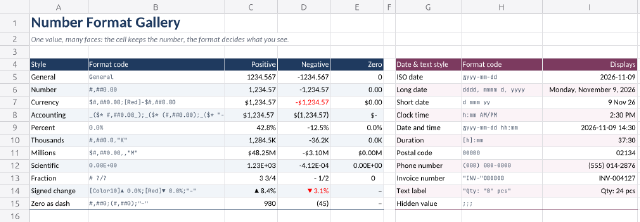</a> 
Sheet 
<b><a href="number-format-gallery/">Number Format Gallery</a></b> 
A reference card that shows the same numbers, dates and codes through a dozen built-in and custom number formats. 
<i>1 sheet; used range A1:I15</i> 
<code>number-formats</code> <code>custom-formats</code> <code>dates</code> <code>reference</code>
</td>
<td width="33%" valign="top">
<a href="regional-sales-heat-map/">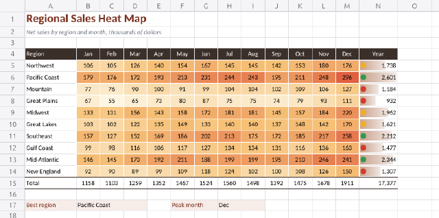</a> 
Sheet 
<b><a href="regional-sales-heat-map/">Regional Sales Heat Map</a></b> 
Twelve months of sales for ten regions, shaded by a three-colour scale so the peaks and the quiet months stand out. 
<i>1 sheet; used range A1:N17</i> 
<code>conditional-formatting</code> <code>color-scale</code> <code>heat-map</code> <code>icon-sets</code> <code>data-bars</code> <code>sales</code>
</td>
<td width="33%" valign="top">
<a href="support-kpi-scorecard/">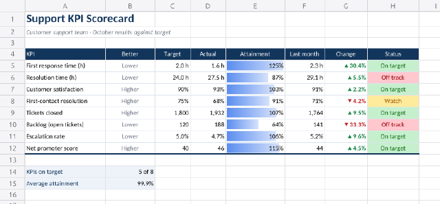</a> 
Sheet 
<b><a href="support-kpi-scorecard/">Support KPI Scorecard</a></b> 
A monthly customer-support scorecard with attainment data bars, coloured trend arrows and rule-driven status pills. 
<i>1 sheet; used range A1:H15</i> 
<code>conditional-formatting</code> <code>data-bars</code> <code>kpi</code> <code>dashboard</code> <code>custom-formats</code>
</td>
</tr>
<tr>
<td width="33%" valign="top">
<a href="team-skills-matrix/">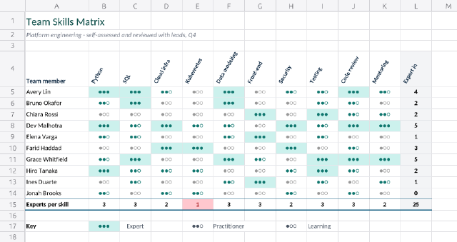</a> 
Sheet 
<b><a href="team-skills-matrix/">Team Skills Matrix</a></b> 
An engineering team's skills grid with angled column headers, dot ratings from a number format and named cell styles. 
<i>1 sheet; used range A1:L17</i> 
<code>rotated-text</code> <code>custom-formats</code> <code>cell-styles</code> <code>conditional-formatting</code> <code>team</code>
</td>
<td width="33%"></td>
<td width="33%"></td>
</tr>
</table>

## Formulas & Functions

<table>
<tr>
<td width="33%" valign="top">
<a href="dynamic-array-registrations/">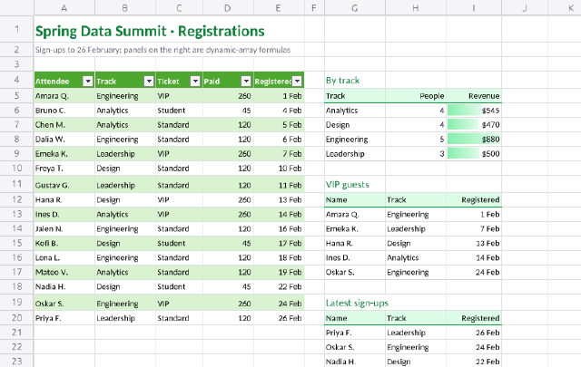</a> 
Sheet 
<b><a href="dynamic-array-registrations/">Dynamic Array Event Report</a></b> 
Three spilling summaries of a conference sign-up list, built with UNIQUE, SORT, FILTER, SORTBY, CHOOSECOLS and TAKE. 
<i>1 sheet; used range A1:I23</i> 
<code>dynamic-arrays</code> <code>formulas</code> <code>tables</code> <code>conditional-formatting</code> <code>number-formats</code>
</td>
<td width="33%" valign="top">
<a href="exam-score-statistics/">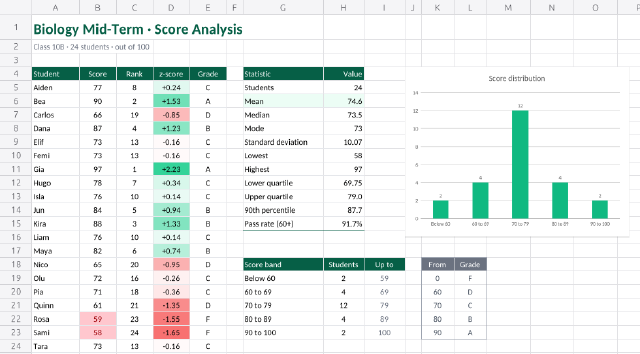</a> 
Sheet 
<b><a href="exam-score-statistics/">Exam Score Statistics</a></b> 
A class's test scores described with AVERAGE, MEDIAN, MODE, STDEV, QUARTILE and PERCENTILE, binned with FREQUENCY into a histogram. 
<i>1 sheet; used range A1:L28</i> 
<code>statistics</code> <code>formulas</code> <code>dynamic-arrays</code> <code>chart</code> <code>conditional-formatting</code>
</td>
<td width="33%" valign="top">
<a href="invoice-due-date-calendar/">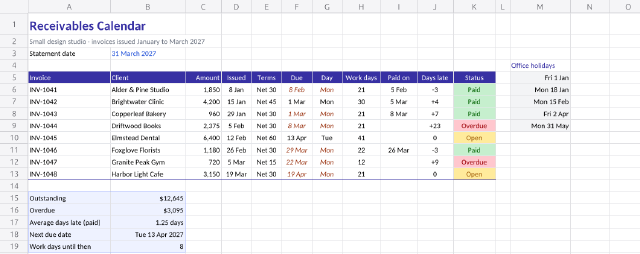</a> 
Sheet 
<b><a href="invoice-due-date-calendar/">Invoice Due-Date Tracker</a></b> 
Due dates that skip weekends and office holidays with WORKDAY, business days with NETWORKDAYS, and a status for every invoice. 
<i>1 sheet; used range A1:M19</i> 
<code>date-functions</code> <code>formulas</code> <code>named-ranges</code> <code>conditional-formatting</code> <code>number-formats</code>
</td>
</tr>
<tr>
<td width="33%" valign="top">
<a href="sales-commission-calculator/">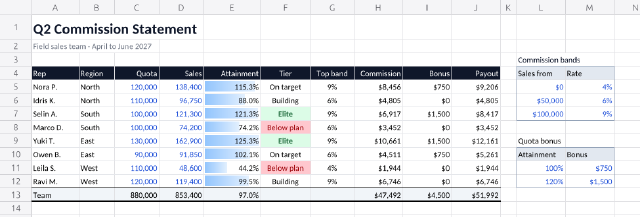</a> 
Sheet 
<b><a href="sales-commission-calculator/">Sales Commission Calculator</a></b> 
Quarterly payouts for eight reps with tiered marginal commission from a named LAMBDA, VLOOKUP rate bands and IFS bonuses. 
<i>1 sheet; used range A1:M13</i> 
<code>lambda</code> <code>lookup</code> <code>formulas</code> <code>named-ranges</code> <code>conditional-formatting</code>
</td>
<td width="33%" valign="top">
<a href="sumifs-regional-sales/">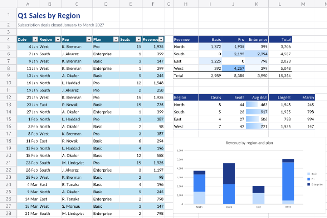</a> 
Sheet 
<b><a href="sumifs-regional-sales/">SUMIFS Regional Sales Summary</a></b> 
A quarter's deal log rolled up by region and product with SUMIFS, COUNTIFS, AVERAGEIFS and MAXIFS. 
<i>1 sheet; used range A1:M28</i> 
<code>conditional-aggregation</code> <code>formulas</code> <code>tables</code> <code>chart</code> <code>conditional-formatting</code>
</td>
<td width="33%" valign="top">
<a href="text-cleanup-functions/">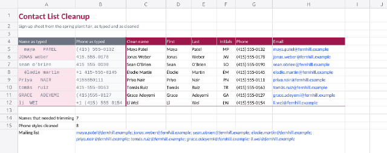</a> 
Sheet 
<b><a href="text-cleanup-functions/">Text Cleanup with Functions</a></b> 
A messy contact import tidied with TRIM, PROPER, TEXTBEFORE, TEXTAFTER, TEXTJOIN and a LET formula that rebuilds every phone number. 
<i>1 sheet; used range A1:H17</i> 
<code>text-functions</code> <code>formulas</code> <code>dynamic-arrays</code> <code>data-cleanup</code> <code>conditional-formatting</code>
</td>
</tr>
<tr>
<td width="33%" valign="top">
<a href="xlookup-order-form/">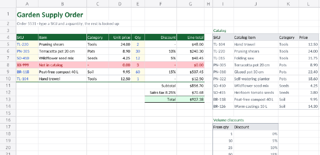</a> 
Sheet 
<b><a href="xlookup-order-form/">XLOOKUP Order Form</a></b> 
An order form that fills in item names, categories, prices and volume discounts from a catalog with XLOOKUP and INDEX/MATCH. 
<i>1 sheet; used range A1:L21</i> 
<code>lookup</code> <code>formulas</code> <code>conditional-formatting</code> <code>number-formats</code> <code>data-validation</code>
</td>
<td width="33%"></td>
<td width="33%"></td>
</tr>
</table>

## Planners & Trackers

<table>
<tr>
<td width="33%" valign="top">
<a href="class-timetable/">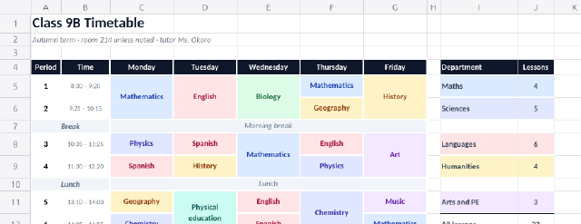</a> 
Sheet 
<b><a href="class-timetable/">Class Timetable</a></b> 
A secondary-school week with double lessons as merged cells, merged break rows and subject colours from text rules. 
<i>1 sheet; used range A1:J12</i> 
<code>timetable</code> <code>merged-cells</code> <code>conditional-formatting</code> <code>school</code> <code>planner</code>
</td>
<td width="33%" valign="top">
<a href="monthly-habit-tracker/">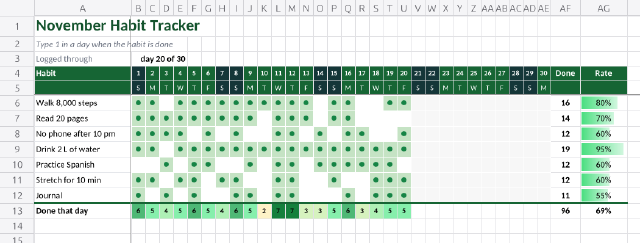</a> 
Sheet 
<b><a href="monthly-habit-tracker/">Monthly Habit Tracker</a></b> 
A November habit grid where a 1 becomes a dot through a number format, with completion rates, data bars and a daily heat row. 
<i>1 sheet; used range A1:AG13</i> 
<code>tracker</code> <code>habits</code> <code>custom-formats</code> <code>conditional-formatting</code> <code>data-bars</code>
</td>
<td width="33%" valign="top">
<a href="swim-club-attendance/">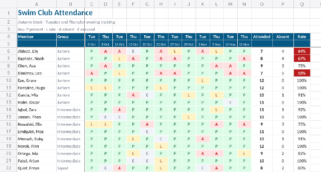</a> 
Sheet 
<b><a href="swim-club-attendance/">Swim Club Attendance</a></b> 
Twelve training sessions for 24 swimmers, with frozen names and dates, letter codes from a dropdown and colour-coded attendance rates. 
<i>1 sheet; used range A1:Q30</i> 
<code>attendance</code> <code>tracker</code> <code>freeze-panes</code> <code>data-validation</code> <code>conditional-formatting</code>
</td>
</tr>
<tr>
<td width="33%" valign="top">
<a href="website-relaunch-gantt/">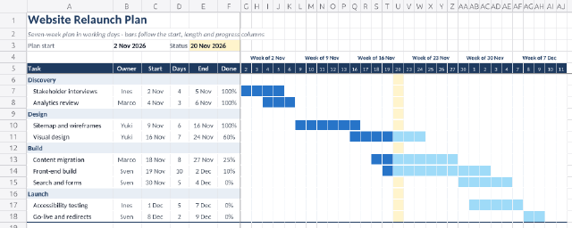</a> 
Sheet 
<b><a href="website-relaunch-gantt/">Website Relaunch Gantt</a></b> 
A seven-week project plan whose Gantt bars, progress fill and status-date column are all drawn by conditional formatting. 
<i>1 sheet; used range A1:AJ18</i> 
<code>gantt</code> <code>project-plan</code> <code>conditional-formatting</code> <code>dates</code> <code>workday</code>
</td>
<td width="33%" valign="top">
<a href="weekly-meal-planner/">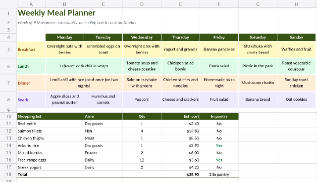</a> 
Sheet 
<b><a href="weekly-meal-planner/">Weekly Meal Planner</a></b> 
A seven-day meal grid with wrapped text, merged cells for batch-cooked meals and a costed shopping list. 
<i>1 sheet; used range A1:H18</i> 
<code>planner</code> <code>merged-cells</code> <code>wrap-text</code> <code>home</code> <code>shopping-list</code>
</td>
<td width="33%"></td>
</tr>
</table>

## Tables & Data

<table>
<tr>
<td width="33%" valign="top">
<a href="bug-triage-validation/">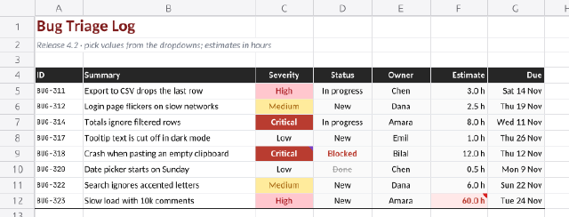</a> 
Sheet 
<b><a href="bug-triage-validation/">Bug Triage Log</a></b> 
A triage sheet with dropdown lists for severity, status and owner, number and date rules, input messages and review notes. 
<i>2 sheets; used range A1:G20</i> 
<code>data-validation</code> <code>dropdowns</code> <code>notes</code> <code>comments</code> <code>conditional-formatting</code>
</td>
<td width="33%" valign="top">
<a href="cafe-chain-quarterly-rollup/">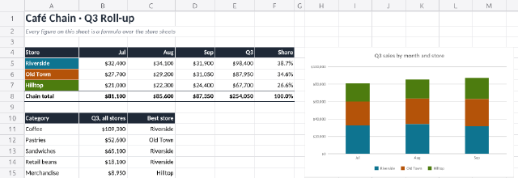</a> 
Sheet 
<b><a href="cafe-chain-quarterly-rollup/">Café Chain Quarterly Roll-up</a></b> 
Three store sheets with coloured tabs feed a summary sheet through cross-sheet and 3-D references. 
<i>4 sheets; used range A1:F15</i> 
<code>multiple-sheets</code> <code>cross-sheet-formulas</code> <code>tab-colors</code> <code>summary</code> <code>chart</code>
</td>
<td width="33%" valign="top">
<a href="department-expense-subtotals/">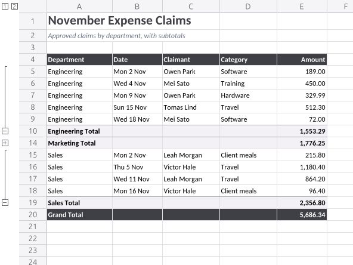</a> 
Sheet 
<b><a href="department-expense-subtotals/">Department Expense Subtotals</a></b> 
A month of expense claims sorted by department, with automatic subtotal rows, a grand total and an outline to collapse the detail. 
<i>1 sheet; used range A1:E20</i> 
<code>subtotal</code> <code>outline</code> <code>grouping</code> <code>sort</code> <code>expenses</code>
</td>
</tr>
<tr>
<td width="33%" valign="top">
<a href="filtered-sales-orders/">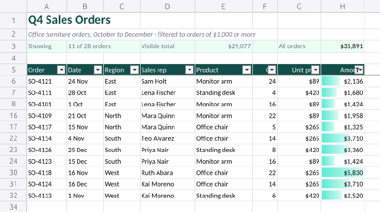</a> 
Sheet 
<b><a href="filtered-sales-orders/">Filtered Sales Orders</a></b> 
A quarter's order list sorted by region and amount, with an AutoFilter that keeps only orders of $1,000 or more. 
<i>1 sheet; used range A1:H33</i> 
<code>sort</code> <code>filter</code> <code>autofilter</code> <code>subtotal</code> <code>sales</code>
</td>
<td width="33%" valign="top">
<a href="orders-pivot-summary/">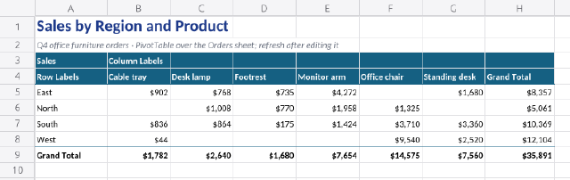</a> 
Sheet 
<b><a href="orders-pivot-summary/">Orders Pivot Summary</a></b> 
A PivotTable that turns a quarter's order list into sales by region and product, with grand totals. 
<i>2 sheets; used range A1:H9</i> 
<code>pivot-table</code> <code>summary</code> <code>multiple-sheets</code> <code>sales</code>
</td>
<td width="33%" valign="top">
<a href="warehouse-inventory-table/">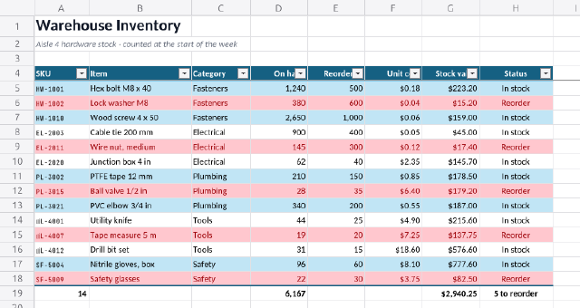</a> 
Sheet 
<b><a href="warehouse-inventory-table/">Warehouse Inventory Table</a></b> 
A stock list formatted as a structured table, with calculated columns, a total row and reorder alerts. 
<i>1 sheet; used range A1:H19</i> 
<code>table</code> <code>structured-references</code> <code>total-row</code> <code>conditional-formatting</code> <code>inventory</code>
</td>
</tr>
</table>

## Tags

`attendance` 1 · `autofilter` 1 · `bar-chart` 1 · `break-even` 1 · `budget` 1 · `cash-flow` 1 · `cell-styles` 1 · `chart` 15 · `color-scale` 1 · `column-chart` 1 · `combo-chart` 1 · `comments` 1 · `conditional-aggregation` 1 · `conditional-formatting` 26 · `cross-sheet-formulas` 1 · `custom-formats` 4 · `dashboard` 1 · `data-bars` 3 · `data-cleanup` 1 · `data-validation` 5 · `date-functions` 2 · `dates` 2 · `depreciation` 1 · `doughnut-chart` 1 · `dropdowns` 1 · `dynamic-arrays` 3 · `expenses` 2 · `filter` 1 · `finance` 1 · `financial-functions` 6 · `forecast` 2 · `formulas` 20 · `freeze-panes` 1 · `gantt` 1 · `grouping` 1 · `habits` 1 · `heat-map` 1 · `home` 1 · `icon-sets` 1 · `inventory` 1 · `investing` 2 · `invoice` 1 · `kpi` 1 · `lambda` 1 · `loan` 3 · `lookup` 2 · `market-share` 1 · `marketing` 1 · `merged-cells` 2 · `multiple-sheets` 2 · `named-ranges` 2 · `notes` 1 · `number-formats` 13 · `outline` 1 · `page-setup` 1 · `payroll` 1 · `percentages` 2 · `pivot-table` 1 · `planner` 2 · `project-plan` 1 · `quote` 1 · `reference` 1 · `rotated-text` 1 · `sales` 4 · `school` 1 · `secondary-axis` 1 · `shopping-list` 1 · `sort` 2 · `stacked-chart` 1 · `statistics` 1 · `structured-references` 1 · `subtotal` 2 · `summary` 2 · `survey` 1 · `tab-colors` 1 · `table` 1 · `tables` 2 · `team` 1 · `template` 5 · `text-functions` 1 · `timesheet` 1 · `timetable` 1 · `total-row` 1 · `tracker` 2 · `trendline` 1 · `variance` 1 · `waterfall-chart` 1 · `what-if` 1 · `workday` 1 · `wrap-text` 1
