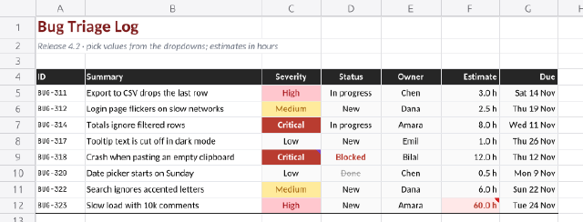

<!-- Generated by tools/gallery.mjs from showcase.yaml and build.json; do not edit. -->
# Bug Triage Log

[Sheet](../README.md) › [Tables & Data](../README.md#tables--data) · `data-validation` `dropdowns` `notes` `comments` `conditional-formatting`

A triage sheet with dropdown lists for severity, status and owner, number and date rules, input messages and review notes.



| | |
|---|---|
| Document | [bug-triage-validation.xlsx](bug-triage-validation.xlsx) (8 KB) |
| Contents | 2 sheets; used range A1:G20 |
| Features | `sheet.data.tools`, `sheet.review.comments`, `sheet.format.conditional`, `sheet.sheets.manage` |
| Built by | `kition-sheet` @ `79ed996ab2`: 52 commands in 46 ms |

## About

Severity and status are dropdown lists typed into the rule; the owner dropdown reads its names
from a range on a Lists sheet, so the team can change without touching the rules. Estimates
must be decimals from 0.5 to 40 hours and due dates must fall in the release window, each with
an input message and a stop alert. One row was imported with an estimate the rule rejects, and
the checks find it. Notes and a threaded comment carry the triage discussion.

## Checks

- `inspect.sheets`: `["Triage","Lists"]`
- `results.badSeverity.ok`: `false`
- `results.badSeverity.message`: `{"contains":"Critical, High"}`
- `results.goodEstimate.ok`: `true`
- `results.lateDate.ok`: `false`
- `results.invalid.invalid`: `["F12"]`
- `results.doc.sheets.0.validations`: `5`
- `results.doc.sheets.0.comments`: `2`
- `results.thread.comment`: `{"author":"Dana","threaded":true,"replies":[["Bilal","Yes: the app closes and unsaved work is lost."]]}`
- diagnostics: none (the kit's check finds nothing wrong)
- the saved document opens again; the thumbnail matches `thumb.png` within the `render` tolerance

## Steps

<details><summary>52 commands (from <a href="showcase.yaml">showcase.yaml</a>)</summary>

```yaml
- command: sheet.rename
  params:
    name: Triage
- command: home.insertSheet
  params:
    name: Lists
- command: range.setValues
  params:
    range: A1
    values:
      - - Owners
      - - Amara
      - - Bilal
      - - Chen
      - - Dana
      - - Emil
- command: sheet.activate
  params:
    sheet: Triage
- command: range.setValues
  params:
    range: A1
    values:
      - - Bug Triage Log
      - - Release 4.2 · pick values from the dropdowns; estimates in hours
- command: range.setValues
  params:
    range: A4
    values:
      - - ID
        - Summary
        - Severity
        - Status
        - Owner
        - Estimate
        - Due
      - - BUG-311
        - Export to CSV drops the last row
        - High
        - In progress
        - Chen
        - 3
        - 46340
      - - BUG-312
        - Login page flickers on slow networks
        - Medium
        - New
        - Dana
        - 2.5
        - 46345
      - - BUG-314
        - Totals ignore filtered rows
        - Critical
        - In progress
        - Amara
        - 8
        - 46337
      - - BUG-317
        - Tooltip text is cut off in dark mode
        - Low
        - New
        - Emil
        - 1
        - 46352
      - - BUG-318
        - Crash when pasting an empty clipboard
        - Critical
        - Blocked
        - Bilal
        - 12
        - 46338
      - - BUG-320
        - Date picker starts on Sunday
        - Low
        - Done
        - Chen
        - 0.5
        - 46335
      - - BUG-322
        - Search ignores accented letters
        - Medium
        - New
        - Dana
        - 6
        - 46348
      - - BUG-323
        - Slow load with 10k comments
        - High
        - New
        - Amara
        - 60
        - 46350
- command: data.validation
  params:
    range: C5:C20
    type: list
    formula1: Critical,High,Medium,Low
    inputTitle: Severity
    inputMessage: How bad is it for users?
    errorStyle: stop
    errorTitle: Severity
    errorMessage: Choose Critical, High, Medium or Low.
- command: data.validation
  params:
    range: D5:D20
    type: list
    formula1: New,In progress,Blocked,Done
    errorStyle: stop
    errorMessage: Choose a status from the list.
- command: data.validation
  params:
    range: E5:E20
    type: list
    formula1: =Lists!$A$2:$A$6
    errorStyle: warning
    errorMessage: That person is not on the team list.
- command: data.validation
  params:
    range: F5:F20
    type: decimal
    operator: between
    formula1: "0.5"
    formula2: "40"
    inputTitle: Estimate
    inputMessage: Hours, from 0.5 to 40. Split anything larger.
    errorStyle: stop
    errorTitle: Too large
    errorMessage: Estimates run from 0.5 to 40 hours.
- command: data.validation
  params:
    range: G5:G20
    type: date
    operator: between
    formula1: =DATE(2026,11,2)
    formula2: =DATE(2026,11,30)
    errorStyle: stop
    errorMessage: Due dates must fall in the November release window.
- command: review.newNote
  params:
    cell: F12
    text: Imported from the old tracker; 60 h breaks the 40 h rule. Split into two tickets.
    author: Release lead
- command: review.newComment
  params:
    cell: C9
    text: Is this really Critical? It only happens with an empty clipboard.
    author: Dana
- command: review.replyComment
  params:
    cell: C9
    text: "Yes: the app closes and unsaved work is lost."
    author: Bilal
- command: home.conditionalFormat
  params:
    range: C5:C20
    rule:
      type: expression
      formula: =C5="Critical"
      style:
        font:
          color:
            Rgb: 16777215
          bold: true
        fill:
          fg:
            Rgb: 12139568
          pattern: Solid
- command: home.conditionalFormat
  params:
    range: C5:C20
    rule:
      type: expression
      formula: =C5="High"
      preset: lightRedFillDarkRedText
- command: home.conditionalFormat
  params:
    range: C5:C20
    rule:
      type: expression
      formula: =C5="Medium"
      preset: yellowFill
- command: home.conditionalFormat
  params:
    range: D5:D20
    rule:
      type: expression
      formula: =D5="Done"
      style:
        font:
          color:
            Rgb: 10066329
          strike: true
- command: home.conditionalFormat
  params:
    range: D5:D20
    rule:
      type: expression
      formula: =D5="Blocked"
      style:
        font:
          color:
            Rgb: 12139568
          bold: true
- command: home.conditionalFormat
  params:
    range: F5:F20
    rule:
      type: expression
      formula: =AND(F5<>"",OR(F5<0.5,F5>40))
      style:
        font:
          color:
            Rgb: 12139568
          bold: true
        fill:
          fg:
            Rgb: 16771304
          pattern: Solid
- command: home.fontSize
  params:
    range: A1
    size: 20
- command: home.bold
  params:
    range: A1
    on: true
- command: home.fontColor
  params:
    range: A1
    color: "#7f1d1d"
- command: home.italic
  params:
    range: A2
    on: true
- command: home.fontColor
  params:
    range: A2
    color: "#6b7280"
- command: home.fillColor
  params:
    range: A4:G4
    color: "#262626"
- command: home.fontColor
  params:
    range: A4:G4
    color: "#ffffff"
- command: home.bold
  params:
    range: A4:G4
    on: true
- command: home.fontName
  params:
    range: A5:A12
    name: JetBrains Mono
- command: home.fontSize
  params:
    range: A5:A12
    size: 9
- command: home.alignCenter
  params:
    range: C4:E12
- command: home.numberFormat
  params:
    range: F5:F20
    format: 0.0" h"
- command: home.numberFormat
  params:
    range: G5:G20
    format: ddd d mmm
- command: home.alignRight
  params:
    range: F4:G4
- command: home.fillColor
  params:
    range: C5:G12
    color: "#fafafa"
- command: home.borders
  params:
    range: A5:G12
    preset: insideHorizontal
    color: "#e5e7eb"
- command: home.borders
  params:
    range: A12:G12
    preset: bottom
    color: "#262626"
- command: home.columnWidth
  params:
    cols: A:A
    width: 64
- command: home.columnWidth
  params:
    cols: B:B
    width: 230
- command: home.columnWidth
  params:
    cols: C:E
    width: 78
- command: home.columnWidth
  params:
    cols: F:G
    width: 76
- command: home.rowHeight
  params:
    rows: 1:1
    height: 28
- command: home.rowHeight
  params:
    rows: 4:12
    height: 21
- command: home.alignMiddle
  params:
    range: A4:G12
- command: sheet.tabColor
  params:
    sheet: Triage
    color: "#b91c1c"
- command: sheet.tabColor
  params:
    sheet: Lists
    color: "#737373"
- command: data.validate
  params:
    cell: C13
    input: Urgent
  as: badSeverity
- command: data.validate
  params:
    cell: F13
    input: "4"
  as: goodEstimate
- command: data.validate
  params:
    cell: G13
    input: 2026-12-15
  as: lateDate
- command: data.circleInvalid
  params: {}
  as: invalid
- command: document.inspect
  params: {}
  as: doc
- command: cell.get
  params:
    cell: C9
  as: thread
```

</details>
