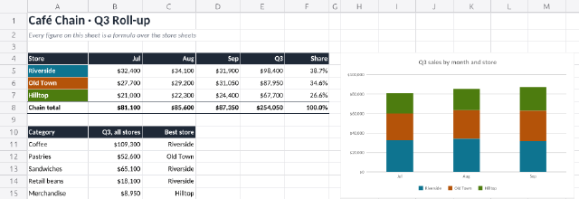

<!-- Generated by tools/gallery.mjs from showcase.yaml and build.json; do not edit. -->
# Café Chain Quarterly Roll-up

[Sheet](../README.md) › [Tables & Data](../README.md#tables--data) · `multiple-sheets` `cross-sheet-formulas` `tab-colors` `summary` `chart`

Three store sheets with coloured tabs feed a summary sheet through cross-sheet and 3-D references.



| | |
|---|---|
| Document | [cafe-chain-quarterly-rollup.xlsx](cafe-chain-quarterly-rollup.xlsx) (11 KB) |
| Contents | 4 sheets; used range A1:F15 |
| Features | `sheet.sheets.manage`, `sheet.formulas.functions`, `sheet.charts.design`, `sheet.format.number` |
| Built by | `kition-sheet` @ `79ed996ab2`: 96 commands in 145 ms |

## About

Each café has its own sheet with the same layout and its own tab colour. The Summary sheet,
moved to the front, holds no typed numbers: store rows point at each sheet's total row
('Old Town'!E10), the category block adds the same cell across all three sheets with a 3-D
reference (SUM(Riverside:Hilltop!E5)), and a nested IF names the best store per category. A
stacked column chart shows each store's months.

## Checks

- `inspect.sheets`: `["Summary","Riverside","Old Town","Hilltop"]`
- `inspect.sheet`: `"Summary"`
- `results.stores.values.0`: `["Riverside",32400,34100,31900,98400,{"approx":0.387325,"tol":0.00001}]`
- `results.stores.values.3`: `["Chain total",81100,85600,87350,254050,1]`
- `results.links.values`: `[["=Riverside!E10"],["='Old Town'!E10"],["=Hilltop!E10"]]`
- `results.categories.values.0`: `["Coffee",109300,"Riverside"]`
- `results.categories.values.4`: `["Merchandise",8950,"Hilltop"]`
- `results.categories.values.1`: `["Pastries",52600,"Old Town"]`
- diagnostics: none (the kit's check finds nothing wrong)
- the saved document opens again; the thumbnail matches `thumb.png` within the `render` tolerance

## Steps

<details><summary>96 commands (from <a href="showcase.yaml">showcase.yaml</a>)</summary>

```yaml
- command: sheet.rename
  params:
    name: Riverside
- command: range.setValues
  params:
    range: A1
    values:
      - - Riverside café
      - - Q3 sales by category, dollars
      - - null
      - - Category
        - Jul
        - Aug
        - Sep
        - Q3
      - - Coffee
        - 14200
        - 15100
        - 13800
        - =SUM(B5:D5)
      - - Pastries
        - 6100
        - 6400
        - 5900
        - =SUM(B6:D6)
      - - Sandwiches
        - 8800
        - 9300
        - 8600
        - =SUM(B7:D7)
      - - Retail beans
        - 2400
        - 2100
        - 2600
        - =SUM(B8:D8)
      - - Merchandise
        - 900
        - 1200
        - 1000
        - =SUM(B9:D9)
      - - Total
        - =SUM(B5:B9)
        - =SUM(C5:C9)
        - =SUM(D5:D9)
        - =SUM(E5:E9)
- command: home.fontSize
  params:
    range: A1
    size: 18
- command: home.bold
  params:
    range: A1
    on: true
- command: home.fontColor
  params:
    range: A1
    color: "#0e7490"
- command: home.fontColor
  params:
    range: A2
    color: "#6b7280"
- command: home.fillColor
  params:
    range: A4:E4
    color: "#0e7490"
- command: home.fontColor
  params:
    range: A4:E4
    color: "#ffffff"
- command: home.bold
  params:
    range: A4:E4
    on: true
- command: home.alignRight
  params:
    range: B4:E4
- command: home.numberFormat
  params:
    range: B5:E10
    format: "#,##0"
- command: home.bold
  params:
    range: A10:E10
    on: true
- command: home.bold
  params:
    range: E5:E9
    on: true
- command: home.borders
  params:
    range: A10:E10
    preset: topDoubleBottom
    color: "#0e7490"
- command: home.columnWidth
  params:
    cols: A:A
    width: 110
- command: home.columnWidth
  params:
    cols: B:E
    width: 76
- command: sheet.tabColor
  params:
    sheet: Riverside
    color: "#0e7490"
- command: home.insertSheet
  params:
    name: Old Town
- command: sheet.activate
  params:
    sheet: Old Town
- command: range.setValues
  params:
    range: A1
    values:
      - - Old Town café
      - - Q3 sales by category, dollars
      - - null
      - - Category
        - Jul
        - Aug
        - Sep
        - Q3
      - - Coffee
        - 11800
        - 12400
        - 12900
        - =SUM(B5:D5)
      - - Pastries
        - 6400
        - 6900
        - 7300
        - =SUM(B6:D6)
      - - Sandwiches
        - 6900
        - 7100
        - 7600
        - =SUM(B7:D7)
      - - Retail beans
        - 1900
        - 2000
        - 2300
        - =SUM(B8:D8)
      - - Merchandise
        - 700
        - 800
        - 950
        - =SUM(B9:D9)
      - - Total
        - =SUM(B5:B9)
        - =SUM(C5:C9)
        - =SUM(D5:D9)
        - =SUM(E5:E9)
- command: home.fontSize
  params:
    range: A1
    size: 18
- command: home.bold
  params:
    range: A1
    on: true
- command: home.fontColor
  params:
    range: A1
    color: "#b45309"
- command: home.fontColor
  params:
    range: A2
    color: "#6b7280"
- command: home.fillColor
  params:
    range: A4:E4
    color: "#b45309"
- command: home.fontColor
  params:
    range: A4:E4
    color: "#ffffff"
- command: home.bold
  params:
    range: A4:E4
    on: true
- command: home.alignRight
  params:
    range: B4:E4
- command: home.numberFormat
  params:
    range: B5:E10
    format: "#,##0"
- command: home.bold
  params:
    range: A10:E10
    on: true
- command: home.bold
  params:
    range: E5:E9
    on: true
- command: home.borders
  params:
    range: A10:E10
    preset: topDoubleBottom
    color: "#b45309"
- command: home.columnWidth
  params:
    cols: A:A
    width: 110
- command: home.columnWidth
  params:
    cols: B:E
    width: 76
- command: sheet.tabColor
  params:
    sheet: Old Town
    color: "#b45309"
- command: home.insertSheet
  params:
    name: Hilltop
- command: sheet.activate
  params:
    sheet: Hilltop
- command: range.setValues
  params:
    range: A1
    values:
      - - Hilltop café
      - - Q3 sales by category, dollars
      - - null
      - - Category
        - Jul
        - Aug
        - Sep
        - Q3
      - - Coffee
        - 9100
        - 9600
        - 10400
        - =SUM(B5:D5)
      - - Pastries
        - 4300
        - 4500
        - 4800
        - =SUM(B6:D6)
      - - Sandwiches
        - 5200
        - 5500
        - 6100
        - =SUM(B7:D7)
      - - Retail beans
        - 1500
        - 1600
        - 1700
        - =SUM(B8:D8)
      - - Merchandise
        - 900
        - 1100
        - 1400
        - =SUM(B9:D9)
      - - Total
        - =SUM(B5:B9)
        - =SUM(C5:C9)
        - =SUM(D5:D9)
        - =SUM(E5:E9)
- command: home.fontSize
  params:
    range: A1
    size: 18
- command: home.bold
  params:
    range: A1
    on: true
- command: home.fontColor
  params:
    range: A1
    color: "#4d7c0f"
- command: home.fontColor
  params:
    range: A2
    color: "#6b7280"
- command: home.fillColor
  params:
    range: A4:E4
    color: "#4d7c0f"
- command: home.fontColor
  params:
    range: A4:E4
    color: "#ffffff"
- command: home.bold
  params:
    range: A4:E4
    on: true
- command: home.alignRight
  params:
    range: B4:E4
- command: home.numberFormat
  params:
    range: B5:E10
    format: "#,##0"
- command: home.bold
  params:
    range: A10:E10
    on: true
- command: home.bold
  params:
    range: E5:E9
    on: true
- command: home.borders
  params:
    range: A10:E10
    preset: topDoubleBottom
    color: "#4d7c0f"
- command: home.columnWidth
  params:
    cols: A:A
    width: 110
- command: home.columnWidth
  params:
    cols: B:E
    width: 76
- command: sheet.tabColor
  params:
    sheet: Hilltop
    color: "#4d7c0f"
- command: home.insertSheet
  params:
    name: Summary
    before: 0
- command: sheet.activate
  params:
    sheet: Summary
- command: range.setValues
  params:
    range: A1
    values:
      - - Café Chain · Q3 Roll-up
      - - Every figure on this sheet is a formula over the store sheets
      - - null
      - - Store
        - Jul
        - Aug
        - Sep
        - Q3
        - Share
      - - Riverside
        - =Riverside!B10
        - =Riverside!C10
        - =Riverside!D10
        - =Riverside!E10
        - =E5/$E$8
      - - Old Town
        - ='Old Town'!B10
        - ='Old Town'!C10
        - ='Old Town'!D10
        - ='Old Town'!E10
        - =E6/$E$8
      - - Hilltop
        - =Hilltop!B10
        - =Hilltop!C10
        - =Hilltop!D10
        - =Hilltop!E10
        - =E7/$E$8
      - - Chain total
        - =SUM(B5:B7)
        - =SUM(C5:C7)
        - =SUM(D5:D7)
        - =SUM(E5:E7)
        - =SUM(F5:F7)
      - - null
      - - Category
        - Q3, all stores
        - Best store
        - null
        - null
        - null
      - - Coffee
        - =SUM(Riverside:Hilltop!E5)
        - =IF(MAX(Riverside!E5,'Old Town'!E5,Hilltop!E5)=Riverside!E5,"Riverside",IF(MAX(Riverside!E5,'Old Town'!E5,Hilltop!E5)='Old Town'!E5,"Old Town","Hilltop"))
      - - Pastries
        - =SUM(Riverside:Hilltop!E6)
        - =IF(MAX(Riverside!E6,'Old Town'!E6,Hilltop!E6)=Riverside!E6,"Riverside",IF(MAX(Riverside!E6,'Old Town'!E6,Hilltop!E6)='Old Town'!E6,"Old Town","Hilltop"))
      - - Sandwiches
        - =SUM(Riverside:Hilltop!E7)
        - =IF(MAX(Riverside!E7,'Old Town'!E7,Hilltop!E7)=Riverside!E7,"Riverside",IF(MAX(Riverside!E7,'Old Town'!E7,Hilltop!E7)='Old Town'!E7,"Old Town","Hilltop"))
      - - Retail beans
        - =SUM(Riverside:Hilltop!E8)
        - =IF(MAX(Riverside!E8,'Old Town'!E8,Hilltop!E8)=Riverside!E8,"Riverside",IF(MAX(Riverside!E8,'Old Town'!E8,Hilltop!E8)='Old Town'!E8,"Old Town","Hilltop"))
      - - Merchandise
        - =SUM(Riverside:Hilltop!E9)
        - =IF(MAX(Riverside!E9,'Old Town'!E9,Hilltop!E9)=Riverside!E9,"Riverside",IF(MAX(Riverside!E9,'Old Town'!E9,Hilltop!E9)='Old Town'!E9,"Old Town","Hilltop"))
- command: home.fontSize
  params:
    range: A1
    size: 20
- command: home.bold
  params:
    range: A1
    on: true
- command: home.fontColor
  params:
    range: A1
    color: "#1f2937"
- command: home.italic
  params:
    range: A2
    on: true
- command: home.fontColor
  params:
    range: A2
    color: "#6b7280"
- command: home.fillColor
  params:
    range: A4:F4
    color: "#1f2937"
- command: home.fillColor
  params:
    range: A10:C10
    color: "#1f2937"
- command: home.fontColor
  params:
    range: A4:F4
    color: "#ffffff"
- command: home.fontColor
  params:
    range: A10:C10
    color: "#ffffff"
- command: home.bold
  params:
    range: A4:F4
    on: true
- command: home.bold
  params:
    range: A10:C10
    on: true
- command: home.alignRight
  params:
    range: B4:F4
- command: home.alignRight
  params:
    range: B10:C10
- command: home.alignRight
  params:
    range: C11:C15
- command: home.fillColor
  params:
    range: A5
    color: "#0e7490"
- command: home.fillColor
  params:
    range: A6
    color: "#b45309"
- command: home.fillColor
  params:
    range: A7
    color: "#4d7c0f"
- command: home.fontColor
  params:
    range: A5:A7
    color: "#ffffff"
- command: home.bold
  params:
    range: A5:A7
    on: true
- command: home.numberFormat
  params:
    range: B5:E8
    format: $$#,##0
- command: home.numberFormat
  params:
    range: F5:F8
    format: 0.0%
- command: home.numberFormat
  params:
    range: B11:B15
    format: $$#,##0
- command: home.bold
  params:
    range: A8:F8
    on: true
- command: home.borders
  params:
    range: A8:F8
    preset: topDoubleBottom
    color: "#1f2937"
- command: home.borders
  params:
    range: A11:C15
    preset: insideHorizontal
    color: "#e5e7eb"
- command: home.borders
  params:
    range: A15:C15
    preset: bottom
    color: "#1f2937"
- command: home.columnWidth
  params:
    cols: A:A
    width: 104
- command: home.columnWidth
  params:
    cols: B:C
    width: 92
- command: home.columnWidth
  params:
    cols: D:F
    width: 76
- command: home.columnWidth
  params:
    cols: G:G
    width: 20
- command: home.rowHeight
  params:
    rows: 1:1
    height: 28
- command: home.rowHeight
  params:
    rows: 4:15
    height: 21
- command: home.alignMiddle
  params:
    range: A4:F15
- command: sheet.tabColor
  params:
    sheet: Summary
    color: "#1f2937"
- command: insert.chart
  params:
    range: A4:D7
    type: column
    subtype: stacked
    at: H4
    width: 400
    height: 250
  as: chart
- command: chart.switchRowColumn
  params: {}
- command: drawing.chart
  params:
    id: "1"
    title: Q3 sales by month and store
    legend: bottom
    seriesFormat:
      - index: 0
        color: "#0e7490"
      - index: 1
        color: "#b45309"
      - index: 2
        color: "#4d7c0f"
- command: sheet.read
  params:
    range: A5:F8
  as: stores
- command: sheet.read
  params:
    range: A11:C15
  as: categories
- command: sheet.read
  params:
    range: E5:E7
    formulas: true
  as: links
```

</details>
