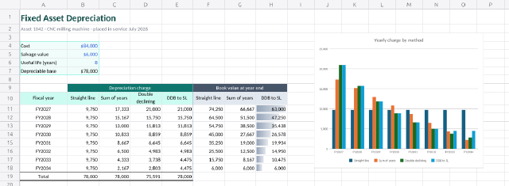

<!-- Generated by tools/gallery.mjs from showcase.yaml and build.json; do not edit. -->
# Depreciation Schedule

[Sheet](../README.md) › [Finance & Budgets](../README.md#finance--budgets) · `depreciation` `financial-functions` `formulas` `chart` `number-formats`

One machine depreciated four ways, with SLN, SYD, DDB and VDB side by side and the book value each leaves behind.



| | |
|---|---|
| Document | [depreciation-schedule.xlsx](depreciation-schedule.xlsx) (9 KB) |
| Contents | 1 sheet; used range A1:H19 |
| Features | `sheet.formulas.functions`, `sheet.edit.fill-clear`, `sheet.format.number`, `sheet.charts.design` |
| Built by | `kition-sheet` @ `79ed996ab2`: 40 commands in 16 ms |

## About

A CNC milling machine bought for $84,000 with $6,000 salvage after eight years. Straight line
spreads the cost evenly, sum-of-years' digits and double-declining balance front-load it, and
VDB switches from declining balance to straight line in year seven so the book value lands
exactly on salvage, which plain DDB never reaches. The period number comes from
`ROWS($A$11:A11)`, so the fiscal-year labels stay text and the chart uses them as categories.

## Checks

- `results.year1.values.0`: `[9750,{"approx":17333.3333333,"tol":0.000001},21000,21000,74250,{"approx":66666.6666667,"tol":0.000001},63000]`
- `results.last.values.0`: `[9750,{"approx":4333.3333333,"tol":0.000001},{"approx":3737.5488281,"tol":0.000001},{"approx":4475.0976563,"tol":0.000001},15750,{"approx":8166.6666667,"tol":0.000001},{"approx":10475.0976563,"tol":0.000001}]`
- `results.last.values.1`: `[9750,{"approx":2166.6666667,"tol":0.000001},{"approx":2803.1616211,"tol":0.000001},{"approx":4475.0976563,"tol":0.000001},{"approx":6000,"tol":0.000001},{"approx":6000,"tol":0.000001},{"approx":6000,"tol":0.000001}]`
- `results.totals.values.0`: `[78000,{"approx":78000,"tol":0.000001},{"approx":75590.5151367,"tol":0.000001},{"approx":78000,"tol":0.000001}]`
- diagnostics: none (the kit's check finds nothing wrong)
- the saved document opens again; the thumbnail matches `thumb.png` within the `render` tolerance

## Steps

<details><summary>40 commands (from <a href="showcase.yaml">showcase.yaml</a>)</summary>

```yaml
- command: range.setValues
  params:
    range: A1
    values:
      - - Fixed Asset Depreciation
      - - Asset 1042 · CNC milling machine · placed in service July 2026
- command: range.setValues
  params:
    range: A4
    values:
      - - Cost
        - 84000
      - - Salvage value
        - 6000
      - - Useful life (years)
        - 8
      - - Depreciable base
        - =B4-B5
- command: range.setValues
  params:
    range: A9
    values:
      - - null
        - Depreciation charge
        - null
        - null
        - null
        - Book value at year end
        - null
        - null
      - - Fiscal year
        - Straight line
        - Sum of years
        - Double declining
        - DDB to SL
        - Straight line
        - Sum of years
        - DDB to SL
      - - FY2027
        - =SLN($B$4,$B$5,$B$6)
        - =SYD($B$4,$B$5,$B$6,ROWS($A$11:A11))
        - =DDB($B$4,$B$5,$B$6,ROWS($A$11:A11))
        - =VDB($B$4,$B$5,$B$6,ROWS($A$11:A11)-1,ROWS($A$11:A11))
        - =$B$4-SUM($B$11:B11)
        - =$B$4-SUM($C$11:C11)
        - =$B$4-SUM($E$11:E11)
      - - FY2028
      - - FY2029
      - - FY2030
      - - FY2031
      - - FY2032
      - - FY2033
      - - FY2034
      - - Total
        - =SUM(B11:B18)
        - =SUM(C11:C18)
        - =SUM(D11:D18)
        - =SUM(E11:E18)
- command: edit.fillDown
  params:
    range: B11:H18
- command: home.fontSize
  params:
    range: A1
    size: 20
- command: home.bold
  params:
    range: A1
- command: home.fontColor
  params:
    range: A1
    color: "#134e4a"
- command: home.fontColor
  params:
    range: A2
    color: "#6b7280"
- command: home.numberFormat
  params:
    range: B4:B5
    format: $$#,##0
- command: home.numberFormat
  params:
    range: B7
    format: $$#,##0
- command: home.fontColor
  params:
    range: B4:B6
    color: "#1d4ed8"
- command: home.fillColor
  params:
    range: A4:B7
    color: "#f0fdfa"
- command: home.borders
  params:
    range: A4:B7
    preset: outside
    color: "#5eead4"
- command: home.bold
  params:
    range: A7:B7
- command: home.mergeCenter
  params:
    range: B9:E9
- command: home.mergeCenter
  params:
    range: F9:H9
- command: home.fillColor
  params:
    range: B9:E9
    color: "#0f766e"
- command: home.fillColor
  params:
    range: F9:H9
    color: "#475569"
- command: home.fontColor
  params:
    range: B9:H9
    color: "#ffffff"
- command: home.bold
  params:
    range: A9:H10
- command: home.fillColor
  params:
    range: A10:E10
    color: "#ccfbf1"
- command: home.fillColor
  params:
    range: F10:H10
    color: "#e2e8f0"
- command: home.wrapText
  params:
    range: A10:H10
- command: home.alignCenter
  params:
    range: A10:H10
- command: home.alignMiddle
  params:
    range: A10:H10
- command: home.rowHeight
  params:
    rows: 10:10
    height: 30
- command: home.alignCenter
  params:
    range: A11:A19
- command: home.numberFormat
  params:
    range: B11:H19
    format: "#,##0"
- command: home.borders
  params:
    range: A11:H18
    preset: insideHorizontal
    color: "#e5e7eb"
- command: home.borders
  params:
    range: F9:F19
    preset: left
    color: "#94a3b8"
- command: home.bold
  params:
    range: A19:H19
- command: home.borders
  params:
    range: A19:E19
    preset: topDoubleBottom
- command: home.conditionalFormat
  params:
    range: H11:H18
    rule:
      type: dataBar
      color: "#94a3b8"
- command: home.columnWidth
  params:
    cols: A:A
    width: 112
- command: home.columnWidth
  params:
    cols: B:H
    width: 74
- command: insert.chart
  params:
    range: A10:E18
    type: column
    subtype: clustered
  as: chart
- command: chart.set
  params:
    title: Yearly charge by method
    legend: bottom
    at: J3
    width: 400
    height: 320
- command: sheet.read
  params:
    range: B11:H11
  as: year1
- command: sheet.read
  params:
    range: B17:H18
  as: last
- command: sheet.read
  params:
    range: B19:E19
  as: totals
```

</details>
