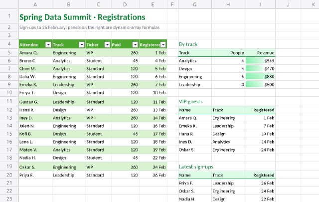

<!-- Generated by tools/gallery.mjs from showcase.yaml and build.json; do not edit. -->
# Dynamic Array Event Report

[Sheet](../README.md) › [Formulas & Functions](../README.md#formulas--functions) · `dynamic-arrays` `formulas` `tables` `conditional-formatting` `number-formats`

Three spilling summaries of a conference sign-up list, built with UNIQUE, SORT, FILTER, SORTBY, CHOOSECOLS and TAKE.



| | |
|---|---|
| Document | [dynamic-array-registrations.xlsx](dynamic-array-registrations.xlsx) (7 KB) |
| Contents | 1 sheet; used range A1:I23 |
| Features | `sheet.formulas.functions`, `sheet.tables.design`, `sheet.format.number`, `sheet.format.conditional` |
| Built by | `kition-sheet` @ `79ed996ab2`: 50 commands in 38 ms |

## About

Every panel on the right is a single formula whose answer spills into the cells below it. The
track summary lists `SORT(UNIQUE())` of the tracks and counts and totals them against the spilled
range itself (`G6#`). The VIP list is `FILTER` over three chosen columns, sorted by date, and the
latest sign-ups are `TAKE(SORTBY(),3)`. Add a registration to the table and every panel grows or
reorders on its own.

## Checks

- `results.tracks.values`: `[["Analytics",4,545],["Design",4,470],["Engineering",5,880],["Leadership",3,500]]`
- `results.vips.values`: `[["Amara Q.","Engineering",46419],["Emeka K.","Leadership",46425],["Hana R.","Design",46431],["Ines D.","Analytics",46432],["Oskar S.","Engineering",46442],[null,null,null]]`
- `results.latest.values`: `[["Priya F.","Leadership",46444],["Oskar S.","Engineering",46442],["Nadia H.","Design",46440]]`
- diagnostics: none (the kit's check finds nothing wrong)
- the saved document opens again; the thumbnail matches `thumb.png` within the `render` tolerance

## Steps

<details><summary>50 commands (from <a href="showcase.yaml">showcase.yaml</a>)</summary>

```yaml
- command: range.setValues
  params:
    range: A1
    values:
      - - Spring Data Summit · Registrations
      - - Sign-ups to 26 February; panels on the right are dynamic-array formulas
- command: range.setValues
  params:
    range: A4
    values:
      - - Attendee
        - Track
        - Ticket
        - Paid
        - Registered
      - - Amara Q.
        - Engineering
        - VIP
        - 260
        - 2027-02-01
      - - Bruno C.
        - Analytics
        - Student
        - 45
        - 2027-02-04
      - - Chen M.
        - Analytics
        - Standard
        - 120
        - 2027-02-05
      - - Dalia W.
        - Engineering
        - Standard
        - 120
        - 2027-02-06
      - - Emeka K.
        - Leadership
        - VIP
        - 260
        - 2027-02-07
      - - Freya T.
        - Design
        - Standard
        - 120
        - 2027-02-10
      - - Gustav G.
        - Leadership
        - Standard
        - 120
        - 2027-02-11
      - - Hana R.
        - Design
        - VIP
        - 260
        - 2027-02-13
      - - Ines D.
        - Analytics
        - VIP
        - 260
        - 2027-02-14
      - - Jalen N.
        - Engineering
        - Standard
        - 120
        - 2027-02-16
      - - Kofi B.
        - Design
        - Student
        - 45
        - 2027-02-17
      - - Lena L.
        - Engineering
        - Standard
        - 120
        - 2027-02-18
      - - Mateo V.
        - Analytics
        - Standard
        - 120
        - 2027-02-19
      - - Nadia H.
        - Design
        - Student
        - 45
        - 2027-02-22
      - - Oskar S.
        - Engineering
        - VIP
        - 260
        - 2027-02-24
      - - Priya F.
        - Leadership
        - Standard
        - 120
        - 2027-02-26
- command: home.formatAsTable
  params:
    range: A4:E20
    style: TableStyleMedium7
- command: home.numberFormat
  params:
    range: D5:D20
    format: "#,##0"
- command: home.numberFormat
  params:
    range: E5:E20
    format: d mmm
- command: range.setValues
  params:
    range: G4
    values:
      - - By track
      - - Track
        - People
        - Revenue
      - - =SORT(UNIQUE(B5:B20))
        - =COUNTIF(B5:B20,G6#)
        - =SUMIFS(D5:D20,B5:B20,G6#)
- command: range.setValues
  params:
    range: G11
    values:
      - - VIP guests
      - - Name
        - Track
        - Registered
      - - =SORT(FILTER(CHOOSECOLS(A5:E20,1,2,5),C5:C20="VIP"),3)
- command: range.setValues
  params:
    range: G19
    values:
      - - Latest sign-ups
      - - Name
        - Track
        - Registered
      - - =TAKE(SORTBY(CHOOSECOLS(A5:E20,1,2,5),E5:E20,-1),3)
- command: home.fontSize
  params:
    range: A1
    size: 20
- command: home.bold
  params:
    range: A1
- command: home.fontColor
  params:
    range: A1
    color: "#15803d"
- command: home.fontColor
  params:
    range: A2
    color: "#6b7280"
- command: home.bold
  params:
    range: G4
- command: home.bold
  params:
    range: G11
- command: home.bold
  params:
    range: G19
- command: home.fontSize
  params:
    range: G4
    size: 13
- command: home.fontSize
  params:
    range: G11
    size: 13
- command: home.fontSize
  params:
    range: G19
    size: 13
- command: home.fontColor
  params:
    range: G4
    color: "#15803d"
- command: home.fontColor
  params:
    range: G11
    color: "#15803d"
- command: home.fontColor
  params:
    range: G19
    color: "#15803d"
- command: home.fillColor
  params:
    range: G5:I5
    color: "#dcfce7"
- command: home.fillColor
  params:
    range: G12:I12
    color: "#dcfce7"
- command: home.fillColor
  params:
    range: G20:I20
    color: "#dcfce7"
- command: home.bold
  params:
    range: G5:I5
- command: home.bold
  params:
    range: G12:I12
- command: home.bold
  params:
    range: G20:I20
- command: home.borders
  params:
    range: G5:I5
    preset: bottom
    color: "#16a34a"
- command: home.borders
  params:
    range: G12:I12
    preset: bottom
    color: "#16a34a"
- command: home.borders
  params:
    range: G20:I20
    preset: bottom
    color: "#16a34a"
- command: home.alignRight
  params:
    range: H5:I5
- command: home.alignRight
  params:
    range: I12
- command: home.alignRight
  params:
    range: I20
- command: home.numberFormat
  params:
    range: I6:I9
    format: $$#,##0
- command: home.numberFormat
  params:
    range: I13:I17
    format: d mmm
- command: home.numberFormat
  params:
    range: I21:I23
    format: d mmm
- command: home.conditionalFormat
  params:
    range: I6:I9
    rule:
      type: dataBar
      color: "#86efac"
- command: home.borders
  params:
    range: G9:I9
    preset: bottom
    color: "#d1d5db"
- command: home.borders
  params:
    range: G17:I17
    preset: bottom
    color: "#d1d5db"
- command: home.borders
  params:
    range: G23:I23
    preset: bottom
    color: "#d1d5db"
- command: home.columnWidth
  params:
    cols: A:A
    width: 84
- command: home.columnWidth
  params:
    cols: B:B
    width: 84
- command: home.columnWidth
  params:
    cols: C:C
    width: 64
- command: home.columnWidth
  params:
    cols: D:E
    width: 70
- command: home.columnWidth
  params:
    cols: F:F
    width: 28
- command: home.columnWidth
  params:
    cols: G:H
    width: 84
- command: home.columnWidth
  params:
    cols: I:I
    width: 76
- command: sheet.read
  params:
    range: G6:I9
  as: tracks
- command: sheet.read
  params:
    range: G13:I18
  as: vips
- command: sheet.read
  params:
    range: G21:I23
  as: latest
```

</details>
