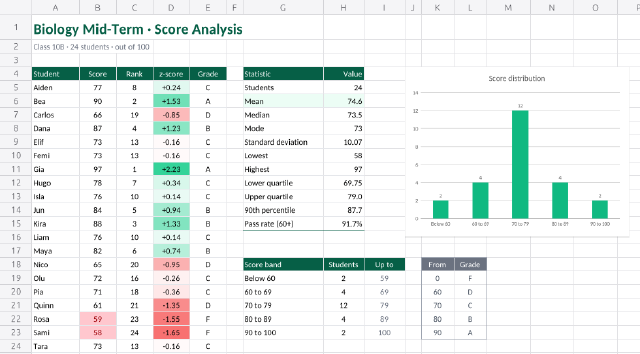

<!-- Generated by tools/gallery.mjs from showcase.yaml and build.json; do not edit. -->
# Exam Score Statistics

[Sheet](../README.md) › [Formulas & Functions](../README.md#formulas--functions) · `statistics` `formulas` `dynamic-arrays` `chart` `conditional-formatting`

A class's test scores described with AVERAGE, MEDIAN, MODE, STDEV, QUARTILE and PERCENTILE, binned with FREQUENCY into a histogram.



| | |
|---|---|
| Document | [exam-score-statistics.xlsx](exam-score-statistics.xlsx) (10 KB) |
| Contents | 1 sheet; used range A1:L28 |
| Features | `sheet.formulas.functions`, `sheet.edit.fill-clear`, `sheet.charts.design`, `sheet.format.conditional` |
| Built by | `kition-sheet` @ `79ed996ab2`: 52 commands in 19 ms |

## About

Twenty-four scores from a biology mid-term. Each student gets a rank (RANK.EQ), a z-score
(STANDARDIZE against the class mean and standard deviation) and a letter grade looked up with
XLOOKUP in next-smaller mode. The panel on the right is the usual descriptive set: count, mean,
median, mode, sample standard deviation, range, quartiles, the 90th percentile and the pass rate.
FREQUENCY bins the scores in one spilling formula (DROP removes its overflow bin), and the
column chart of the bins is the histogram.

## Checks

- `results.roster.values`: `[["Aiden",77,8,{"approx":0.2400114,"tol":0.000001},"C"],["Bea",90,2,{"approx":1.5311074,"tol":0.000001},"A"],["Carlos",66,19,{"approx":-0.8524544,"tol":0.000001},"D"],["Dana",87,4,{"approx":1.2331622,"tol":0.000001},"B"],["Elif",73,13,{"approx":-0.1572489,"tol":0.000001},"C"],["Femi",73,13,{"approx":-0.1572489,"tol":0.000001},"C"]]`
- `results.stats.values`: `[[24],[{"approx":74.5833333,"tol":0.000001}],[73.5],[73],[{"approx":10.0689651,"tol":0.000001}],[58],[97],[69.75],[79],[{"approx":87.7,"tol":0.000001}],[{"approx":0.9166667,"tol":0.000001}]]`
- `results.bins.values`: `[[2],[4],[12],[4],[2],[null]]`
- diagnostics: none (the kit's check finds nothing wrong)
- the saved document opens again; the thumbnail matches `thumb.png` within the `render` tolerance

## Steps

<details><summary>52 commands (from <a href="showcase.yaml">showcase.yaml</a>)</summary>

```yaml
- command: range.setValues
  params:
    range: A1
    values:
      - - Biology Mid-Term · Score Analysis
      - - Class 10B · 24 students · out of 100
- command: range.setValues
  params:
    range: A4
    values:
      - - Student
        - Score
        - Rank
        - z-score
        - Grade
      - - Aiden
        - 77
        - =RANK.EQ(B5,$B$5:$B$28)
        - =STANDARDIZE(B5,$H$6,$H$9)
        - =XLOOKUP(B5,$K$19:$K$23,$L$19:$L$23,,-1)
      - - Bea
        - 90
      - - Carlos
        - 66
      - - Dana
        - 87
      - - Elif
        - 73
      - - Femi
        - 73
      - - Gia
        - 97
      - - Hugo
        - 78
      - - Isla
        - 76
      - - Jun
        - 84
      - - Kira
        - 88
      - - Liam
        - 76
      - - Maya
        - 82
      - - Nico
        - 65
      - - Olu
        - 72
      - - Pia
        - 71
      - - Quinn
        - 61
      - - Rosa
        - 59
      - - Sami
        - 58
      - - Tara
        - 73
      - - Uma
        - 74
      - - Vik
        - 72
      - - Wren
        - 77
      - - Yara
        - 61
- command: edit.fillDown
  params:
    range: C5:E28
- command: range.setValues
  params:
    range: G4
    values:
      - - Statistic
        - Value
      - - Students
        - =COUNT(B5:B28)
      - - Mean
        - =AVERAGE(B5:B28)
      - - Median
        - =MEDIAN(B5:B28)
      - - Mode
        - =MODE.SNGL(B5:B28)
      - - Standard deviation
        - =STDEV.S(B5:B28)
      - - Lowest
        - =MIN(B5:B28)
      - - Highest
        - =MAX(B5:B28)
      - - Lower quartile
        - =QUARTILE.INC(B5:B28,1)
      - - Upper quartile
        - =QUARTILE.INC(B5:B28,3)
      - - 90th percentile
        - =PERCENTILE.INC(B5:B28,0.9)
      - - Pass rate (60+)
        - =COUNTIF(B5:B28,">=60")/H5
- command: range.setValues
  params:
    range: G18
    values:
      - - Score band
        - Students
        - Up to
      - - Below 60
        - =DROP(FREQUENCY(B5:B28,I19:I23),-1)
        - 59
      - - 60 to 69
        - null
        - 69
      - - 70 to 79
        - null
        - 79
      - - 80 to 89
        - null
        - 89
      - - 90 to 100
        - null
        - 100
- command: range.setValues
  params:
    range: K18
    values:
      - - From
        - Grade
      - - 0
        - F
      - - 60
        - D
      - - 70
        - C
      - - 80
        - B
      - - 90
        - A
- command: home.fontSize
  params:
    range: A1
    size: 20
- command: home.bold
  params:
    range: A1
- command: home.fontColor
  params:
    range: A1
    color: "#065f46"
- command: home.fontColor
  params:
    range: A2
    color: "#6b7280"
- command: home.fillColor
  params:
    range: A4:E4
    color: "#065f46"
- command: home.fillColor
  params:
    range: G4:H4
    color: "#065f46"
- command: home.fillColor
  params:
    range: G18:I18
    color: "#065f46"
- command: home.fillColor
  params:
    range: K18:L18
    color: "#6b7280"
- command: home.fontColor
  params:
    range: A4:L4
    color: "#ffffff"
- command: home.fontColor
  params:
    range: G18:L18
    color: "#ffffff"
- command: home.bold
  params:
    range: A4:L4
- command: home.bold
  params:
    range: G18:L18
- command: home.alignCenter
  params:
    range: B4:E28
- command: home.alignRight
  params:
    range: H4
- command: home.numberFormat
  params:
    range: D5:D28
    format: +0.00;-0.00;0.00
- command: home.bold
  params:
    range: E5:E28
- command: home.borders
  params:
    range: A5:E28
    preset: insideHorizontal
    color: "#e5e7eb"
- command: home.conditionalFormat
  params:
    range: D5:D28
    rule:
      type: colorScale
      colors:
        - "#f87171"
        - "#ffffff"
        - "#34d399"
- command: home.conditionalFormat
  params:
    range: B5:B28
    rule:
      type: expression
      formula: =B5<60
      preset: lightRedFillDarkRedText
- command: home.numberFormat
  params:
    range: H6:H7
    format: "0.0"
- command: home.numberFormat
  params:
    range: H9
    format: "0.00"
- command: home.numberFormat
  params:
    range: H12:H14
    format: 0.0#
- command: home.numberFormat
  params:
    range: H15
    format: 0.0%
- command: home.borders
  params:
    range: G5:H15
    preset: insideHorizontal
    color: "#e5e7eb"
- command: home.borders
  params:
    range: G15:H15
    preset: bottom
    color: "#065f46"
- command: home.fillColor
  params:
    range: G6:H6
    color: "#ecfdf5"
- command: home.bold
  params:
    range: G6:H6
- command: home.alignCenter
  params:
    range: H18:I23
- command: home.fontColor
  params:
    range: I19:I23
    color: "#6b7280"
- command: home.alignCenter
  params:
    range: K18:L23
- command: home.fontColor
  params:
    range: K19:L23
    color: "#4b5563"
- command: home.borders
  params:
    range: G19:I23
    preset: insideHorizontal
    color: "#e5e7eb"
- command: home.borders
  params:
    range: K18:L23
    preset: outside
    color: "#9ca3af"
- command: home.columnWidth
  params:
    cols: A:A
    width: 70
- command: home.columnWidth
  params:
    cols: B:E
    width: 54
- command: home.columnWidth
  params:
    cols: F:F
    width: 24
- command: home.columnWidth
  params:
    cols: G:G
    width: 118
- command: home.columnWidth
  params:
    cols: H:I
    width: 60
- command: home.columnWidth
  params:
    cols: J:J
    width: 24
- command: home.columnWidth
  params:
    cols: K:L
    width: 48
- command: insert.chart
  params:
    range: G18:H23
    type: column
  as: chart
- command: chart.set
  params:
    title: Score distribution
    legend: none
    dataLabels: true
    at: J4
    width: 330
    height: 250
- command: chart.formatSelection
  params:
    series: 0
    color: "#10b981"
- command: sheet.read
  params:
    range: A5:E10
  as: roster
- command: sheet.read
  params:
    range: H5:H15
  as: stats
- command: sheet.read
  params:
    range: H19:H24
  as: bins
```

</details>
