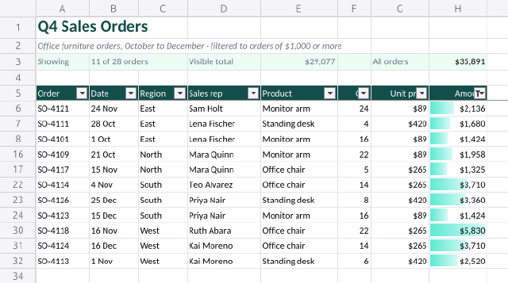

<!-- Generated by tools/gallery.mjs from showcase.yaml and build.json; do not edit. -->
# Filtered Sales Orders

[Sheet](../README.md) › [Tables & Data](../README.md#tables--data) · `sort` `filter` `autofilter` `subtotal` `sales`

A quarter's order list sorted by region and amount, with an AutoFilter that keeps only orders of $1,000 or more.



| | |
|---|---|
| Document | [filtered-sales-orders.xlsx](filtered-sales-orders.xlsx) (7 KB) |
| Contents | 1 sheet; used range A1:H33 |
| Features | `sheet.data.sort-filter`, `sheet.formulas.functions`, `sheet.format.number`, `sheet.view.window` |
| Built by | `kition-sheet` @ `79ed996ab2`: 41 commands in 52 ms |

## About

The order list is sorted on two keys, region A to Z and then amount largest first, and an
AutoFilter with a custom "greater than or equal" condition on the Amount column hides the
small orders. SUBTOTAL formulas above the list count and sum only the rows that are still
visible, so the summary follows the filter; the header row is frozen for scrolling.

## Checks

- `results.doc.sheets.0.autofilter`: `{"exists":true}`
- `results.doc.sheets.0.freeze`: `[5,0]`
- `results.summary.values.0`: `["Showing","11 of 28 orders",null,"Visible total",29077,null,"All orders",35891]`
- `results.first.values.0`: `["SO-4121",46350,"East","Sam Holt","Monitor arm",24,89,2136]`
- diagnostics: none (the kit's check finds nothing wrong)
- the saved document opens again; the thumbnail matches `thumb.png` within the `render` tolerance

## Steps

<details><summary>41 commands (from <a href="showcase.yaml">showcase.yaml</a>)</summary>

```yaml
- command: range.setValues
  params:
    range: A1
    values:
      - - Q4 Sales Orders
      - - Office furniture orders, October to December · filtered to orders of $1,000 or more
- command: range.setValues
  params:
    range: A3
    values:
      - - Showing
        - =SUBTOTAL(103,A6:A33)&" of "&COUNTA(A6:A33)&" orders"
        - null
        - Visible total
        - =SUBTOTAL(109,H6:H33)
        - null
        - All orders
        - =SUM(H6:H33)
- command: range.setValues
  params:
    range: A5
    values:
      - - Order
        - Date
        - Region
        - Sales rep
        - Product
        - Qty
        - Unit price
        - Amount
      - - SO-4101
        - 46296
        - East
        - Lena Fischer
        - Monitor arm
        - 16
        - 89
        - =F6*G6
      - - SO-4102
        - 46299
        - South
        - Teo Alvarez
        - Cable tray
        - 21
        - 22
        - =F7*G7
      - - SO-4103
        - 46300
        - South
        - Priya Nair
        - Desk lamp
        - 9
        - 48
        - =F8*G8
      - - SO-4104
        - 46301
        - East
        - Sam Holt
        - Footrest
        - 4
        - 35
        - =F9*G9
      - - SO-4105
        - 46307
        - North
        - Olu Adeyemi
        - Desk lamp
        - 2
        - 48
        - =F10*G10
      - - SO-4106
        - 46307
        - South
        - Teo Alvarez
        - Cable tray
        - 17
        - 22
        - =F11*G11
      - - SO-4107
        - 46308
        - South
        - Priya Nair
        - Desk lamp
        - 9
        - 48
        - =F12*G12
      - - SO-4108
        - 46310
        - North
        - Olu Adeyemi
        - Footrest
        - 12
        - 35
        - =F13*G13
      - - SO-4109
        - 46316
        - North
        - Mara Quinn
        - Monitor arm
        - 22
        - 89
        - =F14*G14
      - - SO-4110
        - 46317
        - East
        - Sam Holt
        - Cable tray
        - 22
        - 22
        - =F15*G15
      - - SO-4111
        - 46323
        - East
        - Lena Fischer
        - Standing desk
        - 4
        - 420
        - =F16*G16
      - - SO-4112
        - 46327
        - North
        - Mara Quinn
        - Footrest
        - 10
        - 35
        - =F17*G17
      - - SO-4113
        - 46327
        - West
        - Kai Moreno
        - Standing desk
        - 6
        - 420
        - =F18*G18
      - - SO-4114
        - 46330
        - South
        - Teo Alvarez
        - Office chair
        - 14
        - 265
        - =F19*G19
      - - SO-4115
        - 46333
        - North
        - Olu Adeyemi
        - Desk lamp
        - 19
        - 48
        - =F20*G20
      - - SO-4116
        - 46339
        - East
        - Lena Fischer
        - Monitor arm
        - 8
        - 89
        - =F21*G21
      - - SO-4117
        - 46341
        - North
        - Mara Quinn
        - Office chair
        - 5
        - 265
        - =F22*G22
      - - SO-4118
        - 46342
        - West
        - Ruth Abara
        - Office chair
        - 22
        - 265
        - =F23*G23
      - - SO-4119
        - 46342
        - East
        - Lena Fischer
        - Cable tray
        - 14
        - 22
        - =F24*G24
      - - SO-4120
        - 46346
        - East
        - Sam Holt
        - Footrest
        - 17
        - 35
        - =F25*G25
      - - SO-4121
        - 46350
        - East
        - Sam Holt
        - Monitor arm
        - 24
        - 89
        - =F26*G26
      - - SO-4122
        - 46364
        - East
        - Lena Fischer
        - Desk lamp
        - 16
        - 48
        - =F27*G27
      - - SO-4123
        - 46371
        - South
        - Priya Nair
        - Monitor arm
        - 16
        - 89
        - =F28*G28
      - - SO-4124
        - 46372
        - West
        - Kai Moreno
        - Office chair
        - 14
        - 265
        - =F29*G29
      - - SO-4125
        - 46376
        - East
        - Sam Holt
        - Cable tray
        - 5
        - 22
        - =F30*G30
      - - SO-4126
        - 46381
        - South
        - Priya Nair
        - Standing desk
        - 8
        - 420
        - =F31*G31
      - - SO-4127
        - 46382
        - South
        - Teo Alvarez
        - Footrest
        - 5
        - 35
        - =F32*G32
      - - SO-4128
        - 46383
        - West
        - Ruth Abara
        - Cable tray
        - 2
        - 22
        - =F33*G33
- command: data.sort
  params:
    range: A5:H33
    header: true
    keys:
      - column: C
        order: asc
      - column: H
        order: desc
- command: data.filter
  params:
    range: A5:H33
- command: data.filterBy
  params:
    column: H
    custom:
      op: ">="
      value: "1000"
- command: home.fontSize
  params:
    range: A1
    size: 20
- command: home.bold
  params:
    range: A1
- command: home.fontColor
  params:
    range: A1
    color: "#134e4a"
- command: home.italic
  params:
    range: A2
- command: home.fontColor
  params:
    range: A2
    color: "#6b7280"
- command: home.mergeCells
  params:
    range: B3:C3
- command: home.fontColor
  params:
    range: A3:G3
    color: "#6b7280"
- command: home.bold
  params:
    range: B3:H3
- command: home.fillColor
  params:
    range: A3:H3
    color: "#ecfdf5"
- command: home.numberFormat
  params:
    range: E3
    format: $$#,##0
- command: home.numberFormat
  params:
    range: H3
    format: $$#,##0
- command: home.fillColor
  params:
    range: A5:H5
    color: "#134e4a"
- command: home.fontColor
  params:
    range: A5:H5
    color: "#ffffff"
- command: home.bold
  params:
    range: A5:H5
- command: home.alignRight
  params:
    range: F5:H5
- command: home.numberFormat
  params:
    range: B6:B33
    format: d mmm
- command: home.alignLeft
  params:
    range: B6:B33
- command: home.numberFormat
  params:
    range: G6:G33
    format: $$#,##0
- command: home.numberFormat
  params:
    range: H6:H33
    format: $$#,##0
- command: home.bold
  params:
    range: H6:H33
- command: home.borders
  params:
    range: A6:H33
    preset: insideHorizontal
    color: "#e5e7eb"
- command: home.conditionalFormat
  params:
    range: H6:H33
    rule:
      type: dataBar
      color: "#5eead4"
- command: home.columnWidth
  params:
    cols: A:A
    width: 70
- command: home.columnWidth
  params:
    cols: B:C
    width: 64
- command: home.columnWidth
  params:
    cols: D:D
    width: 96
- command: home.columnWidth
  params:
    cols: E:E
    width: 100
- command: home.columnWidth
  params:
    cols: F:F
    width: 44
- command: home.columnWidth
  params:
    cols: G:H
    width: 76
- command: home.rowHeight
  params:
    rows: 1:1
    height: 28
- command: home.rowHeight
  params:
    rows: 3:3
    height: 22
- command: home.alignMiddle
  params:
    range: A3:H3
- command: view.freezePanes
  params:
    cell: A6
- command: document.inspect
  params: {}
  as: doc
- command: sheet.read
  params:
    range: A3:H3
  as: summary
- command: sheet.read
  params:
    range: A6:H6
  as: first
```

</details>
