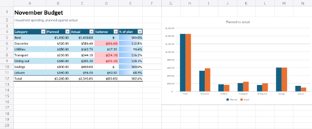

<!-- Generated by tools/gallery.mjs from showcase.yaml and build.json; do not edit. -->
# Household Budget

[Sheet](../README.md) › [Finance & Budgets](../README.md#finance--budgets) · `budget` `formulas` `number-formats` `chart` `conditional-formatting`

A monthly budget with planned and actual spending, variance formulas, a total row and a column chart.



| | |
|---|---|
| Document | [household-budget.xlsx](household-budget.xlsx) (8 KB) |
| Contents | 1 sheet; used range A1:E12 |
| Features | `sheet.cells.entry`, `sheet.format.number`, `sheet.format.font` |
| Built by | `kition-sheet` @ `79ed996ab2`: 18 commands in 44 ms |

## Checks

- `results.totals.values.0`: `[3260,3345.05,{"approx":-85.05,"tol":0.001},{"approx":1.0260889,"tol":0.000001}]`
- diagnostics: none (the kit's check finds nothing wrong)
- the saved document opens again; the thumbnail matches `thumb.png` within the `render` tolerance

## Steps

<details><summary>18 commands (from <a href="showcase.yaml">showcase.yaml</a>)</summary>

```yaml
- command: range.setValues
  params:
    range: A1
    values:
      - - November Budget
      - - Household spending, planned against actual
- command: range.setValues
  params:
    range: A4
    values:
      - - Category
        - Planned
        - Actual
        - Variance
        - "% of plan"
      - - Rent
        - 1450
        - 1450
        - =B5-C5
        - =C5/B5
      - - Groceries
        - 520
        - 586.4
        - =B6-C6
        - =C6/B6
      - - Utilities
        - 180
        - 162.75
        - =B7-C7
        - =C7/B7
      - - Transport
        - 210
        - 244.1
        - =B8-C8
        - =C8/B8
      - - Dining out
        - 160
        - 205.3
        - =B9-C9
        - =C9/B9
      - - Savings
        - 600
        - 600
        - =B10-C10
        - =C10/B10
      - - Leisure
        - 140
        - 96.5
        - =B11-C11
        - =C11/B11
      - - Total
        - =SUM(B5:B11)
        - =SUM(C5:C11)
        - =B12-C12
        - =C12/B12
- command: home.fontName
  params:
    range: A1:E12
    name: Carlito
- command: home.fontSize
  params:
    range: A1
    size: 20
- command: home.bold
  params:
    range: A1
- command: home.fontColor
  params:
    range: A2
    color: "#6b7280"
- command: home.formatAsTable
  params:
    range: A4:E11
    style: TableStyleMedium2
- command: home.accounting
  params:
    range: B5:D12
- command: home.numberFormat
  params:
    range: E5:E12
    format: 0.0%
- command: home.bold
  params:
    range: A12:E12
- command: home.borders
  params:
    range: A12:E12
    preset: topDoubleBottom
- command: home.conditionalFormat
  params:
    range: D5:D11
    rule:
      type: expression
      formula: =D5<0
      preset: lightRedFillDarkRedText
- command: home.columnWidth
  params:
    cols: A:A
    width: 110
- command: home.columnWidth
  params:
    cols: B:E
    width: 82
- command: insert.chart
  params:
    range: A4:C11
    type: column
    subtype: clustered
  as: chart
- command: chart.set
  params:
    title: Planned vs actual
    legend: bottom
    at: G2
    width: 520
    height: 300
- command: home.conditionalFormat
  params:
    range: E5:E11
    rule:
      type: dataBar
      color: "#93c5fd"
- command: sheet.read
  params:
    range: B12:E12
  as: totals
```

</details>
