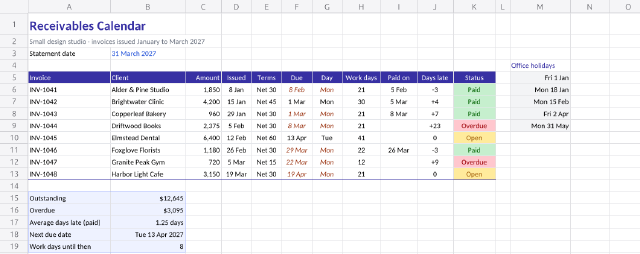

<!-- Generated by tools/gallery.mjs from showcase.yaml and build.json; do not edit. -->
# Invoice Due-Date Tracker

[Sheet](../README.md) › [Formulas & Functions](../README.md#formulas--functions) · `date-functions` `formulas` `named-ranges` `conditional-formatting` `number-formats`

Due dates that skip weekends and office holidays with WORKDAY, business days with NETWORKDAYS, and a status for every invoice.



| | |
|---|---|
| Document | [invoice-due-date-calendar.xlsx](invoice-due-date-calendar.xlsx) (7 KB) |
| Contents | 1 sheet; used range A1:M19 |
| Features | `sheet.formulas.functions`, `sheet.formulas.names`, `sheet.format.conditional`, `sheet.format.number` |
| Built by | `kition-sheet` @ `79ed996ab2`: 57 commands in 35 ms |

## About

Each invoice is due its payment terms after issue, moved to the next working day when that lands
on a weekend or on one of the office holidays in the named range `Holidays`:
`WORKDAY(issued+terms-1,1,Holidays)`. TEXT names the weekday, NETWORKDAYS counts the working
days the client had, and IFS turns the paid date and the statement date into Paid, Overdue or
Open. Due dates that moved are shown in italics. Below, SUMIFS, AVERAGEIFS and MINIFS
summarise what is still owed and what falls due next.

## Checks

- `results.schedule.values`: `[[46426,"Mon",21,46423,-3,"Paid"],[46447,"Mon",30,46451,4,"Paid"],[46447,"Mon",21,46454,7,"Paid"],[46454,"Mon",21,null,23,"Overdue"],[46490,"Tue",41,null,0,"Open"],[46475,"Mon",22,46472,-3,"Paid"],[46468,"Mon",12,null,9,"Overdue"],[46496,"Mon",21,null,0,"Open"]]`
- `results.summary.values`: `[[12645],[3095],[1.25],[46490],[8]]`
- `inspect.used`: `"A1:M19"`
- diagnostics: none (the kit's check finds nothing wrong)
- the saved document opens again; the thumbnail matches `thumb.png` within the `render` tolerance

## Steps

<details><summary>57 commands (from <a href="showcase.yaml">showcase.yaml</a>)</summary>

```yaml
- command: range.setValues
  params:
    range: A1
    values:
      - - Receivables Calendar
      - - Small design studio · invoices issued January to March 2027
      - - Statement date
        - 2027-03-31
- command: range.setValues
  params:
    range: M4
    values:
      - - Office holidays
      - - 2027-01-01
      - - 2027-01-18
      - - 2027-02-15
      - - 2027-04-02
      - - 2027-05-31
- command: formulas.defineName
  params:
    name: Holidays
    refersTo: =Sheet1!$M$5:$M$9
- command: range.setValues
  params:
    range: A5
    values:
      - - Invoice
        - Client
        - Amount
        - Issued
        - Terms
        - Due
        - Day
        - Work days
        - Paid on
        - Days late
        - Status
      - - INV-1041
        - Alder & Pine Studio
        - 1850
        - 2027-01-08
        - 30
        - =WORKDAY(D6+E6-1,1,Holidays)
        - =TEXT(F6,"ddd")
        - =NETWORKDAYS(D6,F6,Holidays)
        - 2027-02-05
        - =IF(I6="",MAX(0,$B$3-F6),I6-F6)
        - =IFS(I6<>"","Paid",$B$3>F6,"Overdue",TRUE,"Open")
      - - INV-1042
        - Brightwater Clinic
        - 4200
        - 2027-01-15
        - 45
        - null
        - null
        - null
        - 2027-03-05
      - - INV-1043
        - Copperleaf Bakery
        - 960
        - 2027-01-29
        - 30
        - null
        - null
        - null
        - 2027-03-08
      - - INV-1044
        - Driftwood Books
        - 2375
        - 2027-02-05
        - 30
      - - INV-1045
        - Elmstead Dental
        - 6400
        - 2027-02-12
        - 60
      - - INV-1046
        - Foxglove Florists
        - 1180
        - 2027-02-26
        - 30
        - null
        - null
        - null
        - 2027-03-26
      - - INV-1047
        - Granite Peak Gym
        - 720
        - 2027-03-05
        - 15
      - - INV-1048
        - Harbor Light Cafe
        - 3150
        - 2027-03-19
        - 30
- command: edit.fillDown
  params:
    range: F6:H13
- command: edit.fillDown
  params:
    range: J6:K13
- command: range.setValues
  params:
    range: A15
    values:
      - - Outstanding
        - =SUMIFS(C6:C13,K6:K13,"<>Paid")
      - - Overdue
        - =SUMIFS(C6:C13,K6:K13,"Overdue")
      - - Average days late (paid)
        - =AVERAGEIFS(J6:J13,K6:K13,"Paid")
      - - Next due date
        - =MINIFS(F6:F13,K6:K13,"Open")
      - - Work days until then
        - =NETWORKDAYS(B3,B18,Holidays)-1
- command: home.fontSize
  params:
    range: A1
    size: 20
- command: home.bold
  params:
    range: A1
- command: home.fontColor
  params:
    range: A1
    color: "#3730a3"
- command: home.fontColor
  params:
    range: A2
    color: "#6b7280"
- command: home.bold
  params:
    range: A3:B3
- command: home.numberFormat
  params:
    range: B3
    format: d mmmm yyyy
- command: home.alignLeft
  params:
    range: B3
- command: home.fontColor
  params:
    range: B3
    color: "#1d4ed8"
- command: home.fillColor
  params:
    range: A5:K5
    color: "#3730a3"
- command: home.fontColor
  params:
    range: A5:K5
    color: "#ffffff"
- command: home.bold
  params:
    range: A5:K5
- command: home.alignCenter
  params:
    range: D5:K5
- command: home.alignRight
  params:
    range: C5
- command: home.numberFormat
  params:
    range: C6:C13
    format: "#,##0"
- command: home.numberFormat
  params:
    range: D6:D13
    format: d mmm
- command: home.numberFormat
  params:
    range: F6:F13
    format: d mmm
- command: home.numberFormat
  params:
    range: I6:I13
    format: d mmm
- command: home.numberFormat
  params:
    range: J6:J13
    format: +0;-0;0
- command: home.alignCenter
  params:
    range: D6:K13
- command: home.numberFormat
  params:
    range: E6:E13
    format: '"Net "0'
- command: home.bold
  params:
    range: F6:F13
- command: home.borders
  params:
    range: A6:K13
    preset: insideHorizontal
    color: "#e5e7eb"
- command: home.borders
  params:
    range: A13:K13
    preset: bottom
    color: "#3730a3"
- command: home.conditionalFormat
  params:
    range: F6:G13
    rule:
      type: expression
      formula: =$F6<>$D6+$E6
      style:
        font:
          italic: true
          color:
            Rgb: 10105874
- command: home.conditionalFormat
  params:
    range: K6:K13
    rule:
      type: expression
      formula: =K6="Overdue"
      preset: lightRedFillDarkRedText
- command: home.conditionalFormat
  params:
    range: K6:K13
    rule:
      type: expression
      formula: =K6="Paid"
      preset: greenFillDarkGreenText
- command: home.conditionalFormat
  params:
    range: K6:K13
    rule:
      type: expression
      formula: =K6="Open"
      preset: yellowFillDarkYellowText
- command: home.bold
  params:
    range: A15:A19
- command: home.numberFormat
  params:
    range: B15:B16
    format: $$#,##0
- command: home.numberFormat
  params:
    range: B17
    format: 0.00 "days"
- command: home.numberFormat
  params:
    range: B18
    format: ddd d mmm yyyy
- command: home.alignRight
  params:
    range: B15:B19
- command: home.fillColor
  params:
    range: A15:B19
    color: "#eef2ff"
- command: home.borders
  params:
    range: A15:B19
    preset: outside
    color: "#a5b4fc"
- command: home.bold
  params:
    range: M4
- command: home.fontColor
  params:
    range: M4
    color: "#3730a3"
- command: home.numberFormat
  params:
    range: M5:M9
    format: ddd d mmm
- command: home.fillColor
  params:
    range: M5:M9
    color: "#f3f4f6"
- command: home.columnWidth
  params:
    cols: A:A
    width: 136
- command: home.columnWidth
  params:
    cols: B:B
    width: 124
- command: home.columnWidth
  params:
    cols: C:C
    width: 60
- command: home.columnWidth
  params:
    cols: D:G
    width: 50
- command: home.columnWidth
  params:
    cols: H:H
    width: 64
- command: home.columnWidth
  params:
    cols: I:J
    width: 60
- command: home.columnWidth
  params:
    cols: K:K
    width: 70
- command: home.columnWidth
  params:
    cols: L:L
    width: 24
- command: home.columnWidth
  params:
    cols: M:M
    width: 100
- command: sheet.read
  params:
    range: F6:K13
  as: schedule
- command: sheet.read
  params:
    range: B15:B19
  as: summary
- command: formulas.nameManager
  params: {}
  as: names
```

</details>
