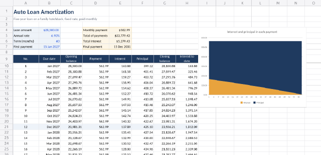

<!-- Generated by tools/gallery.mjs from showcase.yaml and build.json; do not edit. -->
# Loan Amortization Schedule

[Sheet](../README.md) › [Finance & Budgets](../README.md#finance--budgets) · `loan` `financial-functions` `formulas` `number-formats` `chart`

A five-year car loan paid off month by month, with PMT, IPMT and PPMT splitting every payment into interest and principal.



| | |
|---|---|
| Document | [loan-amortization.xlsx](loan-amortization.xlsx) (16 KB) |
| Contents | 1 sheet; used range A1:H69 |
| Features | `sheet.formulas.functions`, `sheet.edit.fill-clear`, `sheet.format.number`, `sheet.charts.design`, `sheet.view.window` |
| Built by | `kition-sheet` @ `79ed996ab2`: 45 commands in 197 ms |

## About

Four inputs drive the whole schedule. PMT gives the level monthly payment, IPMT and PPMT split
each payment into interest and principal, EDATE steps the due dates a month at a time, and the
closing balance runs down to zero on the sixtieth payment. The 60 rows are entered once with
`edit.fillDown` from the second row, whose relative references adjust row by row, and a stacked area chart shows the
interest share shrinking as the balance falls.

## Checks

- `results.summary.values`: `[[{"approx":562.9904925,"tol":0.000001}],[{"approx":33779.4295522,"tol":0.0001}],[{"approx":5279.4295522,"tol":0.0001}]]`
- `results.first.values.0`: `[1,46402,28500,{"approx":562.9904925,"tol":0.000001},{"approx":163.875,"tol":0.000001},{"approx":399.1154925,"tol":0.000001},{"approx":28100.8845075,"tol":0.000001},{"approx":163.875,"tol":0.000001}]`
- `results.last.values.0`: `[60,48197,{"approx":559.7718047,"tol":0.000001},{"approx":562.9904925,"tol":0.000001},{"approx":3.2186879,"tol":0.000001},{"approx":559.7718047,"tol":0.000001},{"approx":0,"tol":0.000001},{"approx":5279.4295522,"tol":0.0001}]`
- diagnostics: none (the kit's check finds nothing wrong)
- the saved document opens again; the thumbnail matches `thumb.png` within the `render` tolerance

## Steps

<details><summary>45 commands (from <a href="showcase.yaml">showcase.yaml</a>)</summary>

```yaml
- command: range.setValues
  params:
    range: A1
    values:
      - - Auto Loan Amortization
      - - Five-year loan on a family hatchback, fixed rate, paid monthly
- command: range.setValues
  params:
    range: A4
    values:
      - - Loan amount
        - 28500
        - null
        - Monthly payment
        - =PMT(B5/12,B6,-B4)
      - - Annual rate
        - 0.069
        - null
        - Total of payments
        - =E4*B6
      - - Term (months)
        - 60
        - null
        - Total interest
        - =E5-B4
      - - First payment
        - =DATE(2027,1,15)
        - null
        - Final payment
        - =EDATE(B7,B6-1)
- command: range.setValues
  params:
    range: A9
    values:
      - - No.
        - Due date
        - Opening balance
        - Payment
        - Interest
        - Principal
        - Closing balance
        - Interest to date
- command: range.setValues
  params:
    range: A10
    values:
      - - 1
        - =EDATE($B$7,A10-1)
        - =$B$4
        - =$E$4
        - =IPMT($B$5/12,A10,$B$6,-$B$4)
        - =PPMT($B$5/12,A10,$B$6,-$B$4)
        - =C10-F10
        - =SUM($E$10:E10)
      - - =A10+1
        - =EDATE($B$7,A11-1)
        - =G10
        - =$E$4
        - =IPMT($B$5/12,A11,$B$6,-$B$4)
        - =PPMT($B$5/12,A11,$B$6,-$B$4)
        - =C11-F11
        - =SUM($E$10:E11)
- command: edit.fillDown
  params:
    range: A11:H69
- command: home.fontSize
  params:
    range: A1
    size: 20
- command: home.bold
  params:
    range: A1
- command: home.fontColor
  params:
    range: A1
    color: "#1f3a5f"
- command: home.fontColor
  params:
    range: A2
    color: "#6b7280"
- command: home.fillColor
  params:
    range: A4:B7
    color: "#eef3f9"
- command: home.fillColor
  params:
    range: D4:E7
    color: "#fdf6e7"
- command: home.fontColor
  params:
    range: B4:B7
    color: "#1d4ed8"
- command: home.bold
  params:
    range: E4:E7
- command: home.borders
  params:
    range: A4:B7
    preset: outside
    color: "#b6c6dc"
- command: home.borders
  params:
    range: D4:E7
    preset: outside
    color: "#e5cf9c"
- command: home.accounting
  params:
    range: B4
- command: home.numberFormat
  params:
    range: B5
    format: 0.00%
- command: home.numberFormat
  params:
    range: B7
    format: d mmm yyyy
- command: home.accounting
  params:
    range: E4:E6
- command: home.numberFormat
  params:
    range: E7
    format: d mmm yyyy
- command: home.fillColor
  params:
    range: A9:H9
    color: "#1f3a5f"
- command: home.fontColor
  params:
    range: A9:H9
    color: "#ffffff"
- command: home.bold
  params:
    range: A9:H9
- command: home.alignCenter
  params:
    range: A9:H9
- command: home.wrapText
  params:
    range: A9:H9
- command: home.alignMiddle
  params:
    range: A9:H9
- command: home.rowHeight
  params:
    rows: 9:9
    height: 30
- command: home.alignCenter
  params:
    range: A10:A69
- command: home.numberFormat
  params:
    range: B10:B69
    format: mmm yyyy
- command: home.numberFormat
  params:
    range: C10:H69
    format: "#,##0.00"
- command: home.borders
  params:
    range: A10:H69
    preset: insideHorizontal
    color: "#e5e7eb"
- command: home.conditionalFormat
  params:
    range: A10:H69
    rule:
      type: expression
      formula: =MOD($A10,12)=0
      style:
        fill:
          fg:
            Rgb: 15660025
          pattern: Solid
- command: home.columnWidth
  params:
    cols: A:A
    width: 92
- command: home.columnWidth
  params:
    cols: B:B
    width: 78
- command: home.columnWidth
  params:
    cols: C:C
    width: 80
- command: home.columnWidth
  params:
    cols: D:D
    width: 96
- command: home.columnWidth
  params:
    cols: E:H
    width: 80
- command: view.freezePanes
  params:
    cell: A10
- command: insert.chart
  params:
    range: E9:F69
    type: area
    subtype: stacked
  as: chart
- command: chart.set
  params:
    title: Interest and principal in each payment
    legend: bottom
    at: I4
    width: 390
    height: 290
- command: chart.formatSelection
  params:
    series: 0
    color: "#e8a33d"
- command: chart.formatSelection
  params:
    series: 1
    color: "#1f3a5f"
- command: sheet.read
  params:
    range: E4:E6
  as: summary
- command: sheet.read
  params:
    range: A10:H10
  as: first
- command: sheet.read
  params:
    range: A69:H69
  as: last
```

</details>
