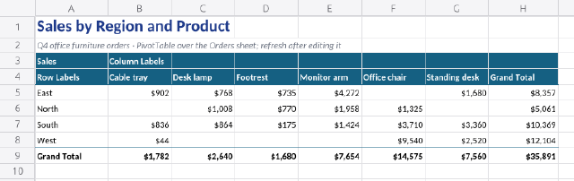

<!-- Generated by tools/gallery.mjs from showcase.yaml and build.json; do not edit. -->
# Orders Pivot Summary

[Sheet](../README.md) › [Tables & Data](../README.md#tables--data) · `pivot-table` `summary` `multiple-sheets` `sales`

A PivotTable that turns a quarter's order list into sales by region and product, with grand totals.



| | |
|---|---|
| Document | [orders-pivot-summary.xlsx](orders-pivot-summary.xlsx) (11 KB) |
| Contents | 2 sheets; used range A1:H9 |
| Features | `sheet.pivot.tables`, `sheet.sheets.manage`, `sheet.format.number` |
| Built by | `kition-sheet` @ `79ed996ab2`: 24 commands in 28 ms |

## About

The Orders sheet holds 28 order lines. A PivotTable on its own sheet groups them by region
down the side and product across the top, sums the order amounts and adds grand totals both
ways, in a medium pivot style with a currency number format on the values. The checks read
the pivot's cells back, so a change in grouping or totals shows up.

## Checks

- `inspect.sheets`: `["Summary","Orders"]`
- `results.pivots`: `{"count":1,"any":{"name":"SalesByRegion","range":"A3:H9","sheet":"Summary"}}`
- `results.report.values.3`: `["Row Labels","Cable tray","Desk lamp","Footrest","Monitor arm","Office chair","Standing desk","Grand Total"]`
- `results.report.values.7`: `["West",44,null,null,null,9540,2520,12104]`
- `results.report.values.8`: `["Grand Total",1782,2640,1680,7654,14575,7560,35891]`
- diagnostics: none (the kit's check finds nothing wrong)
- the saved document opens again; the thumbnail matches `thumb.png` within the `render` tolerance

## Steps

<details><summary>24 commands (from <a href="showcase.yaml">showcase.yaml</a>)</summary>

```yaml
- command: sheet.rename
  params:
    name: Orders
- command: range.setValues
  params:
    range: A1
    values:
      - - Order
        - Date
        - Region
        - Sales rep
        - Product
        - Qty
        - Unit price
        - Amount
      - - SO-4101
        - 46296
        - East
        - Lena Fischer
        - Monitor arm
        - 16
        - 89
        - =F2*G2
      - - SO-4102
        - 46299
        - South
        - Teo Alvarez
        - Cable tray
        - 21
        - 22
        - =F3*G3
      - - SO-4103
        - 46300
        - South
        - Priya Nair
        - Desk lamp
        - 9
        - 48
        - =F4*G4
      - - SO-4104
        - 46301
        - East
        - Sam Holt
        - Footrest
        - 4
        - 35
        - =F5*G5
      - - SO-4105
        - 46307
        - North
        - Olu Adeyemi
        - Desk lamp
        - 2
        - 48
        - =F6*G6
      - - SO-4106
        - 46307
        - South
        - Teo Alvarez
        - Cable tray
        - 17
        - 22
        - =F7*G7
      - - SO-4107
        - 46308
        - South
        - Priya Nair
        - Desk lamp
        - 9
        - 48
        - =F8*G8
      - - SO-4108
        - 46310
        - North
        - Olu Adeyemi
        - Footrest
        - 12
        - 35
        - =F9*G9
      - - SO-4109
        - 46316
        - North
        - Mara Quinn
        - Monitor arm
        - 22
        - 89
        - =F10*G10
      - - SO-4110
        - 46317
        - East
        - Sam Holt
        - Cable tray
        - 22
        - 22
        - =F11*G11
      - - SO-4111
        - 46323
        - East
        - Lena Fischer
        - Standing desk
        - 4
        - 420
        - =F12*G12
      - - SO-4112
        - 46327
        - North
        - Mara Quinn
        - Footrest
        - 10
        - 35
        - =F13*G13
      - - SO-4113
        - 46327
        - West
        - Kai Moreno
        - Standing desk
        - 6
        - 420
        - =F14*G14
      - - SO-4114
        - 46330
        - South
        - Teo Alvarez
        - Office chair
        - 14
        - 265
        - =F15*G15
      - - SO-4115
        - 46333
        - North
        - Olu Adeyemi
        - Desk lamp
        - 19
        - 48
        - =F16*G16
      - - SO-4116
        - 46339
        - East
        - Lena Fischer
        - Monitor arm
        - 8
        - 89
        - =F17*G17
      - - SO-4117
        - 46341
        - North
        - Mara Quinn
        - Office chair
        - 5
        - 265
        - =F18*G18
      - - SO-4118
        - 46342
        - West
        - Ruth Abara
        - Office chair
        - 22
        - 265
        - =F19*G19
      - - SO-4119
        - 46342
        - East
        - Lena Fischer
        - Cable tray
        - 14
        - 22
        - =F20*G20
      - - SO-4120
        - 46346
        - East
        - Sam Holt
        - Footrest
        - 17
        - 35
        - =F21*G21
      - - SO-4121
        - 46350
        - East
        - Sam Holt
        - Monitor arm
        - 24
        - 89
        - =F22*G22
      - - SO-4122
        - 46364
        - East
        - Lena Fischer
        - Desk lamp
        - 16
        - 48
        - =F23*G23
      - - SO-4123
        - 46371
        - South
        - Priya Nair
        - Monitor arm
        - 16
        - 89
        - =F24*G24
      - - SO-4124
        - 46372
        - West
        - Kai Moreno
        - Office chair
        - 14
        - 265
        - =F25*G25
      - - SO-4125
        - 46376
        - East
        - Sam Holt
        - Cable tray
        - 5
        - 22
        - =F26*G26
      - - SO-4126
        - 46381
        - South
        - Priya Nair
        - Standing desk
        - 8
        - 420
        - =F27*G27
      - - SO-4127
        - 46382
        - South
        - Teo Alvarez
        - Footrest
        - 5
        - 35
        - =F28*G28
      - - SO-4128
        - 46383
        - West
        - Ruth Abara
        - Cable tray
        - 2
        - 22
        - =F29*G29
- command: home.numberFormat
  params:
    range: B2:B29
    format: d mmm yyyy
- command: home.numberFormat
  params:
    range: G2:H29
    format: $$#,##0
- command: home.bold
  params:
    range: A1:H1
- command: home.columnWidth
  params:
    cols: A:H
    width: 84
- command: insert.pivotTable
  params:
    source: Orders!$A$1:$H$29
    destination: new
    name: SalesByRegion
    rows:
      - Region
    columns:
      - Product
    values:
      - field: Amount
        func: sum
        name: Sales
  as: pivot
- command: sheet.rename
  params:
    name: Summary
- command: sheet.tabColor
  params:
    color: "#2563eb"
- command: pivot.valueSettings
  params:
    pivot: SalesByRegion
    field: Sales
    numberFormat: $$#,##0
- command: pivot.style
  params:
    pivot: SalesByRegion
    style: PivotStyleMedium2
- command: range.setValues
  params:
    range: A1
    values:
      - - Sales by Region and Product
      - - Q4 office furniture orders · PivotTable over the Orders sheet; refresh after editing it
- command: home.fontSize
  params:
    range: A1
    size: 20
- command: home.bold
  params:
    range: A1
    on: true
- command: home.fontColor
  params:
    range: A1
    color: "#1e3a8a"
- command: home.italic
  params:
    range: A2
- command: home.fontColor
  params:
    range: A2
    color: "#6b7280"
- command: home.columnWidth
  params:
    cols: A:A
    width: 96
- command: home.columnWidth
  params:
    cols: B:G
    width: 84
- command: home.columnWidth
  params:
    cols: H:H
    width: 92
- command: home.rowHeight
  params:
    rows: 1:1
    height: 28
- command: home.rowHeight
  params:
    rows: 3:9
    height: 21
- command: pivot.list
  params: {}
  as: pivots
- command: sheet.read
  params: {}
  as: report
```

</details>
