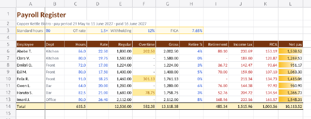

<!-- Generated by tools/gallery.mjs from showcase.yaml and build.json; do not edit. -->
# Payroll Register

[Sheet](../README.md) › [Business Templates](../README.md#business-templates) · `payroll` `template` `formulas` `number-formats` `conditional-formatting`

A fortnight's payroll for a small bistro, from hours and rates through overtime, pre-tax retirement, withholding and FICA to net pay.



| | |
|---|---|
| Document | [payroll-register.xlsx](payroll-register.xlsx) (7 KB) |
| Contents | 1 sheet; used range A1:L14 |
| Features | `sheet.formulas.functions`, `sheet.edit.fill-clear`, `sheet.format.number`, `sheet.format.conditional`, `sheet.view.window` |
| Built by | `kition-sheet` @ `79ed996ab2`: 50 commands in 39 ms |

## About

The four rates in row 3 drive every formula. Hours up to the standard 80 are paid at the base
rate and the rest at time and a half, rounded to the cent; retirement contributions come out
before income tax is withheld, FICA is taken on the full gross, and net pay is what is left.
Every deduction is rounded on its own line, so the column totals are exactly what goes to each
payee. Overtime is highlighted, and the net pay column carries data bars.

## Checks

- `results.register.values`: `[[1800,202.5,2002.5,0.04,{"approx":80.1,"tol":0.000001},230.69,153.19,{"approx":1538.52,"tol":0.000001}],[1580,0,1580,0,0,189.6,120.87,{"approx":1269.53,"tol":0.000001}],[1224,0,1224,0.03,36.72,142.47,93.64,{"approx":951.17,"tol":0.000001}],[1400,0,1400,0.05,70,159.6,107.1,{"approx":1063.3,"tol":0.000001}],[1460,301.13,{"approx":1761.13,"tol":0.000001},0,0,211.34,134.73,{"approx":1415.06,"tol":0.000001}],[1280,0,1280,0.06,76.8,144.38,97.92,{"approx":960.9,"tol":0.000001}],[1680,78.75,1758.75,0.03,52.76,204.72,134.54,{"approx":1366.73,"tol":0.000001}],[2112,0,2112,0.08,168.96,233.16,161.57,{"approx":1548.31,"tol":0.000001}],[12536,{"approx":582.38,"tol":0.000001},{"approx":13118.38,"tol":0.000001},null,{"approx":485.34,"tol":0.000001},{"approx":1515.96,"tol":0.000001},{"approx":1003.56,"tol":0.000001},{"approx":10113.52,"tol":0.000001}]]`
- diagnostics: none (the kit's check finds nothing wrong)
- the saved document opens again; the thumbnail matches `thumb.png` within the `render` tolerance

## Steps

<details><summary>50 commands (from <a href="showcase.yaml">showcase.yaml</a>)</summary>

```yaml
- command: range.setValues
  params:
    range: A1
    values:
      - - Payroll Register
      - - Copper Kettle Bistro · pay period 29 May to 11 June 2027 · paid 16 June 2027
      - - Standard hours
        - 80
        - OT rate
        - 1.5
        - Withholding
        - 0.12
        - FICA
        - 0.0765
- command: range.setValues
  params:
    range: A5
    values:
      - - Employee
        - Dept
        - Hours
        - Rate
        - Regular
        - Overtime
        - Gross
        - Retire %
        - Retirement
        - Income tax
        - FICA
        - Net pay
      - - Abebe T.
        - Kitchen
        - 86
        - 22.5
        - =MIN(C6,$B$3)*D6
        - =ROUND(MAX(0,C6-$B$3)*D6*$D$3,2)
        - =E6+F6
        - 0.04
        - =ROUND(G6*H6,2)
        - =ROUND((G6-I6)*$F$3,2)
        - =ROUND(G6*$H$3,2)
        - =G6-I6-J6-K6
      - - Clara V.
        - Kitchen
        - 80
        - 19.75
        - null
        - null
        - null
        - 0
      - - Dmitri O.
        - Front
        - 72
        - 17
        - null
        - null
        - null
        - 0.03
      - - Esi M.
        - Front
        - 80
        - 17.5
        - null
        - null
        - null
        - 0.05
      - - Felix R.
        - Front
        - 91
        - 18.25
        - null
        - null
        - null
        - 0
      - - Gwen L.
        - Bar
        - 64
        - 20
        - null
        - null
        - null
        - 0.06
      - - Haruto S.
        - Bar
        - 82.5
        - 21
        - null
        - null
        - null
        - 0.03
      - - Imani J.
        - Office
        - 80
        - 26.4
        - null
        - null
        - null
        - 0.08
      - - Total
        - null
        - =SUM(C6:C13)
        - null
        - =SUM(E6:E13)
        - =SUM(F6:F13)
        - =SUM(G6:G13)
        - null
        - =SUM(I6:I13)
        - =SUM(J6:J13)
        - =SUM(K6:K13)
        - =SUM(L6:L13)
- command: edit.fillDown
  params:
    range: E6:G13
- command: edit.fillDown
  params:
    range: I6:L13
- command: home.fontSize
  params:
    range: A1
    size: 20
- command: home.bold
  params:
    range: A1
- command: home.fontColor
  params:
    range: A1
    color: "#78350f"
- command: home.fontColor
  params:
    range: A2
    color: "#6b7280"
- command: home.fillColor
  params:
    range: A3:H3
    color: "#fffbeb"
- command: home.fontColor
  params:
    range: A3:H3
    color: "#6b7280"
- command: home.fontColor
  params:
    range: B3
    color: "#1d4ed8"
- command: home.fontColor
  params:
    range: D3
    color: "#1d4ed8"
- command: home.fontColor
  params:
    range: F3
    color: "#1d4ed8"
- command: home.fontColor
  params:
    range: H3
    color: "#1d4ed8"
- command: home.bold
  params:
    range: A3:H3
- command: home.alignRight
  params:
    range: C3:H3
- command: home.alignLeft
  params:
    range: B3
- command: home.numberFormat
  params:
    range: D3
    format: 0.0"×"
- command: home.numberFormat
  params:
    range: F3
    format: 0%
- command: home.numberFormat
  params:
    range: H3
    format: 0.00%
- command: home.borders
  params:
    range: A3:H3
    preset: outside
    color: "#fcd34d"
- command: home.fillColor
  params:
    range: A5:L5
    color: "#78350f"
- command: home.fontColor
  params:
    range: A5:L5
    color: "#ffffff"
- command: home.bold
  params:
    range: A5:L5
- command: home.alignRight
  params:
    range: C5:L5
- command: home.numberFormat
  params:
    range: C6:C14
    format: "0.0"
- command: home.numberFormat
  params:
    range: D6:D13
    format: "0.00"
- command: home.numberFormat
  params:
    range: E6:G14
    format: '#,##0.00;;"-"'
- command: home.numberFormat
  params:
    range: H6:H13
    format: 0%
- command: home.numberFormat
  params:
    range: I6:L14
    format: '#,##0.00;;"-"'
- command: home.fontColor
  params:
    range: C6:D13
    color: "#1d4ed8"
- command: home.fontColor
  params:
    range: H6:H13
    color: "#1d4ed8"
- command: home.fontColor
  params:
    range: B6:B13
    color: "#6b7280"
- command: home.bold
  params:
    range: G6:G14
- command: home.bold
  params:
    range: L6:L14
- command: home.fontColor
  params:
    range: I6:K13
    color: "#b91c1c"
- command: home.borders
  params:
    range: A6:L13
    preset: insideHorizontal
    color: "#e5e7eb"
- command: home.conditionalFormat
  params:
    range: F6:F13
    rule:
      type: expression
      formula: =F6>0
      preset: yellowFillDarkYellowText
- command: home.conditionalFormat
  params:
    range: L6:L13
    rule:
      type: dataBar
      color: "#fbbf24"
- command: home.bold
  params:
    range: A14:L14
- command: home.fillColor
  params:
    range: A14:L14
    color: "#fef3c7"
- command: home.borders
  params:
    range: A14:L14
    preset: topDoubleBottom
- command: home.columnWidth
  params:
    cols: A:A
    width: 84
- command: home.columnWidth
  params:
    cols: B:B
    width: 56
- command: home.columnWidth
  params:
    cols: C:D
    width: 64
- command: home.columnWidth
  params:
    cols: E:G
    width: 68
- command: home.columnWidth
  params:
    cols: H:H
    width: 70
- command: home.columnWidth
  params:
    cols: I:L
    width: 72
- command: view.freezePanes
  params:
    cell: B6
- command: sheet.read
  params:
    range: E6:L14
  as: register
```

</details>
