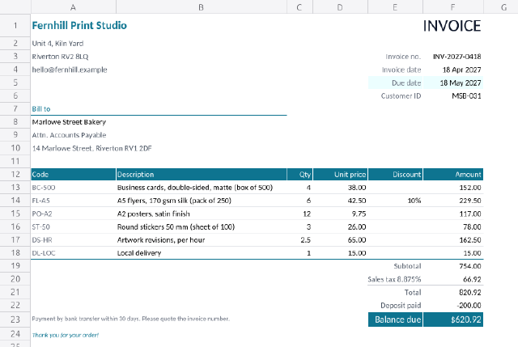

<!-- Generated by tools/gallery.mjs from showcase.yaml and build.json; do not edit. -->
# Print Shop Invoice

[Sheet](../README.md) › [Business Templates](../README.md#business-templates) · `invoice` `template` `formulas` `number-formats` `page-setup`

A ready-to-send invoice with line discounts, rounded sales tax, a deposit and the balance due, laid out without gridlines.



| | |
|---|---|
| Document | [print-shop-invoice.xlsx](print-shop-invoice.xlsx) (6 KB) |
| Contents | 1 sheet; used range A1:F24 |
| Features | `sheet.format.font`, `sheet.format.number`, `sheet.format.alignment`, `sheet.view.window`, `sheet.page.setup` |
| Built by | `kition-sheet` @ `79ed996ab2`: 60 commands in 15 ms |

## About

A one-page invoice from a small print studio. Each line is `ROUND(qty*price*(1-discount),2)`,
the tax is rounded to the cent before it is added, the due date is 30 days after the invoice date,
and the balance subtracts the deposit already received. Gridlines are off, the page is set up
for A4 portrait and fitted to one page, and the print area covers the invoice exactly.

## Checks

- `results.amounts.values`: `[[152],[229.5],[117],[78],[162.5],[15],[754],[66.92],[820.92],[-200],[{"approx":620.92,"tol":0.000001}]]`
- `results.due.values`: `[[46525]]`
- diagnostics: none (the kit's check finds nothing wrong)
- the saved document opens again; the thumbnail matches `thumb.png` within the `render` tolerance

## Steps

<details><summary>60 commands (from <a href="showcase.yaml">showcase.yaml</a>)</summary>

```yaml
- command: range.setValues
  params:
    range: A1
    values:
      - - Fernhill Print Studio
        - null
        - null
        - null
        - INVOICE
      - - Unit 4, Kiln Yard
      - - Riverton RV2 8LQ
        - null
        - null
        - null
        - Invoice no.
        - INV-2027-0418
      - - hello@fernhill.example
        - null
        - null
        - null
        - Invoice date
        - 2027-04-18
      - - null
        - null
        - null
        - null
        - Due date
        - =F4+30
      - - null
        - null
        - null
        - null
        - Customer ID
        - MSB-031
      - - Bill to
      - - Marlowe Street Bakery
      - - Attn. Accounts Payable
      - - 14 Marlowe Street, Riverton RV1 2DF
- command: range.setValues
  params:
    range: A12
    values:
      - - Code
        - Description
        - Qty
        - Unit price
        - Discount
        - Amount
      - - BC-500
        - Business cards, double-sided, matte (box of 500)
        - 4
        - 38
        - 0
        - =ROUND(C13*D13*(1-E13),2)
      - - FL-A5
        - A5 flyers, 170 gsm silk (pack of 250)
        - 6
        - 42.5
        - 0.1
        - =ROUND(C14*D14*(1-E14),2)
      - - PO-A2
        - A2 posters, satin finish
        - 12
        - 9.75
        - 0
        - =ROUND(C15*D15*(1-E15),2)
      - - ST-50
        - Round stickers 50 mm (sheet of 100)
        - 3
        - 26
        - 0
        - =ROUND(C16*D16*(1-E16),2)
      - - DS-HR
        - Artwork revisions, per hour
        - 2.5
        - 65
        - 0
        - =ROUND(C17*D17*(1-E17),2)
      - - DL-LOC
        - Local delivery
        - 1
        - 15
        - 0
        - =ROUND(C18*D18*(1-E18),2)
      - - null
        - null
        - null
        - null
        - Subtotal
        - =SUM(F13:F18)
      - - null
        - null
        - null
        - null
        - Sales tax 8.875%
        - =ROUND(F19*8.875%,2)
      - - null
        - null
        - null
        - null
        - Total
        - =F19+F20
      - - null
        - null
        - null
        - null
        - Deposit paid
        - -200
      - - Payment by bank transfer within 30 days. Please quote the invoice number.
        - null
        - null
        - null
        - Balance due
        - =F21+F22
      - - Thank you for your order!
- command: view.gridlines
  params:
    on: false
- command: home.fontSize
  params:
    range: A1
    size: 16
- command: home.bold
  params:
    range: A1
- command: home.fontColor
  params:
    range: A1
    color: "#0e7490"
- command: home.fontColor
  params:
    range: A2:A4
    color: "#4b5563"
- command: home.mergeCells
  params:
    range: E1:F1
- command: home.alignRight
  params:
    range: E1
- command: home.fontSize
  params:
    range: E1
    size: 24
- command: home.bold
  params:
    range: E1
- command: home.fontColor
  params:
    range: E1
    color: "#0f172a"
- command: home.rowHeight
  params:
    rows: 1:1
    height: 34
- command: home.alignMiddle
  params:
    range: A1:F1
- command: home.fontColor
  params:
    range: E3:E6
    color: "#6b7280"
- command: home.alignRight
  params:
    range: E3:F6
- command: home.bold
  params:
    range: F3:F6
- command: home.numberFormat
  params:
    range: F4:F5
    format: d mmm yyyy
- command: home.fillColor
  params:
    range: E5:F5
    color: "#ecfeff"
- command: home.bold
  params:
    range: A7
- command: home.fontColor
  params:
    range: A7
    color: "#0e7490"
- command: home.borders
  params:
    range: A7:B7
    preset: bottom
    color: "#0e7490"
- command: home.bold
  params:
    range: A8
- command: home.fontColor
  params:
    range: A9:A10
    color: "#4b5563"
- command: home.fillColor
  params:
    range: A12:F12
    color: "#0e7490"
- command: home.fontColor
  params:
    range: A12:F12
    color: "#ffffff"
- command: home.bold
  params:
    range: A12:F12
- command: home.alignRight
  params:
    range: C12:F12
- command: home.fontColor
  params:
    range: A13:A18
    color: "#6b7280"
- command: home.numberFormat
  params:
    range: C13:C18
    format: General
- command: home.numberFormat
  params:
    range: D13:D18
    format: "#,##0.00"
- command: home.numberFormat
  params:
    range: E13:E18
    format: 0%;;""
- command: home.numberFormat
  params:
    range: F13:F22
    format: "#,##0.00"
- command: home.borders
  params:
    range: A13:F18
    preset: insideHorizontal
    color: "#e5e7eb"
- command: home.borders
  params:
    range: A18:F18
    preset: bottom
    color: "#0e7490"
- command: home.alignRight
  params:
    range: E19:E23
- command: home.fontColor
  params:
    range: E19:E22
    color: "#4b5563"
- command: home.bold
  params:
    range: E21:F21
- command: home.borders
  params:
    range: E21:F21
    preset: top
    color: "#9ca3af"
- command: home.fillColor
  params:
    range: E23:F23
    color: "#0e7490"
- command: home.fontColor
  params:
    range: E23:F23
    color: "#ffffff"
- command: home.bold
  params:
    range: E23:F23
- command: home.fontSize
  params:
    range: E23:F23
    size: 13
- command: home.numberFormat
  params:
    range: F23
    format: $$#,##0.00
- command: home.rowHeight
  params:
    rows: 23:23
    height: 24
- command: home.alignMiddle
  params:
    range: A23:F23
- command: home.mergeCells
  params:
    range: A23:C23
- command: home.wrapText
  params:
    range: A23
- command: home.fontSize
  params:
    range: A23:A24
    size: 9
- command: home.fontColor
  params:
    range: A23
    color: "#6b7280"
- command: home.italic
  params:
    range: A24
- command: home.fontColor
  params:
    range: A24
    color: "#0e7490"
- command: home.columnWidth
  params:
    cols: A:A
    width: 130
- command: home.columnWidth
  params:
    cols: B:B
    width: 260
- command: home.columnWidth
  params:
    cols: C:C
    width: 40
- command: home.columnWidth
  params:
    cols: D:E
    width: 84
- command: home.columnWidth
  params:
    cols: F:F
    width: 92
- command: pageLayout.pageSetup
  params:
    orientation: portrait
    paper: A4
    fitToPage: true
    fitWidth: 1
    fitHeight: 1
    printArea: A1:F24
    centerH: true
- command: sheet.read
  params:
    range: F13:F23
  as: amounts
- command: sheet.read
  params:
    range: F5
  as: due
```

</details>
