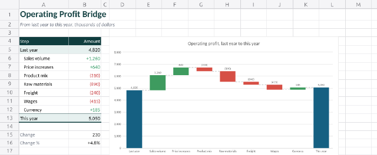

<!-- Generated by tools/gallery.mjs from showcase.yaml and build.json; do not edit. -->
# Profit Bridge Waterfall

[Sheet](../README.md) › [Charts](../README.md#charts) · `chart` `waterfall-chart` `finance` `variance`

A waterfall chart that walks operating profit from last year to this year through its drivers.



| | |
|---|---|
| Document | [profit-bridge-waterfall.xlsx](profit-bridge-waterfall.xlsx) (9 KB) |
| Contents | 1 sheet; used range A1:B16 |
| Features | `sheet.charts.design`, `sheet.format.number`, `sheet.formulas.functions` |
| Built by | `kition-sheet` @ `79ed996ab2`: 34 commands in 7 ms |

## About

A profit bridge explains a change one driver at a time: volume, price, mix, input costs,
freight, wages and currency push last year's operating profit up or down until it lands on
this year's figure. The closing bar is a formula, the drivers carry signed accounting-style
formats with gains in green and losses in red, and the waterfall chart draws the walk.

## Checks

- `results.drawing.objects.0.chart.kind`: `{"other":"waterfall"}`
- `results.drawing.objects.0.chart.categories`: `{"count":9}`
- `results.result.values`: `[[5050],[null],[230],[{"approx":0.047718,"tol":0.00001}]]`
- diagnostics: none (the kit's check finds nothing wrong)
- the saved document opens again; the thumbnail matches `thumb.png` within the `render` tolerance

## Steps

<details><summary>34 commands (from <a href="showcase.yaml">showcase.yaml</a>)</summary>

```yaml
- command: range.setValues
  params:
    range: A1
    values:
      - - Operating Profit Bridge
      - - From last year to this year, thousands of dollars
- command: range.setValues
  params:
    range: A4
    values:
      - - Step
        - Amount
      - - Last year
        - 4820
      - - Sales volume
        - 1260
      - - Price increases
        - 640
      - - Product mix
        - -310
      - - Raw materials
        - -890
      - - Freight
        - -240
      - - Wages
        - -415
      - - Currency
        - 185
      - - This year
        - =SUM(B5:B12)
- command: range.setValues
  params:
    range: A15
    values:
      - - Change
        - =B13-B5
      - - Change %
        - =B13/B5-1
- command: home.fontSize
  params:
    range: A1
    size: 20
- command: home.bold
  params:
    range: A1
- command: home.fontColor
  params:
    range: A1
    color: "#0f3d3e"
- command: home.italic
  params:
    range: A2
- command: home.fontColor
  params:
    range: A2
    color: "#6b7280"
- command: home.fillColor
  params:
    range: A4:B4
    color: "#0f3d3e"
- command: home.fontColor
  params:
    range: A4:B4
    color: "#ffffff"
- command: home.bold
  params:
    range: A4:B4
- command: home.alignRight
  params:
    range: B4
- command: home.numberFormat
  params:
    range: B5:B15
    format: "#,##0;(#,##0)"
- command: home.numberFormat
  params:
    range: B6:B12
    format: +#,##0;(#,##0)
- command: home.numberFormat
  params:
    range: B16
    format: +0.0%;-0.0%
- command: home.conditionalFormat
  params:
    range: B6:B12
    rule:
      type: expression
      formula: =B6>0
      style:
        font:
          color:
            Rgb: 1477711
- command: home.conditionalFormat
  params:
    range: B6:B12
    rule:
      type: expression
      formula: =B6<0
      style:
        font:
          color:
            Rgb: 12592682
- command: home.bold
  params:
    range: A5:B5
- command: home.bold
  params:
    range: A13:B13
- command: home.fillColor
  params:
    range: A5:B5
    color: "#e6f0ef"
- command: home.fillColor
  params:
    range: A13:B13
    color: "#e6f0ef"
- command: home.increaseIndent
  params:
    range: A6:A12
- command: home.borders
  params:
    range: A13:B13
    preset: topDoubleBottom
    color: "#0f3d3e"
- command: home.fontColor
  params:
    range: A15:A16
    color: "#6b7280"
- command: home.bold
  params:
    range: B15:B16
- command: home.columnWidth
  params:
    cols: A:A
    width: 120
- command: home.columnWidth
  params:
    cols: B:B
    width: 80
- command: home.columnWidth
  params:
    cols: C:C
    width: 20
- command: home.rowHeight
  params:
    rows: 1:1
    height: 28
- command: home.rowHeight
  params:
    rows: 4:13
    height: 21
- command: insert.chart
  params:
    range: A4:B13
    type: waterfall
    totals:
      - 0
      - 8
    at: D4
    width: 560
    height: 300
  as: chart
- command: chart.set
  params:
    title: Operating profit, last year to this year
    legend: none
    dataLabels: true
- command: drawing.describe
  params: {}
  as: drawing
- command: sheet.read
  params:
    range: B13:B16
  as: result
```

</details>
