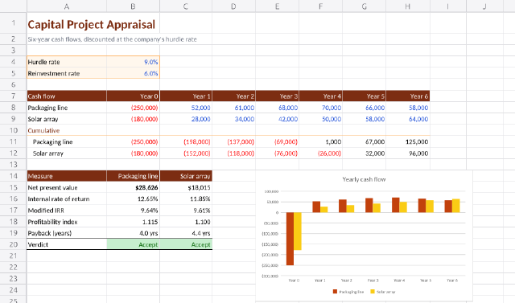

<!-- Generated by tools/gallery.mjs from showcase.yaml and build.json; do not edit. -->
# Project Appraisal (NPV & IRR)

[Sheet](../README.md) › [Finance & Budgets](../README.md#finance--budgets) · `investing` `financial-functions` `formulas` `chart` `conditional-formatting`

Two capital projects compared on NPV, IRR, MIRR, profitability index and payback, with a verdict for each.



| | |
|---|---|
| Document | [project-appraisal-npv-irr.xlsx](project-appraisal-npv-irr.xlsx) (9 KB) |
| Contents | 1 sheet; used range A1:H20 |
| Features | `sheet.formulas.functions`, `sheet.format.number`, `sheet.charts.design`, `sheet.format.conditional` |
| Built by | `kition-sheet` @ `79ed996ab2`: 44 commands in 50 ms |

## About

A small manufacturer weighs a packaging line upgrade against a rooftop solar array. NPV discounts
years one to six and adds the year-zero outlay, IRR and MIRR give the returns, and the payback
period is worked out with LET from the running total: the whole years still under water plus the
part of the next year it takes to break even. Negative cash flows and cumulative balances show in
red, and the verdict row says which projects clear the hurdle rate.

## Checks

- `results.measures.values`: `[[{"approx":28626.119481,"tol":0.0001},{"approx":18015.289207,"tol":0.0001}],[{"approx":0.1265421,"tol":0.000001},{"approx":0.1184847,"tol":0.000001}],[{"approx":0.0963729,"tol":0.000001},{"approx":0.0960531,"tol":0.000001}],[{"approx":1.1145045,"tol":0.000001},{"approx":1.1000849,"tol":0.000001}],[{"approx":3.9857143,"tol":0.000001},{"approx":4.4482759,"tol":0.000001}],["Accept","Accept"]]`
- diagnostics: none (the kit's check finds nothing wrong)
- the saved document opens again; the thumbnail matches `thumb.png` within the `render` tolerance

## Steps

<details><summary>44 commands (from <a href="showcase.yaml">showcase.yaml</a>)</summary>

```yaml
- command: range.setValues
  params:
    range: A1
    values:
      - - Capital Project Appraisal
      - - Six-year cash flows, discounted at the company's hurdle rate
- command: range.setValues
  params:
    range: A4
    values:
      - - Hurdle rate
        - 0.09
      - - Reinvestment rate
        - 0.06
- command: range.setValues
  params:
    range: A7
    values:
      - - Cash flow
        - Year 0
        - Year 1
        - Year 2
        - Year 3
        - Year 4
        - Year 5
        - Year 6
      - - Packaging line
        - -250000
        - 52000
        - 61000
        - 68000
        - 70000
        - 66000
        - 58000
      - - Solar array
        - -180000
        - 28000
        - 34000
        - 42000
        - 50000
        - 58000
        - 64000
      - - Cumulative
        - null
        - null
        - null
        - null
        - null
        - null
        - null
      - - Packaging line
        - =B8
        - =B11+C8
        - =C11+D8
        - =D11+E8
        - =E11+F8
        - =F11+G8
        - =G11+H8
      - - Solar array
        - =B9
        - =B12+C9
        - =C12+D9
        - =D12+E9
        - =E12+F9
        - =F12+G9
        - =G12+H9
- command: range.setValues
  params:
    range: A14
    values:
      - - Measure
        - Packaging line
        - Solar array
      - - Net present value
        - =NPV($B$4,C8:H8)+B8
        - =NPV($B$4,C9:H9)+B9
      - - Internal rate of return
        - =IRR(B8:H8)
        - =IRR(B9:H9)
      - - Modified IRR
        - =MIRR(B8:H8,$B$4,$B$5)
        - =MIRR(B9:H9,$B$4,$B$5)
      - - Profitability index
        - =(B15-B8)/-B8
        - =(C15-B9)/-B9
      - - Payback (years)
        - =LET(n,COUNTIF(B11:H11,"<0"),n-1-INDEX(B11:H11,n)/INDEX(B8:H8,n+1))
        - =LET(n,COUNTIF(B12:H12,"<0"),n-1-INDEX(B12:H12,n)/INDEX(B9:H9,n+1))
      - - Verdict
        - =IF(AND(B15>0,B16>$B$4),"Accept","Reject")
        - =IF(AND(C15>0,C16>$B$4),"Accept","Reject")
- command: home.fontSize
  params:
    range: A1
    size: 20
- command: home.bold
  params:
    range: A1
- command: home.fontColor
  params:
    range: A1
    color: "#7c2d12"
- command: home.fontColor
  params:
    range: A2
    color: "#6b7280"
- command: home.numberFormat
  params:
    range: B4:B5
    format: 0.0%
- command: home.fontColor
  params:
    range: B4:B5
    color: "#1d4ed8"
- command: home.fillColor
  params:
    range: A4:B5
    color: "#fff7ed"
- command: home.borders
  params:
    range: A4:B5
    preset: outside
    color: "#fdba74"
- command: home.fillColor
  params:
    range: A7:H7
    color: "#7c2d12"
- command: home.fontColor
  params:
    range: A7:H7
    color: "#ffffff"
- command: home.bold
  params:
    range: A7:H7
- command: home.alignRight
  params:
    range: B7:H7
- command: home.bold
  params:
    range: A10
- command: home.fontColor
  params:
    range: A10
    color: "#7c2d12"
- command: home.borders
  params:
    range: A10:H10
    preset: bottom
    color: "#fdba74"
- command: home.numberFormat
  params:
    range: B8:H12
    format: "#,##0;[Red](#,##0)"
- command: home.fontColor
  params:
    range: B8:H9
    color: "#1d4ed8"
- command: home.increaseIndent
  params:
    range: A11:A12
- command: home.fillColor
  params:
    range: A14:C14
    color: "#7c2d12"
- command: home.fontColor
  params:
    range: A14:C14
    color: "#ffffff"
- command: home.bold
  params:
    range: A14:C14
- command: home.alignRight
  params:
    range: B14:C14
- command: home.numberFormat
  params:
    range: B15:C15
    format: $$#,##0
- command: home.numberFormat
  params:
    range: B16:C17
    format: 0.00%
- command: home.numberFormat
  params:
    range: B18:C18
    format: "0.000"
- command: home.numberFormat
  params:
    range: B19:C19
    format: 0.0 "yrs"
- command: home.borders
  params:
    range: A15:C19
    preset: insideHorizontal
    color: "#e5e7eb"
- command: home.bold
  params:
    range: A20:C20
- command: home.alignRight
  params:
    range: B20:C20
- command: home.borders
  params:
    range: A20:C20
    preset: topDoubleBottom
- command: home.conditionalFormat
  params:
    range: B20:C20
    rule:
      type: expression
      formula: =B20="Accept"
      preset: greenFillDarkGreenText
- command: home.conditionalFormat
  params:
    range: B15:C15
    rule:
      type: expression
      formula: =B15=MAX($B$15:$C$15)
      style:
        font:
          bold: true
- command: home.columnWidth
  params:
    cols: A:A
    width: 140
- command: home.columnWidth
  params:
    cols: B:H
    width: 76
- command: home.columnWidth
  params:
    cols: B:C
    width: 92
- command: insert.chart
  params:
    range: A7:H9
    type: column
    subtype: clustered
  as: chart
- command: chart.set
  params:
    title: Yearly cash flow
    legend: bottom
    at: E14
    width: 380
    height: 230
- command: chart.formatSelection
  params:
    series: 0
    color: "#c2410c"
- command: chart.formatSelection
  params:
    series: 1
    color: "#facc15"
- command: sheet.read
  params:
    range: B15:C20
  as: measures
```

</details>
