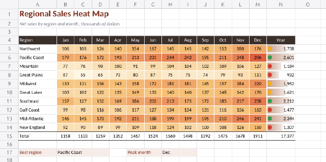

<!-- Generated by tools/gallery.mjs from showcase.yaml and build.json; do not edit. -->
# Regional Sales Heat Map

[Sheet](../README.md) › [Formatting & Styles](../README.md#formatting--styles) · `conditional-formatting` `color-scale` `heat-map` `icon-sets` `data-bars` `sales`

Twelve months of sales for ten regions, shaded by a three-colour scale so the peaks and the quiet months stand out.



| | |
|---|---|
| Document | [regional-sales-heat-map.xlsx](regional-sales-heat-map.xlsx) (7 KB) |
| Contents | 1 sheet; used range A1:N17 |
| Features | `sheet.format.conditional`, `sheet.format.number`, `sheet.formulas.functions` |
| Built by | `kition-sheet` @ `79ed996ab2`: 41 commands in 86 ms |

## About

A colour scale runs from pale sand through amber to deep coral across every monthly figure, so
the holiday peak in November and December and the weaker winter months read at a glance. Row
and column totals are SUM formulas. The year column carries data bars and a traffic-light
icon set that splits the regions into top, middle and bottom thirds, and INDEX/MATCH formulas
name the best region and the peak month.

## Checks

- `results.years.values.0.0`: `{"approx":1738.3,"tol":0.01}`
- `results.years.values.1.0`: `{"approx":2600.8,"tol":0.01}`
- `results.years.values.10.0`: `{"approx":17377.1,"tol":0.01}`
- `results.callouts.values.0`: `["Best region","Pacific Coast",null,null,null,"Peak month",null,"Dec"]`
- `results.doc.sheets.0.conditionalFormats`: `3`
- `results.peak.values.0`: `[{"approx":1678,"tol":0.01},{"approx":1911.1,"tol":0.01}]`
- diagnostics: none (the kit's check finds nothing wrong)
- the saved document opens again; the thumbnail matches `thumb.png` within the `render` tolerance

## Steps

<details><summary>41 commands (from <a href="showcase.yaml">showcase.yaml</a>)</summary>

```yaml
- command: range.setValues
  params:
    range: A1
    values:
      - - Regional Sales Heat Map
      - - Net sales by region and month, thousands of dollars
- command: range.setValues
  params:
    range: A4
    values:
      - - Region
        - Jan
        - Feb
        - Mar
        - Apr
        - May
        - Jun
        - Jul
        - Aug
        - Sep
        - Oct
        - Nov
        - Dec
        - Year
      - - Northwest
        - 106
        - 104.8
        - 125.5
        - 140.2
        - 154.2
        - 167.2
        - 145
        - 145.1
        - 142
        - 153
        - 179.6
        - 175.7
        - =SUM(B5:M5)
      - - Pacific Coast
        - 178.7
        - 175.9
        - 172.3
        - 193
        - 212.7
        - 231.2
        - 243.8
        - 242.9
        - 195.2
        - 210.8
        - 248.1
        - 296.2
        - =SUM(B6:M6)
      - - Mountain
        - 76.5
        - 75.5
        - 90.1
        - 100.4
        - 90.6
        - 98.7
        - 104.3
        - 104.2
        - 101.8
        - 109.4
        - 105.7
        - 126.5
        - =SUM(B7:M7)
      - - Great Plains
        - 67
        - 54.5
        - 65.1
        - 72.7
        - 79.9
        - 86.6
        - 75
        - 75.1
        - 73.6
        - 79.2
        - 92.9
        - 110.6
        - =SUM(B8:M8)
      - - Midwest
        - 133.1
        - 131.1
        - 156.2
        - 143.4
        - 158.1
        - 171.8
        - 181.3
        - 180.7
        - 145
        - 156.6
        - 184.3
        - 219.9
        - =SUM(B9:M9)
      - - Great Lakes
        - 103.1
        - 101.8
        - 121.5
        - 135.4
        - 148.6
        - 132.8
        - 140.4
        - 140.4
        - 137.2
        - 147.5
        - 142.2
        - 170
        - =SUM(B10:M10)
      - - Southeast
        - 156.5
        - 126.7
        - 151.6
        - 169.4
        - 186.3
        - 202.1
        - 212.8
        - 174.9
        - 171.5
        - 184.8
        - 217
        - 258.4
        - =SUM(B11:M11)
      - - Gulf Coast
        - 98.9
        - 97.5
        - 115.9
        - 106.3
        - 117.1
        - 127.2
        - 134.2
        - 133.9
        - 130.7
        - 116
        - 136.3
        - 162.6
        - =SUM(B12:M12)
      - - Mid-Atlantic
        - 146.2
        - 144.5
        - 172.5
        - 192.3
        - 211.1
        - 188.1
        - 199.1
        - 199.1
        - 194.8
        - 209.6
        - 245.5
        - 240.9
        - =SUM(B13:M13)
      - - New England
        - 91.7
        - 90.3
        - 88.7
        - 99
        - 108.8
        - 117.9
        - 124.2
        - 102.1
        - 100.1
        - 107.9
        - 126.4
        - 150.3
        - =SUM(B14:M14)
      - - Total
        - =SUM(B5:B14)
        - =SUM(C5:C14)
        - =SUM(D5:D14)
        - =SUM(E5:E14)
        - =SUM(F5:F14)
        - =SUM(G5:G14)
        - =SUM(H5:H14)
        - =SUM(I5:I14)
        - =SUM(J5:J14)
        - =SUM(K5:K14)
        - =SUM(L5:L14)
        - =SUM(M5:M14)
        - =SUM(N5:N14)
- command: range.setValues
  params:
    range: A17
    values:
      - - Best region
        - =INDEX(A5:A14,MATCH(MAX(N5:N14),N5:N14,0))
        - null
        - null
        - null
        - Peak month
        - null
        - =INDEX(B4:M4,MATCH(MAX(B15:M15),B15:M15,0))
- command: home.fontSize
  params:
    range: A1
    size: 20
- command: home.bold
  params:
    range: A1
- command: home.fontColor
  params:
    range: A1
    color: "#7a2e1d"
- command: home.italic
  params:
    range: A2
- command: home.fontColor
  params:
    range: A2
    color: "#6b7280"
- command: home.fillColor
  params:
    range: A4:N4
    color: "#3b2f2a"
- command: home.fontColor
  params:
    range: A4:N4
    color: "#ffffff"
- command: home.bold
  params:
    range: A4:N4
- command: home.alignCenter
  params:
    range: B4:N4
- command: home.numberFormat
  params:
    range: B5:M15
    format: "0"
- command: home.numberFormat
  params:
    range: N5:N15
    format: "#,##0"
- command: home.alignCenter
  params:
    range: B5:M15
- command: home.conditionalFormat
  params:
    range: B5:M14
    rule:
      type: colorScale
      colors:
        - "#fdf6e3"
        - "#f6c177"
        - "#e0603f"
- command: home.conditionalFormat
  params:
    range: N5:N14
    rule:
      type: dataBar
      color: "#c9a38f"
- command: home.conditionalFormat
  params:
    range: N5:N14
    rule:
      type: iconSet
      set: 3TrafficLights1
- command: home.bold
  params:
    range: A15:N15
- command: home.bold
  params:
    range: N5:N14
- command: home.borders
  params:
    range: A15:N15
    preset: topDoubleBottom
    color: "#3b2f2a"
- command: home.borders
  params:
    range: B5:M14
    preset: all
    color: "#ffffff"
- command: home.mergeCells
  params:
    range: B17:D17
- command: home.mergeCells
  params:
    range: F17:G17
- command: home.mergeCells
  params:
    range: H17:I17
- command: home.fillColor
  params:
    range: A17:D17
    color: "#f7ede8"
- command: home.fillColor
  params:
    range: F17:I17
    color: "#f7ede8"
- command: home.bold
  params:
    range: B17
- command: home.bold
  params:
    range: H17
- command: home.fontColor
  params:
    range: A17
    color: "#7a2e1d"
- command: home.fontColor
  params:
    range: F17
    color: "#7a2e1d"
- command: home.columnWidth
  params:
    cols: A:A
    width: 96
- command: home.columnWidth
  params:
    cols: B:M
    width: 44
- command: home.columnWidth
  params:
    cols: N:N
    width: 72
- command: home.rowHeight
  params:
    rows: 1:1
    height: 28
- command: home.rowHeight
  params:
    rows: 4:15
    height: 22
- command: home.alignMiddle
  params:
    range: A4:N17
- command: sheet.read
  params:
    range: N5:N15
  as: years
- command: sheet.read
  params:
    range: A17:H17
  as: callouts
- command: sheet.read
  params:
    range: L15:M15
  as: peak
- command: document.inspect
  params: {}
  as: doc
```

</details>
