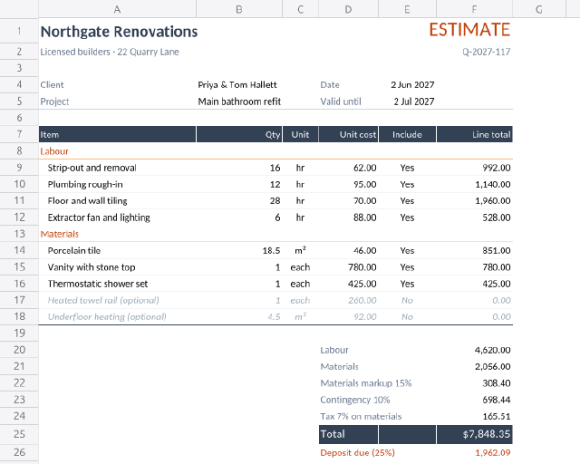

<!-- Generated by tools/gallery.mjs from showcase.yaml and build.json; do not edit. -->
# Renovation Estimate

[Sheet](../README.md) › [Business Templates](../README.md#business-templates) · `quote` `template` `formulas` `data-validation` `conditional-formatting`

A contractor's bathroom quote with labour and materials, optional extras switched by a Yes/No list, markup, contingency, tax and deposit.



| | |
|---|---|
| Document | [renovation-estimate.xlsx](renovation-estimate.xlsx) (6 KB) |
| Contents | 1 sheet; used range A1:F26 |
| Features | `sheet.formulas.functions`, `sheet.data.tools`, `sheet.format.conditional`, `sheet.format.number`, `sheet.format.alignment` |
| Built by | `kition-sheet` @ `79ed996ab2`: 71 commands in 29 ms |

## About

Every line is `IF(include="Yes",qty*unit cost,0)`, so the two optional extras the client has not
chosen stay on the quote, greyed out by an expression rule, at no cost. Labour and materials are
subtotalled separately because the 15 % markup and the 7 % tax apply to materials only; a 10 %
contingency covers the whole job, and the deposit is a quarter of the total, each rounded to the
cent. The Include column is a drop-down list.

## Checks

- `results.lines.values`: `[[992],[1140],[1960],[528],[null],[851],[780],[425],[0],[0]]`
- `results.summary.values`: `[[4620],[2056],[308.4],[698.44],[165.51],[{"approx":7848.35,"tol":0.000001}],[1962.09]]`
- `results.badChoice.ok`: `false`
- diagnostics: none (the kit's check finds nothing wrong)
- the saved document opens again; the thumbnail matches `thumb.png` within the `render` tolerance

## Steps

<details><summary>71 commands (from <a href="showcase.yaml">showcase.yaml</a>)</summary>

```yaml
- command: range.setValues
  params:
    range: A1
    values:
      - - Northgate Renovations
        - null
        - null
        - null
        - ESTIMATE
      - - Licensed builders · 22 Quarry Lane
        - null
        - null
        - null
        - Q-2027-117
      - - null
      - - Client
        - Priya & Tom Hallett
        - null
        - Date
        - 2027-06-02
      - - Project
        - Main bathroom refit
        - null
        - Valid until
        - =E4+30
- command: range.setValues
  params:
    range: A7
    values:
      - - Item
        - Qty
        - Unit
        - Unit cost
        - Include
        - Line total
      - - Labour
      - - Strip-out and removal
        - 16
        - hr
        - 62
        - Yes
        - =IF(E9="Yes",B9*D9,0)
      - - Plumbing rough-in
        - 12
        - hr
        - 95
        - Yes
      - - Floor and wall tiling
        - 28
        - hr
        - 70
        - Yes
      - - Extractor fan and lighting
        - 6
        - hr
        - 88
        - Yes
      - - Materials
      - - Porcelain tile
        - 18.5
        - m²
        - 46
        - Yes
        - =IF(E14="Yes",B14*D14,0)
      - - Vanity with stone top
        - 1
        - each
        - 780
        - Yes
      - - Thermostatic shower set
        - 1
        - each
        - 425
        - Yes
      - - Heated towel rail (optional)
        - 1
        - each
        - 260
        - No
      - - Underfloor heating (optional)
        - 4.5
        - m²
        - 92
        - No
- command: edit.fillDown
  params:
    range: F9:F12
- command: edit.fillDown
  params:
    range: F14:F18
- command: range.setValues
  params:
    range: D20
    values:
      - - Labour
        - null
        - =SUM(F9:F12)
      - - Materials
        - null
        - =SUM(F14:F18)
      - - Materials markup 15%
        - null
        - =ROUND(F21*15%,2)
      - - Contingency 10%
        - null
        - =ROUND(SUM(F20:F22)*10%,2)
      - - Tax 7% on materials
        - null
        - =ROUND((F21+F22)*7%,2)
      - - Total
        - null
        - =SUM(F20:F24)
      - - Deposit due (25%)
        - null
        - =ROUND(F25*25%,2)
- command: data.validation
  params:
    range: E9:E18
    type: list
    formula1: Yes,No
    dropdown: true
- command: view.gridlines
  params:
    on: false
- command: home.fontSize
  params:
    range: A1
    size: 18
- command: home.bold
  params:
    range: A1
- command: home.fontColor
  params:
    range: A1
    color: "#334155"
- command: home.fontColor
  params:
    range: A2
    color: "#64748b"
- command: home.fontSize
  params:
    range: E1
    size: 22
- command: home.bold
  params:
    range: E1
- command: home.fontColor
  params:
    range: E1
    color: "#c2410c"
- command: home.mergeCells
  params:
    range: E1:F1
- command: home.mergeCells
  params:
    range: E2:F2
- command: home.alignRight
  params:
    range: E1:F2
- command: home.fontColor
  params:
    range: E2
    color: "#64748b"
- command: home.rowHeight
  params:
    rows: 1:1
    height: 30
- command: home.fontColor
  params:
    range: A4:A5
    color: "#64748b"
- command: home.fontColor
  params:
    range: D4:D5
    color: "#64748b"
- command: home.bold
  params:
    range: B4:B5
- command: home.bold
  params:
    range: E4:E5
- command: home.numberFormat
  params:
    range: E4:E5
    format: d mmm yyyy
- command: home.alignRight
  params:
    range: E4:E5
- command: home.borders
  params:
    range: A5:F5
    preset: bottom
    color: "#cbd5e1"
- command: home.fillColor
  params:
    range: A7:F7
    color: "#334155"
- command: home.fontColor
  params:
    range: A7:F7
    color: "#ffffff"
- command: home.bold
  params:
    range: A7:F7
- command: home.alignRight
  params:
    range: B7
- command: home.alignRight
  params:
    range: D7
- command: home.alignCenter
  params:
    range: C7
- command: home.alignCenter
  params:
    range: E7
- command: home.alignRight
  params:
    range: F7
- command: home.bold
  params:
    range: A8
- command: home.bold
  params:
    range: A13
- command: home.fontColor
  params:
    range: A8
    color: "#c2410c"
- command: home.fontColor
  params:
    range: A13
    color: "#c2410c"
- command: home.borders
  params:
    range: A8:F8
    preset: bottom
    color: "#fdba74"
- command: home.borders
  params:
    range: A13:F13
    preset: bottom
    color: "#fdba74"
- command: home.increaseIndent
  params:
    range: A9:A12
- command: home.increaseIndent
  params:
    range: A14:A18
- command: home.numberFormat
  params:
    range: B9:B18
    format: General
- command: home.alignCenter
  params:
    range: C9:C18
- command: home.alignCenter
  params:
    range: E9:E18
- command: home.numberFormat
  params:
    range: D9:D18
    format: "#,##0.00"
- command: home.numberFormat
  params:
    range: F9:F26
    format: "#,##0.00"
- command: home.borders
  params:
    range: A9:F12
    preset: insideHorizontal
    color: "#f1f5f9"
- command: home.borders
  params:
    range: A14:F18
    preset: insideHorizontal
    color: "#f1f5f9"
- command: home.borders
  params:
    range: A18:F18
    preset: bottom
    color: "#334155"
- command: home.conditionalFormat
  params:
    range: A9:F18
    rule:
      type: expression
      formula: =$E9="No"
      style:
        font:
          italic: true
          color:
            Rgb: 10070453
- command: home.fontColor
  params:
    range: D20:D24
    color: "#64748b"
- command: home.bold
  params:
    range: D25:F25
- command: home.fontSize
  params:
    range: D25:F25
    size: 13
- command: home.fillColor
  params:
    range: D25:F25
    color: "#334155"
- command: home.fontColor
  params:
    range: D25:F25
    color: "#ffffff"
- command: home.numberFormat
  params:
    range: F25
    format: $$#,##0.00
- command: home.rowHeight
  params:
    rows: 25:25
    height: 24
- command: home.alignMiddle
  params:
    range: D25:F25
- command: home.bold
  params:
    range: D26:F26
- command: home.fontColor
  params:
    range: D26:F26
    color: "#c2410c"
- command: home.columnWidth
  params:
    cols: A:A
    width: 190
- command: home.columnWidth
  params:
    cols: B:B
    width: 104
- command: home.columnWidth
  params:
    cols: C:C
    width: 44
- command: home.columnWidth
  params:
    cols: D:D
    width: 72
- command: home.columnWidth
  params:
    cols: E:E
    width: 70
- command: home.columnWidth
  params:
    cols: F:F
    width: 92
- command: pageLayout.pageSetup
  params:
    orientation: portrait
    paper: Letter
    fitToPage: true
    fitWidth: 1
    fitHeight: 1
    printArea: A1:F26
- command: sheet.read
  params:
    range: F9:F18
  as: lines
- command: sheet.read
  params:
    range: F20:F26
  as: summary
- command: data.validate
  params:
    cell: E16
    input: Maybe
  as: badChoice
```

</details>
