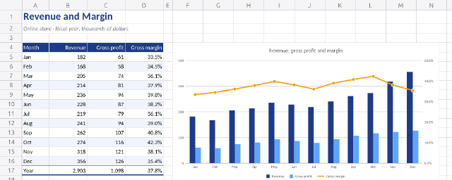

<!-- Generated by tools/gallery.mjs from showcase.yaml and build.json; do not edit. -->
# Revenue and Margin Combo

[Sheet](../README.md) › [Charts](../README.md#charts) · `chart` `combo-chart` `secondary-axis` `sales`

Monthly revenue and gross profit as columns with gross margin as a line on a secondary axis.



| | |
|---|---|
| Document | [revenue-margin-combo.xlsx](revenue-margin-combo.xlsx) (8 KB) |
| Contents | 1 sheet; used range A1:D17 |
| Features | `sheet.charts.design`, `sheet.format.number`, `sheet.formulas.functions` |
| Built by | `kition-sheet` @ `79ed996ab2`: 29 commands in 8 ms |

## About

A combination chart puts measures with different units on one picture: revenue and gross
profit in thousands of dollars as clustered columns, and gross margin as a percentage line on
a secondary axis. The chart is inserted as columns and its third series is then switched to a
line on the second axis with its own colour, width and markers. The margin is a formula, so
the line follows the table; the year's totals sit under it.

## Checks

- `results.drawing.objects`: `{"count":1}`
- `results.drawing.objects.0.kind`: `"chart"`
- `results.drawing.objects.0.chart.categories`: `{"count":12}`
- `results.drawing.objects.0.chart.series`: `{"count":3,"any":{"name":"Gross margin","kind":"line","secondary":true}}`
- `results.drawing.objects.0.chart.series.0.kind`: `{"exists":false}`
- `results.year.values.0`: `[2903,1098,{"approx":0.378229,"tol":0.00001}]`
- diagnostics: none (the kit's check finds nothing wrong)
- the saved document opens again; the thumbnail matches `thumb.png` within the `render` tolerance

## Steps

<details><summary>29 commands (from <a href="showcase.yaml">showcase.yaml</a>)</summary>

```yaml
- command: range.setValues
  params:
    range: A1
    values:
      - - Revenue and Margin
      - - Online store · fiscal year, thousands of dollars
- command: range.setValues
  params:
    range: A4
    values:
      - - Month
        - Revenue
        - Gross profit
        - Gross margin
      - - Jan
        - 182
        - 61
        - =C5/B5
      - - Feb
        - 168
        - 58
        - =C6/B6
      - - Mar
        - 205
        - 74
        - =C7/B7
      - - Apr
        - 214
        - 81
        - =C8/B8
      - - May
        - 236
        - 94
        - =C9/B9
      - - Jun
        - 228
        - 87
        - =C10/B10
      - - Jul
        - 219
        - 79
        - =C11/B11
      - - Aug
        - 241
        - 94
        - =C12/B12
      - - Sep
        - 262
        - 107
        - =C13/B13
      - - Oct
        - 274
        - 116
        - =C14/B14
      - - Nov
        - 318
        - 121
        - =C15/B15
      - - Dec
        - 356
        - 126
        - =C16/B16
      - - Year
        - =SUM(B5:B16)
        - =SUM(C5:C16)
        - =C17/B17
- command: home.fontSize
  params:
    range: A1
    size: 20
- command: home.bold
  params:
    range: A1
- command: home.fontColor
  params:
    range: A1
    color: "#1e3a8a"
- command: home.italic
  params:
    range: A2
- command: home.fontColor
  params:
    range: A2
    color: "#6b7280"
- command: home.fillColor
  params:
    range: A4:D4
    color: "#1e3a8a"
- command: home.fontColor
  params:
    range: A4:D4
    color: "#ffffff"
- command: home.bold
  params:
    range: A4:D4
- command: home.alignRight
  params:
    range: B4:D4
- command: home.numberFormat
  params:
    range: B5:C17
    format: "#,##0"
- command: home.numberFormat
  params:
    range: D5:D17
    format: 0.0%
- command: home.fillColor
  params:
    range: A6:D6
    color: "#f1f5fb"
- command: home.fillColor
  params:
    range: A8:D8
    color: "#f1f5fb"
- command: home.fillColor
  params:
    range: A10:D10
    color: "#f1f5fb"
- command: home.fillColor
  params:
    range: A12:D12
    color: "#f1f5fb"
- command: home.fillColor
  params:
    range: A14:D14
    color: "#f1f5fb"
- command: home.fillColor
  params:
    range: A16:D16
    color: "#f1f5fb"
- command: home.bold
  params:
    range: A17:D17
- command: home.borders
  params:
    range: A17:D17
    preset: topDoubleBottom
    color: "#1e3a8a"
- command: home.columnWidth
  params:
    cols: A:A
    width: 56
- command: home.columnWidth
  params:
    cols: B:D
    width: 80
- command: home.columnWidth
  params:
    cols: E:E
    width: 20
- command: home.rowHeight
  params:
    rows: 1:1
    height: 28
- command: insert.chart
  params:
    range: A4:D16
    type: column
    at: F4
    width: 560
    height: 300
  as: chart
- command: drawing.chart
  params:
    id: "1"
    title: Revenue, gross profit and margin
    legend: bottom
    yAxis:
      min: 0
      max: 400
      major: 100
    seriesFormat:
      - index: 0
        color: "#1e3a8a"
      - index: 1
        color: "#60a5fa"
      - index: 2
        kind: line
        secondary: true
        color: "#f59e0b"
        lineWidth: 2.5
        marker: circle
- command: drawing.describe
  params: {}
  as: drawing
- command: sheet.read
  params:
    range: B17:D17
  as: year
```

</details>
