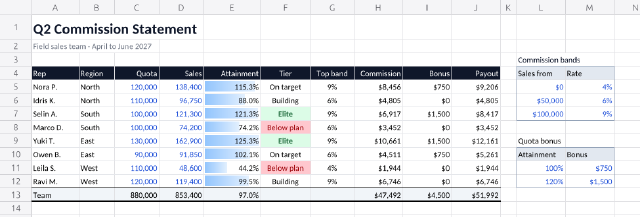

<!-- Generated by tools/gallery.mjs from showcase.yaml and build.json; do not edit. -->
# Sales Commission Calculator

[Sheet](../README.md) › [Formulas & Functions](../README.md#formulas--functions) · `lambda` `lookup` `formulas` `named-ranges` `conditional-formatting`

Quarterly payouts for eight reps with tiered marginal commission from a named LAMBDA, VLOOKUP rate bands and IFS bonuses.



| | |
|---|---|
| Document | [sales-commission-calculator.xlsx](sales-commission-calculator.xlsx) (7 KB) |
| Contents | 1 sheet; used range A1:M13 |
| Features | `sheet.formulas.functions`, `sheet.formulas.names`, `sheet.format.conditional`, `sheet.format.number` |
| Built by | `kition-sheet` @ `79ed996ab2`: 59 commands in 32 ms |

## About

Commission is paid in bands: 4 % of the first $50,000, 6 % of the next $50,000 and 9 % above
that. The band table is named `Tiers` and `Rates`, and a named LAMBDA,
`TIEREDCOMMISSION`, does the marginal sum once so each row simply calls
`=TIEREDCOMMISSION(D5)`. VLOOKUP with approximate match shows the top band a rep reached, IFS
turns quota attainment into a tier label and a bonus, and colour rules mark the elite
performers and the reps below plan.

## Checks

- `results.payouts.values`: `[[{"approx":1.1533333,"tol":0.000001},"On target",0.09,8456,750,9206],[{"approx":0.8795455,"tol":0.000001},"Building",0.06,4805,0,4805],[{"approx":1.213,"tol":0.000001},"Elite",0.09,6917,1500,8417],[{"approx":0.742,"tol":0.000001},"Below plan",0.06,3452,0,3452],[{"approx":1.2530769,"tol":0.000001},"Elite",0.09,10661,1500,12161],[{"approx":1.0205556,"tol":0.000001},"On target",0.06,4511,750,5261],[{"approx":0.4418182,"tol":0.000001},"Below plan",0.04,1944,0,1944],[{"approx":0.995,"tol":0.000001},"Building",0.09,6746,0,6746],[{"approx":0.9697727,"tol":0.000001},null,null,47492,4500,51992]]`
- diagnostics: none (the kit's check finds nothing wrong)
- the saved document opens again; the thumbnail matches `thumb.png` within the `render` tolerance

## Steps

<details><summary>59 commands (from <a href="showcase.yaml">showcase.yaml</a>)</summary>

```yaml
- command: range.setValues
  params:
    range: A1
    values:
      - - Q2 Commission Statement
      - - Field sales team · April to June 2027
- command: range.setValues
  params:
    range: L4
    values:
      - - Sales from
        - Rate
      - - 0
        - 0.04
      - - 50000
        - 0.06
      - - 100000
        - 0.09
- command: range.setValues
  params:
    range: L10
    values:
      - - Attainment
        - Bonus
      - - 1
        - 750
      - - 1.2
        - 1500
- command: formulas.defineName
  params:
    name: Tiers
    refersTo: =Sheet1!$L$5:$L$7
- command: formulas.defineName
  params:
    name: Rates
    refersTo: =Sheet1!$M$5:$M$7
- command: formulas.defineName
  params:
    name: TIEREDCOMMISSION
    refersTo: =LAMBDA(sales,SUMPRODUCT((sales>Tiers)*(sales-Tiers),Rates-VSTACK(0,DROP(Rates,-1))))
    comment: Marginal commission over the Tiers and Rates bands
- command: range.setValues
  params:
    range: A4
    values:
      - - Rep
        - Region
        - Quota
        - Sales
        - Attainment
        - Tier
        - Top band
        - Commission
        - Bonus
        - Payout
      - - Nora P.
        - North
        - 120000
        - 138400
        - =D5/C5
        - =IFS(E5>=1.2,"Elite",E5>=1,"On target",E5>=0.8,"Building",TRUE,"Below plan")
        - =VLOOKUP(D5,$L$5:$M$7,2,TRUE)
        - =TIEREDCOMMISSION(D5)
        - =IFS(E5>=$L$12,$M$12,E5>=$L$11,$M$11,TRUE,0)
        - =H5+I5
      - - Idris K.
        - North
        - 110000
        - 96750
      - - Selin A.
        - South
        - 100000
        - 121300
      - - Marco D.
        - South
        - 100000
        - 74200
      - - Yuki T.
        - East
        - 130000
        - 162900
      - - Owen B.
        - East
        - 90000
        - 91850
      - - Leila S.
        - West
        - 110000
        - 48600
      - - Ravi M.
        - West
        - 120000
        - 119400
      - - Team
        - null
        - =SUM(C5:C12)
        - =SUM(D5:D12)
        - =D13/C13
        - null
        - null
        - =SUM(H5:H12)
        - =SUM(I5:I12)
        - =SUM(J5:J12)
- command: edit.fillDown
  params:
    range: E5:J12
- command: home.fontSize
  params:
    range: A1
    size: 20
- command: home.bold
  params:
    range: A1
- command: home.fontColor
  params:
    range: A1
    color: "#0f172a"
- command: home.fontColor
  params:
    range: A2
    color: "#6b7280"
- command: home.fillColor
  params:
    range: A4:J4
    color: "#0f172a"
- command: home.fontColor
  params:
    range: A4:J4
    color: "#ffffff"
- command: home.bold
  params:
    range: A4:J4
- command: home.alignRight
  params:
    range: C4:E4
- command: home.alignCenter
  params:
    range: F4:G4
- command: home.alignRight
  params:
    range: H4:J4
- command: home.numberFormat
  params:
    range: C5:D13
    format: "#,##0"
- command: home.fontColor
  params:
    range: C5:D12
    color: "#1d4ed8"
- command: home.numberFormat
  params:
    range: E5:E13
    format: 0.0%
- command: home.alignCenter
  params:
    range: F5:G12
- command: home.numberFormat
  params:
    range: G5:G12
    format: 0%
- command: home.numberFormat
  params:
    range: H5:J13
    format: $$#,##0
- command: home.bold
  params:
    range: J5:J13
- command: home.borders
  params:
    range: A5:J12
    preset: insideHorizontal
    color: "#e5e7eb"
- command: home.bold
  params:
    range: A13:J13
- command: home.fillColor
  params:
    range: A13:J13
    color: "#f1f5f9"
- command: home.borders
  params:
    range: A13:J13
    preset: topDoubleBottom
- command: home.conditionalFormat
  params:
    range: F5:F12
    rule:
      type: expression
      formula: =F5="Elite"
      style:
        font:
          bold: true
          color:
            Rgb: 1467700
        fill:
          fg:
            Rgb: 14482663
          pattern: Solid
- command: home.conditionalFormat
  params:
    range: F5:F12
    rule:
      type: expression
      formula: =F5="Below plan"
      preset: lightRedFillDarkRedText
- command: home.conditionalFormat
  params:
    range: E5:E12
    rule:
      type: dataBar
      color: "#93c5fd"
- command: home.bold
  params:
    range: L3
- command: home.bold
  params:
    range: L9
- command: cell.set
  params:
    cell: L3
    input: Commission bands
- command: cell.set
  params:
    cell: L9
    input: Quota bonus
- command: home.fontColor
  params:
    range: L3
    color: "#0f172a"
- command: home.fillColor
  params:
    range: L4:M4
    color: "#e2e8f0"
- command: home.fillColor
  params:
    range: L10:M10
    color: "#e2e8f0"
- command: home.bold
  params:
    range: L4:M4
- command: home.bold
  params:
    range: L10:M10
- command: home.numberFormat
  params:
    range: L5:L7
    format: $$#,##0
- command: home.numberFormat
  params:
    range: M5:M7
    format: 0%
- command: home.numberFormat
  params:
    range: L11:L12
    format: 0%
- command: home.numberFormat
  params:
    range: M11:M12
    format: $$#,##0
- command: home.fontColor
  params:
    range: L5:M7
    color: "#1d4ed8"
- command: home.fontColor
  params:
    range: L11:M12
    color: "#1d4ed8"
- command: home.borders
  params:
    range: L4:M7
    preset: outside
    color: "#94a3b8"
- command: home.borders
  params:
    range: L10:M12
    preset: outside
    color: "#94a3b8"
- command: home.columnWidth
  params:
    cols: A:A
    width: 70
- command: home.columnWidth
  params:
    cols: B:B
    width: 52
- command: home.columnWidth
  params:
    cols: C:D
    width: 66
- command: home.columnWidth
  params:
    cols: E:E
    width: 84
- command: home.columnWidth
  params:
    cols: F:F
    width: 74
- command: home.columnWidth
  params:
    cols: G:G
    width: 64
- command: home.columnWidth
  params:
    cols: H:J
    width: 72
- command: home.columnWidth
  params:
    cols: K:K
    width: 24
- command: home.columnWidth
  params:
    cols: L:M
    width: 72
- command: sheet.read
  params:
    range: E5:J13
  as: payouts
```

</details>
